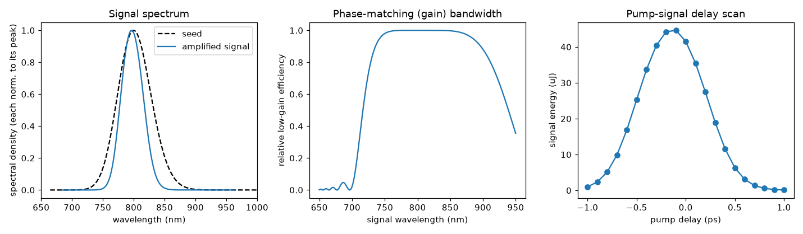

# Non-collinear OPCPA in BBO

A 15 fs, 50 nJ seed at 800 nm, stretched to about 0.6 ps, is amplified in 2 mm of BBO at the magic non-collinear angle (2.56°) pumped by the 515 nm second harmonic of the SHG example: it leaves with 43.7 µJ (gain 874, a 224 nm phase-matching bandwidth) and compresses to 24.0 fs, at its transform limit.

**The story.** Non-collinear optical parametric chirped-pulse amplification (OPCPA). A chirped seed and a pump of matching duration
meet in BBO. At the "magic" angle between pump and signal the idler's group velocity projected on the signal direction equals the signal's,
which gives the broad gain bandwidth that makes few-cycle OPCPA possible. The pump is the 515 nm output of
[the SHG example](../shg-lbo/README.md), read from its saved results (`"from": "../shg-lbo/results"`), so it has the exact temporal and
spectral shape that the SHG produced. **Run the SHG example first** (the first command below does it). The check is the photon bookkeeping,
`manleyRoweResidual` (-8e-9), and the ideal compressor, which must reach the transform limit of the amplified spectrum.



*Left to right: the signal spectrum before and after the stage, the low-gain phase-matching curve against signal wavelength, and the
output energy against the pump-signal delay. `python plot.py` draws the figure from `results/`.*

**Layout** (`nopcpa.ufs`, `run.json`): `nopa` (`crystal` BBO, `lengthM` = 2e-3, `opa` type I with `noncollinearDeg` "magic", `cut` auto,
Gaussian `beam` of `w0M` = 0.55e-3, `aux` pump from the SHG results with `radiusM` = 0.6e-3 and `delayS` auto, `output` signal, `record` idler
and pump), then 0.2 m of air. Pulse: Gaussian, `centerWavelengthM` = 800e-9, `durationFwhmS` = 15e-15 with `chirp` GDD 3000 fs² (stretched to
about 0.6 ps to match the pump), `energyJ` = 50e-9, `repRateHz` = 1e3; `selfSteepening` on. Instruments: `conversion`, a `delayScan` from -1 ps to
1 ps (21 points), `gain_bandwidth` (a `phaseMatchingCurve` over 300 nm), a spectrometer, the ideal compressor and the pulse summary. About 2 s.

**Run it** in the example folder. The two tabs run the same simulation and print the same key numbers. Both first run the SHG example:
the pump is read from `../shg-lbo/results`.

=== "CLI"

    ```bash
    (cd ../shg-lbo && ultrafast run shg.ufs run.json -o results)     # the pump
    ultrafast run nopcpa.ufs run.json -o results                     # about 2 s
    python plot.py                                                   # optional: nopcpa-bbo.png from results/
    ```

    ```
    energy 4.371E-05 J (T = 87,416.80 %), FWHM 389 fs (TL 23.7 fs), peak 1.076E+08 W, B = 0.286 rad
    ```

=== "Python"

    <!-- snippet -->
    ```python
    import ultrafast as uf
    from ultrafast import build as b

    uf.run("../shg-lbo/shg.ufs", "../shg-lbo/run.json").write("../shg-lbo/results")   # the pump: the SHG example's results
    system = uf.System.load("nopcpa.ufs")          # BBO crystal with the pump read from ../shg-lbo/results, then 0.2 m of air
    spec = b.run_spec(                             # run.json, written with the builders (typed: the editor completes every key)
        b.pulse(800e-9, 15e-15, energy=50e-9, rep_rate_hz=1e3, gdd_s2=3000e-30),   # seed stretched to ~0.6 ps
        name="nopcpa-bbo",
        physics=b.physics(selfSteepening=True),
        instruments=[
            b.instrument("conversion", at="nopa"),
            b.instrument("delayScan", at="nopa", fromS=-1e-12, toS=1e-12, points=21),
            b.instrument("phaseMatchingCurve", at="nopa", name="gain_bandwidth", scan="wavelength", rangeM=300e-9, points=301),
            b.instrument("spectrometer"),
            b.instrument("compressor", name="ideal_compressor"),
            b.instrument("pulseSummary"),
        ],
    )
    res = uf.run(system, spec)                     # uf.run("nopcpa.ufs", "run.json") runs the two files as they are
    res.write("results")                           # the same files as the CLI: python plot.py draws the figure from them
    out, tot = res.summary["output"], res.summary["totals"]
    print(f"energy {out['energyJ']:.4G} J (T = {100 * tot['energyTransmission']:,.2f} %), FWHM {out['fwhmS'] * 1e15:.4G} fs "
          f"(TL {out['transformLimitFwhmS'] * 1e15:.4G} fs), peak {out['peakPowerW']:.4G} W, B = {tot['bIntegralRad']:.3G} rad")
    v = res.elements()[0]["values"]
    print(f"  signal {v['energy_signal_J'] * 1e6:.1f} uJ (gain {res.instrument('conversion_nopa')['efficiencyVsInput']:.0f}), "
          f"idler {v['energy_idler_J'] * 1e6:.1f} uJ, efficiency {100 * v['conversionEfficiency']:.1f} %, Manley-Rowe residual {v['manleyRoweResidual']:.0e}")
    print(f"  magic angle {v['noncollinearDeg']:.2f} deg, signal cut {v['thetaDeg']:.1f} deg, gain bandwidth {res.instrument('gain_bandwidth')['fwhm'] * 1e9:.0f} nm, "
          f"best delay {res.instrument('delayScan_nopa')['optimalDelayS'] * 1e12:.1f} ps, compressed {res.instrument('ideal_compressor')['compressedFwhmS'] * 1e15:.1f} fs")
    ```

    ```
    energy 4.371E-05 J (T = 87,416.80 %), FWHM 389 fs (TL 23.7 fs), peak 1.076E+08 W, B = 0.286 rad
      signal 43.7 uJ (gain 874), idler 23.9 uJ, efficiency 20.8 %, Manley-Rowe residual -8e-09
      magic angle 2.56 deg, signal cut 22.0 deg, gain bandwidth 224 nm, best delay -0.1 ps, compressed 24.0 fs
    ```

**What it shows.**

* **Set-up.** `"process": "opa"`, main beam = the signal (the run's pulse), aux beam = the pump. The idler is generated.
  `"noncollinearDeg": "magic"` solves for the pump-signal angle at which the idler's group velocity projected on the signal direction
  equals the signal's (2.56°); `"cut": "auto"` then phase-matches at the nominal wavelengths (signal at 22.0° to the optic axis).
* **Gain.** The 50 nJ seed leaves with 43.7 µJ (gain 874; 20.8 % of the energy in, the rest is the idler, 23.9 µJ, and the unconverted
  pump). `manleyRoweResidual` is the photon bookkeeping (-8e-9).
* **Bandwidth.** `gain_bandwidth` is the low-gain phase-matching curve against signal wavelength: 224 nm FWHM for 2 mm, the reason for the
  non-collinear geometry (collinear would give about 20 nm) and far wider than the seed (15 fs corresponds to roughly 60 nm). Even so, the
  amplified spectrum is narrower than the seed, because the gain is highest at the centre of the strongly saturated pulse.
* **Compression.** `ideal_compressor` finds the GDD and TOD that best compress the amplified signal: 24.0 fs against a transform limit of
  23.7 fs (gain narrowing took the 15 fs seed bandwidth down to this).
* **Delay.** `"delayS": "auto"` centres the pump on the signal. The `delayScan` instrument re-runs the crystal for a range of delays;
  the best is about -0.1 ps (the output is highest when the pump is about 0.1 ps ahead of the signal's centre, which compensates the
  pump-signal group-velocity mismatch) and the output falls to near zero when the pump no longer overlaps the seed. A 3 mm crystal
  grows two maxima in the scan: at zero delay the centre of the pulse is over-saturated and back-converts.
* **Beams.** `results/result.npz` has `probe_nopa_idler_*` (the idler at about 1.4 µm) and `probe_nopa_pump_*` (the depleted pump).

No SHG results? Replace the aux `"from"` with a pulse:
`"pulse": {"shape": "gaussian", "centerWavelengthM": 515e-9, "durationFwhmS": 0.8e-12, "energyJ": 200e-6}`.

**Limits.** The 1-D model treats the beams through an overlap of Gaussian modes. For spatial gain narrowing, walk-off and the pump's
spatial depletion add `"transverse": {"model": "radial"}` (fast) or `{"model": "cartesian"}` (needed for walk-off and the non-collinear
geometry; slower) to the crystal. See [the NOPA in a Branched system](../noncollinear-opa/README.md) for the angle taken from a pump arm.
