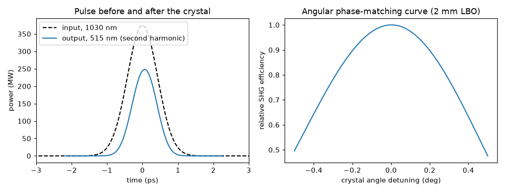

# Second-harmonic generation in LBO

A 1 ps, 400 µJ pulse at 1030 nm is frequency doubled in 2 mm of LBO (type I, XY plane) with 52.5 % energy conversion (210.1 µJ at 515 nm in 808.5 fs) and a 0.985° angular acceptance; the radial model across the beam gives 47.4 %.

**The story.** The pump line for [the non-collinear OPCPA](../nopcpa-bbo/README.md). The crystal element follows **one main beam**: it
enters as the 1030 nm fundamental and leaves as the 515 nm second harmonic (`"output": "sh"`). The unconverted fundamental is not lost:
`"record": ["fundamental"]` keeps it as a by-product. The 1-D model uses an overlap of Gaussian modes, which is exact at low conversion and
an estimate at high conversion; the radial (Hankel) run computes the conversion point by point across the beam and shows the
difference (52.5 % against 47.4 %). Energy closes to 3e-8 of the input (`energyBudget`).



*Left: the pulses before and after the crystal. Right: the efficiency of the same crystal as it is tilted away from the phase-matching
angle. `python plot.py` draws this figure from `results/`.*

**Layout** (`shg.ufs`, `run.json`, `run-radial.json`): `shg` (`crystal` LBO, `lengthM` = 2e-3, type I `shg` with `cut` auto, Gaussian
`beam` of `w0M` = 1.3e-3, `output` sh, `record` fundamental), then 5 cm of air (`gap`). Pulse: Gaussian, `centerWavelengthM` = 1.03e-6,
`durationFwhmS` = 1e-12, `energyJ` = 400e-6, `repRateHz` = 1e3; `selfSteepening` on. Instruments: `conversion`, two `phaseMatchingCurve`
(angle `rangeDeg` = 1.0 and wavelength `rangeM` = 20e-9), a spectrometer and the pulse summary. `run-radial.json` has
`transverse` radial with 48 points and a `beamProfile` instead of the curves. The two runs take under 1 s.

**Run it** in the example folder. The two tabs run the same two simulations and print the same key numbers. The run in `results/` is
the input of [the OPCPA example](../nopcpa-bbo/README.md).

=== "CLI"

    ```bash
    ultrafast run shg.ufs run.json -o results                   # 1-D coupled waves, Gaussian-mode overlap (fast)
    ultrafast run shg.ufs run-radial.json -o results-radial     # radial (Hankel) model across the beam
    python plot.py                                              # optional: shg-lbo.png from results/
    ```

    ```
    energy 0.0002101 J (T = 52.52 %), FWHM 808.5 fs (TL 777.8 fs), peak 2.48E+08 W, B = 0.0584 rad
    energy 0.0001896 J (T = 47.40 %), FWHM 808.9 fs (TL 784.1 fs), peak 2.233E+08 W, B = 0.0526 rad
    ```

=== "Python"

    <!-- snippet -->
    ```python
    import ultrafast as uf
    from ultrafast import build as b

    system = uf.System.load("shg.ufs")             # 2 mm LBO, type I SHG, then 5 cm of air
    pulse = b.pulse(1.03e-6, 1e-12, energy=400e-6, rep_rate_hz=1e3, polarization="x")
    specs = {
        "1-D": b.run_spec(                         # run.json
            pulse, name="shg-lbo", physics=b.physics(selfSteepening=True),
            instruments=[
                b.instrument("conversion", at="shg"),
                b.instrument("phaseMatchingCurve", at="shg", scan="angle", rangeDeg=1.0, points=201),
                b.instrument("phaseMatchingCurve", at="shg", name="acceptance_wavelength", scan="wavelength", rangeM=20e-9),
                b.instrument("spectrometer"),
                b.instrument("pulseSummary"),
            ]),
        "radial": b.run_spec(                      # run-radial.json: the same crystal, resolved across the beam
            pulse, name="shg-lbo-radial",
            physics=b.physics(selfSteepening=True, transverse={"model": "radial", "points": 48}),
            instruments=[
                b.instrument("conversion", at="shg"),
                b.instrument("beamProfile", at="shg"),
                b.instrument("pulseSummary"),
            ]),
    }
    for label, spec in specs.items():
        res = uf.run(system, spec)
        res.write("results" if label == "1-D" else "results-radial")   # results/ is read by the OPCPA example
        out, tot = res.summary["output"], res.summary["totals"]
        print(f"energy {out['energyJ']:.4G} J (T = {100 * tot['energyTransmission']:.2f} %), FWHM {out['fwhmS'] * 1e15:.4G} fs "
              f"(TL {out['transformLimitFwhmS'] * 1e15:.4G} fs), peak {out['peakPowerW']:.4G} W, B = {tot['bIntegralRad']:.3G} rad")
        v = res.elements()[0]["values"]
        print(f"  {label}: phi = {v['phiDeg']:.1f} deg, deff = {v['deffPmPerV']:.2f} pm/V, efficiency {100 * v['conversionEfficiency']:.1f} %, "
              f"{v['energy_sh_J'] * 1e6:.1f} uJ of 515 nm, {v['energy_fundamental_J'] * 1e6:.0f} uJ of fundamental left")
        if label == "1-D":
            print(f"  acceptance: {res.instrument('phaseMatchingCurve_shg')['fwhm']:.3f} deg (angle), "
                  f"{res.instrument('acceptance_wavelength')['fwhm'] * 1e9:.1f} nm (wavelength)")
        else:
            beam = res.instrument("beamProfile_shg")
            print(f"  second harmonic beam radius {beam['radiusXM'] * 1e3:.2f} mm, M2 = {beam['m2']:.3f}")
    ```

    ```
    energy 0.0002101 J (T = 52.52 %), FWHM 808.5 fs (TL 777.8 fs), peak 2.48E+08 W, B = 0.0584 rad
      1-D: phi = 13.8 deg, deff = 0.82 pm/V, efficiency 52.5 %, 210.1 uJ of 515 nm, 190 uJ of fundamental left
      acceptance: 0.985 deg (angle), 15.3 nm (wavelength)
    energy 0.0001896 J (T = 47.40 %), FWHM 808.9 fs (TL 784.1 fs), peak 2.233E+08 W, B = 0.0526 rad
      radial: phi = 13.8 deg, deff = 0.82 pm/V, efficiency 47.4 %, 189.6 uJ of 515 nm, 210 uJ of fundamental left
      second harmonic beam radius 1.01 mm, M2 = 1.003
    ```

**What it shows.** What to look at in `results/summary.json`:

* `elements[0].values` - `phiDeg` (the cut found by `"cut": "auto"`: 13.8 deg), `deffPmPerV` (0.82 pm/V),
  `conversionEfficiency` (~52 %), `energy_sh_J`, `energy_fundamental_J`.
* `elements[0].carrierWavelengthM` and the note "carrier changed 1029.97 -> 514.95 nm": from here on the main
  beam is the SH, on its own (re-planned) grid. `outputGrid` describes it.
* `energyBudget` - "to fundamental" is the energy carried off by the by-product; "numerical" is the solver's
  bookkeeping error (~1e-8 of the input).
* `instruments`: `conversion_shg` (energies and photon numbers of every field), `phaseMatchingCurve_shg`
  (angular acceptance, 0.985 deg FWHM for 2 mm), `acceptance_wavelength` (spectral acceptance, ~15.3 nm).
* `results/result.npz` -> `probe_shg_fundamental_*`: the depleted fundamental (time and spectrum).

The radial run computes the conversion point by point across the beam: the centre converts more than the wings,
so the SH beam is narrower than a Gaussian-overlap estimate suggests, and the fundamental gets a depleted
centre. `results-radial/summary.json` -> `elements[0].beam` (radius, M^2) and the `beamProfile_shg` instrument
(fluence vs radius) show this. The 1-D model uses an overlap of Gaussian modes, which is exact at low
conversion and an estimate at high conversion (here 52.5 % against 47.4 % radial).

The figure: the 1000 fs, 400 uJ pump at 1030 nm is converted with an
energy efficiency of 52.5 % (210.1 uJ of 515 nm light, 190 uJ of fundamental left over). The second-harmonic pulse
(left, solid) is shorter than the input, 808.5 fs, because the intense centre of the pulse converts better than its
wings. The right panel is the efficiency of the same crystal as it is tilted away from the phase-matching angle:
it falls to half of its maximum at +-0.49 deg, which is the 0.985 deg FWHM angular acceptance reported by
`phaseMatchingCurve_shg`. This tells you how accurately the crystal has to be aligned.

**Limits.** The 1-D run uses a Gaussian-mode overlap, exact at low conversion and an estimate at 52 %; the radial run resolves the
beam profile but keeps one transverse model per crystal. For what each crystal model includes (walk-off, absorption, acceptance) see
the [crystal reference](../../../reference/crystals.md).

Things to try:

* `"cut": {"thetaDeg": 90, "phiDeg": 13.8}` with `"detuneDeg": 0.3` -- detune the crystal and watch the efficiency.
* Change `"crystal"` to `"BBO"` (type I, `"cut": "auto"` gives 23.4 deg) or `"BiBO"`.
* `"overlap": "planeWave"` -- the textbook plane-wave estimate at the peak intensity (overestimates for Gaussian beams).
