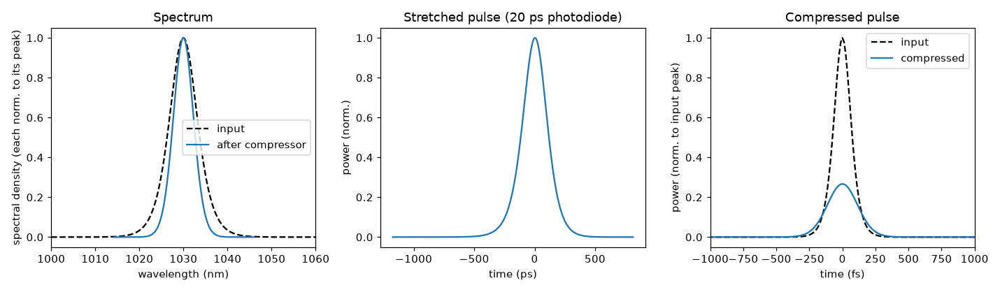

# Stretcher, amplifier stand-in and compressor (analytic)

A 150 fs, 1 nJ sech² pulse at 1030 nm is stretched to 233.6 ps by a grating pair, trimmed by a gain-narrowing filter and recompressed to 268.8 fs, within 0.2 % of the 268.4 fs transform limit of the narrowed spectrum, with 45.38 % of the energy left.

**The story.** A chirped-pulse-amplification (CPA) line built from analytic elements: a Treacy grating-pair stretcher, a gain-narrowing
filter and a YAG crystal standing in for the amplifier, a second grating pair as the compressor and chirped mirrors that cancel the
rest of the dispersion. Stretching keeps the peak power low where the amplifier sits. The check is internal: the compressor and the
chirped mirrors must cancel the stretcher's GDD and TOD, so the output must sit at its transform limit (temporal Strehl ratio 1).
To do the same with your OpticStudio stretcher, export it ([Zemax workflow](../../Interop/zemax-workflow/README.md)) and run the
resulting `.ufs` instead.



*Left: spectrum in and out (the filter trims it). Middle: the stretched pulse as a 20 ps photodiode sees it. Right: the compressed
pulse. `python plot.py` draws the figure from `results/`.*

**Layout** (`cpa.ufs`, `run.json`): `stretcher` and `compressor` (`gratingPair`), a `probe` after the stretcher, `gain_narrowing` (filter),
a `crystal` (bulk YAG) and `cm` (`chirpedMirror`). Pulse: `sech2`, `centerWavelengthM` = 1.03e-6, `durationFwhmS` = 150e-15,
`energyJ` = 1e-9, `repRateHz` = 50e6. Instruments, where you would put them on the table: a spectrometer and an autocorrelator at the
input; a photodiode (`scope`, `riseTimeS` = 20e-12), a spectrometer and a virtual Wigner distribution after the stretcher
(`probe_stretched`); a spectrometer, an autocorrelator, a virtual field probe and the ideal compressor (`residual`) at the end. The
grid is sized automatically from the stretcher's group-delay spread (N = 262144, window 3277 ps, dt = 12.5 fs). About 3 s.

**Run it** in the example folder. The two tabs run the same simulation and print the same key numbers.

=== "CLI"

    ```bash
    ultrafast run cpa.ufs run.json -o results     # about 3 s
    python plot.py                                # optional: cpa-line.png from results/
    ```

    ```
    energy 4.538E-10 J (T = 45.38 %), FWHM 268.8 fs (TL 268.4 fs), peak 1568 W, B = 0 rad
    ```

=== "Python"

    <!-- snippet -->
    ```python
    import ultrafast as uf
    from ultrafast import build as b

    system = uf.System.load("cpa.ufs")             # stretcher, filter, crystal, compressor, chirped mirrors
    spec = b.run_spec(                             # run.json, written with the builders (typed: the editor completes every key)
        b.pulse(1.03e-6, 150e-15, energy=1e-9, shape="sech2", rep_rate_hz=50e6),
        name="cpa",
        probes=["probe_stretched", "compressor"],
        instruments=[
            b.instrument("spectrometer", at="input", name="spectrum_in", resolutionM=0.05e-9),
            b.instrument("autocorrelator", at="input", name="ac_in"),
            b.instrument("scope", at="probe_stretched", name="photodiode_stretched", riseTimeS=20e-12),
            b.instrument("spectrometer", at="probe_stretched", name="spectrum_stretched", resolutionM=0.05e-9),
            b.instrument("wigner", at="probe_stretched", name="wigner_stretched", points=256),
            b.instrument("spectrometer", at="end", name="spectrum_out", resolutionM=0.05e-9),
            b.instrument("autocorrelator", at="end", name="ac_out"),
            b.instrument("fieldProbe", at="end", name="phase_out"),
            b.instrument("compressor", at="end", name="residual"),
            b.instrument("energyMeter", at="end"),
        ],
    )
    res = uf.run(system, spec)                     # uf.run("cpa.ufs", "run.json") runs the two files as they are
    res.write("results")                           # the same files as the CLI: python plot.py draws the figure from them
    out, tot = res.summary["output"], res.summary["totals"]
    print(f"  energy {out['energyJ']:.4G} J (T = {100 * tot['energyTransmission']:.2f} %), FWHM {out['fwhmS'] * 1e15:.4G} fs "
          f"(TL {out['transformLimitFwhmS'] * 1e15:.4G} fs), peak {out['peakPowerW']:.4G} W, B = {tot['bIntegralRad']:.3G} rad")
    print(f"  stretched pulse {res.instrument('photodiode_stretched')['fwhmS'] * 1e12:.1f} ps, "
          f"temporal Strehl after the compressor {res.instrument('residual')['temporalStrehl']:.2f}")
    ```

    ```
    energy 4.538E-10 J (T = 45.38 %), FWHM 268.8 fs (TL 268.4 fs), peak 1568 W, B = 0 rad
    stretched pulse 233.6 ps, temporal Strehl after the compressor 1.00
    ```

**What it shows.**

* **Stretching:** the 150 fs input becomes 233.6 ps at the photodiode (`photodiode_stretched`, `fwhmS`). The Wigner panel shows the
  ~230 ps linear chirp the stretcher imposes.
* **Gain narrowing:** the filter trims the spectrum, so the compressed pulse is longer than the input, 268.8 fs instead of 150 fs, and
  the line transmits 45.38 % of the energy. `lossBudget` separates grating efficiency (`grating`), the filter (`filter`) and the
  chirped-mirror reflectance (`coating`). The peak power at the output (1568 W) is lower than at the input.
* **Residual chirp:** the compressor and the chirped mirrors cancel the stretcher's GDD and TOD almost perfectly. The pulse leaves at
  its transform limit (268.4 fs) and the `residual` instrument reports a temporal Strehl ratio of 1.00: how far the mirrors are from
  optimal is `compressorGddS2` and `compressorTodS3` there.
* **Grid:** the notes printed at the start say why the window is 3277 ps; `edgeEnergyFraction` in the summary should be about 0.

**Limits.** The line is linear (B = 0 rad): no nonlinearity, no gain saturation and no spatial chirp. The amplifier is a
filter and a crystal, not a gain model; see [Yb multipass CPA](../yb-multipass-cpa/README.md) for real gain and the
[four-grating compressor](../four-grating-compressor/README.md) for spatial chirp. Grating pairs are the analytic Treacy model;
[gratings](../../../reference/components.md) describes the ray-traced one.
