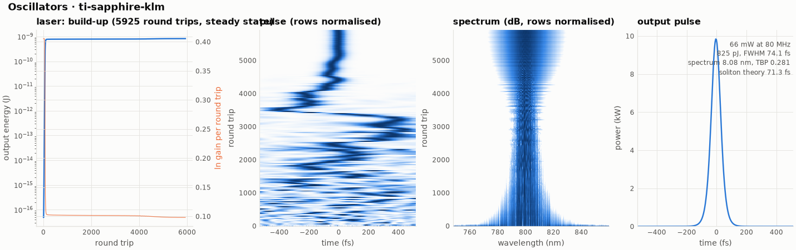

# Kerr-lens mode-locked Ti:sapphire oscillator (Haus model)

A Haus master-equation model of an 80 MHz Kerr-lens mode-locked Ti:sapphire laser starts from quantum noise and settles after 5925 round trips into a single 74.1 fs soliton of 825 pJ, 4 % above the 71.3 fs of the soliton area theorem.

**The story.** The master-equation model of a Kerr-lens mode-locked (KLM) Ti:sapphire laser at 80 MHz
([oscillator reference](../../../reference/oscillators.md)). The laser starts from one photon per mode of noise. Each round trip applies:

* saturated gain with a 100 nm bandwidth;
* 2 % loss plus a 5 % output coupler;
* −500 fs² of net GDD;
* SPM of the crystal, δ = 1.5×10⁻⁶ rad/W;
* the Kerr-lens loss modulation q(P) = q0 − κP.

The check is the soliton area theorem: with GDD and SPM balanced, the pulse duration is τ = 3.53 |GDD| / (δE).



*`ultrafast-plot results` draws the start-up figure (`results/plots/oscillator.png`).*

**Layout** (`laser.ufs`, `run.json`): an `oscillator` (`model` haus, `repRateHz` = 80e6, `outputCoupler` = 0.05, gain `smallSignalGain` =
1.5, `saturationEnergyJ` = 5e-9, `bandwidthM` = 100e-9, `lossPerRoundTrip` = 0.02, `gddFs2` = -500, `spmRadPerW` = 1.5e-6, `kerrLens`
absorber with `modulationDepth` = 0.03 and `kappaPerW` = 3e-8, `start` noise, at most 8000 round trips), then 3 mm of fused silica and a
chirped-mirror pair outside the laser. The pulse in `run.json` only sets the grid (4096 points, 8 ps window); the oscillator starts from
noise. Instruments: spectrometer, autocorrelator and power meter at the laser, the ideal compressor at the end. About 2 s.

**Run it** in the example folder. The two tabs run the same simulation and print the same key numbers.

=== "CLI"

    ```bash
    ultrafast run laser.ufs run.json -o results     # about 2 s
    ultrafast-plot results                          # optional: oscillator.png: build-up, pulse and spectrum vs round trip
    ```

    ```
    energy 8.253E-10 J (T = 82,528.83 %), FWHM 74.26 fs (TL 71.94 fs), peak 9841 W, B = 0 rad
    ```

    The line is the pulse after the window and the chirped mirrors; the laser's own output (74.1 fs) is in `elements[0]` of `summary.json`.

=== "Python"

    <!-- snippet -->
    ```python
    import ultrafast as uf
    from ultrafast import build as b

    system = uf.System.load("laser.ufs")           # the KLM oscillator, a window and a chirped-mirror pair
    spec = b.run_spec(                             # run.json, written with the builders (typed: the editor completes every key)
        b.pulse(800e-9, 30e-15, energy=1e-12, shape="sech2"),   # only sets the grid: the laser starts from noise
        name="klm",
        grid=b.grid(auto=False, n=4096, window_s=8e-12),
        instruments=[
            b.instrument("spectrometer", at="laser", name="spectrum"),
            b.instrument("autocorrelator", at="laser", name="ac"),
            b.instrument("powerMeter", at="laser", name="power"),
            b.instrument("compressor", at="end", name="residual"),
        ],
    )
    res = uf.run(system, spec)                     # uf.run("laser.ufs", "run.json") runs the two files as they are
    res.write("results")                           # the same files as the CLI: ultrafast-plot results draws the figures
    out, tot = res.summary["output"], res.summary["totals"]
    print(f"energy {out['energyJ']:.4G} J (T = {100 * tot['energyTransmission']:,.2f} %), FWHM {out['fwhmS'] * 1e15:.4G} fs "
          f"(TL {out['transformLimitFwhmS'] * 1e15:.4G} fs), peak {out['peakPowerW']:.4G} W, B = {tot['bIntegralRad']:.3G} rad")
    v = res.elements()[0]["values"]                # the oscillator's own numbers
    print(f"  {v['roundTrips']} round trips: {v['outputEnergyJ'] * 1e12:.0f} pJ, {v['averagePowerW'] * 1e3:.0f} mW "
          f"({v['intracavityEnergyJ'] * 1e9:.1f} nJ intracavity), {v['outputFwhmS'] * 1e15:.1f} fs, {v['outputSpectralFwhmM'] * 1e9:.1f} nm, "
          f"TBP {v['timeBandwidthProduct']:.2f}, background {100 * v['backgroundFraction']:.1f} %")
    print(f"  soliton area theorem {v['solitonFwhmS'] * 1e15:.1f} fs (ratio {v['fwhmOverSoliton']:.2f}), "
          f"B per round trip {v['bIntegralPerRoundTripRad']:.2f} rad")
    ```

    ```
    energy 8.253E-10 J (T = 82,528.83 %), FWHM 74.26 fs (TL 71.94 fs), peak 9841 W, B = 0 rad
      5925 round trips: 825 pJ, 66 mW (16.5 nJ intracavity), 74.1 fs, 8.1 nm, TBP 0.28, background 0.2 %
      soliton area theorem 71.3 fs (ratio 1.04), B per round trip 0.30 rad
    ```

**What it shows.**

| | |
|---|---|
| round trips to steady state | 5925 (from one photon per mode) |
| output | 825 pJ, 66 mW at 80 MHz (16.5 nJ intracavity) |
| pulse | 74.1 fs, 8.1 nm, TBP 0.28 (sech²: 0.315), single pulse, 0.2 % background |
| soliton area theorem 3.53 \|GDD\|/(δE) | 71.3 fs (ratio 1.04) |
| B-integral per round trip | 0.30 rad |

The left panel shows the output energy (log scale): the cavity fills with light from quantum noise within the first
few hundred round trips and then stays at 825 pJ. The two colour maps show the pulse in time and the spectrum for
every round trip. For the first thousands of round trips the light is a changing pattern of noise spikes; around
round trip 3500 one spike wins, the spectrum widens and smooths out, and the pulse settles into a single sech^2-like
soliton. The final pulse (right) is 74.1 fs long with an 8.08 nm spectrum, close to the 71.3 fs that the soliton
area theorem predicts from the GDD, the SPM strength and the pulse energy.

`oscillator.png` shows the start-up: noise first, then a few noise spikes competing, then one pulse winning
(around 3500 round trips) and shaping into a soliton. Try `"gddFs2": -800` (longer pulse), a larger
`kappaPerW` (stronger mode-locking), or `"saturationEnergyJ": 20e-9` (more energy than one soliton can carry:
the laser becomes unstable or multi-pulses).

**Limits.** The Haus model is a lumped master equation: one round trip is a fixed sequence of gain, loss, dispersion and SPM on a 1-D
pulse, with no transverse mode, no cavity alignment and no gain dynamics within a round trip (see the
[oscillator reference](../../../reference/oscillators.md)). The Kerr-lens modulation is a fast saturable absorber with the stated
`kappaPerW`, not a computed mode-size change. A SESAM oscillator in a full system is in [Yb laser system](../yb-laser-system/README.md).
