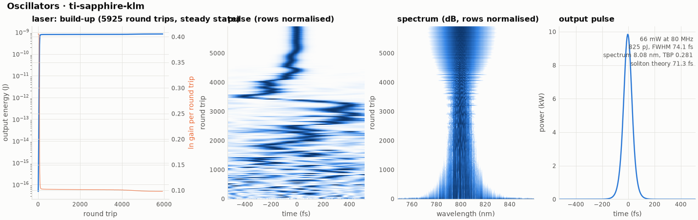

# 19 -- Kerr-lens mode-locked Ti:sapphire oscillator (Haus model)

The master-equation model of a KLM Ti:sapphire laser at 80 MHz ([docs/oscillators.md](../../../reference/oscillators.md)).
Each round trip applies:

* saturated gain with a 100 nm bandwidth;
* 2 % loss plus a 5 % output coupler;
* −500 fs² of net GDD;
* SPM of the crystal, δ = 1.5×10⁻⁶ rad/W;
* the Kerr-lens loss modulation q(P) = q0 − κP.

The laser starts from quantum noise.

```bash
ultrafast run laser.ufs run.json -o results
ultrafast-plot results          # oscillator.png: build-up, pulse and spectrum vs round trip
```

| | |
|---|---|
| round trips to steady state | 5925 (from one photon per mode) |
| output | 825 pJ, 66 mW at 80 MHz (16.5 nJ intracavity) |
| pulse | 74.1 fs, 8.1 nm, TBP 0.28 (sech²: 0.315), single pulse, 0.2 % background |
| soliton area theorem 3.53 \|GDD\|/(δE) | 71.3 fs (ratio 1.04) |
| B-integral per round trip | 0.30 rad |



The left panel shows the output energy (log scale): the cavity fills with light from quantum noise within the first
few hundred round trips and then stays at 825 pJ. The two colour maps show the pulse in time and the spectrum for
every round trip. For the first thousands of round trips the light is a changing pattern of noise spikes; around
round trip 3500 one spike wins, the spectrum widens and smooths out, and the pulse settles into a single sech^2-like
soliton. The final pulse (right) is 74.1 fs long with an 8.08 nm spectrum, close to the 71.3 fs that the soliton
area theorem predicts from the GDD, the SPM strength and the pulse energy.

`oscillator.png` shows the start-up: noise first, then a few noise spikes competing, then one pulse winning
(around 3500 round trips) and shaping into a soliton. Try `"gddFs2": -800` (longer pulse), a larger
`kappaPerW` (stronger mode-locking), or `"saturationEnergyJ": 20e-9` (more energy than one soliton can carry:
the laser becomes unstable or multi-pulses).
