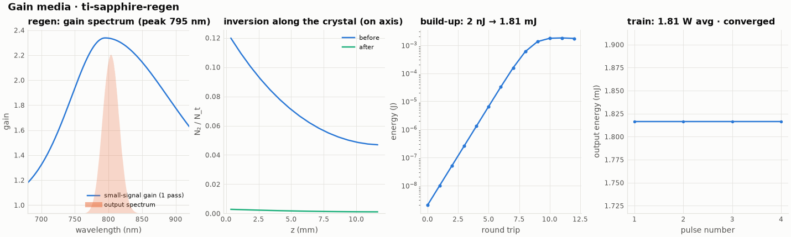

# Ti:sapphire regenerative amplifier

A 30 fs, 2 nJ oscillator pulse at 800 nm is stretched, amplified in an auto-ejected 11-round-trip Ti:sapphire regen pumped by 10 mJ at 532 nm to 1.81 mJ (gain 9 × 10⁵) and recompressed to 41.1 fs, against a 34.3 fs transform limit.

**The story.** The classic 1 kHz CPA front end. The pulse is stretched by an ideal stretcher (GDD 1.5 ps², TOD), amplified in a regen
pumped by a Q-switched, frequency-doubled laser (10 mJ at 532 nm, double pass, 200 ns before injection), ejected automatically at the
energy maximum and recompressed. The regen solves the rate equations of the crystal between and during the round trips; the checks are
internal: the extracted energy must follow from the stored energy, and the compressor (tuned with the `compressor` instrument) must give
back a pulse close to the transform limit of the narrowed spectrum.



*`ultrafast-plot results` draws this figure (`results/plots/gain.png`).*

**Layout** (`regen.ufs`, `run.json`): an ideal `dispersion` stretcher (`gddS2` = 1.5e-24, `todS3` = 1e-39), the `regen` amplifier
(`geometry` regenerative, `roundTrips` auto, 2 passes per round trip, Ti:sapphire of `lengthM` = 12e-3, `slices` 16, `modeRadiusM` =
0.45e-3, pulsed pump of `energyJ` = 10e-3 at 532 nm, `radiusM` = 0.5e-3, double pass, `delayS` = 200e-9; cavity loss 6 % per round trip
and 40 mm of fused silica per round trip as the Pockels cell and polariser), and an ideal `dispersion` compressor (GDD and TOD
tuned). Pulse: Gaussian, `centerWavelengthM` = 800e-9, `durationFwhmS` = 30e-15, `energyJ` = 2e-9, `repRateHz` = 1000. The grid needs 512k points
(30 fs bandwidth stretched to hundreds of ps), so the run takes about 7 s.

**Run it** in the example folder. The two tabs run the same simulation and print the same key numbers.

=== "CLI"

    ```bash
    ultrafast run regen.ufs run.json -o results     # about 7 s
    ultrafast-plot results                          # optional: results/plots/gain.png
    ```

    ```
    energy 0.00181 J (T = 90,517,222.70 %), FWHM 41.13 fs (TL 34.25 fs), peak 3.983E+10 W, B = 1.8 rad
    ```

=== "Python"

    <!-- snippet -->
    ```python
    import ultrafast as uf
    from ultrafast import build as b

    system = uf.System.load("regen.ufs")           # ideal stretcher, auto-ejected regen, ideal compressor
    spec = b.run_spec(                             # run.json, written with the builders (typed: the editor completes every key)
        b.pulse(800e-9, 30e-15, energy=2e-9, rep_rate_hz=1000),
        name="regen",
        probes=["regen", "compressor"],
        instruments=[
            b.instrument("spectrometer", at="input", name="spectrum_seed"),
            b.instrument("spectrometer", at="regen", name="spectrum_out"),
            b.instrument("energyMeter", at="regen", name="energy_regen"),
            b.instrument("compressor", at="end", name="residual"),
            b.instrument("autocorrelator", at="end", name="ac_out"),
        ],
    )
    res = uf.run(system, spec)                     # uf.run("regen.ufs", "run.json") runs the two files as they are
    res.write("results")                           # the same files as the CLI: ultrafast-plot results draws the figures
    out, tot = res.summary["output"], res.summary["totals"]
    print(f"energy {out['energyJ']:.4G} J (T = {100 * tot['energyTransmission']:,.2f} %), FWHM {out['fwhmS'] * 1e15:.4G} fs "
          f"(TL {out['transformLimitFwhmS'] * 1e15:.4G} fs), peak {out['peakPowerW']:.4G} W, B = {tot['bIntegralRad']:.3G} rad")
    regen = res.elements()[1]
    v = regen["values"]
    print(f"  absorbed pump {v['absorbedPumpEnergyJ'] * 1e3:.2f} mJ, small-signal gain {v['smallSignalGain']:.2f} per pass, "
          f"{v['roundTrips']} round trips, gain {v['gain']:.3G}, extraction {100 * v['extractionEfficiency']:.0f} %, B = {regen['bIntegralRad']:.2G} rad")
    sin, sout = res.instrument("spectrum_seed"), res.instrument("spectrum_out")
    print(f"  spectrum {sin['fwhmM'] * 1e9:.1f} nm -> {sout['fwhmM'] * 1e9:.1f} nm, centroid {sin['centroidWavelengthM'] * 1e9:.1f} -> "
          f"{sout['centroidWavelengthM'] * 1e9:.1f} nm")
    ```

    ```
    energy 0.00181 J (T = 90,517,222.70 %), FWHM 41.13 fs (TL 34.25 fs), peak 3.983E+10 W, B = 1.8 rad
      absorbed pump 9.65 mJ, small-signal gain 2.34 per pass, 11 round trips, gain 9.05E+05, extraction 97 %, B = 1.8 rad
      spectrum 31.4 nm -> 28.6 nm, centroid 800.2 -> 802.9 nm
    ```

**What it shows.**

| quantity | value |
|---|---|
| absorbed pump | 9.65 mJ; small-signal gain 2.34 per pass |
| round trips (auto) | 11 (2 passes each, 6 % cavity loss, 40 mm of fused silica per round trip) |
| output | 1.81 mJ (gain 9 × 10⁵), extraction 97 % of the stored energy |
| spectrum | 31.4 nm → 28.6 nm FWHM (gain narrowing), centroid shifts red (800.2 → 802.9 nm) |
| compressed | 41.1 fs (transform limit 34.3 fs; the remainder is higher-order phase of the cavity) |
| B-integral in the regen | 1.8 rad |

In the figure, the pulse grows from 2 nJ to 1.81 mJ in
the cavity. On the build-up panel the energy rises exponentially, a factor of about 5 per round trip (two passes at
2.34 each), until the gain saturates and the energy flattens, which is where the regen ejects the pulse. The
inversion panel shows the same thing in the crystal: the pump has excited up to 12 % of the ions near the entrance
face, and the amplified pulse leaves almost none (green), i.e. nearly all of the stored energy is extracted. The
gain spectrum (left) is broad but not flat, so the output spectrum (shaded) is narrower than the seed and shifted
towards the gain peak side; the output is identical for all 4 pulses of the train, because the upper state is
re-pumped from scratch every millisecond.

The compressor's GDD and TOD were tuned with the `compressor` instrument. Without the correction, the 11 round
trips of sapphire and silica (≈ 30 000 fs²) leave a 2.4 ps pulse. `el_regen_energyPerRoundTrip` holds the build-up
from 2 nJ. The pulse train is only 4 pulses long: at 1 kHz, the 3.2 µs upper-state lifetime forgets each pulse
before the next one.

**Limits.** The oscillator is an ideal pulse, the stretcher and compressor are ideal dispersion elements (no grating loss, no spatial
chirp), and the cavity is a lumped round trip (loss and fused-silica path), not a ray trace. The thermal lens is reported and not applied
in the 1-D amplifier. The Ti:sapphire cross sections are catalogue values; the run lists the approximate ones in `unverifiedInputs`.
See [Yb multipass CPA](../yb-multipass-cpa/README.md) for a multipass amplifier and the [gain reference](../../../reference/gain.md).
