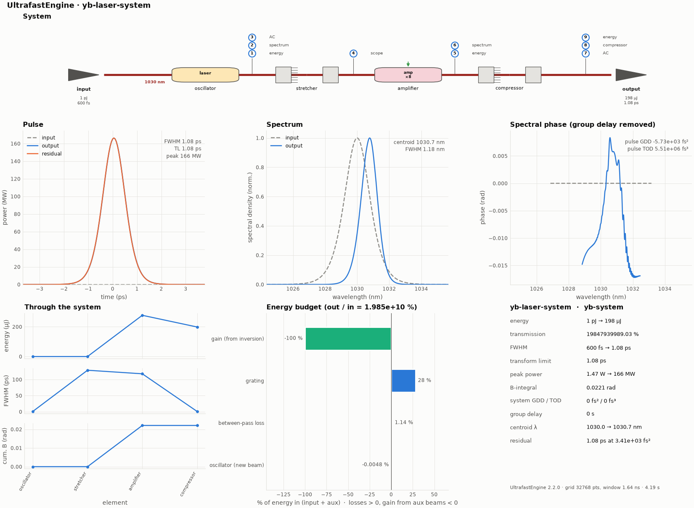

# A complete Yb laser system: oscillator, stretcher, amplifier, compressor

A SESAM mode-locked Yb:YAG oscillator (1.08 W, 871 fs) feeds a grating stretcher, an 8-pass Yb:YAG amplifier at 10 kHz and a compressor, and the system delivers 198 µJ in 1.08 ps, at the transform limit of the amplified spectrum.

**The story.** The whole chain of a Yb CPA laser in one system file, from the oscillator to the compressed pulse. The oscillator is
a cavity model with a real 2 mm Yb:YAG crystal, so its power, pulse duration and stability follow from the gain, the dispersion and the
SESAM. The checks are internal: the oscillator pulse must match the soliton area theorem (871 fs against 873 fs), and the compressor must
restore the transform-limited pulse of the narrowed spectrum (Strehl 0.99997).



*The overview figure of this example's run (`python make_figures.py` redraws it; the file is `hero.png`).*

**Layout** (`system.ufs`, `run.json`):

1. **Oscillator** (`oscillator`, `model` cavity). A real 2 mm Yb:YAG crystal (8 W at 969 nm, double pass) in a
   cavity with 12 bounces on −1500 fs² chirped mirrors, a SESAM (1 % modulation depth, 50 µJ/cm², 1 ps) and a
   5 % output coupler at 80 MHz.
2. **Pulse picker and stretcher.** The amplifier's `repRateHz` (10 kHz) replaces the 80 MHz of the oscillator
   pulse; the grating pair stretches it to 131 ps.
3. **Amplifier.** The 8-pass amplifier of [Yb multipass CPA](../yb-multipass-cpa/README.md) (150 W pump, pulse train iterated to
   steady state at 10 kHz).
4. **Compressor**, matched to the stretcher.

Pulse in `run.json`: sech², `centerWavelengthM` = 1.03e-6, `durationFwhmS` = 600e-15, `energyJ` = 1e-12; it sets the grid and seeds the
oscillator. About 6 s.

**Run it** in the example folder. The two tabs run the same simulation and print the same key numbers.

=== "CLI"

    ```bash
    ultrafast run system.ufs run.json -o results     # about 6 s
    ultrafast-plot results                           # optional: system, oscillator, gain, instruments ...
    ```

    ```
    energy 0.0001985 J (T = 19,847,939,989.03 %), FWHM 1081 fs (TL 1081 fs), peak 1.663E+08 W, B = 0.0221 rad
    ```

=== "Python"

    <!-- snippet -->
    ```python
    import ultrafast as uf
    from ultrafast import build as b

    system = uf.System.load("system.ufs")          # oscillator, stretcher, 8-pass amplifier, compressor
    spec = b.run_spec(                             # run.json, written with the builders (typed: the editor completes every key)
        b.pulse(1.03e-6, 600e-15, energy=1e-12, shape="sech2"),   # sets the grid and seeds the oscillator
        name="yb-system",
        instruments=[
            b.instrument("powerMeter", at="oscillator", name="P_oscillator"),
            b.instrument("spectrometer", at="oscillator", name="spectrum_oscillator"),
            b.instrument("autocorrelator", at="oscillator", name="ac_oscillator"),
            b.instrument("scope", at="stretcher", name="photodiode_stretched", riseTimeS=20e-12),
            b.instrument("powerMeter", at="amplifier", name="P_amplified"),
            b.instrument("spectrometer", at="amplifier", name="spectrum_amplified"),
            b.instrument("autocorrelator", at="end", name="ac_out"),
            b.instrument("compressor", at="end", name="residual"),
            b.instrument("energyMeter", at="end"),
        ],
    )
    res = uf.run(system, spec)                     # uf.run("system.ufs", "run.json") runs the two files as they are
    res.write("results")                           # the same files as the CLI: ultrafast-plot results draws the figures
    out, tot = res.summary["output"], res.summary["totals"]
    print(f"energy {out['energyJ']:.4G} J (T = {100 * tot['energyTransmission']:,.2f} %), FWHM {out['fwhmS'] * 1e15:.4G} fs "
          f"(TL {out['transformLimitFwhmS'] * 1e15:.4G} fs), peak {out['peakPowerW']:.4G} W, B = {tot['bIntegralRad']:.3G} rad")
    osc, amp = res.elements()[0]["values"], res.elements()[2]["values"]
    print(f"  oscillator: {osc['averagePowerW']:.2f} W, {osc['outputEnergyJ'] * 1e9:.1f} nJ, {osc['outputFwhmS'] * 1e15:.0f} fs, "
          f"{osc['outputSpectralFwhmM'] * 1e9:.2f} nm (soliton: theory {osc['solitonFwhmS'] * 1e15:.0f} fs), "
          f"QML parameter {osc['qmlParameter']:.1f}, {osc['roundTrips']} round trips")
    print(f"  stretched {res.instrument('photodiode_stretched')['fwhmS'] * 1e12:.0f} ps; amplified {res.instrument('P_amplified')['energyJ'] * 1e6:.0f} uJ, "
          f"{res.instrument('P_amplified')['averagePowerW']:.2f} W, gain {amp['gain']:.2G}, f_th = {amp['thermalLensFocalLengthM'] * 100:.0f} cm, "
          f"{res.instrument('spectrum_amplified')['fwhmM'] * 1e9:.2f} nm")
    print(f"  compressed {out['energyJ'] * 1e6:.0f} uJ, {out['fwhmS'] * 1e12:.2f} ps, Strehl {res.instrument('residual')['temporalStrehl']:.5f}")
    ```

    ```
    energy 0.0001985 J (T = 19,847,939,989.03 %), FWHM 1081 fs (TL 1081 fs), peak 1.663E+08 W, B = 0.0221 rad
      oscillator: 1.08 W, 13.5 nJ, 871 fs, 1.29 nm (soliton: theory 873 fs), QML parameter 6.3, 1700 round trips
      stretched 131 ps; amplified 277 uJ, 2.77 W, gain 2.9E+04, f_th = 15 cm, 1.18 nm
      compressed 198 uJ, 1.08 ps, Strehl 0.99997
    ```

**What it shows.**

| stage | result |
|---|---|
| oscillator | 1.08 W, 13.5 nJ, 871 fs, 1.29 nm (soliton: theory 873 fs), QML parameter 6.3 (stable), steady state after 1700 round trips |
| stretched | 131 ps (photodiode) |
| amplified | 277 µJ, 2.77 W at 10 kHz (gain 2.9×10⁴; thermal lens f = 15 cm); 1.18 nm (gain narrowing) |
| compressed | 198 µJ, 1.08 ps, transform limited (Strehl 0.99997) |

The oscillator iterates on a 4096-point part of the system's 32768-point window (`gridPoints`), so the long
stretcher does not slow it down. Its output is embedded exactly into the full window.

**Limits.** The stages are linked by their pulses only: the oscillator, the picker and the amplifier share no transverse beam, and the
pulse picker is the change of repetition rate (no picker loss). The thermal lens of the amplifier is reported, not applied. The Yb:YAG
catalogue values are approximate (listed in `unverifiedInputs`). See [Kerr-lens oscillator](../ti-sapphire-klm-haus/README.md) for a
second oscillator model.
