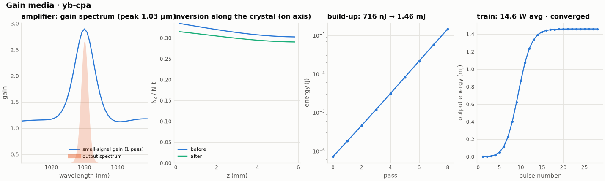

# Yb:YAG multipass CPA amplifier

A 250 fs, 1 µJ seed at 10 kHz is stretched to 431 ps, amplified in 8 passes through a 6 mm Yb:YAG rod pumped with 150 W of cw diode light to 1.46 mJ (gain 2000) and recompressed to 535 fs, at the transform limit (Strehl 0.999) after 1.04 mJ of grating throughput.

**The story.** A chirped-pulse-amplification line with a real gain model. The seed is stretched by a grating pair, amplified in 8 passes
through a 6 mm Yb:YAG rod, pumped from both ends with 150 W of cw diode light at 940 nm, and recompressed by the matching grating
pair. The amplifier element solves the rate equations for the inversion between pulses (the steady state at 10 kHz), the saturated
spectral gain per pass with time-ordered extraction, and the heat load of the rod. Checks: the extracted energy follows from the
stored energy, and the compressor must restore the transform-limited pulse of the narrowed spectrum.



*`ultrafast-plot results` draws this figure (`results/plots/gain.png`).*

**Layout** (`amp.ufs`, `run.json`): a `gratingPair` stretcher, the `amplifier` (`geometry` multipass, `passes` 8, `lengthM` = 6e-3,
`slices` 16, `pump` cw 150 W at 940 nm, `radiusM` = 0.5e-3, superGaussian of order 4, double pass), a `gratingPair` compressor.
Pulse: `sech2`, `centerWavelengthM` = 1.03e-6, `durationFwhmS` = 250e-15, `energyJ` = 1e-6, `repRateHz` = 10e3. Instruments: seed and
amplified spectrometers, a photodiode after the stretcher, a power meter after the amplifier, an autocorrelator, the ideal
compressor (`residual`) and an energy meter. The grid is sized automatically (N = 262144, window 5461 ps). About 3 s.

**Run it** in the example folder. The two tabs run the same simulation and print the same key numbers.

=== "CLI"

    ```bash
    ultrafast run amp.ufs run.json -o results     # about 3 s
    ultrafast-plot results                        # optional: results/plots/gain.png: gain spectrum, inversion, build-up, pulse train
    ```

    ```
    energy 0.001044 J (T = 104,416.88 %), FWHM 534.8 fs (TL 534 fs), peak 1.777E+09 W, B = 0.0665 rad
    ```

=== "Python"

    <!-- snippet -->
    ```python
    import ultrafast as uf
    from ultrafast import build as b

    system = uf.System.load("amp.ufs")             # stretcher, 8-pass Yb:YAG amplifier, compressor
    spec = b.run_spec(                             # run.json, written with the builders (typed: the editor completes every key)
        b.pulse(1.03e-6, 250e-15, energy=1e-6, shape="sech2", rep_rate_hz=10e3),
        name="yb-cpa",
        probes=["probe_stretched", "probe_amplified", "amplifier", "compressor"],
        instruments=[
            b.instrument("spectrometer", at="input", name="spectrum_seed", resolutionM=0.05e-9),
            b.instrument("scope", at="probe_stretched", name="photodiode_stretched", riseTimeS=20e-12),
            b.instrument("spectrometer", at="probe_amplified", name="spectrum_amplified", resolutionM=0.05e-9),
            b.instrument("powerMeter", at="probe_amplified", name="power_amplified"),
            b.instrument("autocorrelator", at="end", name="ac_out"),
            b.instrument("compressor", at="end", name="residual"),
            b.instrument("energyMeter", at="end"),
        ],
    )
    res = uf.run(system, spec)                     # uf.run("amp.ufs", "run.json") runs the two files as they are
    res.write("results")                           # the same files as the CLI: ultrafast-plot results draws the figures
    out, tot = res.summary["output"], res.summary["totals"]
    print(f"energy {out['energyJ']:.4G} J (T = {100 * tot['energyTransmission']:,.2f} %), FWHM {out['fwhmS'] * 1e15:.4G} fs "
          f"(TL {out['transformLimitFwhmS'] * 1e15:.4G} fs), peak {out['peakPowerW']:.4G} W, B = {tot['bIntegralRad']:.3G} rad")
    v = res.elements()[2]["values"]                # the amplifier's own numbers
    print(f"  amplifier: {res.instrument('power_amplified')['energyJ'] * 1e3:.2f} mJ ({res.instrument('power_amplified')['averagePowerW']:.1f} W), "
          f"gain {v['gain']:.0f}, inversion {v['inversionFractionBefore']:.3f}, small-signal gain {v['smallSignalGain']:.2f} per pass, "
          f"{v['steadyStatePulses']} pulses to steady state")
    print(f"  absorbed pump {v['absorbedPumpPowerW']:.0f} W, extraction {100 * v['extractionEfficiency']:.1f} %, heat {v['heatW']:.1f} W, "
          f"dT = {v['peakTemperatureRiseK']:.0f} K, f_th = {v['thermalLensFocalLengthM']:.2f} m")
    print(f"  stretched {res.instrument('photodiode_stretched')['fwhmS'] * 1e12:.0f} ps, spectrum {res.instrument('spectrum_seed')['fwhmM'] * 1e9:.2f} nm "
          f"-> {res.instrument('spectrum_amplified')['fwhmM'] * 1e9:.2f} nm, compressed {out['fwhmS'] * 1e15:.0f} fs "
          f"(Strehl {res.instrument('residual')['temporalStrehl']:.3f})")
    ```

    ```
    energy 0.001044 J (T = 104,416.88 %), FWHM 534.8 fs (TL 534 fs), peak 1.777E+09 W, B = 0.0665 rad
      amplifier: 1.46 mJ (14.6 W), gain 2035, inversion 0.315, small-signal gain 2.90 per pass, 28 pulses to steady state
      absorbed pump 120 W, extraction 5.4 %, heat 10.5 W, dT = 57 K, f_th = 0.14 m
      stretched 431 ps, spectrum 4.46 nm -> 2.51 nm, compressed 535 fs (Strehl 0.999)
    ```

**What it shows.**

The amplifier element ([gain reference](../../../reference/gain.md)):

* iterates the pulse train with the rate equations. It converges after 28 pulses: the inversion is pumped up
  during the 100 µs between pulses and pulled down by each pulse;
* propagates the last pulse with the full model: per pass, 16 slices of saturated spectral gain with time-ordered
  extraction (16 arrival groups, because the pulse is stretched), YAG dispersion and SPM;
* applies 3 % loss and 3 mm of fused silica between passes;
* reports the thermal lens of the rod.

| quantity | value |
|---|---|
| absorbed pump | 120 W (of 150 W) |
| on-axis inversion before the pulse | 0.315 (small-signal gain 2.9 per pass) |
| output after the amplifier | 1.46 mJ (14.6 W), gain 2000 over 8 passes |
| extraction (of the energy stored above transparency) | 5.4 % |
| gain narrowing | 4.46 nm → 2.51 nm FWHM |
| compressed pulse | 535 fs, transform limited (Strehl 0.999) |
| B-integral | 0.07 rad (well stretched) |
| thermal lens | 10.5 W of heat, ΔT(0) = 57 K, f_th = 0.14 m |

In the figure, the left panel shows why the amplified
spectrum is narrower than the seed: the small-signal gain of Yb:YAG peaks at 1030 nm and falls off on both sides,
so the centre of the spectrum grows fastest. The second panel is the fraction of ions in the excited state along
the rod, before and after the pulse passes; the pulse takes only a small part of the stored energy, consistent
with the 5.4 % extraction in the table. The build-up panel is a straight line on the log scale, a constant gain
of about 2.9 per pass from 716 nJ to 1.46 mJ over 8 passes. The last panel is the pulse train: the first pulses
find an unpumped rod, and the output settles at 1.46 mJ after about 15 pulses (the engine runs 28 and reports 14.6 W average power).

**Limits.** The thermal lens is reported and not applied in the 1-D amplifier (the note in `summary.json` says so); the gain is
spatially averaged over the mode area. The doping, lifetime and cross sections of the Yb:YAG catalogue are approximate (the run lists them
in `unverifiedInputs`), so the absolute gain is good to about 20 %. The "T = 104,416.88 %" is the energy out over the seed energy
after 8 passes of gain. See [thermal lens in a rod](../../Wavefronts/spatial-gain-thermal-lens/README.md) for the spatial model.

Things to try:

* `"passes": 12`, or raise the seed to watch saturation flatten the build-up (`energyPerPass`);
* `"repRateHz": 1000` in run.json: more energy per pulse and less average power;
* replace the stretcher with a shorter one (`separationM: -0.05`) and watch the B-integral grow.
