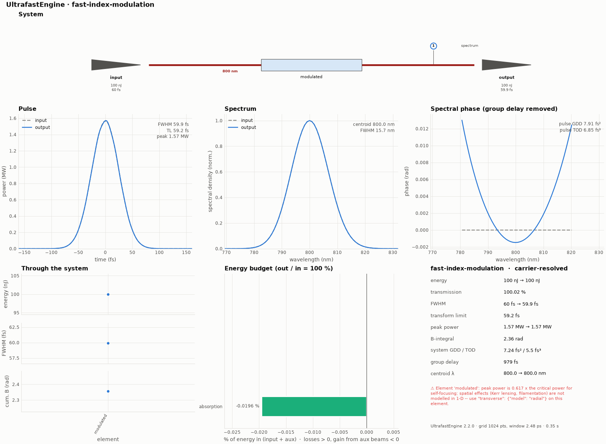

# Carrier-resolved propagation

A 60 fs, 0.1 µJ pulse at 800 nm crosses 0.2 mm of fused silica whose index is modulated at 60 THz; the engine propagates the real optical field instead of the envelope, and the modulation puts sidebands about 46 dB below the peak near 691 nm and 951 nm.

**The story.** Some media change their index on the scale of the optical cycle: a pump-driven phonon, a time-varying metamaterial, an
electro-optic crystal driven at terahertz rates. The envelope model cannot follow such a response, because it removes the carrier.
The time response in `fast-index.ufs` is written in **lab time** (`t_lab`) and oscillates at 60 THz (period 16.7 fs). Because it declares
`"carrierResolved": true`, the engine propagates this element with the real optical field e(t) (`summary.json` →
`elements[0].solver.representation` says "carrier-resolved field") and the pulse gains sidebands at ±60 THz around the carrier. The
check is physical: a sinusoidal index modulation at frequency f_m puts sidebands at f0 ± f_m, which is 691 nm and 952 nm for a carrier at
800 nm (374.7 THz) and f_m = 60 THz.



*The overview figure of this example's run (`python make_figures.py` redraws it; the file is `hero.png`).*

**Layout** (`fast-index.ufs`, `run.json`): one `bulk` element of fused silica (with `n2` = 2.6e-20 m²/W), `lengthM` = 0.2e-3, a constant beam
of `radiusM` = 200e-6, and a `timeResponse` expression `dn cos(2 pi fm t_lab) exp(-(t_lab / tau)^2)` with `dn` = 2e-3, `fm` = 60e12 and
`tau` = 400e-15. Pulse: Gaussian, `centerWavelengthM` = 800e-9, `durationFwhmS` = 60e-15, `energyJ` = 1e-7. Physics: `fieldMode` auto,
`fieldHarmonic` 3. Grid: `minSpanFraction` 0.5. Instrument: a spectrometer (`resolutionM` = 0.5e-9, in dB). About 0.5 s.

**Run it** in the example folder. The two tabs run the same simulation and print the same key numbers.

=== "CLI"

    ```bash
    ultrafast run fast-index.ufs run.json -o results     # about 0.5 s
    ```

    ```
    energy 1E-07 J (T = 100.02 %), FWHM 59.9 fs (TL 59.23 fs), peak 1.571E+06 W, B = 2.36 rad
    ```

=== "Python"

    <!-- snippet -->
    ```python
    import numpy as np
    import ultrafast as uf
    from ultrafast import build as b

    system = uf.System.load("fast-index.ufs")      # the 0.2 mm modulated plate
    spec = b.run_spec(                             # run.json, written with the builders
        b.pulse(800e-9, 60e-15, energy=1e-7),
        name="carrier-resolved",
        grid={"minSpanFraction": 0.5},             # room for the sidebands
        physics=b.physics(fieldMode="auto", fieldHarmonic=3),
        instruments=[b.instrument("spectrometer", resolutionM=0.5e-9, db=True)],
    )
    res = uf.run(system, spec)
    res.write("results")
    out, tot = res.summary["output"], res.summary["totals"]
    print(f"energy {out['energyJ']:.4G} J (T = {100 * tot['energyTransmission']:.2f} %), FWHM {out['fwhmS'] * 1e15:.4G} fs "
          f"(TL {out['transformLimitFwhmS'] * 1e15:.4G} fs), peak {out['peakPowerW']:.4G} W, B = {tot['bIntegralRad']:.3G} rad")
    el = res.elements()[0]
    print(f"  solver: {el['solver']['representation']}")
    spec_db = res.instrument("spectrometer")
    wl, db = np.asarray(spec_db["wavelength_m"]), np.asarray(spec_db["spectrum_db"])
    for name, lo, hi in (("blue", 680e-9, 700e-9), ("red", 940e-9, 960e-9)):
        k = np.flatnonzero((wl > lo) & (wl < hi))
        j = k[np.argmax(db[k])]
        print(f"  {name} sideband: {wl[j] * 1e9:.0f} nm, {db[j]:.0f} dB")
    ```

    ```
    energy 1E-07 J (T = 100.02 %), FWHM 59.9 fs (TL 59.23 fs), peak 1.571E+06 W, B = 2.36 rad
      solver: carrier-resolved field (8192 points, x8)
      blue sideband: 691 nm, -46 dB
      red sideband: 951 nm, -48 dB
    ```

**What it shows.**

* **Representation.** `elements[0].solver.representation` is "carrier-resolved field (8192 points, x8)": the nonlinear polarisation is
  computed from e(t) itself, so third-harmonic generation and self-steepening come out automatically. The energy generated outside the
  envelope band is reported as `harmonics (out of band)` (1e-15 J here, 1e-8 of the input).
* **Sidebands.** The spectrometer (in dB) shows the sidebands at ±60 THz around the carrier, at 691 nm and 951 nm, about 46 and 48 dB
  below the peak: the predicted 689.6 nm and 952.5 nm, within the 0.5 nm resolution and the width of the 60 fs pulse spectrum.
* **Pulse.** The pulse stays 59.9 fs long (transform limit 59.2 fs) with B = 2.36 rad; the energy grows by 0.02 % (T = 100.02 %) because the
  time-varying index is allowed to exchange energy with the field (`energyBudget` → `absorption` is negative).
* **Window.** `fieldHarmonic` sets how far the real-field grid extends (3 = up to the third harmonic); `grid.minSpanFraction` widens the
  envelope grid so the sidebands stay in band when the result is mapped back.

**Limits.** The modulation is a prescribed function of lab time: there is no feedback on the medium, so no energy bookkeeping for the
driver. The beam is constant (1-D). Use `"fieldMode": "carrier"` to force the real-field model everywhere and `"envelope"` to forbid it;
the real-field model is slower (8 times the points here). See [Nonlinear physics](../../../reference/nonlinear.md) and the time responses
in [Materials](../../../reference/materials.md).
