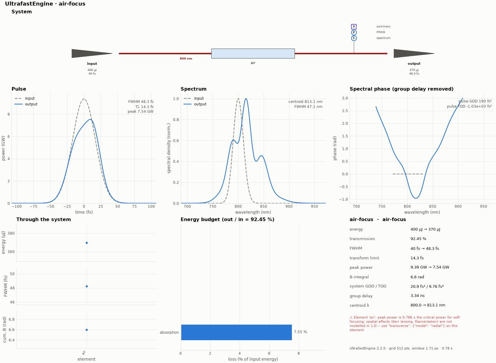

# Air at a focus: rotational Raman, ionisation and pulse retrieval

A 0.4 mJ, 40 fs pulse at 800 nm focused (w0 = 100 µm) in the middle of 1 m of air gains B = 6.65 rad, loses 8.8 % of its energy to photo-ionisation and shifts its spectral centroid from 800 nm to 815 nm; a simulated SHG-FROG of the output retrieves a 50.3 fs pulse (51.3 fs simulated).

**The story.** At a focus in air the Kerr response has two parts: the instantaneous electronic one and the delayed rotational Raman
response of N2 and O2 ([Gases](../../../reference/gases.md)). At the same time photo-ionisation (PPT rates, Drude plasma) makes free
electrons that lower the index and blue-shift the leading part of the pulse ([Ionisation](../../../reference/ionization.md)). The
two shift the spectrum in opposite directions: the delayed rotational response red-shifts the trailing part of the pulse more than the
weak plasma blue-shifts the leading part, so the centroid moves to the red. A SHG-FROG measures the output, and the pulse is retrieved
from the simulated trace with PCGPA, which is the check of the whole chain: the retrieved width must match the simulated one.



*The overview figure of this example's run (`python make_figures.py` redraws it; the file is `hero.png`).*

**Layout** (`cell.ufs`, `run.json`): one `bulk` element of `Air`, `lengthM` = 1.0, `nonlinear` and `ionization` on, a Gaussian `beam`
(`w0M` = 100e-6, `zWaistM` = 0.5, the middle of the cell). Pulse: Gaussian, `centerWavelengthM` = 800e-9, `durationFwhmS` = 40e-15,
`energyJ` = 0.4e-3. Instruments: spectrometer, SHG-FROG (`points` = 128) and pulse summary, all at the end. About 1 s.

**Run it** in the example folder. The two tabs run the same simulation, the pulse retrieval and the variant with the plasma index at the
carrier only, and print the same key numbers.

=== "CLI"

    ```bash
    ultrafast run cell.ufs run.json -o results                         # about 1 s
    ultrafast retrieve pcgpa results/result.npz -o retrieved           # FROG -> pulse (the frog instrument's trace)
    ```

    ```
    energy 0.0003649 J (T = 91.22 %), FWHM 51.25 fs (TL 15.38 fs), peak 7.027E+09 W, B = 6.65 rad
    pcgpa: error 9.73E-06 after 48 iterations, FWHM 50.32 fs
    ```

=== "Python"

    <!-- snippet -->
    ```python
    import ultrafast as uf
    from ultrafast import build as b

    system = uf.System.load("cell.ufs")            # 1 m of air with a focus in the middle, ionisation on
    spec = b.run_spec(                             # run.json, written with the builders
        b.pulse(800e-9, 40e-15, energy=0.4e-3),
        name="air-focus",
        instruments=[
            b.instrument("spectrometer"),
            b.instrument("frog", name="frog", type="shg", points=128),
            b.instrument("pulseSummary"),
        ],
    )
    res = uf.run(system, spec)
    res.write("results")
    out, tot = res.summary["output"], res.summary["totals"]
    print(f"energy {out['energyJ']:.4G} J (T = {100 * tot['energyTransmission']:.2f} %), FWHM {out['fwhmS'] * 1e15:.4G} fs "
          f"(TL {out['transformLimitFwhmS'] * 1e15:.4G} fs), peak {out['peakPowerW']:.4G} W, B = {tot['bIntegralRad']:.3G} rad")
    v = res.elements()[0]["values"]
    print(f"  electrons: {v['peakElectronDensityM3']:.3G} /m^3, ionisation fraction {v['peakIonizationFraction']:.2G}, "
          f"centroid {out['centroidWavelengthM'] * 1e9:.0f} nm")

    ret = uf.retrieve("pcgpa", "results/result.npz", output="retrieved")   # the FROG trace of the run -> the pulse
    print(f"pcgpa: error {ret['error']:.3G} after {ret['iterations']} iterations, FWHM {ret['fwhmS'] * 1e15:.4G} fs")

    # the Drude index at the carrier only (versions before frequency-resolved plasma): the system file with one key changed
    carrier_only = system.to_dict()
    carrier_only["elements"][0]["ionization"] = {"frequencyResolved": False}
    res2 = uf.run(carrier_only, spec)
    out2, tot2 = res2.summary["output"], res2.summary["totals"]
    print(f"carrier-only plasma: centroid {out2['centroidWavelengthM'] * 1e9:.0f} nm, "
          f"energy loss {100 * (1 - tot2['energyTransmission']):.1f} % (frequency-resolved: {100 * (1 - tot['energyTransmission']):.1f} %)")
    ```

    ```
    energy 0.0003649 J (T = 91.22 %), FWHM 51.25 fs (TL 15.38 fs), peak 7.027E+09 W, B = 6.65 rad
      electrons: 1.87E+22 /m^3, ionisation fraction 0.00075, centroid 815 nm
    pcgpa: error 9.73E-06 after 48 iterations, FWHM 50.32 fs
    carrier-only plasma: centroid 813 nm, energy loss 7.5 % (frequency-resolved: 8.8 %)
    ```

**What it shows.**

* `summary.json` → `elements[0].values`: `peakElectronDensityM3` (1.9e22 m⁻³) and `peakIonizationFraction` (7.5e-4).
* The spectrum broadens (B = 6.65 rad) and its centroid moves to the red (815 nm). The simulated FWHM is 51.25 fs, longer than the
  40 fs input; the transform limit of the broadened spectrum is 15.4 fs.
* The FROG and its retrieval: `retrieved/retrieval.json` (G = 9.7e-6, FWHM 50.3 fs against 51.3 fs simulated, within 2 %);
  `retrieved/retrieved_spectrum.csv` can be the input of another run
  (`"pulse": {"shape": "spectrum", "spectrum": {"csv": "retrieved/retrieved_spectrum.csv"}, "energyJ": 3.7e-4}`). The SHG-FROG cannot
  tell E(t) from E*(-t), so the sign of the chirp of the retrieved pulse is ambiguous (the retrieval notes say so).
* **Frequency-resolved plasma.** With `"ionization": {"frequencyResolved": false}` the Drude index is applied at the carrier only, as
  versions before this one did: the centroid moves to 813 nm and the energy loss drops from 8.8 % to 7.5 %, because the electrons
  born in the field also take their drift energy U_p in the frequency-resolved model
  ([Ionisation](../../../reference/ionization.md#plasma)).

**Limits.** The peak power is 0.8 of the critical power of air, and the engine warns that self-focusing is not modelled in 1-D. For a
real filament give the element `"transverse": {"model": "radial", "points": 128, "radiusM": 1e-3, "equation": "uppe"}` (much slower:
minutes). Try `"rotationalRaman": false` on a custom air material, or `"ionization": false`, and compare the spectra. Related:
[spatial Kerr](../spatial-kerr/README.md), [Gases](../../../reference/gases.md).
