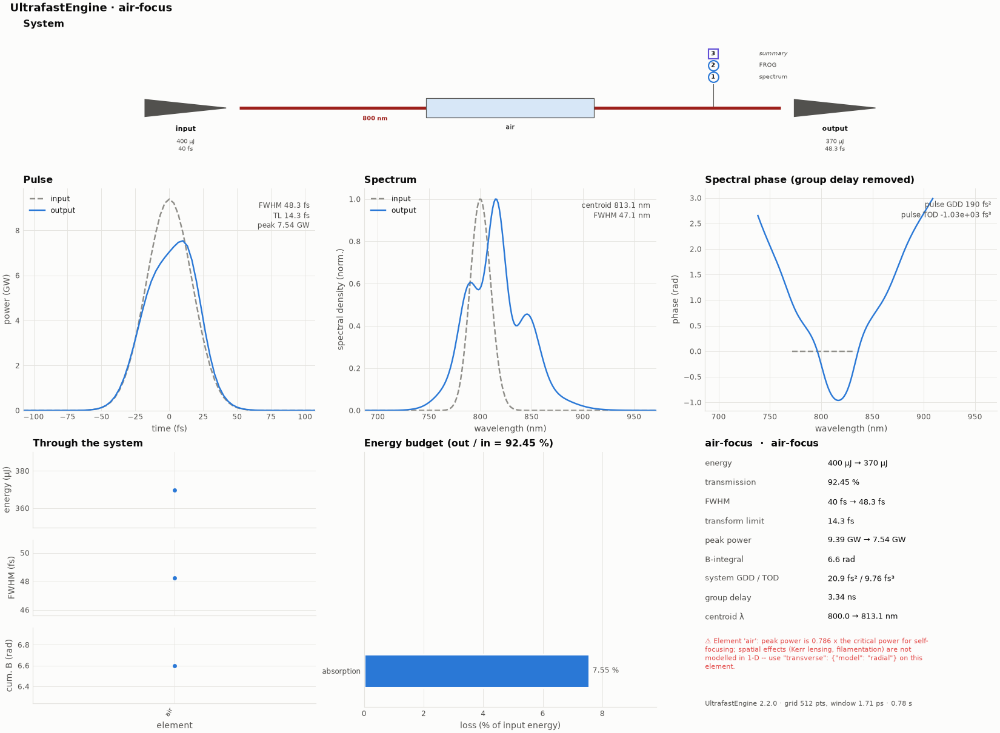

# 24 -- Air at a focus: rotational Raman, ionisation and pulse retrieval

A 0.4 mJ, 40 fs pulse at 800 nm focused (w0 = 100 µm) in the middle of 1 m of air. The Kerr response of air
includes the rotational Raman response of N2 and O2 ([Gases](../../../reference/gases.md)), and photo-ionisation
(PPT rates, Drude plasma) is on ([Ionisation](../../../reference/ionization.md)). A SHG-FROG measures the output,
and the pulse is retrieved from the simulated trace.



*The overview figure of this example's run (`python make_figures.py` redraws it; the file is `hero.png`).*

```bash
ultrafast run cell.ufs run.json -o results                        # ~2 s
ultrafast retrieve pcgpa results/result.npz -o retrieved           # FROG -> pulse (the frog instrument's trace)
```

What to look at:

* `summary.json → elements[0].values`: `peakElectronDensityM3` (~1.9·10²² m⁻³) and `peakIonizationFraction` (~7·10⁻⁴).
* The spectrum broadens (B ≈ 6.6 rad) and its centroid moves to the red (815 nm): the delayed rotational response
  red-shifts the trailing part of the pulse more than the weak plasma blue-shifts the leading part.
* The FROG and its retrieval: `retrieved/retrieval.json` (G ≈ 10⁻⁵, FWHM 50.3 fs vs 51.3 fs simulated);
  `retrieved/retrieved_spectrum.csv` can be the input of another run
  (`"pulse": {"shape": "spectrum", "spectrum": {"csv": "retrieved/retrieved_spectrum.csv"}, "energyJ": 3.7e-4}`).

1-D caveat: the peak power is 0.8 of the critical power of air, and the engine warns that self-focusing is not
modelled. For a real filament give the element `"transverse": {"model": "radial", "points": 128, "radiusM": 1e-3,
"equation": "uppe"}` (much slower: minutes).

Try: `"rotationalRaman": false` on a custom air material, or `"ionization": false`, and compare the spectra. `"ionization": {"frequencyResolved": false}` applies the Drude index at the carrier only, as versions before this one did: the centroid moves to 813 nm and the energy loss drops from 8.8 % to 7.5 %, because the electrons born in the field also take their drift energy U_p in the frequency-resolved model ([Ionisation](../../../reference/ionization.md#plasma)).
