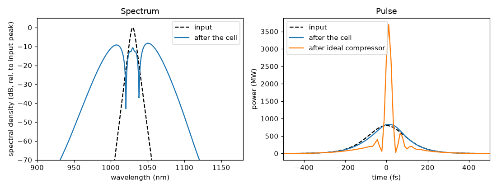

# Argon multipass cell (Herriott MPC)

A 220 fs, 200 µJ pulse crosses a 20-pass, 0.55 m Herriott cell with 2 bar argon and collects B = 9.12 rad; the spectrum broadens to 61.0 nm and an ideal compressor shortens the pulse to 33.1 fs at 3.70 GW.

**The story.** Multipass cells broaden the spectrum of a pulse that is too energetic for a fibre: the beam crosses a gas many times between
two mirrors, collects self-phase modulation in the gas, and the dispersive mirrors (-30 fs² per bounce) keep the pulse from stretching.
The system file is generated by `make_mpc.py` with the Python builders (`ultrafast.build`), which is a good template for parameter
scans. The B-integral per pass is the analytic quantity to check: 0.43 rad per pass here, and the sum over 20 passes (9.12 rad) fixes
the spectral broadening and the compression factor (about 6.7 here). The Gaussian beam of each pass (`"kind": "gaussian"`, waist
mid-pass) is what the Zemax binding would export from GBPS / GBPW for a real cell ([Zemax](../../../plugins/zemax.md)).



*Left: spectrum before (dashed) and after the cell. Right: the pulse in time. `python plot.py` draws this figure from `results/`.*

**Layout** (`make_mpc.py`, `mpc.ufs`, `run.json`): fused-silica window (3 mm), 0.10 m of argon, 20 `bulk` passes of argon at 2 bar
(`lengthM` = 0.55, `w0M` = 150e-6 at mid-pass, `m2` = 1.1) separated by 19 mirrors (`mpc_mirror`, `R` = 0.9990, `gddS2` = -30e-30,
damage threshold 0.3 J/cm² at 1 ps), 0.10 m of argon and the output window; both windows have an AR coating (`R` = 0.002). Pulse: sech²,
`centerWavelengthM` = 1.03e-6, `durationFwhmS` = 220e-15, `energyJ` = 200e-6, `repRateHz` = 10e3. Physics: `selfSteepening` on, `raman` off;
adaptive stepper with `tolerance` 1e-6. Instruments: spectrometer (dB), ideal compressor, d-scan (`gdd_scan`), autocorrelator, contrast.
About 1 s.

**Run it** in the example folder. The two tabs run the same simulation and print the same key numbers.

=== "CLI"

    ```bash
    python make_mpc.py                       # optional: (re)generates mpc.ufs
    ultrafast run mpc.ufs run.json -o results       # about 1 s
    python plot.py                           # optional: mpc-broadening.png from results/
    ```

    ```
    energy 0.0001947 J (T = 97.33 %), FWHM 197.5 fs (TL 32.76 fs), peak 8.357E+08 W, B = 9.12 rad
    ```

=== "Python"

    <!-- snippet -->
    ```python
    import ultrafast as uf
    from ultrafast import build as b

    system = uf.System.load("mpc.ufs")            # the cell, written by make_mpc.py with the builders
    spec = b.run_spec(                            # run.json, written with the builders
        b.pulse(1.03e-6, 220e-15, energy=200e-6, rep_rate_hz=10e3, shape="sech2"),
        name="mpc",
        physics=b.physics(selfSteepening=True, raman=False),
        stepper={"method": "adaptive", "tolerance": 1e-6},
        probes=["pass01", "pass05", "pass10", "pass15", "pass20", "win_out_back"],
        instruments=[
            b.instrument("spectrometer", resolutionM=0.2e-9, db=True),
            b.instrument("compressor", name="ideal_compressor"),
            b.instrument("dscan", name="gdd_scan", gddRangeS2=[-2000e-30, 0], steps=101),
            b.instrument("autocorrelator"),
            b.instrument("contrast", dynamicRangeDb=80),
        ],
    )
    res = uf.run(system, spec)
    res.write("results")                          # python plot.py draws the figure from these files
    out, tot = res.summary["output"], res.summary["totals"]
    print(f"energy {out['energyJ']:.4G} J (T = {100 * tot['energyTransmission']:.2f} %), FWHM {out['fwhmS'] * 1e15:.4G} fs "
          f"(TL {out['transformLimitFwhmS'] * 1e15:.4G} fs), peak {out['peakPowerW']:.4G} W, B = {tot['bIntegralRad']:.3G} rad")
    first = res.elements()[4]
    print(f"  one pass: B = {first['bIntegralRad']:.2f} rad, P/Pcr = {first['criticalPowerRatio']:.2f}")
    print(f"  spectrum: FWHM {out['spectralFwhmM'] * 1e9:.1f} nm; input peak {res.summary['input']['peakPowerW'] / 1e9:.2f} GW")
    comp = res.instrument("ideal_compressor")
    print(f"  ideal compressor: {comp['compressedFwhmS'] * 1e15:.1f} fs, peak {comp['compressedPeakPowerW'] / 1e9:.2f} GW, "
          f"Strehl {comp['temporalStrehl']:.2f}")
    ```

    ```
    energy 0.0001947 J (T = 97.33 %), FWHM 197.5 fs (TL 32.76 fs), peak 8.357E+08 W, B = 9.12 rad
      one pass: B = 0.43 rad, P/Pcr = 0.09
      spectrum: FWHM 61.0 nm; input peak 0.80 GW
      ideal compressor: 33.1 fs, peak 3.70 GW, Strehl 0.76
    ```

**What it shows.** In `results/summary.json`:

* per-pass `bIntegralRad` (0.43 rad for the first pass) and `cumulativeBIntegralRad` (9.12 rad at the end), `criticalPowerRatio` (0.09),
* the spectral broadening pass by pass (`probes` -> `probe_passNN_*` arrays in `result.npz`),
* `ideal_compressor` (how short the pulse could be: 33.1 fs from 220 fs) and `gdd_scan`, a d-scan trace versus added GDD (what scanning a
  chirped-mirror or prism compressor would show),
* `lidtMargin` on every mirror (fluence against the coating's scaled damage threshold),
* `lossBudget`: mirror reflectance (`coating`, 2.7 % of the input) against window AR (`coating`) against gas (none).

The figure: over the 20 passes the pulse collects a total B-integral of 9.12 rad. Self-phase modulation turns the narrow 220 fs
input spectrum (dashed) into a broad two-lobed spectrum with a FWHM of 61.0 nm and a dip at the centre, which is the signature of a
large nonlinear phase. (61.0 nm is `output.spectralFwhmM`, the FWHM in frequency converted to wavelength at the centroid; the
`spectrometer` instrument, which measures the FWHM of the spectrum per unit wavelength, reports 61.9 nm.) The pulse itself stays 197.5 fs long, because the argon dispersion and the mirrors' -30 fs² per bounce hardly
change its shape. The ideal compressor shows what the new bandwidth is worth: 33.1 fs and 3.70 GW of peak power, against 0.80 GW at
the input. The compressed pulse has pedestals (temporal Strehl ratio 0.76) because the SPM chirp is not perfectly quadratic, so a pure
GDD compressor cannot remove all of it.

**Limits.** Each pass is a 1-D propagation of a fixed Gaussian beam: spatial effects (the spatial-temporal coupling of a real cell,
ionisation at the mirrors' focus) are not modelled, and the mirror positions are not a ray trace. See
[spatial Kerr](../spatial-kerr/README.md) for a transverse model and [Gases](../../../reference/gases.md) for the argon data.
