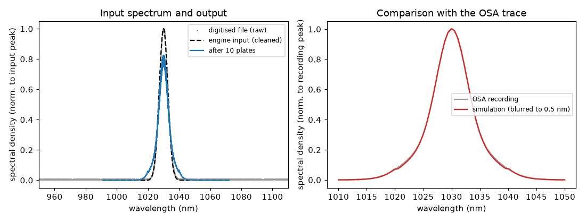

# Nonlinear ellipse rotation, driven by a digitised spectrum

Ten 3 mm fused-silica plates rotate the polarisation ellipse of a digitised 1030 nm pulse (ellipticity 0.3, 3 µJ, B = 1.39 rad) by 10.23 deg, within 2 % of the analytic 10.07 deg; a simulated OSA trace after the plates agrees with the recording to 0.43 % rms.

**The story.** Elliptically polarised light rotates its ellipse in a Kerr medium (nonlinear ellipse rotation, NER). This example sends a
measured -- digitised -- 1030 nm spectrum with ellipticity 0.3 through ten 3 mm fused-silica plates and compares the rotation with
the analytic result, θ(t) = B(t) sin 2χ [(1 − fR)/3 + fR b/2] (electronic Kerr only: B sin 2χ / 3), averaged over the pulse as the
polarimeter does. It also shows what the engine does with a digitised spectrum (sorting, merging, background removal) and how a
recording after the plates is compared. The physics is in
[Nonlinear physics](../../../reference/nonlinear.md#polarisation-circular-light-and-nonlinear-ellipse-rotation).



*Left: the raw digitised file (grey dots), the cleaned input (dashed) and the output after ten plates (solid). Right: the simulated
spectrum, blurred to the OSA's resolution, on the recording. `python plot.py` draws this figure from `results/`.*

**Layout** (`plates.ufs`, `run.json`, `data/`): ten `bulk` elements of fused silica (`lengthM` = 3e-3, constant `beam` of
`radiusM` = 150e-6, AR ghosts with `frontReflectance` = `backReflectance` = 0.002). Pulse: a measured spectrum
(`data/spectrum_digitised.csv`, `background` auto, `threshold` 0.002), `energyJ` = 3e-6, polarisation `angleDeg` = 0 and
`ellipticity` = 0.3. Physics: `selfSteepening` off. Instruments: a polarimeter at the input and one at the end, and a spectrometer
`osa` (1010 to 1050 nm, step 0.1 nm) compared with `data/spectrum_osa.csv` (`resolutionM` = 0.5e-9). The run takes about 1 s; `ner.py`
(four runs) a few seconds.

**Run it** in the example folder. The two tabs run the same simulation and print the same key numbers.

=== "CLI"

    ```bash
    python make_data.py                        # optional: regenerates data/ (needs the engine built for Python)
    ultrafast run plates.ufs run.json -o results     # about 1 s
    python plot.py                             # optional: ner-measured.png from results/
    ```

    ```
      Measured spectrum: 29 row(s) were out of wavelength order (typical of digitised curves) and were sorted.
      Measured spectrum: 1 row(s) repeated a wavelength and were merged with their neighbour (intensity and phase averaged).
      Measured spectrum: background 6.618 subtracted (0.658 % of the peak, auto: median of the darker edge); values below 0.2 % of the peak set to zero.
      Satellites: the window makes room for 58.56 ps of ghost/replica delay (...); the longest delays of all 10 sources added up would need 292.8 ps. Weaker satellites may wrap around the window.
    energy 3.001E-06 J (T = 100.04 %), FWHM 260.2 fs (TL 135.7 fs), peak 1.108E+07 W, B = 1.39 rad
      measured data:
        osa                    spectrometer   chi^2 18.55      (401 points)  rms error 0.43 %
    ```

=== "Python"

    <!-- snippet -->
    ```python
    import ultrafast as uf
    from ultrafast import build as b

    system = uf.System.load("plates.ufs")          # ten 3 mm fused-silica plates with AR ghosts
    spec = b.run_spec(                             # run.json, written with the builders
        b.measured_spectrum_csv(                   # the digitised file: sorted, merged and cleaned by the engine
            "data/spectrum_digitised.csv", 3e-6, background="auto", threshold=0.002,
            polarization={"angleDeg": 0, "ellipticity": 0.3},
        ),
        name="ner",
        physics=b.physics(selfSteepening=False),
        instruments=[
            b.instrument("polarimeter", name="pol_in", at="input"),
            b.instrument("polarimeter", name="pol_out"),
            b.instrument("spectrometer", name="osa", axis=b.axis(start=1010e-9, stop=1050e-9, step=0.1e-9),
                         measured=b.measured("data/spectrum_osa.csv", background="auto", resolution_m=0.5e-9)),
        ],
    )
    res = uf.run(system, spec)
    res.write("results")                           # python plot.py draws the figure from these files
    for note in res.summary["notes"]:
        if note.startswith("Measured spectrum"):
            print("  " + note)
    out, tot = res.summary["output"], res.summary["totals"]
    print(f"energy {out['energyJ']:.4G} J (T = {100 * tot['energyTransmission']:.2f} %), FWHM {out['fwhmS'] * 1e15:.4G} fs "
          f"(TL {out['transformLimitFwhmS'] * 1e15:.4G} fs), peak {out['peakPowerW']:.4G} W, B = {tot['bIntegralRad']:.3G} rad")
    print(f"  input transform limit {res.summary['input']['transformLimitFwhmS'] * 1e15:.0f} fs; "
          f"ellipse azimuth after the plates {abs(res.instrument('pol_out')['azimuthDeg']):.2f} deg")
    cmp = res.summary["comparisons"][0]
    print(f"  measured data: {cmp['instrument']}, chi^2 {cmp['chi2']:.2f} ({cmp['points']} points), rms error {100 * cmp['rmsError']:.2f} %")
    ```

    ```
      Measured spectrum: 29 row(s) were out of wavelength order (typical of digitised curves) and were sorted.
      Measured spectrum: 1 row(s) repeated a wavelength and were merged with their neighbour (intensity and phase averaged).
      Measured spectrum: background 6.618 subtracted (0.658 % of the peak, auto: median of the darker edge); values below 0.2 % of the peak set to zero.
    energy 3.001E-06 J (T = 100.04 %), FWHM 260.2 fs (TL 135.7 fs), peak 1.108E+07 W, B = 1.39 rad
      input transform limit 249 fs; ellipse azimuth after the plates 10.23 deg
      measured data: osa, chi^2 18.55 (401 points), rms error 0.43 %
    ```

The full script runs four simulations (linear light for B, then elliptical light with the Raman response anisotropic, isotropic and
off) and compares the rotation with the analytic value:

```bash
python ner.py                              # a few seconds: rotation vs analytic
```

```
B-integral of linear light: 1.525 rad; ellipse angle chi = 16.70 deg

Raman response                      azimuth (deg)   analytic
anisotropic, b = 0.25 (default)             10.23      10.07
isotropic, b = 0                             9.45       9.31
off (electronic Kerr only)                  11.53      11.34
```

**What it shows.**

* **The digitised spectrum.** `data/spectrum_digitised.csv` is what a digitiser hands over: 950 to 1110 nm, a flat floor of 0.66 % of the
  peak, 29 rows out of wavelength order, one repeated wavelength and a little noise. The three "Measured spectrum" lines above are what
  the engine did. Without `background` the run warns about the floor, and the floor spreads light over the whole 160 nm: the
  transform-limited FWHM of the input drops from 249 fs to 26 fs (a sharp spike on a weak background), and the reported B-integral
  doubles (3.07 rad instead of 1.39). A repeated wavelength used to turn every result into NaN; it is now merged. See
  [Measured data](../../../reference/measured-data.md#measured-input-spectra).
* **The window.** Each plate has AR-coated faces (0.2 % per face), so each makes a ghost of 4e-6 about 29 ps behind the pulse. The window
  makes room for the satellites that reach `grid.satelliteLevel` (1e-8) -- the ten coincident single ghosts add up to 4e-4, double
  ghosts stay far below -- instead of every order of every plate (58.56 ps instead of 292.8 ps).
* **The rotation.** The engine is within 2 % of the analytic value in all three cases; the small common excess comes from the pulse
  shape after cleaning and the plates' dispersion. The anisotropic part of the fused-silica Raman response (b = 0.25, Hellwarth) adds
  8 % to the rotation compared with an isotropic Raman response; switching Raman off gives the largest rotation because all of the
  nonlinearity is then electronic.
* **The recording after the plates.** `data/spectrum_osa.csv` is an OSA trace after the plates: 0.5 nm resolution, 1010 to 1050 nm only,
  a dark level of 40 counts and noise. The simulated spectrometer is ideal; the comparison blurs it to the recording's resolution,
  compares only where both have readings and removes the dark level from the darker edge (chi² 18.55 over 401 points, rms error 0.43 %,
  the noise of the recording). In the figure, the grey dots are the raw digitised file: the flat floor is visible over the whole 160 nm
  range, and the engine input (dashed) is the same spectrum after the floor was removed. After the ten plates (solid) the peak is lower
  and the wings are broader, as SPM spreads the spectrum. On the right the simulated spectrum lies on top of the recording, including
  the shoulders at about 1020 nm and 1040 nm that come from the shape of the measured input. Because the input is the measurement
  itself, this agreement tests the Kerr and dispersion model, not the input. `ultrafast-plot results` draws the comparison in
  `measurements.png`.

**Limits.** A constant beam (plane-wave NER): no Kerr lensing and no spatial effects; the analytic formula assumes a Gaussian pulse
shape and ignores dispersion. The digitised input has no phase (flat phase assumed). Related: [spatial Kerr](../spatial-kerr/README.md),
[Measured data](../../../reference/measured-data.md).
