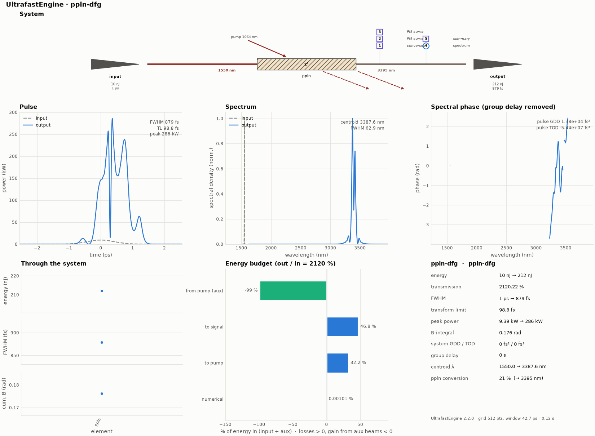

# Mid-IR difference-frequency generation in MgO:PPLN

A 1064 nm pump (1 µJ, 1 ps) and a 1550 nm signal (10 nJ) generate 212 nJ of 3.39 µm idler in 5 mm of periodically poled MgO:LiNbO3 (type 0, d33, QPM period 30.6 µm), with 68 % of the pump depleted.

**The story.** Difference-frequency generation turns a strong near-infrared pump and a weak signal into a mid-infrared idler: the photon
energies satisfy 1/λ_idler = 1/λ_pump − 1/λ_signal, which gives 3.39 µm for 1064 nm and 1550 nm. Quasi-phase-matching (QPM) in a poled
crystal compensates the phase mismatch with a grating of period 2π/Δk; the engine solves the period for the nominal wavelengths. The
crystal element follows **one main beam**: `"output": "idler"` makes the mid-IR the main beam from here on, and the signal and pump are
kept as by-products. The result is checked against [pyNLO](https://github.com/pyNLO/PyNLO) (see below): idler, signal and pump energies
agree to about 0.1 %.



*The overview figure of this example's run (`python make_figures.py` redraws it; the file is `hero.png`).*

**Layout** (`dfg.ufs`, `run.json`): one `crystal` element, `MgO:LiNbO3`, `temperatureC` = 24.5, `lengthM` = 5e-3, `interaction` `dfg` with
`qpm` model `averaged`, Gaussian `beam` of `w0M` = 100e-6, an `aux` pump (Gaussian, `centerWavelengthM` = 1.064e-6, `durationFwhmS` =
1e-12, `energyJ` = 1e-6), `mainRole` signal, `output` idler, `record` signal and pump, `spectralMargin` = 5. Pulse (the signal): Gaussian,
`centerWavelengthM` = 1.55e-6, `durationFwhmS` = 1e-12, `energyJ` = 10e-9. Instruments: `conversion`, two `phaseMatchingCurve` (`period_tuning`
with `rangeM` = 0.4e-6, `temperature_tuning` with `rangeK` = 200), a spectrometer and the pulse summary. About 0.2 s.

**Run it** in the example folder. The two tabs run the same simulation and print the same key numbers.

=== "CLI"

    ```bash
    ultrafast run dfg.ufs run.json -o results     # about 0.2 s
    ```

    ```
    energy 2.12E-07 J (T = 2,120.22 %), FWHM 879.1 fs (TL 98.81 fs), peak 2.86E+05 W, B = 0.176 rad
    ```

=== "Python"

    <!-- snippet -->
    ```python
    import ultrafast as uf
    from ultrafast import build as b

    system = uf.System.load("dfg.ufs")             # 5 mm MgO:PPLN, the 1064 nm pump is the aux beam of the crystal
    spec = b.run_spec(                             # run.json, written with the builders (the pulse is the 1550 nm signal)
        b.pulse(1.55e-6, 1e-12, energy=10e-9),
        name="ppln-dfg",
        probes="all",
        instruments=[
            b.instrument("conversion", at="ppln"),
            b.instrument("phaseMatchingCurve", name="period_tuning", at="ppln", scan="period", rangeM=0.4e-6),
            b.instrument("phaseMatchingCurve", name="temperature_tuning", at="ppln", scan="temperature", rangeK=200),
            b.instrument("spectrometer"),
            b.instrument("pulseSummary"),
        ],
    )
    res = uf.run(system, spec)
    res.write("results")
    out, tot = res.summary["output"], res.summary["totals"]
    print(f"energy {out['energyJ']:.4G} J (T = {100 * tot['energyTransmission']:,.2f} %), FWHM {out['fwhmS'] * 1e15:.4G} fs "
          f"(TL {out['transformLimitFwhmS'] * 1e15:.4G} fs), peak {out['peakPowerW']:.4G} W, B = {tot['bIntegralRad']:.3G} rad")
    v = res.elements()[0]["values"]
    conv = res.instrument("conversion_ppln")
    print(f"  QPM period {v['qpmPeriodM'] * 1e6:.1f} um, deff {abs(v['deffPmPerV']):.1f} pm/V, idler {out['centroidWavelengthM'] * 1e6:.2f} um "
          f"{v['energy_idler_J'] * 1e9:.0f} nJ, pump left {v['energy_pump_J'] * 1e9:.0f} nJ "
          f"({100 * (1 - conv['pumpEnergyJ'] / 1e-6):.0f} % depleted)")
    print(f"  acceptance: period {res.instrument('period_tuning')['fwhm'] * 1e6:.2f} um, "
          f"temperature {res.instrument('temperature_tuning')['fwhm']:.0f} K (FWHM)")
    ```

    ```
    energy 2.12E-07 J (T = 2,120.22 %), FWHM 879.1 fs (TL 98.81 fs), peak 2.86E+05 W, B = 0.176 rad
      QPM period 30.6 um, deff 15.9 pm/V, idler 3.39 um 212 nJ, pump left 325 nJ (68 % depleted)
      acceptance: period 0.17 um, temperature 52 K (FWHM)
    ```

**What it shows.**

* The QPM period is solved for the nominal wavelengths (30.6 µm at 24.5 °C) unless `"periodM"` is given. `"model": "averaged"`
  (default) uses deff × 2/π with the grating phase; `"domains"` flips the sign of d domain by domain (the integrator lands on every
  domain wall): slower, and it captures the higher QPM orders.
* The pump is 68 % depleted. Back-conversion with group-velocity mismatch carves sharp features into all three pulses and broadens
  their spectra, so the crystal is given `"spectralMargin": 5` (internal window 5 times the input bandwidth instead of 2.5 times). If a
  crystal's spectra reach the edge of its internal window, the engine absorbs that part, books it as "numerical" in the energy budget
  and warns once it exceeds 0.1 %: the cue to raise the margin. The idler pulse has two peaks (FWHM 879 fs spanning both), a
  consequence of the group-velocity walk-off; the warning of the run says so.
* Instruments: `period_tuning` (QPM period acceptance, 0.17 µm FWHM), `temperature_tuning` (the MgO:LN Sellmeier is temperature
  dependent: 52 K FWHM here), `conversion`. The "T = 2,120 %" is energy out over energy in of the main beam: the idler (212 nJ) is
  made mostly from the pump, not from the 10 nJ signal.

**Cross-check against pyNLO.** `compare_pynlo.py` runs the same DFG in pyNLO and in the engine (with pyNLO's plane-wave coupling and
domain-resolved poling) and plots the idler spectra:

```bash
python python/tools/get_pynlo.py           # once: clones the pinned pyNLO into python/third_party/pynlo
PYNLO_SRC=$(pwd)/python/third_party/pynlo/src python docs/examples/Nonlinear/ppln-dfg/compare_pynlo.py
```

For the default case (0.5 µJ pump, 3 mm) idler, signal and pump energies agree to about 0.1 % and the spectra overlay
(`pynlo_comparison.png`); `compare_pynlo.py 2e-6 5e-3` (signal gain about 50, 35 % pump depletion) agrees to 0.1-0.5 %. The automated
version is `python/tests/test_pynlo_dfg.py`.

**Limits.** The beams are Gaussian overlaps of three modes (a plane-wave estimate is `"overlap": "planeWave"`): no transverse
resolution, no thermal effects, no photorefractive damage. The pump is an auxiliary beam of the crystal, not a second input of the
system. Related: [SHG in LBO](../../LaserSystems/shg-lbo/README.md), [Crystals](../../../reference/crystals.md).
