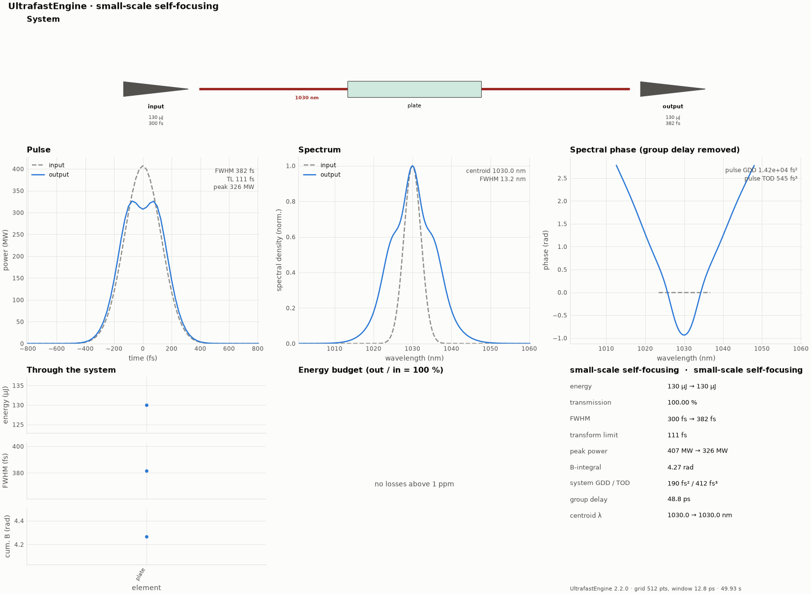

# Small-scale self-focusing in a 2-D plate

A 300 fs, 130 µJ pulse crosses 10 mm of fused silica in a flat-top beam of radius 0.3 mm at 96.5 times the critical power; 1 % seeded noise grows 3.13 times in the plate (B = 4.27 rad) and is not yet saturated.

**The story.** A beam far above the critical power for self-focusing does not collapse as a whole: noise on its profile grows first, because a
ripple of the right period is amplified by the Kerr effect (Bespalov-Talanov). Here the pulse carries 3.3e8 W, about 100 times the
critical power. A 1 % random amplitude noise with a 40 µm correlation length seeds the break-up, and the beam is propagated in 2-D
(x, y) on a 128 x 128 grid over 4 beam radii ([Small-scale self-focusing](../../../reference/transverse.md#small-scale-self-focusing)).
The growth law is checked against the Bespalov-Talanov result, cosh(Delta L), by a test to 6 % (see **Things to try**).



*The overview figure of this example's run (`python make_figures.py` redraws it; the file is `hero.png`).*

**Layout** (`plate.ufs`, `run.json`): one `bulk` element of fused silica, `lengthM` = 10e-3, a Gaussian `beam` of `w0M` = 0.3e-3, and
`transverse` `cartesian` with `nx` = `ny` = 128, `halfWidthM` = 0.6e-3 and an `initialProfile` `flatTop` with `noise`
(`relativeAmplitudeRms` = 0.01, `correlationLengthM` = 40e-6, `seed` = 1). Pulse: Gaussian, `centerWavelengthM` = 1030e-9,
`durationFwhmS` = 300e-15, `energyJ` = 130e-6. Physics: `raman` and `selfSteepening` off. Grid: `n` = 256 (the planner makes N = 512).
About 1 minute on a laptop CPU.

**Run it** in the example folder. The two tabs run the same simulation and print the same key numbers.

=== "CLI"

    ```bash
    ultrafast run plate.ufs run.json -o results            # about 1 minute on a laptop CPU
    ```

    ```
    energy 0.00013 J (T = 100.00 %), FWHM 381.6 fs (TL 111 fs), peak 3.263E+08 W, B = 4.27 rad
    ```

=== "Python"

    <!-- snippet -->
    ```python
    import ultrafast as uf
    from ultrafast import build as b

    system = uf.System.load("plate.ufs")           # 10 mm of fused silica, 128 x 128 transverse grid, noisy flat-top beam
    spec = b.run_spec(                             # run.json, written with the builders
        b.pulse(1030e-9, 300e-15, energy=130e-6),
        name="small-scale self-focusing",
        grid=b.grid(n=256),
        fidelity="full",                           # the default; quick would collapse the 2-D model and drop the diagnostics
        physics=b.physics(raman=False, selfSteepening=False),
    )
    res = uf.run(system, spec)
    res.write("results")
    out, tot = res.summary["output"], res.summary["totals"]
    print(f"energy {out['energyJ']:.4G} J (T = {100 * tot['energyTransmission']:.2f} %), FWHM {out['fwhmS'] * 1e15:.4G} fs "
          f"(TL {out['transformLimitFwhmS'] * 1e15:.4G} fs), peak {out['peakPowerW']:.4G} W, B = {tot['bIntegralRad']:.3G} rad")
    v = res.elements()[0]["values"]
    print(f"  P/Pcr {v['peakPowerOverCritical']:.1f}, fluence contrast {v['fluenceContrastIn']:.4f} -> {v['fluenceContrastOut']:.4f}, "
          f"small-scale gain {v['smallScaleGain']:.2f}")
    ```

    ```
    energy 0.00013 J (T = 100.00 %), FWHM 381.6 fs (TL 111 fs), peak 3.263E+08 W, B = 4.27 rad
      P/Pcr 96.5, fluence contrast 0.0148 -> 0.0465, small-scale gain 3.13
    ```

**What it shows.** `summary.json` -> `elements[0].values` (the small-scale diagnostics):

| key | value | meaning |
|---|---|---|
| `peakPowerOverCritical` | 96.5 | peak power / P_cr, `P_cr = 3.77 lambda^2 / (8 pi n0 n2)` |
| `fluenceContrastIn` | 0.0148 | rms / mean of the fluence over the beam core (about twice the 1 % amplitude noise; the core holds only a few correlation cells) |
| `fluenceContrastOut` | 0.0465 | the same after the plate |
| `smallScaleGain` | 3.13 | their ratio: the noise has grown 3.1 x in 10 mm (B = 4.3 rad) and is not yet saturated |

The arrays `el_plate_x_m`, `el_plate_fluence_in_x` and `el_plate_fluence_out_x` in `results/result.npz` hold the fluence along y = 0.

**Limits.** The model is 2-D in space with one carrier: no filament plasma and no Raman here (both are switched off), and the result
depends on the noise realisation (`seed`) and the grid. Resolution: the grid must resolve the most unstable ripple (86 µm here; 128
points over 1.2 mm give 9.4 µm steps, 9 samples per period) and the correlation length of the seed. See
[Transverse](../../../reference/transverse.md) and [spatial Kerr](../spatial-kerr/README.md).

Things to try:

* **The textbook seed.** Replace `noise` by `"ripple": {"periodM": 86e-6, "relativeAmplitude": 0.01}`: one ripple at the most unstable period
  `2 pi / sqrt(2 k Delta)` (`Delta = k0 n2 I`) grows as `cosh(Delta L)` -- the Bespalov-Talanov test checks this growth law to 6 %.
* **Resolution.** Run 64 x 64 and 256 x 256 for your beam and check that `smallScaleGain` has converged; 256 x 256 needs 4 x the memory
  and about 4 x the time of 128 x 128 (not run here).
* **Longer pulses and the GPU.** `"compute": {"backend": "auto"}` runs the 2-D steps on a CUDA / OpenCL device ([GPU plugin](../../../plugins/gpu.md)); the time
  window of 12.8 ps (N = 512) is what the pulse needs, not 2^13 points.
* **More plates.** Chain several `bulk` elements: the profile travels with the beam ([Transverse](../../../reference/transverse.md#the-profile-travels-with-the-beam)).
