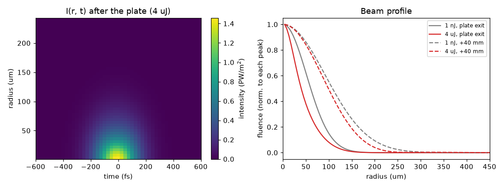

# Self-focusing in a glass plate (spatial model)

A 4 µJ, 300 fs pulse at 1030 nm (about 3 times the critical power) crosses 10 mm of fused silica with a 100 µm collimated beam; the Kerr lens shrinks the beam to 97.4 µm against 102.5 µm without it, the wavefront curves to R = -70 mm and the pulse on axis is 234 fs against 327 fs in the wings.

**The story.** The plate has a radial (Hankel) transverse model, so diffraction, the radially varying Kerr phase and the coupling between
space and time are all resolved. The Kerr effect acts as a weak positive lens, because the centre of the beam has the highest intensity
and so the highest index. The transverse profile travels with the beam: the free-space steps (also radial) carry it exactly and show the
Kerr focus and the divergence after it. The check is the linear run at 1 nJ: its beam radii (102.5 µm after the plate and 183.4 µm after
40 mm) are those of Gaussian optics (102.5 and 183).



*`python plot.py` draws this figure from `results-run/` and `results-run-linear/`. The left panel is the intensity after the plate as a
function of radius and time, a quantity no single camera measures: the pulse is strongest and shortest on the axis and weaker and longer
in the wings, because the Kerr phase follows the local intensity. The right panel compares the beam at 1 nJ (grey, no Kerr effect) and
at 4 µJ (red).*

**Layout** (`kerr.ufs`, `run.json`, `run-linear.json`): a `bulk` plate of fused silica (`lengthM` = 10e-3, Gaussian `beam` with `w0M` = 100e-6,
`transverse` radial with 96 points over `radiusM` = 0.45e-3), then four `gap` elements of vacuum, 10 mm each (radial, 224 points over
1.0e-3). Pulse: Gaussian, `centerWavelengthM` = 1.03e-6, `durationFwhmS` = 300e-15, `energyJ` = 4e-6 (1e-9 in `run-linear.json`).
Physics: `selfSteepening` and `raman` on. Instruments: beam profiles, near-field and far-field cameras, a wavefront sensor, a virtual
space-time map, spectrometers and autocorrelators with a `sampling` block, and the pulse summary. About 3 s for both runs.

**Run it** in the example folder. The two tabs run the same two simulations and print the same key numbers.

=== "CLI"

    ```bash
    ultrafast run kerr.ufs run.json -o results-run                  # about 3 s
    ultrafast run kerr.ufs run-linear.json -o results-run-linear    # same, at 1 nJ (no Kerr effect)
    python plot.py                                                  # optional: spatial-kerr.png
    ```

    ```
    energy 4E-06 J (T = 100.00 %), FWHM 313.1 fs (TL 199.1 fs), peak 1.226E+07 W, B = 1.55 rad
    energy 1E-09 J (T = 100.00 %), FWHM 300 fs (TL 300 fs), peak 3131 W, B = 0.000308 rad
    ```

=== "Python"

    <!-- snippet -->
    ```python
    import ultrafast as uf
    from ultrafast import build as b

    system = uf.System.load("kerr.ufs")            # 10 mm of fused silica (radial model), then 4 x 10 mm of free space
    near = b.sampling("near", "pinhole", radius_m=15e-6)


    def run_spec(name, energy):
        return b.run_spec(                         # run.json (4 uJ) and run-linear.json (1 nJ), written with the builders
            b.pulse(1.03e-6, 300e-15, energy=energy),
            name=name,
            physics=b.physics(selfSteepening=True, raman=True),
            probes="all",
            instruments=[
                b.instrument("beamProfile", name="after_plate", at="plate"),
                b.instrument("beamProfile", name="after_gap", at="free4"),
                b.instrument("camera", name="nf_plate", at="plate", pixels=200),
                b.instrument("wavefrontSensor", name="wfs_plate", at="plate"),
                b.instrument("camera", name="ff_plate", at="plate", imaging={"plane": "far", "focalLengthM": 0.5}),
                b.instrument("spaceTime", name="space_time_plate", at="plate"),
                b.instrument("camera", name="nf_end", at="free4", pixels=200, bitDepth=12),
                b.instrument("spectrometer"),
                b.instrument("pulseSummary"),
                # where the instrument looks: the whole beam, a pinhole on axis or in the wings, a fibre in the far field, a slit
                b.instrument("spectrometer", name="spec_whole", at="plate"),
                b.instrument("spectrometer", name="spec_nf_axis", at="plate", sampling=near),
                b.instrument("spectrometer", name="spec_nf_wing", at="plate", sampling=b.sampling("near", "pinhole", radius_m=15e-6, center_x_m=100e-6)),
                b.instrument("spectrometer", name="spec_ff_fibre", at="plate",
                             sampling=b.sampling("far", "fibre", radius_m=25e-6, focal_length_m=0.2, na=0.22)),
                b.instrument("autocorrelator", name="ac_whole", at="plate"),
                b.instrument("autocorrelator", name="ac_nf_axis", at="plate", sampling=near),
                b.instrument("autocorrelator", name="ac_nf_slit", at="plate", sampling=b.sampling("near", "slit", width_m=20e-6)),
            ],
        )


    for label, name, energy, folder in (("4 uJ", "spatial-kerr", 4e-6, "results-run"), ("1 nJ", "spatial-kerr-linear", 1e-9, "results-run-linear")):
        res = uf.run(system, run_spec(name, energy))
        res.write(folder)                          # python plot.py draws the figure from results-run/ and results-run-linear/
        out, tot = res.summary["output"], res.summary["totals"]
        print(f"energy {out['energyJ']:.4G} J (T = {100 * tot['energyTransmission']:.2f} %), FWHM {out['fwhmS'] * 1e15:.4G} fs "
              f"(TL {out['transformLimitFwhmS'] * 1e15:.4G} fs), peak {out['peakPowerW']:.4G} W, B = {tot['bIntegralRad']:.3G} rad")
        radii = [e["beam"]["radiusXM"] * 1e6 for e in res.elements()]
        wfs, ff, st = res.instrument("wfs_plate"), res.instrument("ff_plate"), res.instrument("space_time_plate")
        print(f"  {label}: beam radius after each element (um) " + ", ".join(f"{r:.1f}" for r in radii) +
              f"; M2 {res.elements()[-1]['beam']['m2']:.2f}")
        print(f"  {label}: wavefront R = {wfs['radiusOfCurvatureM'] * 1e3:+.0f} mm, {wfs['rmsWithoutDefocusWaves']:.2g} waves rms beyond defocus; "
              f"far-field half-angle {ff['divergenceHalfAngleXRad'] * 1e3:.2f} mrad; "
              f"FWHM on axis / at r = w {st['onAxisFwhmS'] * 1e15:.0f} / {st['fwhmAtRadiusS'] * 1e15:.0f} fs")
        if label == "4 uJ":
            for n in ("spec_whole", "spec_nf_axis", "spec_nf_wing", "spec_ff_fibre"):
                v = res.instrument(n)
                print(f"  {n}: {100 * v.get('samplingTransmission', 1):.2f} % transmitted, spectral FWHM {v['fwhmM'] * 1e9:.2f} nm, "
                      f"rms {v['rmsWidthM'] * 1e9:.2f} nm")
            for n in ("ac_whole", "ac_nf_axis", "ac_nf_slit"):
                v = res.instrument(n)
                print(f"  {n}: {100 * v.get('samplingTransmission', 1):.1f} % transmitted, AC FWHM {v['acFwhmS'] * 1e15:.0f} fs")
    ```

    ```
    energy 4E-06 J (T = 100.00 %), FWHM 313.1 fs (TL 199.1 fs), peak 1.226E+07 W, B = 1.55 rad
      4 uJ: beam radius after each element (um) 97.4, 97.9, 113.1, 138.2, 168.8; M2 1.08
      4 uJ: wavefront R = -70 mm, 0.0083 waves rms beyond defocus; far-field half-angle 3.80 mrad; FWHM on axis / at r = w 234 / 327 fs
      spec_whole: 100.00 % transmitted, spectral FWHM 5.34 nm, rms 2.72 nm
      spec_nf_axis: 6.38 % transmitted, spectral FWHM 6.17 nm, rms 3.64 nm
      spec_nf_wing: 0.55 % transmitted, spectral FWHM 5.09 nm, rms 2.16 nm
      spec_ff_fibre: 0.28 % transmitted, spectral FWHM 5.19 nm, rms 2.34 nm
      ac_whole: 100.0 % transmitted, AC FWHM 416 fs
      ac_nf_axis: 6.4 % transmitted, AC FWHM 365 fs
      ac_nf_slit: 18.0 % transmitted, AC FWHM 409 fs
    energy 1E-09 J (T = 100.00 %), FWHM 300 fs (TL 300 fs), peak 3131 W, B = 0.000308 rad
      1 nJ: beam radius after each element (um) 102.5, 114.3, 133.3, 156.9, 183.4; M2 1.00
      1 nJ: wavefront R = +142 mm, 8.5e-06 waves rms beyond defocus; far-field half-angle 3.28 mrad; FWHM on axis / at r = w 300 / 300 fs
    ```

Spatial runs gain most from a GPU: `ultrafast run kerr.ufs run.json --backend auto` puts the radial elements on the device when one is
found ([GPU](../../../plugins/gpu.md)).

**What it shows.** Beam radius (1/e², second moment, energy-weighted over the spectrum) after each element:

| element | linear (1 nJ) | 4 µJ |
|---|---|---|
| plate (10 mm) | 102.5 µm (Gaussian optics: 102.5) | 97.4 µm, converging (wavefront R = -70 mm) |
| + 10 mm | 114.3 µm | 97.9 µm (just past the Kerr focus) |
| + 20 mm | 133.3 µm | 113.1 µm |
| + 30 mm | 156.9 µm | 138.2 µm |
| + 40 mm | 183.4 µm (Gaussian optics: 183) | 168.8 µm |

Diagnostics after the plate (instruments 3 to 6 on the system diagram):

| | linear | 4 µJ |
|---|---|---|
| wavefront sensor: radius of curvature | +142 mm (diverging; = R inside the glass / n) | -70 mm (the Kerr lens makes it converge) |
| wavefront beyond defocus (mostly spherical) | 9e-6 waves rms | 0.0083 waves rms |
| far field (f = 0.5 m): divergence half-angle | 3.28 mrad | 3.80 mrad |
| space-time (virtual): FWHM on axis / at r = w | 300 / 300 fs | 234 / 327 fs |

The space-time map shows what no single camera or autocorrelator can: the centre of the beam is compressed (SPM plus self-steepening on
axis) while the wings are not. The intense beam is narrower at the plate exit (97.4 µm against 102.5 µm) and, after 40 mm of free
space, still narrower than the linear beam (168.8 µm against 183.4 µm), since it has been focused and has begun to diverge again from a
smaller spot.

**Where the instrument looks: near field, far field, apertures.** A real spectrometer or autocorrelator rarely sees the whole beam: it
looks through a fibre, a pinhole or a slit, often in the focal plane of a lens. With spatio-temporal coupling the answer depends on
where. The run adds spectrometers and autocorrelators with a `"sampling"` block (see
[instruments](../../../reference/instruments.md#sampling-where-the-instrument-looks)):

| instrument (after the plate) | sampling | transmitted | spectral FWHM / rms width | AC FWHM |
|---|---|---|---|---|
| `spec_whole`, `ac_whole` | whole beam (default) | 100 % | 5.34 / 2.72 nm | 416 fs |
| `spec_nf_axis`, `ac_nf_axis` | near field, pinhole r = 15 µm on axis | 6.4 % | 6.17 / 3.64 nm | 365 fs |
| `spec_nf_wing` | near field, pinhole r = 15 µm at x = 100 µm | 0.55 % | 5.09 / 2.16 nm | |
| `spec_ff_fibre` | far field (f = 0.2 m), fibre r = 25 µm, NA 0.22 | 0.28 % | 5.19 / 2.34 nm | |
| `ac_nf_slit` | near field, 20 µm slit through the centre | 18.0 % | | 409 fs |

The centre of the beam has the most SPM (broadest spectrum, shortest pulse); the wings have almost none. The fibre in the far field
mostly collects the low spatial frequencies, which are dominated by the large, weakly broadened part of the beam. A slit averages over a
line, so it sits between the pinhole and the whole beam.

Also in `summary.json`: `elements[*].beam` (radius and M² after each element: M² grows from 1.00 to 1.08, because the Kerr lens is not
parabolic across the beam); `after_plate` and `after_gap` (fluence against radius, true peak fluence); `nf_plate` and `nf_end` (near-field
cameras, the second one a 12-bit sensor), `ff_plate` (far field in the focal plane of an f = 0.5 m lens), `wfs_plate` (wavefront and
Zernike terms), `space_time_plate` (virtual: I(r, t)). The B-integral is 1.55 rad (on axis) and the transform limit of the pulse drops
from 300 fs to 199 fs (`pulseSummary`). `energyBudget`: free-space propagation is exactly energy conserving (the only entry is Raman and
solver error in the plate, 1e-5 of the input). The engine warns if more than 0.01 % of the energy sits near the edge of a transverse
grid; enlarge `radiusM` (keeping the point spacing) if it does.

**Limits.** The radial model is rotationally symmetric: no astigmatism, no walk-off, no filament plasma, and one carrier. The same plate
without `"transverse"` runs in 1-D (much faster) and warns that the peak power is above the critical power: this example is what that
warning points to. Related: [Small-scale self-focusing](../small-scale-self-focusing/README.md), [transverse reference](../../../reference/transverse.md).
