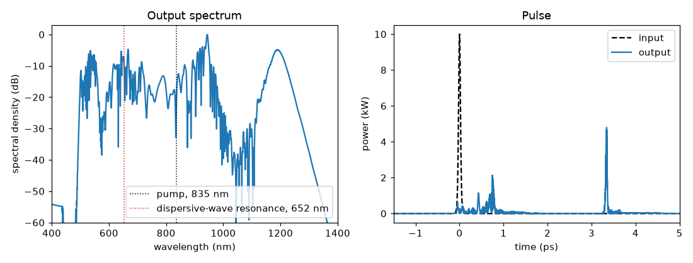

# Supercontinuum in a photonic-crystal fibre

The benchmark of Dudley, Genty and Coen (Rev. Mod. Phys. 78, 1135 (2006), Fig. 3): a 50 fs, 10 kW sech pulse at 835 nm breaks up into solitons in 15 cm of photonic-crystal fibre (soliton number 8.65), the spectrum spans 492 to 1307 nm at -40 dB and the mean coherence over six noise realisations is 0.98.

**The story.** A short pulse launched close to the zero-dispersion wavelength of a photonic-crystal fibre (PCF) first compresses by
higher-order soliton compression and then splits (soliton fission) into several fundamental solitons; Raman scattering shifts them to
the red, and each ejects a dispersive wave on the blue side. The standard benchmark of fibre supercontinuum codes is Fig. 3 of Dudley
et al.: soliton number N = 8.65, dispersion length L_D = 6.8 cm, nonlinear length L_NL = 0.9 mm, fission length about 8 mm and a
dispersive-wave resonance at 652 nm, all of which the engine reports. The coherence follows the paper's discussion of noise: a 50 fs pump
gives a coherent supercontinuum, a 150 fs pump (N about 26) a noise-seeded, incoherent one.



*`python plot.py` draws this figure from `results/`. The 50 fs pulse (dashed, right) has a soliton number of 8.65, so it first compresses
and then breaks up after about 8 mm into several short solitons. The spectrum (left) shows a dispersive wave on the blue side near the
predicted 652 nm resonance and the Raman-shifted fundamental soliton on the red side; in time, that soliton has slowed down and arrives
about 3.3 ps after the others, because red light travels slower in this fibre.*

**Layout** (`pcf.ufs`, `run.json`, `run-noise.json`, `coherence.json`): one `fiber` element, `lengthM` = 0.15, `gamma` = 0.11,
`raman` silica (Blow-Wood, fR = 0.18), `referenceWavelengthM` = 835e-9 and `betasPsKm` from beta2 = -11.83 ps²/km to beta10 (zero
dispersion near 780 nm). Pulse: sech², `centerWavelengthM` = 835e-9, `durationFwhmS` = 50e-15, `peakPowerW` = 10e3. Grid: explicit, `n` =
16384 over `windowS` = 12.5e-12 (`run-noise.json`: `n` = 8192), `stepper` `tolerance` 1e-6. Instruments: a spectrometer (400 to 1400 nm,
4000 points, dB) and the pulse summary. The single run takes about 6 s; the coherence study (6 noise realisations in parallel) about 10 s.

With an NVIDIA or OpenCL GPU, add `--backend auto` (or `"compute": {"backend": "auto"}`): the fibre runs on the device with the same
result ([GPU](../../../plugins/gpu.md)). Installing FFTW (Windows / Linux) speeds up the CPU run.

**Run it** in the example folder. The two tabs run the same simulations and print the same key numbers.

=== "CLI"

    ```bash
    ultrafast run pcf.ufs run.json -o results                 # about 6 s
    ultrafast study coherence.json -o coherence-results       # 6 runs with quantum noise, about 10 s
    python plot.py                                            # optional: supercontinuum.png from results/
    ```

    ```
    energy 5.165E-10 J (T = 91.05 %), FWHM 33.55 fs (TL 2.347 fs), peak ... W, B = 118 rad
    ```

=== "Python"

    <!-- snippet -->
    ```python
    import numpy as np
    import ultrafast as uf
    from ultrafast import build as b

    system = uf.System.load("pcf.ufs")             # 15 cm of PCF, beta2 to beta10, gamma = 0.11 /(W m), Blow-Wood Raman
    grid = b.grid(n=16384, window_s=12.5e-12, auto=False)
    spec = b.run_spec(                             # run.json, written with the builders
        b.pulse(835e-9, 50e-15, shape="sech2", peak_power_w=10e3),
        name="pcf-supercontinuum",
        grid=grid,
        stepper={"tolerance": 1e-6},
        instruments=[
            b.instrument("spectrometer", name="spectrum", rangeM=[400e-9, 1400e-9], points=4000, db=True),
            b.instrument("pulseSummary"),
        ],
    )
    res = uf.run(system, spec)
    res.write("results")                           # python plot.py draws the figure from these files
    out, tot = res.summary["output"], res.summary["totals"]
    print(f"energy {out['energyJ']:.4G} J (T = {100 * tot['energyTransmission']:.2f} %), FWHM {out['fwhmS'] * 1e15:.4G} fs "
          f"(TL {out['transformLimitFwhmS'] * 1e15:.4G} fs), peak {out['peakPowerW']:.4G} W, B = {tot['bIntegralRad']:.3G} rad")
    v = res.elements()[0]["values"]
    print(f"  soliton number N = {v['solitonNumber']:.2f}, L_D = {v['dispersionLengthM'] * 100:.1f} cm, L_NL = {v['nonlinearLengthM'] * 1e3:.1f} mm, "
          f"fission {v['fissionLengthM'] * 1e3:.1f} mm, dispersive wave {v['dispersiveWaveWavelengthM'] * 1e9:.0f} nm")
    sp = res.instrument("spectrum")
    wl, db = np.asarray(sp["wavelength_m"]), np.asarray(sp["spectrum_db"])
    t, p = np.asarray(res.arrays["output_time_s"]), np.asarray(res.arrays["output_power_w"])
    print(f"  spectrum above -40 dB: {wl[db > -40].min() * 1e9:.0f} to {wl[db > -40].max() * 1e9:.0f} nm; "
          f"Raman soliton arrives {t[np.argmax(p)] * 1e12:.2f} ps after the pump pulse")

    # coherence over six one-photon-per-mode noise realisations (coherence.json + run-noise.json), for 50 fs and 150 fs pumps
    for fwhm in (50e-15, 150e-15):
        noisy = b.run_spec(
            b.pulse(835e-9, fwhm, shape="sech2", peak_power_w=10e3, noise={"kind": "onePhotonPerMode"}),
            name="pcf-supercontinuum-noise",
            grid=b.grid(n=8192, window_s=12.5e-12, auto=False),
            stepper={"tolerance": 1e-6},
            instruments=[b.instrument("spectrometer", name="spectrum", rangeM=[400e-9, 1400e-9], points=4000, db=True)],
        )
        coh = uf.coherence(system, noisy, trials=6, parallel=6)
        print(f"  {fwhm * 1e15:.0f} fs pump: mean coherence {coh['meanCoherence']:.2f}")
    ```

    ```
    energy 5.165E-10 J (T = 91.05 %), FWHM 33.55 fs (TL 2.347 fs), peak ... W, B = 118 rad
      soliton number N = 8.65, L_D = 6.8 cm, L_NL = 0.9 mm, fission 7.9 mm, dispersive wave 652 nm
      spectrum above -40 dB: 492 to 1307 nm; Raman soliton arrives 3.34 ps after the pump pulse
      50 fs pump: mean coherence 0.98
      150 fs pump: mean coherence 0.24
    ```

**What it shows.**

* The output peak power (about 4.9 kW) is not quoted to four digits: at B = 118 rad it differs by 0.2 % between Linux and
  macOS builds (floating-point order in the FFTs), which the example check would flag; the other numbers agree to the digits shown.
* `results/summary.json` → `elements[0].values`: soliton number N = 8.65, L_D = 6.8 cm, L_NL = 0.9 mm, fission length about 8 mm,
  dispersive-wave resonance 652 nm: the numbers of the paper.
* `results/spectrum.csv` (`spectrum_db`): the spectrum spans 492 to 1307 nm at -40 dB; Raman solitons on the red side, dispersive waves
  on the blue side. The energy falls to 91.05 % because the Raman shift moves photons to the red (photon number is conserved).
* In time, the output has five separate peaks above half maximum (the run warns); the strongest, the Raman soliton, arrives 3.34 ps
  after the pump pulse (4.9 kW peak).
* `coherence-results/coherence.csv`: |g12(lambda)| over independent one-photon-per-mode noise realisations. The mean coherence is 0.98:
  a 50 fs pump gives a coherent supercontinuum, as in the paper. With a 150 fs pulse at the same peak power (N about 26) the mean
  coherence drops to 0.24: the spectrum is then seeded by noise-driven modulation instability.
* The figure: the soliton fission after about 8 mm, the dispersive wave near 652 nm and the Raman soliton near 1200 nm; the output keeps
  91.05 % of the pulse energy, the rest of the photon energy goes to the vibrations of the glass.

The explicit grid (16384 points over 12.5 ps) resolves the full spectrum; the edges of the output spectrum are 60 dB below its peak
(check `edgeEnergyFraction`, 1.1e-5 of the energy here).

**Limits.** The model is the generalised nonlinear Schrödinger equation of a single mode: no higher-order modes, no fibre loss, a
constant gamma (no dispersion of the effective area), and the Raman response is the Blow-Wood form. The noise is one photon per mode
with a fixed seed. Related: [Raman self-frequency shift](../../Fibres/raman-soliton-shift/README.md), [fibres](../../../reference/fibers.md).
