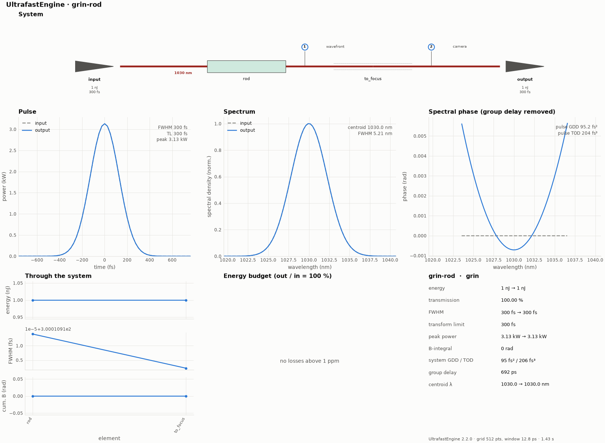

# Position-dependent material properties

A 5 mm fused-silica rod with a parabolic index profile is a thin lens of f = 0.2 m, and the engine focuses a 0.5 mm beam to 132 µm, within 1 % of the thin-lens 131 µm, whether the profile is an expression, a table or a Python function.

**The story.** `indexProfile`, `absorptionProfile` and `n2Scale` make any material property a function of position (x, y, z, r, θ).
Combined with time responses, that gives n(t, r, θ, z, I); see the
[position-dependent properties reference](../../../reference/spatial-properties.md). Here a 5 mm rod with Δn(r) = −½ n0 g² r² is a
gradient-index lens with f = 1 / (n0 g² L) = 0.2 m, so a collimated Gaussian beam of 0.5 mm waist radius focuses to
λ f / (π w0) = 131 µm at 0.2 m. The same profile is written four ways (expression, table, Python function, and a profile that tapers
along z), and each focus is checked against that thin-lens formula.



*The overview figure of this example's run (`python make_figures.py` redraws it; the file is `hero.png`).*

**Layout** (`grin.ufs`, `run.json`, `grin_variants.py`): `bulk` FusedSilica with `lengthM` = 5e-3, `nonlinear` false, a Gaussian `beam`
(`w0M` = 0.5e-3), a radial `transverse` model (96 points, `radiusM` = 2e-3) and an `indexProfile` expression `-0.5 * n0 * g2 * r^2`
(n0 = 1.45, g2 = 689.655 m⁻²); then a `gap` of vacuum with `lengthM` = 0.2 (128 points, `radiusM` = 2e-3). Pulse: Gaussian,
`centerWavelengthM` = 1.03e-6, `durationFwhmS` = 300e-15, `energyJ` = 1e-9 (linear: no nonlinear effect). Instruments: a wavefront sensor
after the rod and a camera at the focus. One run takes about 2 s; the script (four runs) about 10 s.

**Run it** in the example folder. The two tabs run the same simulation and print the same key numbers.

=== "CLI"

    ```bash
    ultrafast run grin.ufs run.json -o results     # GRIN rod written as an expression, about 2 s
    ```

    ```
    energy 1E-09 J (T = 100.00 %), FWHM 300 fs (TL 300 fs), peak 3131 W, B = 0 rad
    ```

=== "Python"

    <!-- snippet -->
    ```python
    import ultrafast as uf
    from ultrafast import build as b

    system = uf.System.load("grin.ufs")            # the GRIN rod written as an expression
    spec = b.run_spec(                             # run.json, written with the builders (typed: the editor completes every key)
        b.pulse(1.03e-6, 300e-15, energy=1e-9),
        name="grin",
        instruments=[
            b.instrument("wavefrontSensor", at="rod", name="wfs_rod"),
            b.instrument("camera", at="to_focus", name="nf_focus"),
        ],
    )
    res = uf.run(system, spec)                     # uf.run("grin.ufs", "run.json") runs the two files as they are
    res.write("results")
    out, tot = res.summary["output"], res.summary["totals"]
    print(f"  energy {out['energyJ']:.4G} J (T = {100 * tot['energyTransmission']:.2f} %), FWHM {out['fwhmS'] * 1e15:.4G} fs "
          f"(TL {out['transformLimitFwhmS'] * 1e15:.4G} fs), peak {out['peakPowerW']:.4G} W, B = {tot['bIntegralRad']:.3G} rad")
    focus = {e["id"]: e for e in res.elements()}["to_focus"]
    print(f"  beam radius at the focus: {focus['beam']['radiusXM'] * 1e6:.1f} um (thin lens: 131.1 um)")
    ```

    ```
    energy 1E-09 J (T = 100.00 %), FWHM 300 fs (TL 300 fs), peak 3131 W, B = 0 rad
    beam radius at the focus: 132.3 um (thin lens: 131.1 um)
    ```

The full script writes the same lens as an expression, a table, a Python function and a tapered profile:

```bash
python grin_variants.py         # about 10 s
python make_figures.py          # optional: hero.png
```

```
thin-lens prediction: w(f) = 131.1 um at f = 200 mm
  expression          : w =  132.3 um
  table (r)           : w =  132.3 um
  Python f(x, y, z)   : w =  132.3 um
tapered x (1 - z/L): focus expected at 2f = 400 mm with w = 262.3 um: w = 263.7 um
```

**What it shows.**

* **Focus:** 132.3 µm against the thin-lens 131.1 µm. The 1 % difference is the rod's own thickness and diffraction.
* **Three ways, one result:** the expression, the table (`"kind": "table"` over r) and the Python function (`"@grin"`, passed as
  `fields=` to `uf.run`) give the same 132.3 µm.
* **Tapered profile:** a profile that falls linearly to zero along the rod has half the mean strength, so f doubles to 0.4 m and the
  focus is 263.7 µm (expected 262.3 µm). It depends on z, so the engine evaluates it at every step along the rod.
* **Other elements:** the same keys work on gain elements (where the thermal lens is added to them) and on crystals.

**Limits.** Without a `transverse` model, absorption and n2 scaling are averaged over the beam and an index profile has no effect.
The rod is thin, so the lens is the thin-lens limit; a thick GRIN rod would also have to be checked against its ray matrix. For a
gain element with a thermal lens built from the same keys see [spatial gain and thermal lens](../spatial-gain-thermal-lens/README.md).
