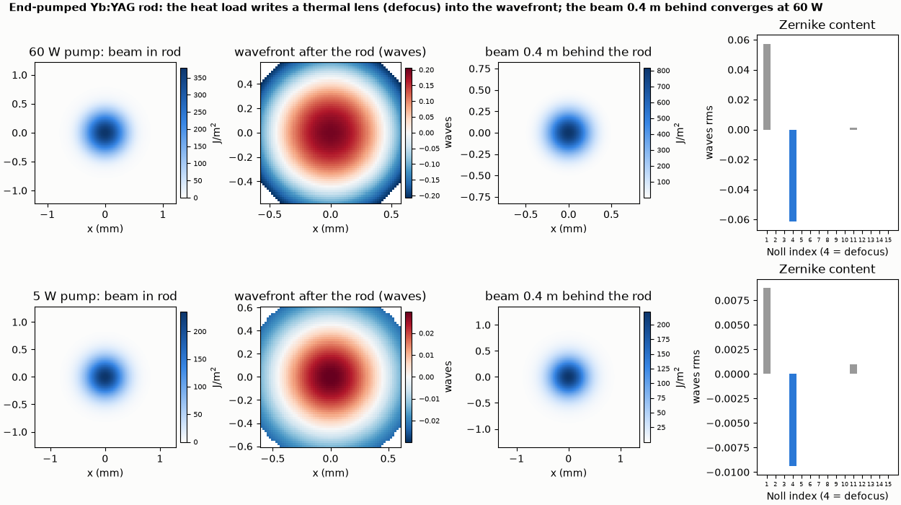

# Spatially resolved gain and the thermal lens

A 2 ps, 100 µJ pulse at 10 kHz crosses a 4 mm Yb:YAG rod end-pumped by 60 W: the heat load writes a thermal lens of f = 0.54 m into the wavefront, and the beam 0.4 m behind the rod has shrunk from 471 µm to 319 µm.

**The story.** The rod is modelled on a radial grid, so every transverse point has its own inversion and the gain and depletion follow
the pump and beam profiles. The heat load (quantum defect × absorbed pump) gives ΔT(r, z) and Δn = dn/dT·ΔT, applied as a
position-dependent index ([position-dependent properties](../../../reference/spatial-properties.md)); the parabolic part of it is the thermal
lens, f_th. The beam diffracts inside the rod and then travels 0.4 m in free space. A weak pump (5 W) shows the same rod with almost no
gain and a ten times weaker lens.



*Top row 60 W pump, bottom row 5 W. Left to right: the beam in the rod (the input is a collimated Gaussian), the wavefront it leaves
with (a parabola: the thermal lens), the beam 0.4 m behind the rod, and the Zernike content of the wavefront (the blue bar is defocus,
Noll 4). At 60 W the lens converges the beam, so the peak fluence 0.4 m behind the rod is higher than in it (colour bars); at 5 W the
lens is 10 times weaker. `python make_figures.py` runs the commands below and redraws it.*

**Layout** (`rod.ufs`, `run.json`, `run-lowpump.json`): `gain` Yb:YAG with `lengthM` = 4e-3 and `slices` = 12; `pump` `cw`, `powerW` = 60,
`wavelengthM` = 940e-9, `radiusM` = 0.6e-3, `profile` superGaussian of `order` 4, `passes` 2 (double pass); Gaussian `beam` with
`w0M` = 0.5e-3; `transverse` radial with 48 points; `thermalLens` with `rodRadiusM` = 2e-3. Then a `gap` of `lengthM` = 0.4 (96 points,
`radiusM` = 2.5e-3). Pulse: Gaussian, `centerWavelengthM` = 1.03e-6, `durationFwhmS` = 2e-12, `energyJ` = 1e-4, `repRateHz` = 10e3.
Instruments: near-field cameras in the rod and 0.4 m behind it, a wavefront sensor, a far-field camera (`imaging` far plane,
`focalLengthM` = 0.5) and a power meter. `run-lowpump.json` is the same run with a 5 W pump set by an override. Each run takes under 1 s.

**Run it** in the example folder. The two tabs run the same two simulations and print the same key numbers.

=== "CLI"

    ```bash
    ultrafast run rod.ufs run.json -o results-60W
    ultrafast run rod.ufs run-lowpump.json -o results-5W     # same system, 5 W pump (a run-spec override)
    ultrafast-plot results-60W                               # optional: figures from results-60W/
    ```

    ```
    energy 0.0001416 J (T = 141.59 %), FWHM 2044 fs (TL 1922 fs), peak 6.563E+07 W, B = 0.226 rad
    energy 9.24E-05 J (T = 92.40 %), FWHM 1987 fs (TL 1945 fs), peak 4.361E+07 W, B = 0.173 rad
    ```

=== "Python"

    <!-- snippet -->
    ```python
    import ultrafast as uf
    from ultrafast import build as b

    system = uf.System.load("rod.ufs")             # the Yb:YAG rod and 0.4 m of free space (b.gain, b.pump, b.thermal_lens build the same)
    instruments = [                                # the same read-outs for both runs
        b.instrument("camera", at="rod", name="nf_rod"),
        b.instrument("wavefrontSensor", at="rod", name="wfs_rod"),
        b.instrument("camera", at="free", name="nf_400mm"),
        b.instrument("camera", at="rod", name="ff_rod", imaging={"plane": "far", "focalLengthM": 0.5}),
        b.instrument("powerMeter"),
    ]
    pulse = b.pulse(1.03e-6, 2e-12, energy=1e-4, rep_rate_hz=10e3)
    weak = b.pump("cw", 940e-9, 0.6e-3, power_w=5, profile="superGaussian", order=4, passes=2)   # run-lowpump.json: the 5 W pump
    specs = {
        "60 W": b.run_spec(pulse, name="rod-60W", probes=["rod", "free"], instruments=instruments),
        "5 W": b.run_spec(pulse, name="rod-5W", probes=["rod", "free"], instruments=instruments,
                          overrides=[b.override("element:rod", "pump", value=weak)]),
    }
    for label, spec in specs.items():
        res = uf.run(system, spec)
        res.write("results-" + label.replace(" ", ""))    # results-60W, results-5W: make_figures.py draws from them
        out, tot = res.summary["output"], res.summary["totals"]
        print(f"{label}: energy {out['energyJ']:.4G} J (T = {100 * tot['energyTransmission']:.2f} %), FWHM {out['fwhmS'] * 1e15:.4G} fs "
              f"(TL {out['transformLimitFwhmS'] * 1e15:.4G} fs), peak {out['peakPowerW']:.4G} W, B = {tot['bIntegralRad']:.3G} rad")
        rod, free = (e for e in res.elements() if e["id"] in ("rod", "free"))
        v = rod["values"]
        print(f"  absorbed pump {v['absorbedPumpPowerW']:.1f} W, heat {v['heatW']:.2f} W, inversion {v['inversionFractionBefore']:.2f}, "
              f"energy gain {v['gain']:.2f}, thermal lens f = {v['thermalLensFocalLengthM']:.2f} m")
        print(f"  wavefront R = {res.instrument('wfs_rod')['radiusOfCurvatureM']:.2f} m, beam radius {rod['beam']['radiusXM'] * 1e6:.0f} um "
              f"in the rod / {free['beam']['radiusXM'] * 1e6:.0f} um after 0.4 m, M2 = {rod['beam']['m2']:.3f}, "
              f"Strehl {res.instrument('ff_rod')['strehlRatio']:.2f}")
    ```

    ```
    60 W: energy 0.0001416 J (T = 141.59 %), FWHM 2044 fs (TL 1922 fs), peak 6.563E+07 W, B = 0.226 rad
      absorbed pump 44.3 W, heat 3.87 W, inversion 0.20, energy gain 1.42, thermal lens f = 0.54 m
      wavefront R = -0.51 m, beam radius 471 um in the rod / 319 um after 0.4 m, M2 = 1.034, Strehl 0.41
    5 W: energy 9.24E-05 J (T = 92.40 %), FWHM 1987 fs (TL 1945 fs), peak 4.361E+07 W, B = 0.173 rad
      absorbed pump 4.1 W, heat 0.35 W, inversion 0.02, energy gain 0.92, thermal lens f = 5.93 m
      wavefront R = -3.70 m, beam radius 497 um in the rod / 524 um after 0.4 m, M2 = 1.002, Strehl 0.99
    ```

```bash
python make_figures.py          # optional: hero.png (runs the CLI commands above first)
```

**What it shows.**

| | 60 W pump | 5 W pump |
|---|---|---|
| absorbed pump / heat | 44.3 W / 3.87 W | 4.1 W / 0.35 W |
| on-axis inversion | 0.20 | 0.02 |
| energy gain | 1.42 | 0.92 (reabsorption: Yb:YAG is quasi-three-level) |
| thermal lens f_th | 0.54 m | 5.9 m |
| wavefront after the rod (R) | −0.51 m (converging) | −3.7 m |
| beam radius after the rod / after 0.4 m | 471 µm / 319 µm | 497 µm / 524 µm |
| M² | 1.034 (aberrated lens: the pump is not Gaussian) | 1.002 |

* **Spatial gain:** `gain.png` (from `ultrafast-plot`) shows the inversion across the beam: flat inside the pump, zero outside.
* **Steady state:** the pulse train converges in 73 pulses (τ = 0.95 ms is much longer than the 100 µs period).
* **Strehl ratio:** the far-field camera's 0.41 at 60 W is computed against a flat-phase beam, so it includes the defocus of the thermal
  lens as well as its aberration (0.99 at 5 W).

**Limits.** The Yb:YAG catalogue values (doping, lifetime, cross sections, thermal data) are approximate or unverified, and the run
prints that; the numbers above show the size of the effects, not a calibrated rod. The thermal lens is the heat-conduction model of
the rod (`thermalLens`, no stress birefringence). See [position-dependent index](../position-dependent-index/README.md) for the same
mechanism with a prescribed profile.
