# UltrafastEngine

**Nonlinear ultrafast pulse propagation through complete optical systems** — stretchers and compressors,
amplifiers, multipass cells, interferometers, crystals, plates, gas cells, mirrors and coatings, with some support for
single-mode fibre. Built for table-top, open-air optics.

UltrafastEngine answers *what does my pulse look like after this system?* — spectrum, temporal profile, chirp,
energy and losses, B-integral, contrast, fluence against damage thresholds, polarisation, beam size — and shows it the
way laboratory instruments would: spectrometer, autocorrelator, FROG, d-scan, photodiode, cross-correlator,
polarimeter, camera, each with its own resolution and detector.

```
 hand-written / Python ──> system file (.ufs) ──┐
                           run spec (.json)  ───┴──> UltrafastEngine.Core ──> results: summary.json, result.npz, CSV,
                                                     (C#, no dependencies)      instruments, loss budget, provenance
                                                       ^      ^      ^
                                                CLI   Python  C API (C/C++)  .NET
```

<table width="100%">
<tr><td align="center"><a href="examples/LaserSystems/yb-laser-system/README.md">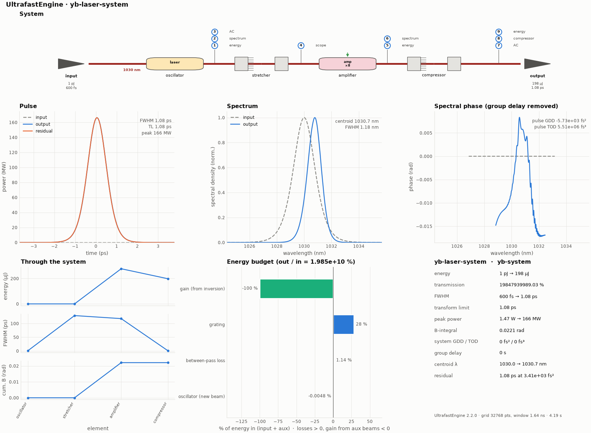</a><br><sub>A complete Yb laser system</sub></td><td align="center"><a href="examples/Nonlinear/filament/README.md">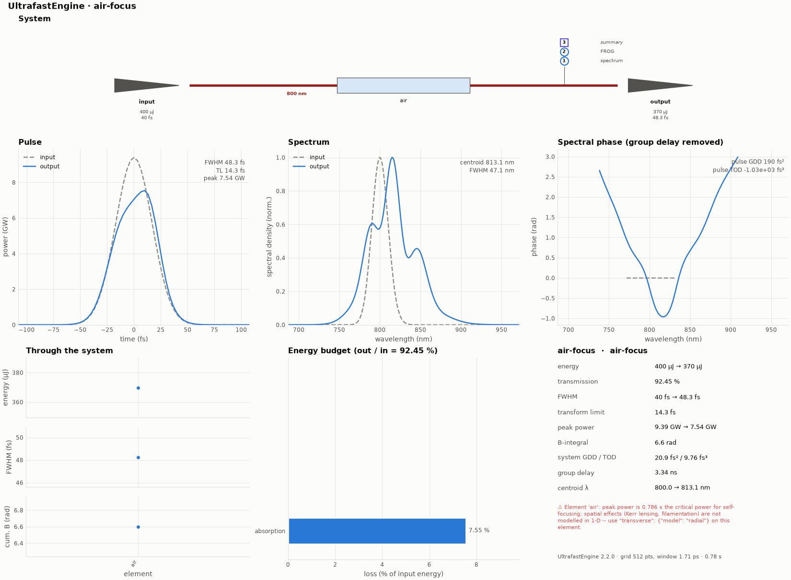</a><br><sub>Filament in air</sub></td><td align="center"><a href="examples/LaserSystems/noncollinear-opa/README.md">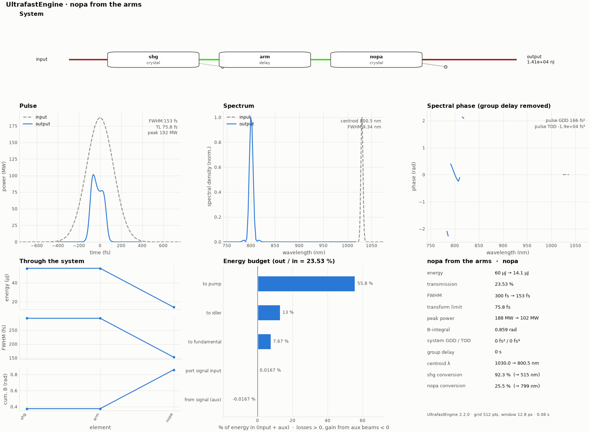</a><br><sub>Non-collinear OPA</sub></td></tr>
<tr><td align="center"><a href="examples/LaserSystems/four-grating-compressor/README.md">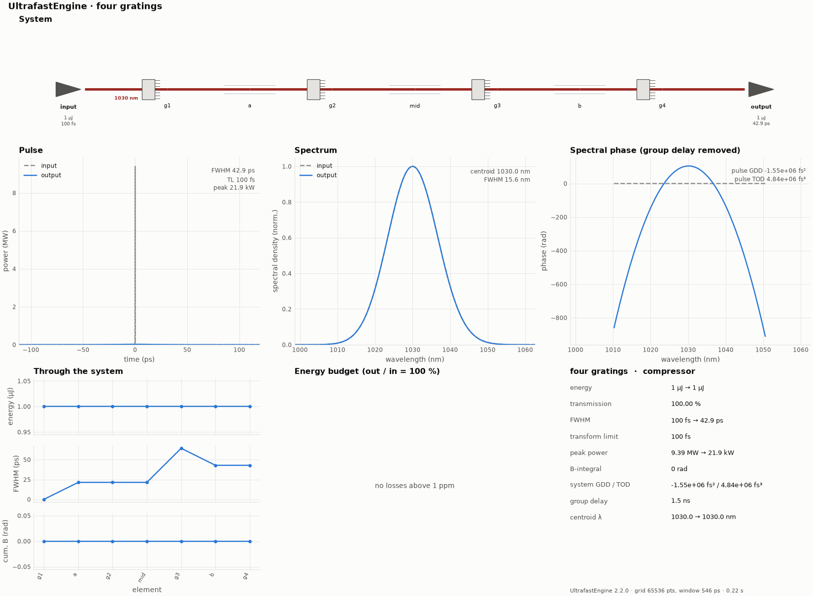</a><br><sub>Four-grating compressor</sub></td><td align="center"><a href="examples/Nonlinear/carrier-resolved/README.md">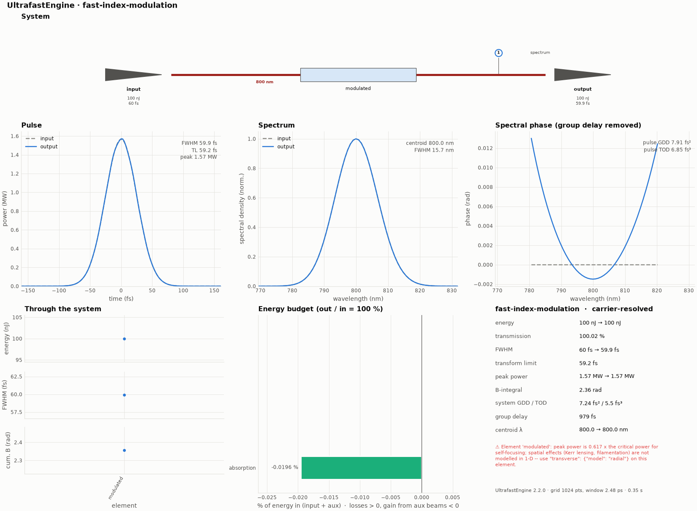</a><br><sub>Carrier-resolved propagation</sub></td><td align="center"><a href="examples/AdaptiveOptics/tiled-array/README.md">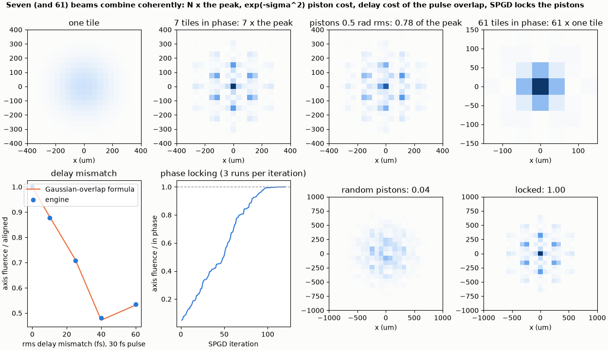</a><br><sub>Tiled-aperture combining</sub></td></tr>
<tr><td align="center"><a href="examples/AdaptiveOptics/scatterer-focusing/README.md">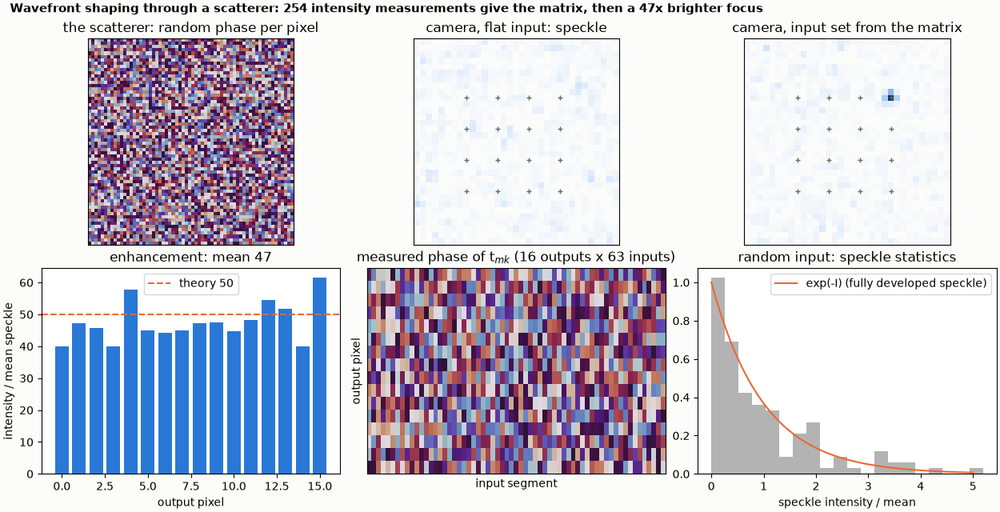</a><br><sub>Focusing through a scatterer</sub></td><td align="center"><a href="examples/DigitalTwin/build-the-twin/README.md">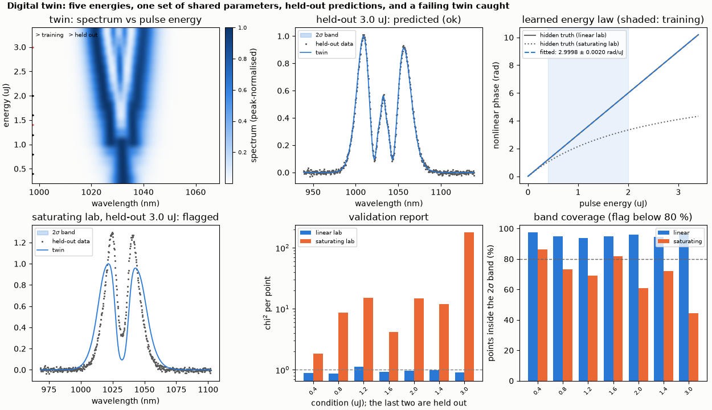</a><br><sub>A digital twin</sub></td><td align="center"><a href="examples/Diffraction/tilt-fringes/README.md">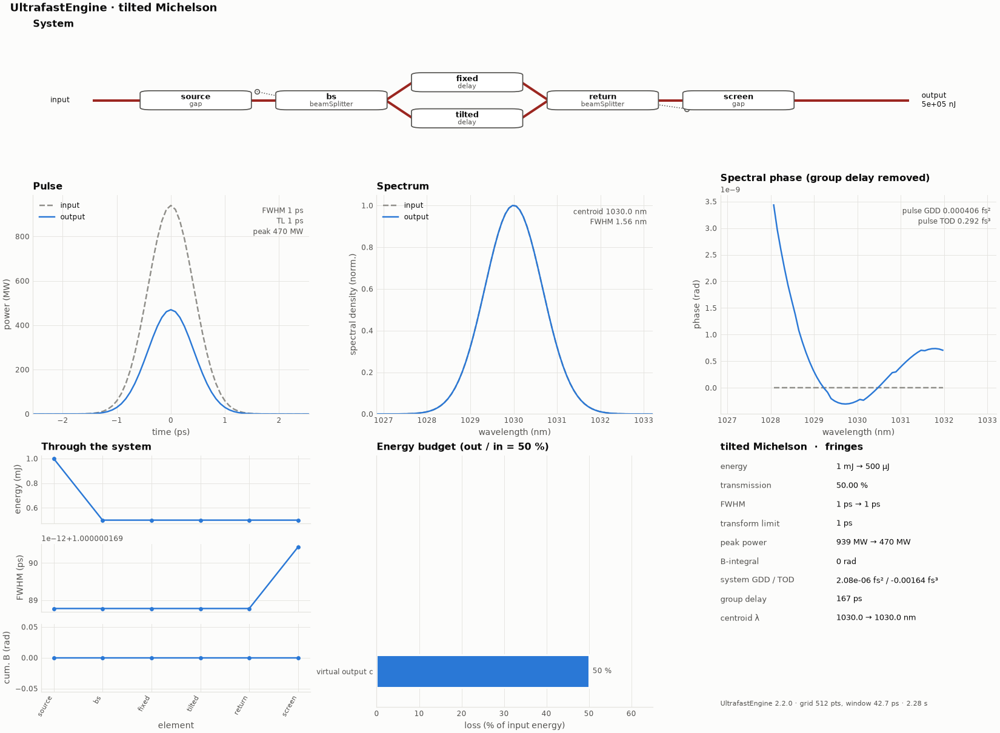</a><br><sub>Fringes from a tilted mirror</sub></td></tr>
<tr><td align="center"><a href="examples/Branched/system-schematics/README.md">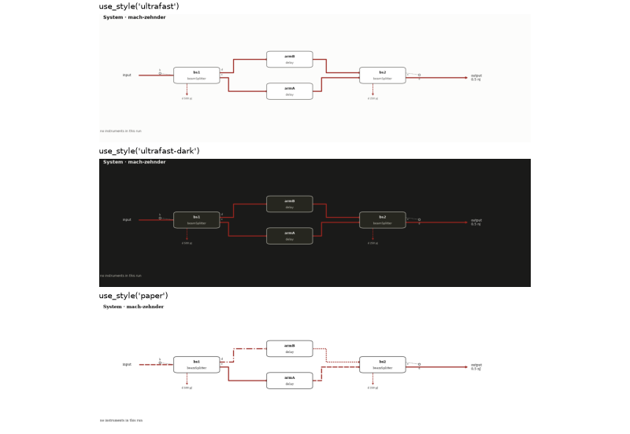</a><br><sub>System schematics in four plot styles</sub></td><td align="center"><a href="examples/GettingStarted/calculators/README.md">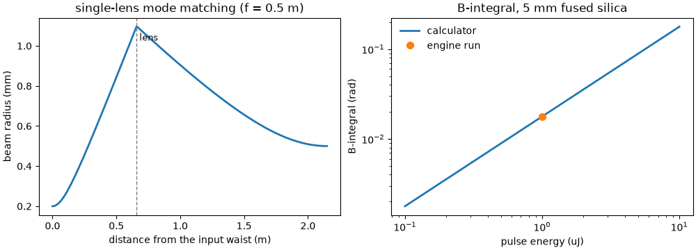</a><br><sub>Calculators: one call per design question</sub></td><td align="center"><a href="examples/Branched/cavity-and-coherence/README.md">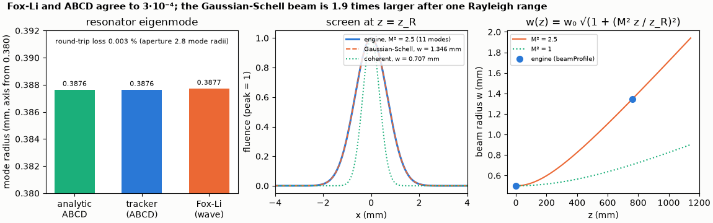</a><br><sub>Resonator eigenmode and coherence</sub></td></tr>
</table>

Every figure is drawn by `ultrafast.plotting` or by the example's own script; the [gallery](gallery.md) has all of them and the [plotting reference](reference/plotting.md) the styles.

## In short

* **One engine, every interface.** A C# library with no dependencies (.NET 10 and .NET Framework 4.8), used from the
  command line, from Python in-process, from C/C++ through a C API, and from any .NET language. System files run
  unchanged on Windows, macOS and Linux.
* **Physics of the whole chain.** Exact linear optics (materials, coatings, gratings, polarisation, losses), Kerr and
  Raman nonlinearity, fibres, gases with rotational Raman and ionisation, χ(2) crystals, gain media and oscillators,
  spatial models up to UPPE, beam splitters and interferometers (Branched systems), delayed light (ghosts, echoes) — see [Capabilities and limitations](capabilities.md).
* **Everything is a replaceable model.** Indices, n², Raman responses, beam sizes, coatings, filters, gain media and
  time-domain responses can be data, expressions or your own functions, set per material, per element or globally
  from the run spec ([Models and overrides](reference/models.md)).
* **Instruments, not just fields.** Every result can be read through a modelled device, with its resolution,
  sampling and detector.
* **From the design to your lab** (fitting plugin): `transform` elements fitted to your recordings make the model
  reproduce the real system and carry that to new inputs; a measured output field can be propagated back to the input.
* **Plugins.** Element types, instruments, models, run modes, retrieval algorithms, compute back-ends and commands
  can be added without touching the core ([Plugin system](reference/plugins.md)).
* **Self-describing options.** Every key has a declared type, unit and default: JSON Schemas give editor completion,
  typos are reported with suggestions, Python gets TypedDicts ([Option reference](reference/options.md)).

## Where to go next

| I want to... | Read |
|---|---|
| install and build | [Install and build](install.md), then [Getting started](getting-started.md) |
| learn step by step | [Tutorials](tutorials/index.md) |
| see what is modelled and what is not | [Capabilities and limitations](capabilities.md) |
| understand the model and conventions | [Concepts](concepts.md), [Model levels](model-levels.md) |
| describe a system / a run | [System file](reference/system-file.md), [Run spec](reference/run-spec.md) |
| change physics without code | [Models and overrides](reference/models.md) |
| fibres and supercontinuum | [Fibres](reference/fibers.md) |
| frequency conversion, OPA / OPCPA | [Crystals](reference/crystals.md) |
| time-bandwidth product, transform limit | [Pulse calculator](reference/pulse-calculator.md) |
| Gaussian beams, mode matching, critical power, B-integral (no engine needed) | [Calculators](reference/calculators.md) |
| amplifiers and lasers | [Gain media](reference/gain.md), [Oscillators](reference/oscillators.md) |
| diffraction, self-focusing, filaments | [Spatial models](reference/transverse.md), [Ionisation](reference/ionization.md) |
| splitters, interferometers, loops | [Branched systems](reference/branches.md) |
| ghosts, echoes, scatter, ring-down | [Delayed light](reference/delayed-light.md) |
| model my instruments, compare with measurements | [Instruments](reference/instruments.md), [Measured data](reference/measured-data.md) |
| fit the model to my lab, reuse it on new inputs, propagate backward | [Fitting plugin](plugins/fitting.md), [example 26](examples/DigitalTwin/transforms/README.md) |
| install or check plugins | [Installing plugins](plugins/installing.md) |
| scan, optimise, retrieve a pulse | [Studies](reference/studies.md), [Pulse retrieval](reference/retrieval.md) |
| plug in my own function or element | [Extending](reference/extending.md), [Python](reference/python.md), [C API](reference/c-api.md) |
| check the validation | [Testing and validation](testing.md), [paper replications](papers/README.md) |
| see what is planned | [Roadmap](roadmap.md) |
| drive it from an AI agent | [For AI agents](agents.md) |
| cite it, licence, contact | the [README](https://github.com/JosephCodemard/UltrafastEngine#citing): BibTeX, Apache-2.0 and NOTICE, jac318@bath.ac.uk |
