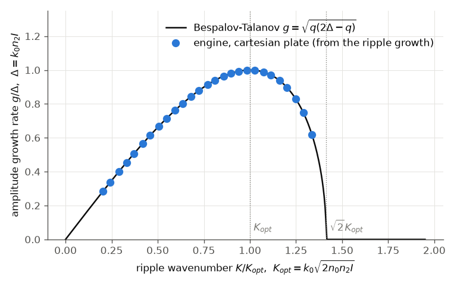
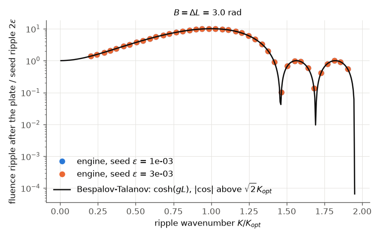

# Bespalov & Talanov (1966): the small-scale self-focusing gain spectrum

V. I. Bespalov and V. I. Talanov, "Filamentary structure of light beams in nonlinear liquids", JETP Lett. 3, 307
(1966). **Not available in full text; the paper was not read.** Status: **reproduced** (against the linear
stability analysis derived below; the paper's own wording is UNVERIFIED).

## What the paper claims

A plane wave of intensity I in a Kerr medium (n = n0 + n2 I) is unstable: a weak transverse modulation of
wavenumber K grows exponentially. Linearising the paraxial envelope equation about the plane wave (this
engine's convention: k0 = 2π/λ in vacuum, k = n0 k0, Δ = k0 n2 I; docs/reference/transverse.md, small-scale
self-focusing) gives for the in-phase and quadrature parts u, v of the perturbation

    u' = q v,   v' = (2Δ − q) u,   q = K² / (2k)   →   g² = q (2Δ − q)

* the gain g(K) peaks at q = Δ, i.e. **K_opt = sqrt(2kΔ) = k0 sqrt(2 n0 n2 I)** (= k sqrt(2 n2 I / n0)),
* with **g_max = Δ = k0 n2 I** (= k n2 I / n0), the field-amplitude growth rate,
* and is zero above K = √2 K_opt, where the ripple only oscillates.

The forms "k0 sqrt(2 n2 I / n0)" and "k0 n2 I / n0" found in the literature use k0 for the wavenumber in the
medium; with k0 the vacuum wavenumber they are the bold forms above.

## Our setup

* `run.py` (Python API): a 3 mm Kerr plate, constant index n0 = 1.45, n2 = 2.7·10⁻²⁰ m²/W, no Raman, no
  self-steepening.
* A **cw source** (one spectral bin): the intensity is constant in time, so the ripple grows exactly as cosh(gL)
  and no average over a pulse is needed (the C# test `SmallScaleTests` does that average for a pulse).
* A flat-top beam (super-Gaussian of order 10, radius 1 mm) on a 2048 × 1 cartesian grid over 7 mm; the field
  carries a ripple ε cos(Kx) with ε = 10⁻³ (10⁻³ and 3·10⁻³ in the full tier), K a whole number of periods in the
  box, from 0.2 to 1.9 K_opt (14 values fast, 40 full).
* Calibration: one run without a ripple gives the core intensity per watt; the power is then set for
  I = 6.07·10¹⁵ W/m², Δ = 1000 m⁻¹, B = ΔL = 3 rad. The engine's reported B-integral of the plate is 3.00-3.01 rad.
* The fluence ripple after the plate is fitted (a + b cos Kx + c sin Kx) over |x| < 0.4 mm; the growth rate is
  g = acosh(m / 2ε) / L.

```bash
python run.py --tier fast             # or: python3 build/paper_check.py bespalov
python run.py --tier full --figures
```

## Plots



The measured amplitude growth rate (points) on g = sqrt(q(2Δ − q)) (line).



The fluence ripple after the plate relative to the seed, 2ε cosh(gL) below the cut-off and 2ε |cos(sqrt(q(q − 2Δ)) L)|
above it, for two seed amplitudes: the ripple stays linear (the two seeds give the same ratio).

## Comparison

| quantity | Bespalov-Talanov (analytic) | engine | check |
|---|---|---|---|
| g_max / (k0 n2 I) | 1 | 0.9997 (fast), 1.0000 (full) | ±2 % |
| K at the gain peak / K_opt | 1 | 0.992 (fast), 0.999 (full) | ±3 % |
| fluence ripple vs 2ε cosh(gL) / \|cos\|, every K | 0 | 0.4 % (fast), 1.8 % (full: one K next to a zero of the cosine) | < 2 % |
| growth above √2 K_opt | none | ripple / seed ≤ 0.80 (fast), 0.997 (full) | < 1 |
| B-integral of the plate | 3.000 rad | 3.004-3.012 rad (with the ripple) | ±1 % |

## Commentary

The engine's cartesian Kerr plate follows the linear stability analysis to 0.4 % (2 % next to the zeros of the cosine) across the
whole spectrum, the unstable band and the oscillating band beyond the cut-off. This tests the split-step coupling
of diffraction (q) and the Kerr phase (Δ) in the spatial model, and the B-integral it reports.

## What does not reproduce / is not done

* The paper itself was not read; its formulas are quoted in the literature in the k-in-the-medium form above.
* Only the x cut of the 2-D grid (ny = 1) is run; a 2-D grid with a ripple at an angle, and seeded noise
  (example 29), would show the same law and isotropy but take minutes per run.
* Not used here: the critical power. `SmallScaleTests.SmallScale_ReportsPeakPowerOverCritical` and the element's
  `peakPowerOverCritical` use P_cr = 3.77 λ² / (8π n0 n2) (Marburger's Gaussian-beam value); other texts quote
  3.72 in the same formula (not checked here). The difference (1.3 %) does not enter this replication.
