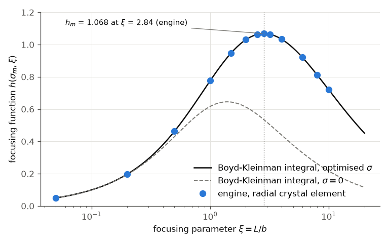
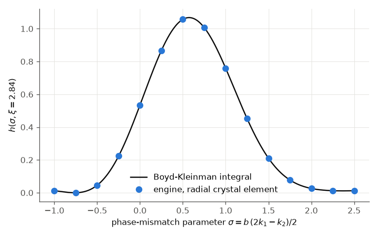

# Boyd & Kleinman (1968): focused Gaussian-beam second-harmonic generation

G. D. Boyd and D. A. Kleinman, "Parametric interaction of focused Gaussian light beams", J. Appl. Phys. 39, 3597
(1968), DOI 10.1063/1.1656831. **Not open access; the paper was not read.** Status: **reproduced** (against the
focusing function evaluated here; the paper's own numbers are UNVERIFIED).

## What the paper claims

At low conversion the second-harmonic power of a Gaussian beam focused into a crystal of length L is
P_2w ∝ P_w² L k1 h(σ, B, ξ), where ξ = L / b is the focusing parameter (b = k1 w0² the confocal parameter),
σ = b Δk / 2 the phase-mismatch parameter (Δk = 2 k1 − k2) and B the walk-off parameter. Without walk-off and with
the waist in the middle of the crystal,

    h(σ, ξ) = 1 / (4 ξ) |∫_{-ξ}^{ξ} exp(i σ τ) / (1 + i τ) dτ|²

The widely quoted optimum is h_m = 1.068 at ξ = 2.84 (with σ_m ≈ 0.57). These two values are attributed to the
paper in textbooks; they were not checked against its text, so `paper.json` marks them UNVERIFIED. `run.py`
evaluates the integral above with numpy and maximises it over σ and ξ: **h_m = 1.0677 at ξ = 2.838, σ_m = 0.573**,
the same values. That evaluation is the reference of the checks.

## Our setup

* `run.py` (Python API). An "ideal" crystal: one Sellmeier index for both waves (n = 1.8 at 1030 nm) with a tiny
  dispersive term whose coefficient sets Δk = k(2ω) − 2k(ω) and nothing else. Type 0 at θ = 90°: no walk-off, no
  group-velocity mismatch over 2 ps. deff = 2 pm/V, L = 10 mm, χ(3) off.
* A 2 ps, 1 pJ pulse at 1030 nm (conversion ~10⁻⁶: undepleted pump), a Gaussian beam with its waist in the middle
  of the crystal, w0 = sqrt(L / (ξ k1)). The crystal element runs on a radial (Hankel) grid: ≥ 96 points over
  6 × the beam radius at the crystal faces (≥ 4 samples per waist radius).
* Normalisation: h_engine(σ, ξ) = ξ · η_radial(σ, ξ) / η_1D(ξ), where η_1D is the 1-D model of the same crystal
  with a collimated beam of radius w0 and Δk = 0, the near-field limit in which h = ξ exactly. A weak-focusing
  point (ξ = 0.05) checks that the normalisation is not circular: there the radial run must give h ≈ ξ.
* σ in the engine: σ = −b Δk_engine / 2 (the engine's Δk is k2 − 2k1). The optimum lies at a negative engine Δk,
  that is k2 < 2k1, which compensates the Gouy phase of the focus.
* For each ξ, three runs around the integral's σ_m and a parabola give the engine's optimum. Fast tier: 7 values of
  ξ (~15 s); full tier: 13 values and the σ scan at ξ = 2.84.

```bash
python run.py --tier fast             # or through the harness: python3 build/paper_check.py boyd
python run.py --tier full --figures   # rewrites figures/
```

## Plots



The optimised focusing function: the engine's radial crystal element (points) on the integral (line); the dashed
line is the integral at σ = 0 (perfect plane-wave phase matching), which peaks at only 0.65.



h(σ) at the optimal focusing: the engine follows the integral over the whole mismatch range, including the
side lobes.

## Comparison

| quantity | Boyd & Kleinman (quoted, UNVERIFIED) | integral (run.py) | engine | check |
|---|---|---|---|---|
| h_m at ξ = 2.84 | 1.068 | 1.0677 | 1.0680 | ±0.5 % |
| optimal ξ | 2.84 | 2.838 | 2.841 full tier, 2.852 fast tier (parabola in ln ξ) | ±0.1 |
| σ_m at ξ = 2.84 | ~0.57 | 0.573 | 0.574 | ±0.02 |
| h / ξ at ξ = 0.05 (weak focusing) | → 1 | 0.99834 | 0.99833 | ±0.2 % |
| largest difference engine vs integral, all runs | | | 0.09 % | < 0.5 % |

## Commentary

The engine reproduces the focusing function to better than 0.1 % over ξ = 0.05 ... 10, at the optimal σ and
across the σ scan. This tests the radial crystal element's diffraction (each field at its own index), the Gouy
phase, the coupling normalisation against the 1-D Gaussian overlap, and the sign convention of Δk.

## What does not reproduce / is not done

* **Walk-off** (the B parameter, h_m(B)): not done. The radial grid cannot hold walk-off; it needs the cartesian
  model with a real birefringent crystal (BBO at 1030 nm, ρ ≈ 3°) and an angle scan for σ. Left for a follow-up.
* **Absorption** (κ) and an off-centre focus (μ ≠ 0): not done.
* The paper itself was not read: its numbers in the table are the textbook values.
