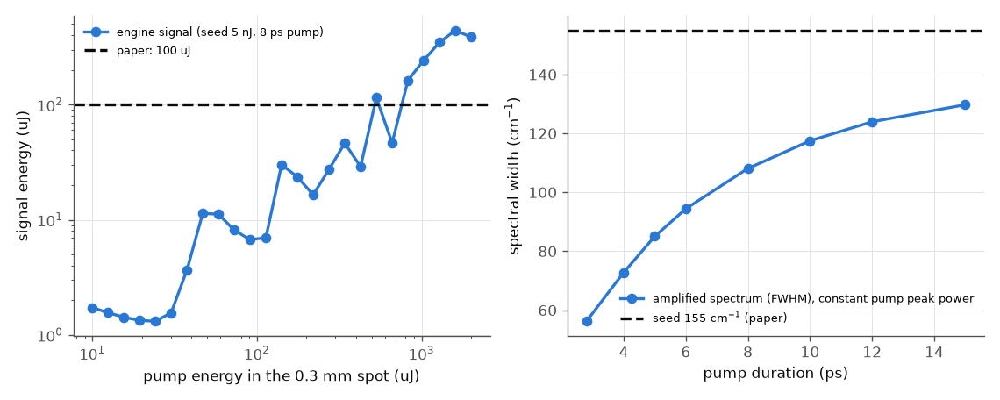
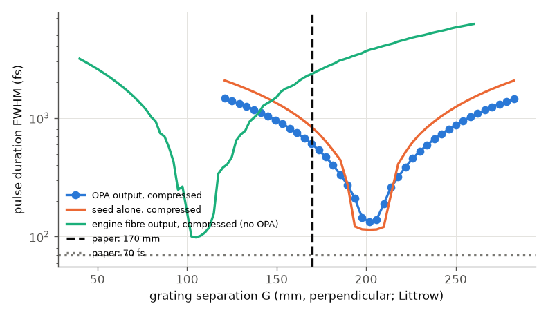

# Dubietis, Jonusauskas, Piskarskas (1992): chirped-pulse parametric amplification in BBO

**Reading status.** The Optics Communications PDF (4 pages) was read in full through the macOS PDFKit text layer and page images
(Read-tool PDF mode is unavailable here). Figure 2 and 3 were read for shape only. The PDF and its figures are not in the repository.
Everything below marked "inferred" or "assumed" is not a number of the paper.

## What the paper did (pp. 437-440)

A 1.7 ps, 1.055 um Nd:glass pulse goes through 4.5 m of fibre, where self-phase modulation and dispersion give it a linear chirp: about
155 cm^-1 swept over about 5 ps (30 cm^-1/ps). This chirped pulse (about 5 nJ usable) is amplified in an 8 mm type-I BBO crystal pumped
by an 8 ps, 527.5 nm pulse (beams crossed at about 2 degrees, pump waist 0.3 mm). The authors pick the pump duration to match the
signal, so that the whole chirped spectrum is amplified (a shorter pump would cut it down). The signal reaches 100 uJ (gain about 2e4)
and a single-pass grating compressor (600 lines/mm, 170 mm) gives 70 fs, 65 uJ, 0.9 GW.

## How it is reproduced

`run.py` (fast tier about 25 s; full tier a few minutes) runs these stages with the engine:

| stage | engine model |
|---|---|
| A fibre | `fiber` element, FusedSilica dispersion, n2 2.6e-20, A_eff 50 um^2 (= 4.5 kW / 9 GW/cm^2, from the paper), silica Raman |
| B seed | sech^2 pulse with a 155 cm^-1 wide spectrum and a 30 cm^-1/ps linear chirp (GDD 1.77e5 fs^2): the paper's description of the chirped pulse |
| C OPA | `crystal` BBO 8 mm, `opa`, type I, cut auto (22 deg), 2 degrees non-collinear (inside, assumed), 1-D Gaussian overlap, signal radius 64 um, pump radius 150 um |
| D compressor | `gratingPair` 600 lines/mm, Littrow (18.45 deg), one pass, scan of the separation; Treacy's formula in `run.py` |
| E | stage A followed by the same compressor |

## Results

Left: signal energy against pump energy for the 8 ps pump (1-D model). The paper's 100 uJ is the dashed line. Right: width of the amplified
spectrum against pump duration at constant pump peak power in the unsaturated regime (gain exponent 2.5, gain about 15), seed width 155 cm^-1.

Pulse duration after the compressor against grating separation, for the amplified pulse (blue), the unamplified seed (orange) and the
engine's own fibre output (green). The paper's 170 mm and 70 fs are marked.

### Paper against ours

| quantity | paper (location) | ours | verdict |
|---|---|---|---|
| sech^2 transform limit of 155 cm^-1 | "predicted 67 fs" (p. 439) | 67.8 fs | agrees; the paper's prediction is this number |
| time-bandwidth product, 70 fs x 155 cm^-1 | 0.325 (p. 439) | 0.3253 | agrees (arithmetic) |
| 110 fs autocorrelation / 1.543 | 70 fs (Fig. 3a) | 71.3 fs | agrees |
| compression ratio 1.7 ps / 70 fs | about 24 (p. 440) | 24.3 | agrees |
| 65 uJ / 70 fs | 0.9 GW (p. 439) | 0.93 GW | agrees |
| GDD of the 30 cm^-1/ps chirp | not given | 1.77e5 fs^2 (5.17 ps seed, 155 cm^-1) | consistent with "about 5 ps" |
| fibre output spectral width | 155 cm^-1 (p. 438) | 264 cm^-1 | **disagrees, factor 1.7** |
| fibre output duration | about 5 ps (p. 438) | 5.3 ps | agrees |
| fibre sweep rate | about 30 cm^-1/ps | 50 cm^-1/ps | follows from the width |
| pump intensity for G = 2e4 in 8 mm | not given | 2.1 GW/cm^2 (inferred, G = exp(2 Gamma L)/4) | inferred only |
| pump energy for 100 uJ signal (seed 5 nJ) | not given (3 mJ of second harmonic made) | 0.55-0.76 mJ at a 0.3 mm spot: 180-250 GW/cm^2 peak | inferred; see below |
| shorter pump narrows the amplified spectrum | argued (p. 437) | 56 cm^-1 at 2.8 ps, 108 at 8 ps, 130 at 15 ps | agrees in sign |
| grating separation | 170 mm (p. 439) | 202 mm perpendicular (213 mm slant) | **disagrees by 19 %** |
| compressed duration | 70 fs (Fig. 3a) | 133 fs (amplified), 114 fs (ideal seed), 98 fs (fibre output) | **disagrees** |

## Commentary

**What is not a disagreement with the engine.** The paper's own numbers are mutually consistent: the "predicted 67 fs" is exactly the
sech^2 transform limit of a 155 cm^-1 spectrum. With that seed the engine's ideal compression (a mirror with the opposite GDD) returns
67.79 fs, and the engine's grating pair reaches its minimum at the separation where Treacy's formula equates its GDD to the chirp (the scan
point is the analytic value to 5 digits).

**Compressor length (170 mm against 202 mm).** The engine agrees with Treacy's closed form, so this comes from the inputs. The chirp rate is
"about 30 cm^-1/ps"; 170 mm would need 36 cm^-1/ps. The angle is only "near Littrow": plus or minus 4 degrees moves our value from 186 to
214 mm. The folded layout (one grating, two mirrors) may also not map onto a perpendicular pair distance one to one. Not resolved.

**Compressed duration (133 fs against 70 fs).** The compressor's third-order dispersion is 3.6e-40 s^3 at this separation (engine value, equal to
the effect of a chirped mirror with that TOD). On a 155 cm^-1 sech^2 spectrum it lengthens 68 fs to 114 fs. The paper reaches 70 fs, so the TOD of its chirp (from the
fibre) must largely have cancelled the grating's, as is known for fibre and grating compressors. The engine's fibre gives a different spectrum and therefore a
different TOD: its fibre output compresses to 98 fs at 105 mm. So the 70 fs depends on the exact shape of the fibre chirp, which is not given.
The OPA adds a further 20 fs (133 against 114): the saturated 1-D amplifier distorts the pulse.

**Fibre (264 against 155 cm^-1).** A scalar silica fibre with A_eff 50 um^2 and the full 8 nJ gives a B-integral of 39 rad and 1.7 times the reported
spectral width. Likely reasons (not tested): the fibre is not polarisation-preserving, so only part of the power acts as a scalar
field; the mode area; the quoted "4.5 kW" and "9 GW/cm^2" belong to the input intensity of the onset of Raman, not necessarily the operating point.
This was fixed before the numbers were seen and was not tuned.

**Gain and pump energy.** The pump energy at the crystal is not given. 100 uJ out of a pump that fills a 0.3 mm spot needs at least 200 uJ of pump
photons; in the engine about 0.55-0.76 mJ is needed, because the signal (radius 64 um) only samples the centre of the pump. That is a peak intensity of 180-250 GW/cm^2, well
above what BBO survives with 8 ps pulses, so the real pump was surely larger or weaker than "0.3 mm waist" and the engine cannot say which.
At this level of saturation the 1-D Gaussian-overlap model is not reliable: the left plot is not monotonic (for example 50 uJ gives
more signal than 100 uJ), as the strongly depleted pump and signal back-convert; the crystals documentation says high conversion
needs a transverse model. The output pulse in this regime is distorted (duration 1.6 ps, shifted centroid), so the bandwidth and compression
numbers use the lower-gain stage (gain about 15, pump depletion 11 %). A transverse (cartesian, non-collinear) run at 100 uJ is the next step and was not done.
A separate point: results from an earlier run of the same script, made while the engine library may have been rebuilt by another session, differed
(20 uJ pump: 2.6 uJ against 1.33 uJ). Eight repeats of the current library gave identical values, even under CPU load; no engine bug is claimed.

## What is missing

* Transverse OPA at saturation; idler compression; beam ellipticity of the single-pass compressor.
* A fibre model that reproduces 155 cm^-1 (polarisation, mode area) and the real fibre's TOD, which would decide the compressed duration.
* The gain bandwidth "up to 400 cm^-1": not compared (the calculator's gain spectrum needs a pump intensity input; not run).
* The `externalAngleDeg` interaction key gave "unknown parameter, ignored" with the library used for these runs, although the schema declares it; the angle was given inside the crystal instead.
