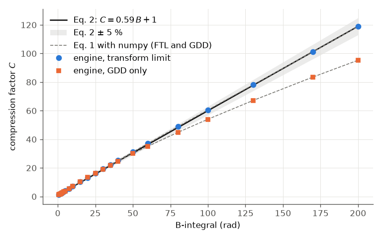
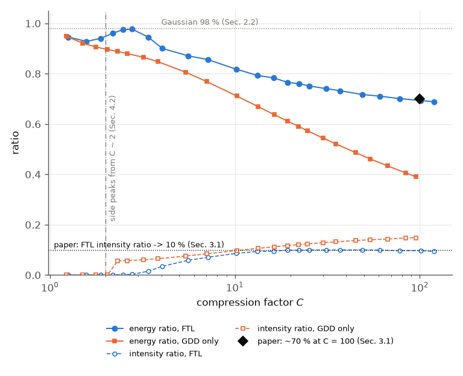
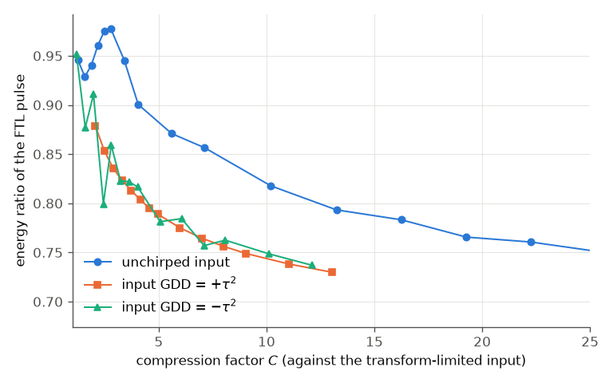
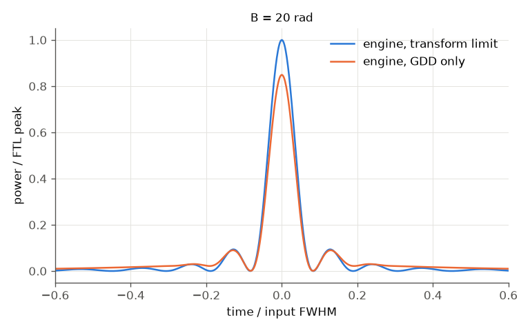

# Escoto et al. (2022): temporal quality of post-compressed pulses at large compression factors

E. Escoto, A.-L. Viotti, S. Alisauskas, H. Tünnermann, I. Hartl and C. M. Heyl, J. Opt. Soc. Am. B 39, 1694
(2022), DOI 10.1364/JOSAB.453901, open access; preprint arXiv:2201.05836v1 (CC BY 4.0). **Read in full: the
preprint.** Locations below are its sections and equations. Status: **reproduced**, with one claim that holds
only from B ≈ 4 rad (below).

## What the paper claims

The model (Sec. 2.1, Eq. 1): self-phase modulation of a Gaussian without dispersion, E_in(t) exp(iB|E_in|²), then a
linear compressor -- the GDD that maximises the peak power (Sec. 3.1), or the transform limit (FTL). With the
compression factor C = FWHM_in / FWHM_out:

* **Eq. 2: C ≈ 0.59 B + 1**, "with an error below 5 % for both [FTL and GDD-only] up to a B-integral of
  40 radians"; up to 100 rad below 2 % (FTL) and "just above 10 %" (GDD only) (Sec. 2.1).
* Energy ratio (Eq. 3: energy within t0 ± FWHM_out over the total): ~98 % for a Gaussian (Sec. 2.2); for the FTL pulse
  ~70 % at C = 100 and ~65 % at C = 1000 (Sec. 3.1).
* Intensity ratio (highest secondary peak / main peak): for the FTL pulse it approaches ~10 % (Sec. 3.1, Fig. 3a).
* GDD-only compression degrades continuously and faster than FTL (Sec. 3.1).
* Secondary pulses appear "roughly when C > 2" (Sec. 4.2, Fig. 3).
* A chirped input degrades the energy and intensity ratios much faster with C (Sec. 3.3, Fig. 6); Eq. 4 gives a
  stretch of "almost 14 times" at γ/σ² = ±5.

## Our setup

* `run.py` (Python API). The **engine does the broadening**: a 1 mm Kerr plate with a constant index (no
  dispersion), a constant beam area, no Raman, no self-steepening, 1 ps (intensity FWHM) at 1030 nm; the energy
  is set for B = k0 n2 I0 L and the engine reports that B to 10⁻⁴. A fixed grid of 8192 points over 12 ps
  (1.46 fs; the B = 200 spectrum fits with room). All results are dimensionless (t / FWHM_in), as in the paper.
* The compression and the metrics are computed from the engine's output field with the paper's definitions:
  FTL (flat spectral phase); GDD only (the GDD that maximises the peak power: a scan over ±80 TL², then golden
  section); FWHM of the main peak; energy ratio by Eq. 3; intensity ratio from the local maxima other than the
  main one (above 10⁻⁵).
* Cross-checks drawn on the same axes: Eq. 1 evaluated directly with numpy, Eq. 2, and the engine's ideal
  `compressor` instrument (`optimizeTod: false`) at B = 5, 20, 40.
* Chirped input: GDD = ±τ² (γ/σ² = ±1) on the transform-limited 1 ps pulse, C against the transform-limited input
  duration (as in the paper), energy ratio of the FTL pulse at C = 10.
* Fast tier: B = 0.5 ... 40 rad (15 s). Full tier: up to B = 200 rad (C ≈ 120).

```bash
python run.py --tier fast             # or: python3 build/paper_check.py escoto
python run.py --tier full --figures
```

## Plots



C vs B: engine FTL (circles) and GDD-only (squares), Eq. 1 with numpy (dashed), Eq. 2 with ±5 % (band).



Energy ratio and intensity ratio vs C, FTL and GDD only, with the paper's 98 %, ~70 % at C = 100 and the 10 %
asymptote.



The energy ratio of the FTL pulse for an unchirped and a ±τ²-chirped input.



The compressed pulses at B = 20 rad (C ≈ 13): the side peaks that set the intensity ratio.

## Comparison

| quantity | paper (location) | engine | check |
|---|---|---|---|
| engine broadening vs Eq. 1 (numpy), C | identical model | 10⁻⁴ | 0.2 % |
| max \|C / (0.59B + 1) − 1\|, FTL, B ≤ 40 | < 5 % (Sec. 2.1) | 3.6 % (at B ≈ 15) | pass |
| same, GDD only, 4 ≤ B ≤ 40 | < 5 % (Sec. 2.1) | 4.4 % | pass |
| same, GDD only, 0.5 ≤ B ≤ 40 | < 5 % (Sec. 2.1) | **6.1 % (at B = 1.5-2)** | soft fail, see below |
| C / (0.59B + 1) − 1 at B = 100, FTL | < 2 % (Sec. 2.1) | +1.0 % | pass |
| \|same\| at B = 100, GDD only | just above 10 % (Sec. 2.1) | 9.9 % | pass (10.5 ± 2 %) |
| energy ratio of a Gaussian | ~98 % (Sec. 2.2) | 98.15 % | pass |
| FTL energy ratio at C = 100 | ~70 % (Sec. 3.1) | 69.4 % | pass |
| FTL intensity ratio, asymptote | ~10 % (Sec. 3.1) | 10.0 % at C = 25; 9.3 % at C = 119 | pass |
| GDD only below FTL (energy ratio, B = 20) | degrades faster (Sec. 3.1) | 0.670 < 0.793 | pass |
| side peaks appear | roughly C > 2 (Sec. 4.2) | C = 2.18 (FTL), 2.33 (GDD; jumps to 5.7 %) | pass (soft) |
| Eq. 4 stretch at γ/σ² = 5 | almost 14 (Sec. 3.3) | 13.90 | pass |
| FTL energy ratio at C = 10: unchirped / +τ² / −τ² | chirped worse (Sec. 3.3) | 0.820 / 0.744 / 0.749 | pass |
| engine compressor instrument vs numpy GDD optimum | | 4·10⁻⁶ | pass |

## Commentary

* The engine's SPM is the paper's Eq. 1 to 10⁻⁴ in C, so every difference from the paper's statements is in the
  statements or the metrics, not in the propagation.
* Eq. 2 holds as stated for the FTL case, and for GDD-only compression from B ≈ 4 rad (C ≈ 3). The
  energy-ratio and intensity-ratio trends, the ~70 % at C = 100 and the 10 % asymptote are reproduced. The 10 %
  asymptote is reached early, at C ≈ 20; at C ≈ 120 the ratio is 9.3 %, slowly decreasing.
* The chirped-input case reproduces the paper's conclusion: for the same compression factor the energy ratio is
  7-8 points lower with a ±τ² input chirp.

## What does not reproduce

* **Eq. 2 for GDD-only compression at small B.** For 0.5 ≤ B ≤ 3 the GDD-only compression factor is 5-6 % below
  0.59 B + 1 (e.g. C = 1.50 at B = 1, Eq. 2: 1.59). Triage: the engine agrees with Eq. 1 evaluated with numpy to
  10⁻⁴, and the engine's own compressor instrument gives the same GDD; the FTL case agrees to 1 % there. So it is
  not an engine bug. Either the paper's "below 5 % up to 40 rad" refers to its plotted range (Fig. 1a, not read
  off), or its GDD-only duration is defined differently at small B. Recorded as a soft check.
* Not reproduced: the energy ratio at C = 1000 (~65 %, B ≈ 1700, needs a much larger grid), the experimental
  results of Sec. 3.4 (the 2 m argon MPC parameters are not given), the GDD-detuning maps of Figs. 4-5 and the
  cascaded compression of Sec. 4.
