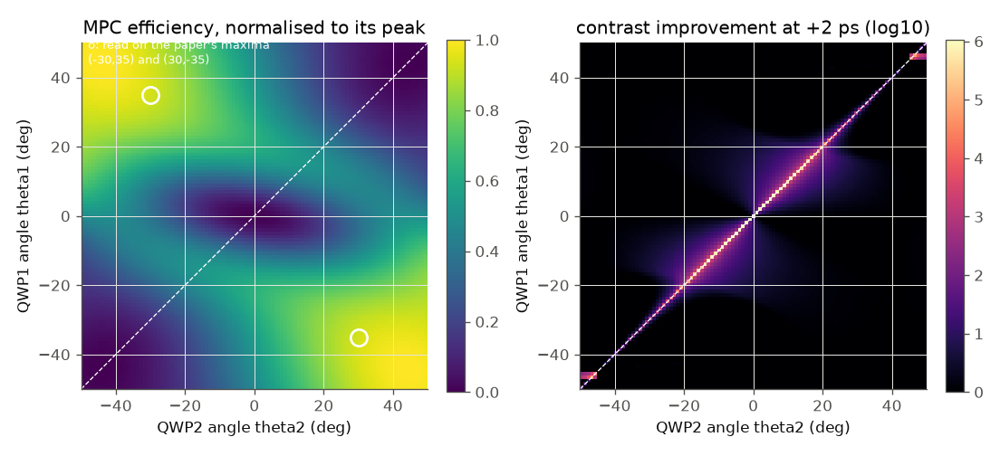
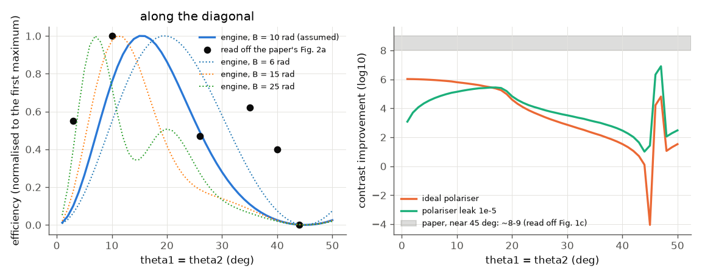
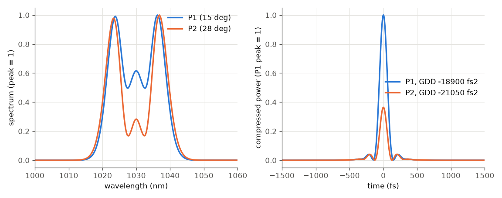

# Escoto et al. (CLEO 2024): polarisation-based contrast enhancement in a multi-pass cell

E. Escoto et al., "Polarization-Based Contrast Enhancement during Spectral Broadening in a Multi-Pass Cell", CLEO 2024,
SF2O.8 (licensed; only the abstract and values read off its figures were used, nothing is copied).

**Idea.** A Kerr medium (fused-silica plates in a multi-pass cell, dispersion close to zero per round trip) sits between
two quarter-wave plates (QWP1, QWP2) and a polariser. Intense light rotates its polarisation ellipse by nonlinear ellipse
rotation (NER) and passes the polariser; the weak pedestal does not rotate and is blocked. Two numbers are mapped over the
two plate angles in [-50, 50] deg: the **efficiency** (energy through the polariser, normalised to its peak) and the
**contrast improvement at +2 ps** (peak over intensity at +2 ps, output relative to input).

## Set-up used here (hypothesis: the cell is not given)

* Cell assumed to be the Seidel et al. cell (Laser Photon. Rev. 16, 2100268 (2022): three 1 mm fused-silica plates, 31
  round trips, 900 fs, 1030 nm), reduced to **one** 1-D plane-wave fused-silica Kerr element (dispersion taken as
  compensated; silica Raman on). Its energy is set so the B-integral of linear light is **B = 10 rad**, the value of the
  paper's model.
* 900 fs Gaussian at 1030 nm, linear along x; QWP1 at theta1; QWP2 at theta2; ideal polariser crossed to the input.
  The paper calls equal angles "identical (orthogonal)": for theta1 = theta2 the two quarter-wave axes are perpendicular, so
  the pair is transparent to linear light and the low-efficiency ellipse lies along theta1 = theta2 (engine angle of QWP2
  = paper angle + 90 deg).
* QWP1 and the cell run in the engine (`waveplate`, `bulk`); QWP2 + polariser are applied as Jones matrices to the output
  field (one engine run per theta1, then the whole theta2 axis at once). The matrices agree with the engine's own
  `waveplate` and `polarizer` elements to 3e-3 of the energy (1e-5 at 1 degree steps).
* Input contrast at +2 ps: the Gaussian value (peak / I = 8.8e5). Waveplates and polariser are ideal.

Run: `python run.py --tier fast` (2 degree grid, ~20 s) or `--tier full --figures` (1 degree grid, B = 6, 15, 25 rad,
polariser leak; ~2 min).

## Results

Left: efficiency over (theta2, theta1) with the paper's maxima marked. Right: contrast improvement at +2 ps (log10).

Along theta1 = theta2: efficiency (black points: values read off Fig. 2a) and contrast improvement. Dotted: other
assumed B; every curve is normalised to its first maximum on the diagonal, as the paper's Fig. 2a is.

Spectra and GDD-compressed pulses at two diagonal operating points of our model (15 deg and 28 deg).

## What reproduces

| feature | paper (read off its figures) | ours |
|---|---|---|
| no light through the polariser at the origin; symmetry (theta1, theta2) -> (-theta1, -theta2) | Fig. 1b | exact |
| efficiency maxima in the (theta2 < 0, theta1 > 0) and (theta2 > 0, theta1 < 0) quadrants | (-30, +35), (+30, -35) deg | yes: broad maxima in those quadrants, reaching the corner (-45, +45) |
| contrast improvement is confined to the diagonal theta1 = theta2 | Fig. 1c | yes (map above, right): about 6 orders on the diagonal, ~1 off it |
| the diagonal efficiency has a first maximum at small angle, then falls to zero near 45 deg | Fig. 2a: maximum at ~10 deg, zero at ~44 deg | maximum at 15 deg for B = 10 rad (11 deg for B = 15 rad, the experiment's largest B), zero at 45 deg |

## What does not reproduce

* **The second diagonal maximum (Fig. 2a, ~0.62 of the first at ~35 deg).** For B = 10 rad our diagonal efficiency has a single
  maximum and falls monotonically to zero. A second maximum appears only at larger B and closer in (B = 25 rad: first
  maximum at 7 deg, a second of 0.5 at 20 deg; see the figure). The position of the first maximum alone would suggest
  B of about 15-20 rad for linear light; the rest of the shape then differs. A lumped plane-wave element is the likely
  reason: the real cell has three plates, a Gaussian beam of changing size and 31 round trips.
* **The size of the contrast improvement.** Ours is ~6 orders at small angles on the diagonal and falls towards 45 deg
  (it is limited there by the narrowness of the null on the angle grid); the paper's Fig. 1c rises to ~8-9 near +-45 deg.
  A polariser leak of 1e-5 caps the improvement at ~5.5.
* **P1 modulated, P2 smooth, P2 cleaner (Fig. 2f,g).** Our two operating points (the first and a later diagonal
  maximum) have spectra of nearly equal width (~28 nm; the paper's is ~35 nm) and P2 is not smoother or cleaner after
  compression than P1. A single lumped Kerr element cannot make the complementary-spectra effect the paper describes
  (two circular components broadened differently in a multi-plate cell).

Most likely reasons, in order: the assumed cell and B (a lumped plane-wave element instead of three plates and 31 round
trips); the contrast metric's definition; the polariser's finite extinction.

## Files

`run.py` (model and figures), `checks.json`, `paper.json`, `figures/`. Check: `python3 build/paper_check.py escoto-2024`
(4 hard checks: Jones vs engine elements, symmetry, dark origin, maxima quadrants; the figure values are soft checks).
