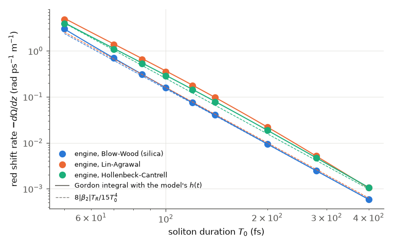
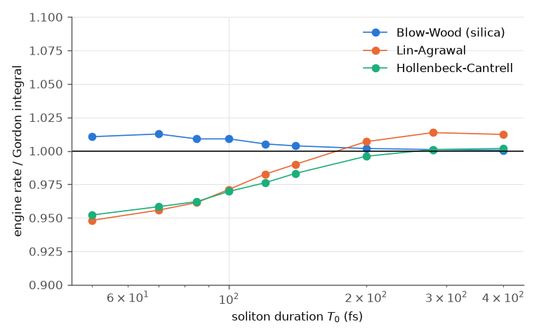
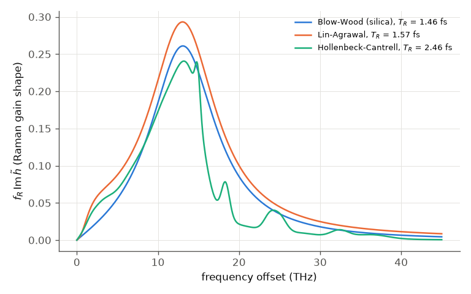

# Gordon (1986): the soliton self-frequency shift

J. P. Gordon, "Theory of the soliton self-frequency shift", Opt. Lett. 11, 662 (1986), DOI 10.1364/OL.11.000662.
**Not open access; neither the paper nor its abstract could be read.** Status: **reproduced against the
perturbation theory**; the paper's worked example is UNVERIFIED.

## What the paper claims

The Raman effect continuously red-shifts a fibre soliton. To first order, for a sech² soliton
P(t) = P0 sech²(t/T0) with γ P0 T0² = |β2| and energy E = 2 P0 T0, the moment method gives Gordon's integral over
the Raman gain (derived in `run.py`; h(t) is the model's response with unit integral, fR its fraction):

    dΩ/dz = −(γ fR / E) ∫ |P̃(W)|² W Im H(W) dW / 2π,    |P̃(W)|² = (π P0 T0² W / sinh(π W T0 / 2))²,
    Im H(W) = ∫ h(t) sin(W t) dt

For T0 much longer than the Raman times, Im H ≈ W T_R / fR with T_R = fR ∫ t h(t) dt, and the rate becomes the
textbook law dΩ/dz = −8 |β2| T_R / (15 T0⁴) (Agrawal, *Nonlinear Fiber Optics*, Raman-induced frequency shift):
the **T0⁻⁴ law**. Gordon's abstract is quoted in secondary sources with a worked example, "a 250 fs soliton at
1.5 µm in a fibre with D = 15 ps/(nm km) shifts by its own spectral width in about 100 m"; it is UNVERIFIED and only
a soft check. The numeric prefactors found online (0.0436 / τ⁴ in THz/km; 5.12 |k''| / t⁴) have unknown units and
are not used.

## Our setup

* `run.py` (Python API): an N = 1 sech² soliton at 1550 nm in a `fiber` element with β2 only
  (D = 15 ps/(nm km), β2 = −19.13 ps²/km), γ = 1.3 /(W km), Raman on, self-steepening off, the engine's auto grid.
* The fibre is four segments with probes; the spectral centroid Ω(z) at the five probes is fitted with a line.
  The length gives a shift of about 0.05 / T0, so the soliton keeps its shape (checked: FWHM unchanged to 0.04 %).
* T0 = 70 ... 200 fs (fast tier, 12 s) or 50 ... 400 fs (full tier); three Raman models, each with its published
  response and fraction:

| model | response | fR | T_R = fR ∫ t h dt |
|---|---|---|---|
| `silica` | Blow & Wood: damped oscillator 12.2 / 32 fs | 0.18 | 1.46 fs |
| `linAgrawal` | Lin & Agrawal 2006: + boson peak (96 fs) | 0.245 | 1.57 fs |
| `hollenbeck` | Hollenbeck & Cantrell 2002: 13 modes | 0.18 | 2.46 fs |

  The often-quoted T_R ≈ 3 fs comes from the measured gain slope; the Blow-Wood oscillator has about half of it.

```bash
python run.py --tier fast             # or: python3 build/paper_check.py gordon
python run.py --tier full --figures
```

## Plots



The red-shift rate: engine (points), Gordon's integral with each model's response (lines) and the long-pulse law
8|β2|T_R/15T0⁴ (dashed).



Engine rate / Gordon's integral.



The three Raman gain shapes fR Im H̃(f) and their T_R.

## Comparison (full tier)

| quantity | reference | Blow-Wood | Lin-Agrawal | Hollenbeck |
|---|---|---|---|---|
| engine rate / Gordon integral, worst over T0 = 50-400 fs | 1 | 1.013 | 0.948 (50 fs) | 0.952 (50 fs) |
| ... at T0 ≥ 140 fs | 1 | ≤ 1.004 | 0.990-1.014 | 0.983-1.002 |
| exponent, T0 = 200-400 fs | −4 (long-pulse law) | −4.02 | −4.41 | −4.13 |
| exponent of the integral itself, same fit | | −4.02 | −4.40 | −4.13 |
| engine / 8\|β2\|T_R/15T0⁴ at 400 fs | 1 | 1.004 | 1.67 | 1.09 |
| distance to shift one spectral width, 250 fs FWHM | ~100 m (abstract, UNVERIFIED) | 208 m | 87 m | 107 m |

## Commentary

* The engine follows Gordon's integral: to 1.3 % for Blow-Wood at every T0, and to 1-2 % for
  the other two models for T0 ≥ 140 fs. The fitted exponents agree with those of the integral to 0.01.
* The long-pulse T0⁻⁴ law needs T0 much longer than every time of the response. For Blow-Wood and Hollenbeck it
  holds to 0.13 in the exponent from 200 fs; the Lin-Agrawal boson peak (96 fs, a gain bump near 2 THz) keeps the
  rate 1.7 × above 8|β2|T_R/15T0⁴ even at 400 fs, and its local exponent is −4.4 there. That is the model, not the
  solver: the integral does the same.
* For T0 ≤ 100 fs the engine is 3-5 % slower than the first-order integral for the two broad-gain models: the
  shift per soliton period is no longer small, and first-order perturbation theory (an unchanged sech of the
  same T0) is not expected to hold to better than that. Not investigated further.
* Gordon's worked example (~100 m) agrees best with the Hollenbeck model (107 m), whose gain is the measured
  spectrum; the Blow-Wood oscillator, with half the gain slope, needs twice the distance.

## What is not done

* Self-steepening, β3 and loss (the cancellation of the shift by β3 near the zero-dispersion wavelength).
* The paper itself was not read; its prefactor in practical units is not compared.
