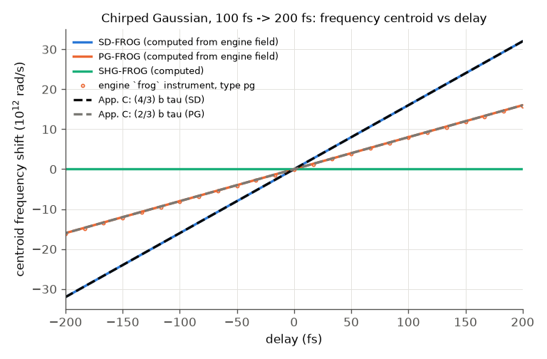
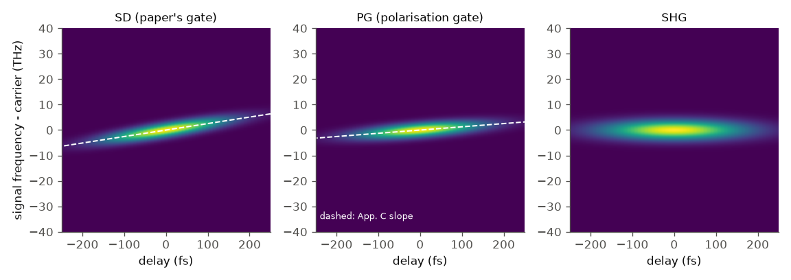
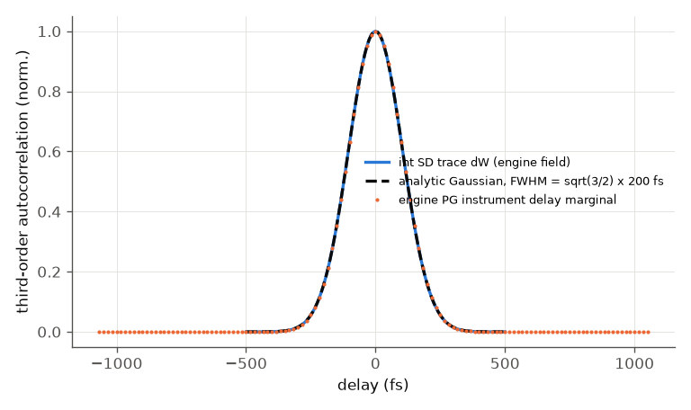
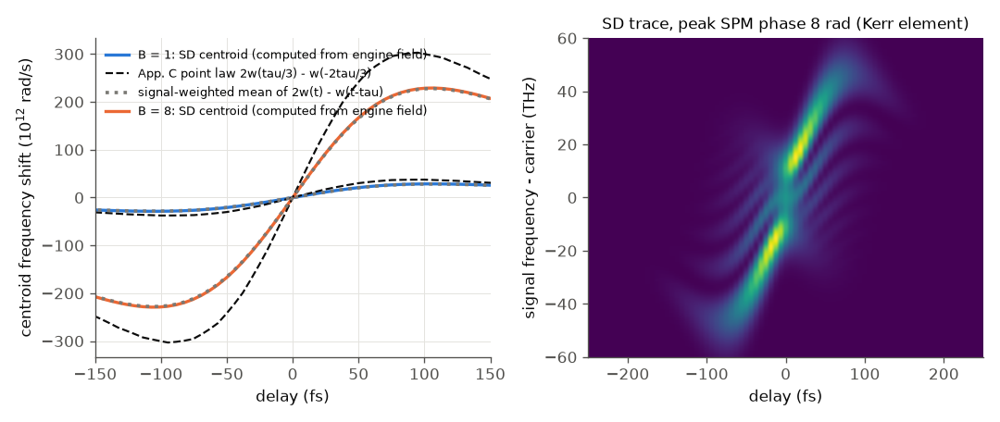
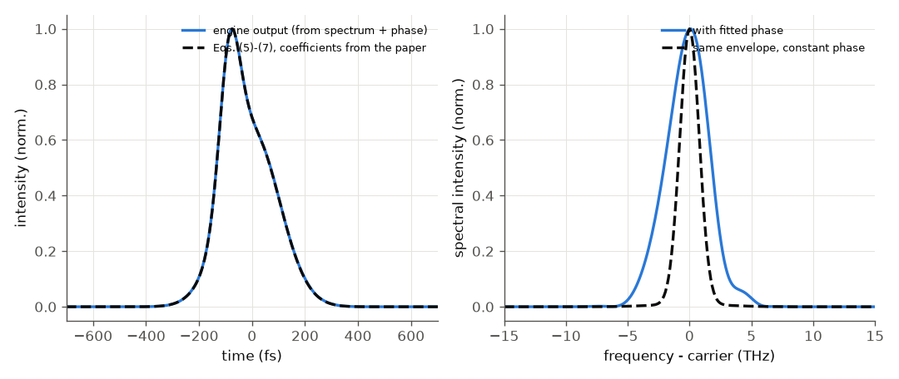

# Kane & Trebino 1993 -- frequency-resolved optical gating (FROG)

Paper: D. J. Kane and R. Trebino, IEEE J. Quantum Electron. 29, 571 (1993), doi 10.1109/3.199311 (not open access).

**Was the paper readable?** Text yes, figures no. The PDF's text layer was extracted (the PDF page renderer was not
available in this environment), so every sentence, equation description and appendix was read. The figures were not
viewed: no number below is read off a graph; what the figures show (Figs. 5-11) is UNVERIFIED here. The fit
coefficients of Eqs. (5)-(7) were taken from the text layer and may carry OCR errors.

## What FROG is (for a reader who has not seen the paper)

You split a pulse in two, cross the copies in an instantaneous nonlinear medium, and record the spectrum of the
generated signal for each delay tau between the copies. The result is a picture of intensity versus (delay, frequency),
like a musical score of the pulse. The paper's gate is *self-diffraction* (SD): the signal is
E_sig(t, tau) = E(t)^2 E*(t - tau). Because the gate is the pulse itself, a 2-D phase-retrieval argument (no
Fundamental Theorem of Algebra in 2-D) makes the pulse recoverable from the trace up to trivial ambiguities. Two
results used here: the trace of a chirped pulse tilts (frequency rises with delay) and Appendix C turns the tilt
into the chirp rate; SHG-FROG, in contrast, is symmetric in delay and cannot tell the direction of time (Appendix B).

## Lab setup and what we reproduce

| item | paper (location) | our model |
|---|---|---|
| pulse | ~200 fs, positively chirped, compressible to ~100 fs, ~620 nm (p. 574) | Gaussian, 100 fs transform limit, GDD 6247 fs^2 -> 200 fs, 620 nm (engine input) |
| medium | 3 mm BK-7, 6 uJ per beam, 25 GW/cm^2 (p. 574) | engine `bulk` N-BK7, constant area chosen for 25 GW/cm^2 |
| FROG geometry | self-diffraction; PG discussed in App. C | SD trace computed here from the engine field; PG and SHG traces from the engine `frog` instrument |
| fitted pulse | Eqs. (5)-(7), tau_ref = 76 fs (p. 574-575) | built from the printed coefficients, fed to the engine as spectrum + phase |

Run: `python run.py --tier fast` (about 2 s) or `--tier full` (more retrieval seeds); `--figures` writes `figures/`;
`python3 build/paper_check.py kane` checks. The engine supplies the pulses, the Kerr step, its own PG / SHG FROG
traces and the PCGPA retrieval. **Missing engine capability:** the `frog` instrument and the retrievers know `shg` and
`pg` only, not the paper's self-diffraction (E^2 E*) gate (and no `xfrog`). The SD trace is therefore computed in
`run.py` with numpy on the engine's complex field; it is not an engine feature and SD retrieval is not possible.

## Comparison, paper vs ours

Where the "paper" column is a law from an appendix, the reference is that law; where it is a measured number it is
quoted with its location. "Ours" is from the full tier.

| quantity | paper | ours | verdict |
|---|---|---|---|
| chirp lengthens the pulse by | factor ~2 (p. 575) | 2.000 (100 fs -> 200.07 fs, by construction) | consistent |
| SD trace: mean frequency slope / chirp rate | 4/3 (App. C: w = 3/4 a t) | 1.33333 | agrees |
| PG trace: slope / chirp rate | 2/3 (App. C: w = 3/2 a t) | 0.66667 (numpy); 0.66667 (engine `frog` pg) | agrees |
| SHG-FROG trace symmetric in delay | yes (Eq. B2) | asymmetry 0 (numpy), 3e-16 (engine) | agrees |
| SHG-FROG retrieval: direction of time | ambiguous (App. B) | PCGPA on the engine's SHG trace returns GDD = +6247 and -6247 fs^2 for different seeds (12 seeds) | agrees |
| PG-FROG retrieval | no such ambiguity | GDD = +6246.6 fs^2 (true +6247.05), G = 7e-6 | agrees |
| integral of the SD trace over frequency = third-order autocorrelation (p. 575) | identity | difference < 1e-15 | agrees |
| third-order autocorrelation FWHM of the 200 fs pulse | not given (Fig. 9, UNVERIFIED) | 245.0 fs = sqrt(3/2) x 200 fs (analytic 244.95); engine PG marginal 245.2 fs | analytic check |
| 3 mm BK-7, 25 GW/cm^2: B integral | "negligible spectral broadening" (p. 574, no number) | B = 0.255 rad (analytic from the engine's own peak intensity 0.252); spectral rms width +8 %, FWHM +13 % (engine and a numpy Kerr step agree to 3e-7) | see below |
| 3 mm BK-7: GDD at 620 nm | "negligible" (p. 574, no number) | 196 fs^2 (3 % FWHM change) | consistent |
| fitted pulse (Eqs. 5-7): FWHM | "about 200 fs" (p. 575) | 204.3 fs (engine from spectrum + phase: 205.2 fs) | agrees (coefficients UNVERIFIED) |
| fitted pulse: chirp-to-transform-limit | ~2 (p. 575) | 2.07 | agrees |
| fitted pulse: spectrum with vs without the phase | "significantly narrower" without (Fig. 10 text) | rms width ratio 1.94 | consistent (qualitative) |
| fitted pulse: sign of chirp | positive (p. 575) | engine GDD +8074 fs^2 | agrees |
| fit rms 1.9 %, 33 x 33 array, Fig. 5 / 6 / 7 / 9 / 10 / 11 shapes | measured data | not reproduced: the measured trace is not available in the text | UNVERIFIED |

## Plots

Mean signal frequency (relative to the carrier) against delay for the 200 fs chirped pulse. Solid: SD (blue), PG
(orange, from the engine instrument as circles), SHG (green, flat). Dashed black / grey: Appendix C's slopes
(4/3) b tau and (2/3) b tau with b the chirp rate of the pulse (analytic 1.2e26 rad/s^2, equal to the field's to 1e-13).
The SD trace amplifies the chirp by 2 relative to the PG trace, the paper's "self-diffraction FROG is more sensitive
to chirp".

The three traces of the same pulse. SD and PG tilt; SHG does not (and is mirror-symmetric in delay).

Integrating the SD trace over frequency gives the third-order autocorrelation of the paper (blue), a Gaussian of
FWHM sqrt(3/2) x 200 fs (dashed); the engine's PG delay marginal (orange) is the same curve.

Weak and strong self-phase modulation (the paper's Figs. 3-4 use Q = 1 and Q = 8; the text has no definition of Q,
so we read it as the peak SPM phase B = 1, 8 rad: UNVERIFIED). Left: the centroid of the SD trace against Appendix C's
point law 2 w(tau/3) - w(-2 tau/3) (dashed) and against the same law averaged over the signal (dotted). Right: the
SD trace at B = 8, with the fringe structure the paper attributes to the phase at two different times.

The pulse of Eqs. (5)-(7), the engine's reconstruction of it from spectrum and phase (left, indistinguishable), and
its spectrum with and without the fitted phase (right).

## Commentary and disagreements

* **Appendix C is exact for linear chirp and only approximate otherwise.** For the chirped Gaussian the 4/3 and 2/3
  factors come out to 1e-13. For a nonlinearly chirped (SPM) pulse the point law 2w(tau/3) - w(-2tau/3) misses the
  trace centroid by 28 % (rms, of the maximum; B = 1 and 8), but the signal-weighted average of 2w(t) - w(t - tau)
  over the signal intensity E^2 E* matches to 0.5-0.9 %. The paper says the law holds for "not-too-pathological pulse
  shapes", so this is a statement about its range, not an error. Mean frequency versus delay still reveals the sign
  and shape of the chirp.
* **"Negligible spectral broadening" in BK-7 (p. 574)** is qualitative in the paper. With the engine library's
  n2 = 3.4e-20 m^2/W the peak SPM phase is 0.26 rad and the spectral rms width of the chirped pulse grows by 8 %
  (FWHM by 13 %) because SPM adds chirp to an already chirped pulse. The engine's Kerr step agrees with a one-line
  numpy Kerr phase (3e-7). Whether 8 % counts as negligible cannot be decided from the text; the cubic-dependence
  claim and the observed spectra are UNVERIFIED (figures not seen).
* **Not reproduced:** the experimental trace and its fit residuals (no data), the 33 x 33 resampling and
  Fig. 11's spectra. The paper's own retrieval algorithm is announced as future work in the paper; the engine's PCGPA
  and ePIE are for SHG / PG and are used on those traces.
* The checks in `checks.json` compare the engine with the paper's appendix laws and with analytic Gaussian results; the
  tests in the BK-7 and fitted-pulse sections that rely on text-layer numbers are marked soft (`hard: false`).
