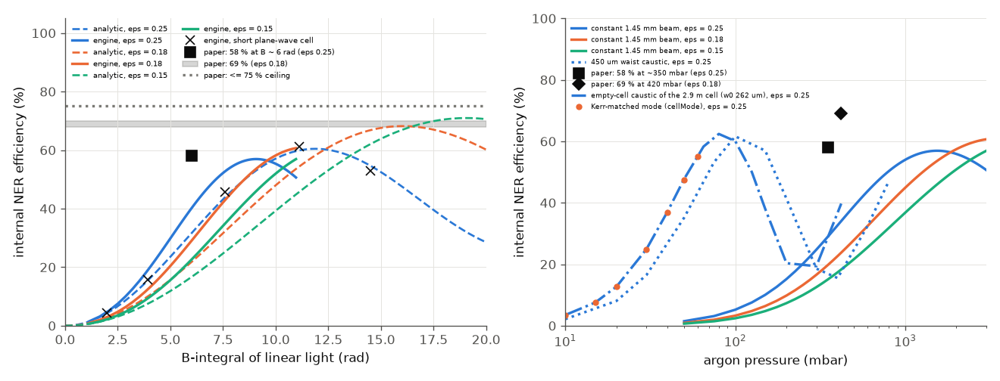
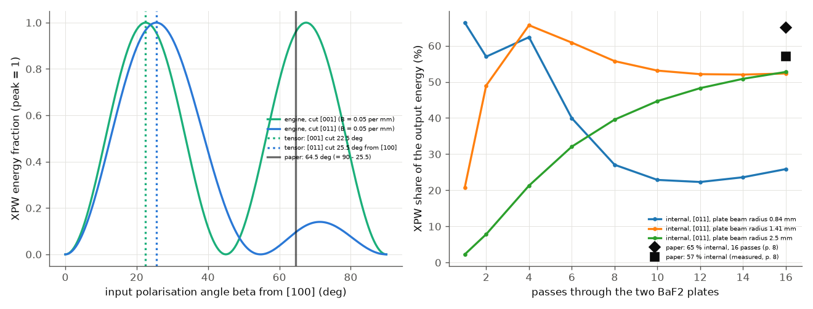

# Kaur et al. 2024: nonlinear ellipse rotation and XPW in a multi-pass cell

J. Kaur et al., J. Phys. Photonics 6, 015001 (2024), DOI 10.1088/2515-7647/ad078a (open access, CC BY 4.0).

**Readability.** All 14 pages were read as extracted text (the page-image reader needs `pdftoppm`, which is not installed).
No figure was seen, so every value that only appears in a figure is UNVERIFIED and is not checked. Reference numbers are taken
from the running text only (`paper.json`).

## What the paper does

1 mJ, 30 fs, 800 nm Ti:sapphire pulses go through an argon-filled cell (two 1.5 m mirrors, about 3 m apart, 12 passes = 36 m).
Elliptical input light (quarter-wave plate, ellipticity eps 0.25 or 0.18), a second crossed quarter-wave plate and a polariser
turn the intensity-dependent rotation of the ellipse (NER) into a temporal filter: only the strong centre of the pulse is
rotated and transmitted. Reported: internal efficiency (energy after / before the polariser) 58 % at ~350 mbar for eps 0.25;
69 % at 420 mbar for eps 0.18, with 5.8 fs nearly transform-limited pulses after compression and a contrast gain of at least 3
orders. The second half of the paper uses cross-polarised wave generation (XPW) in two 600 um BaF2 plates (65 % internal).

## What we model, and what we cannot

* **NER: modelled.** `run.py`: 1 mJ, 30 fs Gaussian, 12 passes of 3 m argon with 1 % loss per mirror; QWP1 as the ideal input
  ellipse (eps = tan alpha), QWP2 the inverse plate, polariser crossed with the input; efficiency computed from the engine's output
  field. Two readings of the beam: a constant 1.45 mm radius (2.9 mm diameter on the end mirrors, "overall constant beam size")
  and a 450 um waist Gaussian caustic in every pass. Plane wave in 1-D.
* **Analytic reference** (instantaneous Kerr, no dispersion): the ellipse rotates by theta(t) = B(t) sin(2 chi) / 3, B = the
  B-integral of linear light of the same intensity (`docs/reference/nonlinear.md`). Averaged over a Gaussian pulse the transmission
  has a ceiling that depends only on eps: 60.4 % (eps 0.25), 68.2 % (0.18), 71.0 % (0.15).
* **Cell mode (new): the `cellMode` helper.** `ultrafast.cells.cell_mode` gives the Kerr-matched Gaussian eigenmode of a two-mirror cell at a
  given peak power and gas pressure (docs/reference/components.md, "Multi-pass cell mode"). `run.py` uses it for the stated mirrors
  (R = 1.5 m) with a mirror distance of 2.9 m (our reading of "about 3 m", see below) and the 31 GW peak power of the first pass.
* **XPW: modelled with the engine's cubic Kerr tensor (new).** Built-in `BaF2` (Li 1980 index; n2 = 2.0e-20 m2/W and the anisotropy
  sigma = -1.2 are literature values, both UNVERIFIED), `kerrCutAxis` and `kerrAzimuthDeg` on the element. 1-D plane wave only (the engine
  rejects the cubic term in a radial model): two 600 um plates per pass, constant beam radius, 4 % loss per pass. No free-space diffraction,
  no Kerr lens, no average over the beam profile: this is the efficiency of the beam centre.



*Left: internal NER efficiency against the B-integral of linear light: analytic law (dashed), engine with the 36 m argon cell
(solid), engine short plane-wave cell (crosses); the paper's numbers as black marks. Right: against argon pressure for the beam
readings (constant 1.45 mm; 450 um caustic; the new 2.9 m cell: its empty-mode caustic, and the Kerr-matched mode from `cellMode` where one
exists), with the paper's two measured points. Where the efficiency is not smooth the pulse breaks up at B above the optimum.*

## Comparison

Re-run on the merged engine (2026-11-08): every NER number is identical to the earlier run (argon, 800 nm, 1-D: the carrier-offset and
stepper fixes change nothing here). New rows are marked (new).

| quantity | paper (location) | ours |
|---|---|---|
| maximum NER efficiency, eps 0.25 | 58 % (p. 4, measured, ~350 mbar) | 57 % at 1.55 bar (constant beam); 62 % at 100 mbar (450 um caustic); 62 % at 80 mbar (new, 2.9 m cell caustic); analytic ceiling 60 % |
| efficiency, eps 0.18, 420 mbar | 69 % (p. 5) | 24 % (constant beam), 34 % (caustic), 15 % (new, 2.9 m cell); analytic ceiling 68 %; the engine reaches 61 % only at 3 bar (constant beam) |
| ceiling for eps >= 0.15 | "should not exceed 75 %" (p. 3) | analytic 71 % at eps 0.15 |
| pressure of the maximum, eps 0.25 | ~350 mbar (p. 4) | 1.55 bar (constant) / 100 mbar (450 um caustic) / 80 mbar (2.9 m cell caustic) / 60 mbar (Kerr-matched mode, the only pressures with a mode) |
| B at 400 mbar | ~6 rad (p. 3; B not defined) | 5.4 rad (constant beam); 19 rad (450 um caustic); 24 rad (2.9 m cell caustic) |
| analytic efficiency at B = 6 rad, eps 0.25 | (58 % claimed) | 32 %; the peak angle at B = 6 rad is 54 deg, not > 90 deg as the paper states (p. 3) |
| transform-limited duration at 420 mbar, eps 0.18 | 5.8 fs (p. 4) | 10.3 fs (constant), 3.7 fs (caustic), 2.4 fs (2.9 m cell) |
| contrast gain with a 5e-3 polariser leak | at least 3 orders (p. 4) | 2.2 orders (peak transmission 0.80 / 5e-3 = 160) |
| overall efficiency | 49 % overall, 69 % internal (p. 5) | the 12 mirrors alone give 0.886; the other losses are not given |
| cell: waist, beam diameter on the mirrors | 450 um, 2.9 mm (p. 2) (new) | R = 1.5 m, d = 2.9 m: 262 um, 2.87 mm. The waist of 450 um is not possible (confocal limit 437 um); the 2.9 mm fixes d = 2.9 m |
| Kerr-matched mode at 350 mbar, 31 GW (new) | the experiment worked there | none exists above 0.2 of the peak power (argon P_cr = 29 GW at 350 mbar); a mode exists at full power only up to ~60 mbar |
| BaF2 P / P_cr | ~5e3 (p. 7) | 9.6e3 with the built-in n2 = 2.0e-20 (UNVERIFIED); 5e3 would need n2 = 3.8e-20 |
| XPW optimum input angle | 64.5 deg "to the optical axes", holographic cut (p. 8) (new) | tensor, [011] cut: 25.5 deg from [100] = 64.5 deg from [01-1] (engine peak 25.5 deg); [001] cut: 22.5 deg |
| XPW internal efficiency, 16 passes | 65 % (simulated), 57 % measured (p. 8) (new) | depends on the beam radius at the plates, which is not given consistently: 26 % at 0.84 mm (stated waist 330 um, plates 1 m away), 52 % at 1.41 mm, 53 % at 2.5 mm; best pass count 1-4 for the smaller beams, up to 66 % |
| XPW overall efficiency | 28 % measured, 34 % (p. 8, 10) (new) | 14 % / 27 % / 28 % for the same three beams |

## XPW and the 64.5 deg angle (new)

**Reading of the paper.** p. 7 says "holographic cut BaF2" crystals "aligned with the same orientation"; p. 8 says the input polarisation is
"64.5 deg with respect to the optical axes of the BaF2 crystals, which maximizes XPW conversion efficiency per pass". It does not say which
axis, and it does not name the cut index. The engine's tensor gives, at low conversion:

* [001] cut, angle beta from [100]: XPW proportional to sin^2(4 beta), maximum at 22.5 deg (and 67.5 deg).
* [011] cut (the usual meaning of "holographic cut"), beta from [100] in the plane (lab x = [100], y = [01-1]): amplitude
  sin b cos b (sin^2 b / 2 - cos^2 b), global maximum at **25.5 deg from [100]**, a smaller one at 71.3 deg, zero at 54.7 deg. The peak is
  (0.2805 / 0.25)^2 = 1.26 times that of the [001] cut.

64.5 deg = 90 deg - 25.5 deg: the paper's angle is the [011]-cut optimum measured from the other in-plane axis ([01-1]). It cannot be the
[001] cut (22.5 / 67.5 deg) and a value measured from [100] would be 25.5 deg. **This reading (holographic = [011]-type cut, angle from [01-1])
is UNVERIFIED**: the match is exact, but the paper's reference axis is not stated, and the cited Ref. [46] is a carrier-envelope-phase paper (Canova et al., Opt. Lett. 34, 1333 (2009)) that
cannot settle it (the intended reference is probably another Canova et al. paper on holographic-cut BaF2; not checked). A web search confirmed only that commercial "holographic cut" BaF2 for XPW
is [011]-oriented (EKSMA Optics product page), not which axis the 64.5 deg refers to. The engine reproduces both curves (`xpwCurveLowB_*` in `results/numbers.json`, checks in `checks.json`).



*Left: XPW energy fraction against the input angle for the two cuts at low conversion (B = 0.05 per mm), normalised; dotted: tensor
optimum; grey: the paper's 64.5 deg. Right: internal XPW efficiency (XPW energy / output energy) against the number of passes through two
600 um BaF2 plates, [011] cut at 25.5 deg, three assumed beam radii at the plates; paper's 65 % (simulated) and 57 % (measured) at 16 passes.*

**Efficiency against passes.** The plates sit in a strong B regime (5.9 rad per pass at 0.84 mm radius, 2.3 rad at 1.41 mm, 0.8 rad at 2.5 mm; 31 GW
peak power). At the large B the conversion saturates and goes back into the fundamental, so the curves oscillate with the pass number.
Only the largest radius gives a monotonic rise to about the paper's 16-pass value. The beam radius at the plates cannot be derived from the paper:
a 330 um waist and plates 1 m away give 0.84 mm (B too large), "4 mm on the end mirrors" does not fit R = 1.5 m (1.2 mm radius at 1.5 m
from a 330 um waist). The three radii are a sensitivity scan, **not** a fit: nothing was chosen to match 65 %. The result that survives: the
[011] cut beats the [001] cut at every beam size we tried (internal 52 % against 9 % after 16 passes at 1.41 mm), as the paper's use of the
holographic cut implies. A plane-wave centre-of-beam model overestimates the conversion of a Gaussian beam; the paper's 65 % is a spatial
simulation.

## Kerr-matched cell mode (new)

The cell has two 1.5 m mirrors "about 3 m apart" and a 450 um waist with 2.9 mm beam diameter on the mirrors (p. 2). `cellMode` shows the
statement is not self-consistent as a linear cell: the largest waist for R = 1.5 m at 800 nm is 437 um (confocal, d = 1.5 m), and the empty
mode of a d = 2.9 m cell is 262 um with a 2.87 mm diameter on the mirrors, which is the paper's 2.9 mm. We therefore take d = 2.9 m (UNVERIFIED;
d = 3 m is concentric, waist 148 um at d = 2.99 m).

With argon and the pulse's 31 GW peak power the helper finds a self-consistent mode only at low pressure:

| argon pressure | largest peak power (fraction of 31 GW) with a Kerr-matched mode, d = 2.9 m |
|---|---|
| 50 mbar | 1.0 (mode: waist 269 um, 2.78 mm diameter on the mirrors, B = 10 rad in 12 passes) |
| 100 mbar | 0.68 |
| 200 mbar | 0.31 |
| 350 mbar | 0.20 |
| 420 mbar | 0.14 |

At the 350 mbar of the paper the Kerr lens of the argon (P_cr = 29 GW, so P / P_cr = 1.06 at the peak) drives the round trip out of its stability
range for any peak power above 6 GW. The helper models the peak of the pulse only (the wings and the temporal average see a weaker lens), round
beams and a thin Kerr lens per slice (second-moment), so it is a conservative estimate; it does not prove the paper's cell is unstable. What it does
show: with the stated mirrors and a 3 m cell, the beam that the paper describes is not a Kerr-matched mode at the pressure that was used, so the pressure at which
the NER peaks depends on a Kerr-matched mode the paper does not specify. Feeding the 2.9 m cell's empty-mode caustic (and the Kerr-matched mode where
it exists) into the NER pass puts the efficiency maximum at 60-80 mbar (62 % at 80 mbar), 4-6 times below the paper's 350 mbar, in the same
direction as the 450 um caustic (100 mbar), while the constant 1.45 mm beam gives 1.55 bar. The paper lies between the two kinds of reading; none lands on 350 mbar.
No radial run was made for the NER stage (the vector NER + radial model is not set up here).

## What does not reproduce

* **The pressure (and B) at which the efficiency peaks.** The magnitude of the maximum agrees with the analytic ceiling for
  all three ellipticities (58 / 69 / <= 75 % against 60 / 68 / 71 %), so the polarisation chain and the ellipticity convention
  are consistent with the paper. The B needed to reach it is not: for eps = 0.25 the textbook law needs a peak angle of 90 deg, i.e.
  B = 10 rad of linear light, while the paper says the maximum occurs at about 6 rad. At B = 6 rad the same law gives 32 %.
  Debugging: the polarisation chain gives zero light for linear input (`linearLeak`); the engine agrees with the analytic
  efficiency to 2 % absolute in a short plane-wave cell (B up to 14 rad); with dispersion and self-steepening off the
  conclusion is unchanged; and `repro_1.py` shows the engine's one-pass B equals the closed form 8 pi n2 P / lambda^2 atan(d / 2 zR)
  to 0.1 % and its ellipse rotation equals B sin(2 chi)/3 to 0.4 %. The engine therefore does what the textbook law says;
  the gap is in how the paper's B, ellipticity or beam is defined. We tried the other reading of eps (the ratio of the minor and
  major INTENSITIES, tan^2 chi) in exploration: it puts the maximum at B ~ 6-7 rad, as the paper says, but caps the efficiency at
  28-42 %, far below 58-69 %, so neither reading reproduces all the numbers. This was not tuned further.
* **Beam geometry.** See "Kerr-matched cell mode": the stated 450 um waist cannot exist; with d = 2.9 m the empty mode fits the 2.9 mm diameter, and
  no Kerr-matched mode exists at 350 mbar and the full peak power.
* **Compressed pulse duration.** 5.8 fs needs a spectrum of order 150 nm: the constant-beam reading (B = 5.4 rad) gives 10 fs,
  the 450 um caustic 3.7 fs, the 2.9 m cell 2.4 fs. Again the geometry decides.
* **Contrast.** With the quoted leak of 5e-3 (read as a power leak) the improvement is limited to ~160 (2.2 orders), less than
  the reported >= 3 orders. The reading of "5e-3" (power or field, polariser quality of the rotated beam) is not stated.
* **XPW efficiency 65 % at 16 passes** is reproduced only for a plate beam radius the paper does not give (see above); with the geometry it states
  (0.84 mm) we get 26 %.

## How well the science matched

| quantity | paper | ours | verdict | most likely reason |
|---|---|---|---|---|
| NER efficiency ceiling, eps 0.25 / 0.18 / 0.15 | 58 / 69 / <= 75 % | analytic 60 / 68 / 71 %; engine 57 % (maximum at 1.55 bar) for eps 0.25, but only 61 % / 57 % at the 3 bar edge of the scan for eps 0.18 / 0.15 (not maxima; at 420 mbar 24 %) | partly | the ceiling itself agrees (it depends only on eps: a property of the Jones chain; engine matches the closed form to 2 %); the cell reaches it only at pressures the paper did not use (beam assumption) |
| pressure of the NER maximum | ~350 mbar | 1.55 bar (constant beam); 60-100 mbar (caustic readings) | does not | paper does not specify inputs (assumption): beam radius along the cell and the Kerr-matched mode are not given; the stated waist (450 um) is internally inconsistent with R = 1.5 m (paper erratum / internal inconsistency) |
| B at the optimum | ~6 rad | 5.4 (constant) / 19-24 (caustics); textbook law needs 10 rad for the 90 deg peak | partly | paper internal inconsistency: a maximum at 58 % with B = 6 rad contradicts the instantaneous-Kerr law (54 deg peak, 32 %); B is not defined (UNVERIFIED reading of eps and B) |
| 69 % at 420 mbar, eps 0.18 | 69 % | 24-34 % (15 % in the 2.9 m cell) | does not | same as the pressure row (assumption on the beam) |
| transform-limited 5.8 fs | 5.8 fs | 10.3 / 3.7 / 2.4 fs | does not | assumption: the beam sets B and so the bandwidth; none of the readings is the paper's |
| contrast gain >= 3 orders | >= 3 | 2.2 | partly | UNVERIFIED reading of "5e-3" (power or field leak) and of the rotated beam's polarisation purity |
| Kerr-matched mode at 350 mbar | exists (experiment) | none above 0.2 of the peak power | partly | mostly physics of the regime (P / P_cr = 1.06 in a near-concentric cell); the helper is conservative (engine limitation, cellMode: peak power only, instantaneous Kerr, round beams, thin second-moment lens) and the paper's actual beam is not given (assumption) |
| 2.9 mm beam on the mirrors | 2.9 mm | 2.87 mm (d = 2.9 m) | agrees | assumption d = 2.9 m (the paper says "about 3 m") |
| waist 450 um | 450 um | 262 um | does not | paper erratum / internal inconsistency (confocal limit 437 um); not a Kerr-matched value either |
| XPW optimum angle 64.5 deg | 64.5 deg | 64.5 deg from [01-1] in the [011] cut | agrees | UNVERIFIED reading: holographic cut = [011]-type, angle measured from [01-1]; the paper names no axis |
| XPW internal efficiency, 16 passes | 65 % (57 % measured) | 26 % (0.84 mm), 52-53 % (1.4-2.5 mm) | partly | assumption (beam radius on the plates not given consistently) and engine limitation: 1-D plane wave, no spatial average, no Kerr lens, cubic term refused in the radial model |
| BaF2 P / P_cr | 5e3 | 9.6e3 | does not | UNVERIFIED BaF2 n2 (2.0e-20; paper implies 3.8e-20) |

**Overall judgement.** The engine reproduces the polarisation physics of NER (the ceilings, the ellipse rotation law to 0.4 %, the Jones chain) and the
XPW tensor law (both cuts, the 64.5 deg reading), and it shows quantitatively why the paper's cell is under-specified (no waist of 450 um, no Kerr-matched mode at
350 mbar with a 31 GW pulse). It does not reproduce where the paper's NER peaks (350 mbar, B = 6 rad), the 5.8 fs compressed pulse, the 3-orders contrast gain or the 65 % XPW
efficiency, because those depend on the beam inside the cell, which the paper does not give and which the paper's own simulation provides only as a figure. To close the gap one needs the paper's measured
caustic (Fig. 7) or spectra as input, a time-resolved Kerr-matched mode (not only the peak), a radial vector model with the cubic term (the engine refuses it today) and
the paper's n2 and sigma for BaF2.

## What is left

The measured spectrum as input; Fig. 3 spectra and Fig. 7 caustics (not read); a radial NER run with the matched mode; XPW with a spatial beam and a
Kerr lens per plate; the output compressor; the polariser as a thin-film stack; the right reference for the 64.5 deg convention (Ref. [46] is a CEP paper; likely Canova et al., Appl. Phys. Lett. 92, 231102 (2008), not read) and of the BaF2 n2 and sigma.

## Files and run

`run.py` (tiers; NER, cell mode, XPW), `repro_1.py` (engine vs closed form, one pass and ellipse rotation; still valid, passes), `checks.json`, `paper.json`.
`repro_2.py` (no XPW in the engine) was removed: the engine has the XPW tensor now, and its checks are in `checks.json` (angle laws, [011] / [001] ratio).

```bash
python3 build/paper_check.py kaur                                    # fast tier, ~80 s
cd docs/papers/kaur-2024-mpc-ner-xpw && python run.py --tier full --figures
```
