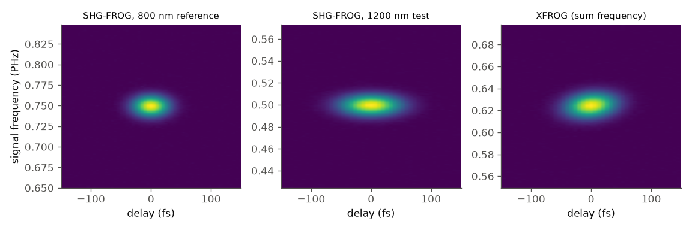
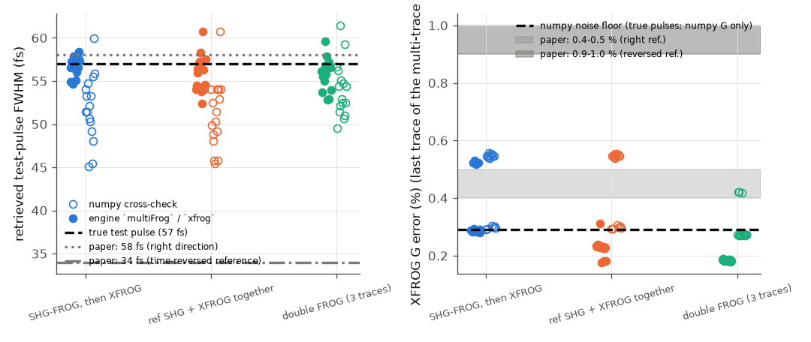
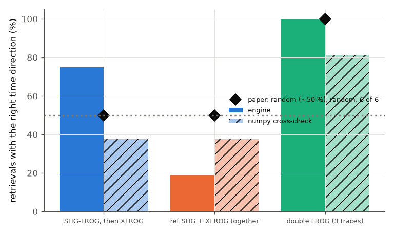

# Kida et al. 2014 -- "double FROG" (SHG-FROG + XFROG analysed together)

**Was the paper readable?** Text yes (4 pages, text layer extracted; the PDF page renderer was unavailable), figures no.
All numbers below come from the text. The retrieved intensities and phases of Figs. 4, 5, 7 and the traces of
Fig. 3 were not seen: UNVERIFIED and not used.

Paper: Y. Kida, Y. Nakano, K. Motoyoshi, T. Imasaka, Opt. Lett. 39, 3006 (2014), doi 10.1364/OL.39.003006 (not open access).

## The idea

Two unknown pulses (an 800 nm reference and a 1200 nm test pulse) are overlapped in one thin BBO crystal. One
scan of the delay between two copies of the double pulse records three signals in one spectrometer: the second
harmonic (SHG) of each pulse (two SHG-FROG traces) and the sum-frequency (SFG) of one with the other (an XFROG trace).
An SHG-FROG trace is the same for a pulse E(t) and its conjugated time reversal E*(-t), so retrieving the reference from
SHG alone gives the right pulse or its twin at random, and the test pulse (retrieved from the XFROG trace using that
reference) is wrong when the twin is used. Analysing the three traces together should remove the ambiguity and make the
retrieval reproducible.

## Setup and what we model

| item | paper | ours |
|---|---|---|
| reference | 800 nm, 35 fs, Ti:sapphire (p. 3007) | engine: Gaussian, 30 fs transform limit + GDD 195 fs^2 -> 35.0 fs (chirp is an assumption) |
| test | 1200 nm OPA, ~58 fs, positive chirp (pp. 3007-3008) | engine: Gaussian 40 fs + GDD 580 fs^2, then 3 mm fused silica -> 57.6 fs, GDD 598 fs^2 (assumption) |
| dichroic mirror | 3 mm fused silica, GDD 25.6 fs^2 (p. 3009) | engine `bulk` FusedSilica 3 mm |
| crystal | BBO 5 um, theta = 33.2 deg, phi = 90 deg | engine phase-matching calculator, type I assumed |
| FROG traces | SHG ref, SHG test, one XFROG (SFG) | engine `frog` (shg) and `xfrog` instruments, 128 x 128, additive noise 0.4 % of the peak (assumption) |
| algorithm | generalised projections, Fig. 6 | engine: `uf.retrieve` (pcgpa, kinds `shg-frog`, `xfrog`) and `uf.retrieve_multi` (`multiFrog`); a numpy version of Fig. 6 as an independent cross-check |

Everything the engine needs now exists: the `xfrog` instrument (a known `reference` pulse at 800 nm gates the 1200 nm test pulse at the sum
frequency), the single-trace retrievers with kind `xfrog` (the reference fixes the time direction) and the multi-trace `multiFrog` retrieval (the
double FROG, `docs/reference/retrieval.md`). The numpy SFG trace and the numpy algorithm are kept for cross-checking only. They agree with the
engine where they overlap (the numpy SHG delay marginal 49.9 fs against the engine instrument's 49.5 fs; the same G ratio of 2.0 for the reversed
reference).

How the engine runs are built: the reference SHG trace, the test SHG trace (after the substrate) and the XFROG trace of the test pulse gated by the
reference are produced by instruments, 0.4 % additive noise (seeded) is added to each, and `retrieve_multi` gets
`[{ref SHG}, {test SHG}, {XFROG, pulse: "test", gate: "ref"}]` from random starts (the engine's seeds 1000 + i). "Conventional": `pcgpa` on the reference SHG
trace, then `pcgpa` with kind `xfrog` using that retrieved reference as the gate. "Two traces": `retrieve_multi` with the reference SHG and the XFROG only.
The time direction is the sign of the retrieved GDD against the true one (+195 and +598 fs^2).

Run: `python run.py --tier fast|full` (fast: 6 starts, 600 iterations, about 85 s; full: 16 starts, 1000 iterations, about 6 min; both include the
numpy cross-check, which alone takes 19 s / 80 s).

## Comparison, paper vs ours (full tier, 16 starts; engine unless marked numpy)

| quantity | paper (location) | ours | verdict |
|---|---|---|---|
| engine SHG-FROG + PCGPA: time direction | two groups, twins (p. 3007) | GDD = +195 and -195 fs^2 across 12 seeds | agrees |
| conventional (SHG then XFROG): wrong-direction retrievals | random (p. 3007) | engine: 4 of 16 wrong (75 % right); numpy: 10 of 16 wrong (37.5 % right) | agrees with "random" within the statistics of 16 starts (the two implementations differ by chance level) |
| XFROG G error, right ref vs time-reversed ref | 0.4-0.5 % vs 0.9-1.0 % (pp. 3007-3008) | engine: 0.26 % vs 0.54 % (ratio 2.06; paper ratio 1.8-2.5); numpy 0.27 % vs 0.53 % (2.0); absolute values depend on the assumed noise | agrees (ratio) |
| test pulse FWHM, reversed reference vs right | 34 fs vs 58 fs (p. 3008) | engine: 51.0 fs vs 57.5 fs; the reversed reference gives negative GDD (-280 to -330 fs^2) in 6 of 6 fits; numpy 48-52 | direction agrees (shorter, opposite chirp), magnitude does not |
| "SHG(ref) + XFROG only" | no improvement, twin appears randomly (p. 3009) | engine `retrieve_multi` with two traces: 3 of 16 right (19 %), 13 wrong; noise-free: 0 of 6 right, G stops at 1e-3 to 4e-3 (see `repro_2.py`); numpy: 37.5 % right | **partly: no improvement, but ours is biased to the wrong direction, not random** |
| double FROG: wrong-direction retrievals | none in six (p. 3008) | **engine `multiFrog`: 0 of 16** (16 of 16 right, both pulses; test GDD within 3.7 %); noise-free G = 2e-4. The numpy version of Fig. 6: 3 of 16 wrong (81 % right) | **agrees with the engine; the numpy algorithm does not reproduce it** |
| double FROG: G errors | constant over retrievals: SHG 0.5 %, XFROG 0.4 % | engine trace errors of the three traces are the same for the 16 starts to 3 digits in the right-direction group (XFROG 0.18-0.2 %, last trace of the fit; not the paper's metric, U) | consistent |
| double FROG: reproducibility of the test FWHM (std over starts) | "no notable difference" (p. 3008) | engine: 1.8 fs (double) vs 1.1 fs (conventional); numpy 3.1 vs 3.75 fs | consistent (the spread is at the noise level either way) |
| dichroic substrate GDD (test pulse) | 25.6 fs^2 (p. 3009) | **18.2 fs^2** for 3 mm (`repro_1.py`) | **disagrees** (see below) |
| BBO 5 um at 33.2 deg: sinc^2(dk L/2) for SHG 800 / SHG 1200 / SFG | thin crystal chosen for broad phase matching (p. 3007, qualitative) | 0.97 / 0.90 / 0.90 (type I; its exact phase-matching angles 29.2 / 21.2 / 24.3 deg) | consistent |

## Plots

The three traces from the engine instruments (`frog` shg for the reference and the test pulse, `xfrog` for the sum frequency), noise 0.4 %. They are
the analogue of the paper's Fig. 3; the paper's own trace was not seen.

Each dot is one retrieval from a random start; filled: engine, open: numpy cross-check. Left: the test-pulse FWHM against the true 57.6 fs
(dashed). Right: the XFROG G error (the numpy line is the numpy noise floor; the engine's G is the engine's own error definition and a different
noise draw, so only compare within a marker type). Conventional and two-trace results fall in two groups (right and wrong direction). The engine's
double FROG gives only the right group; the numpy double method leaves 3 of 16 in the wrong-direction group.

Fraction of retrievals with both pulses in the right time direction (dotted: 50 %, a coin flip; hatched: numpy cross-check). The two-trace bar of the engine is 19 %, below a coin flip.

## What does not reproduce, and what changed

1. **"SHG(ref) + XFROG only" is not random in the engine.** With the engine's `retrieve_multi` on those two traces 13 of 16 starts end in the
   wrong-direction solution (both pulses with the sign of the chirp reversed), and the noise-free case does the same (0 of 6; the trace error stays at 1e-3
   to 4e-3 although the truth has zero) and does not move from 600 to 3000 iterations. So it is stagnation in a deep local minimum, not an exact
   ambiguity (an exact twin would reach G = 0). The paper says the twin appears at random. Likely reason: algorithm details of the
   start and the step order (the paper's are not given): not an engine bug, but an observation about `multiFrog` when a pulse has no SHG trace of its own.
   Minimal reproduction: `repro_2.py`. The same six starts with the third trace find the truth every time.
2. **GDD of the dichroic substrate: 25.6 fs^2 (paper) vs 18.2 fs^2 (engine).** Debugged first: the engine's value
   equals an independent second derivative of Malitson's fused-silica formula (18.14 fs^2, `repro_1.py`), so the
   engine is right for 3 mm of fused silica at 1200 nm. 25.6 fs^2 would need 4.2 mm, or other glass in the path;
   the paper does not say. This does not change any conclusion (both are tiny compared with the 580 fs^2 chirp).
3. **34 fs vs 58 fs.** The reversed reference gives a test pulse that is shorter (51 fs on average in the engine, 49-54 fs by
   start) and of the opposite chirp, but not by the 24 fs of the paper. This depends on the real pulses (the paper's
   are not Gaussian: its Figs. 4-5 phases span several radians) and our chirps are assumptions.
4. **The old "double FROG removes the ambiguity in 81 % only" finding was a property of the numpy algorithm, not of the paper's method.** The first
   version of this folder implemented Fig. 6 in numpy because the engine had no multi-trace retrieval, and got 13 of 16. The engine's `multiFrog` gets
   16 of 16 (6 of 6 in the fast tier) on the same pulses and noise level. Caution: `MultiTraceRetrievalTests` validated `multiFrog` on exactly these
   assumed pulses (30 fs / 195 fs^2, 40 fs / 580 fs^2, six seeds), so the 6-of-6 result is partly by construction; what is new here is the 0.4 % noise,
   the substrate in the test arm and 16 starts. The numpy result shows that the paper's claim depends on algorithm details.

### Why the fast-tier soft-fail count went from 2 to 4 (diagnosis)

The soft-fails are statistical and not a physics change. The two extra ones were fast-tier (6 starts) ordering checks: the reversed-reference test pulse
being at least 3 fs shorter (numpy 49.5 vs 52.2 fs: misses by 0.3 fs) and the spread of the double FROG's test FWHM being below the conventional one
(4.5 vs 3.7 fs). Evidence: (a) the numpy code was not changed; the full tier of the old `run.py`, re-run on the new engine, gives exactly the README
numbers of before (conventional 37.5 % right, double 81 % right, G ratio 2.0; the std values 3.1 and 3.75 fs against 3.1 and 4.3 quoted before) and passes both
checks (48.5 + 3 < 52.0; 3.09 < 3.75); (b) the old fast tier with five different noise seeds flips these two checks: the reversed-reference check fails for 4 of
5 seeds (margin 3 fs), the std ordering for 4 of 5; the 4-of-6 right-direction fraction is the same for all five seeds. (c) The new multi-trace retrieval cannot
be the cause: the old `run.py` never calls it. (d) The stream-1 change (input pulse at the requested carrier) cannot be separated from the others
because the old engine is not available; it only adds a sub-bin linear phase to the envelope, and the full-tier numbers are unchanged within
their quoted precision except the std of the conventional spread. Those two checks are now full-tier only. In the current fast tier two soft-fails
remain: the substrate GDD (a paper number the engine disagrees with, see above) and the "two traces" direction check (item 1).

## Notes and limits

* Noise is additive, 0.4 % of the peak, chosen before running; absolute G values follow from it, only comparisons
  (ordering, ratios) are tested. `KIDA_NOISE`, `KIDA_ITERS` and `KIDA_ENG_ITERS` environment variables exist only for sensitivity statements.
* Engine G (`pcgpa` error, `traceErrors` of `multiFrog`) and the numpy G are not the same function on the same grid: do not compare them across.
* The XFROG delay range is the full circle of the grid, not the single signal at +tau the paper records.
* UNVERIFIED (figures not seen): retrieved pulse shapes and phases, the double-FROG trace itself, the 50 s scan time effect.

## How well the science matched

Reasons: A = the paper does not specify inputs (assumption); E = erratum or internal inconsistency; L = engine limitation (named); B = engine bug
(named); U = UNVERIFIED reading.

| quantity | paper | ours | verdict | most likely reason |
|---|---|---|---|---|
| SHG-FROG alone: time direction random | p. 3007 | both signs of GDD (12 seeds) | agrees | none |
| conventional (SHG then XFROG): random direction | p. 3007 | 75 % (engine), 37.5 % (numpy) of 16 | agrees | statistics of 16 starts |
| XFROG G with right vs reversed reference | 0.4-0.5 % vs 0.9-1.0 % | 0.26 % vs 0.54 %, ratio 2.06 (paper 1.8-2.5) | agrees (ratio) | A: noise level assumed, so absolute G differs |
| test FWHM with the reversed reference | 34 fs (right: 58 fs) | 51 fs (57.5 fs) | partly (direction yes, size no) | A: pulse shapes and chirps (the paper's are non-Gaussian, U) |
| double FROG: no wrong-direction result in 6 | p. 3008 | engine 16 of 16 right; numpy Fig.-6 clone 13 of 16 | agrees (engine) | numpy algorithm details (start, step order) not given in the paper (A) |
| ref SHG + XFROG only: twin appears randomly | p. 3009 | 19 % right, noise-free 0 % (stagnation, G 1e-3 to 4e-3) | partly | A: start and step details; `multiFrog` local minimum (not an engine bug); `repro_2.py` |
| double FROG G errors constant and equal across retrievals | 0.5 / 0.4 % | trace errors equal across starts to 3 digits | agrees | metric differs (U) |
| substrate GDD 25.6 fs^2 | p. 3009 | 18.2 fs^2 (Malitson second derivative 18.14) | does not | E or A: 3 mm of fused silica gives 18 fs^2; the paper's path (thickness, extra glass) is unspecified |
| BBO 5 um phase matching at 33.2 deg | qualitative | sinc^2 0.90-0.97 | agrees | none; type I assumed (A) |

**Overall.** With the new `xfrog` instrument and `multiFrog` retrieval the engine reproduces the paper's central claim: the double FROG removes the
SHG time-direction ambiguity in every start (16 of 16 here, 6 of 6 as in the paper), the XFROG error doubles with the reversed reference (ratio 2.06
against 1.8-2.5), and the conventional route is a coin flip. Partly reproduced: the size of the pulse-shape error with a reversed reference (51 vs 34 fs),
because our pulses are Gaussians with assumed chirps; the behaviour of the two-trace subset (ours is biased, not random). Not reproduced: the substrate
GDD, which the engine gets right for 3 mm of fused silica, so the paper's number needs a different glass path. To close the gap one would need the
paper's retrieved pulses (Figs. 4-5) as inputs, its algorithm's start and step rules, and the substrate thickness.
