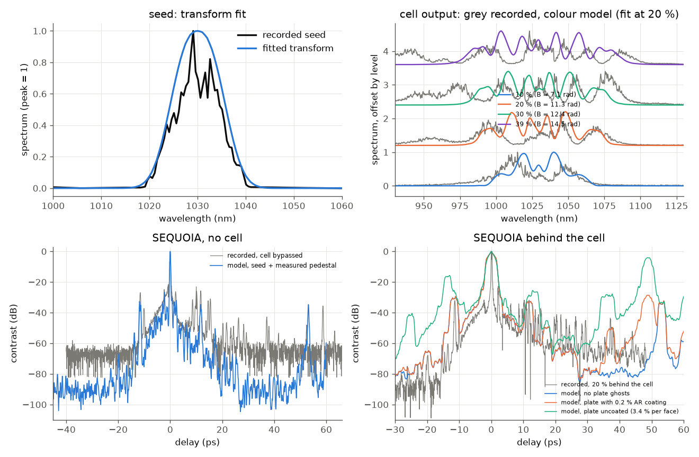

# Lab case: Pharos laser, multi-pass cell and SEQUOIA contrast

Not a paper: a worked example of modelling a real beamline from recordings (spectra and third-order cross-correlator
traces) with the fitting plugin, the measured-pedestal input and the delayed-light ledger. The recordings are the
owner's own (`data/`).

**System (as described).** Pharos, 1030 nm, 200 fs, 1 kHz. Telescope and input QWP, then a multi-pass cell: 50 passes,
1350 mm long, mirror ROC about 2 m, a 5 mm fused-silica plate 200 mm from a mirror, beam radius about 0.55 mm, dispersive
mirrors. Then QWP, HWP and a Glan polariser, then the SEQUOIA correlator.

**Reading the data.** `Spectrum_Pharos_Output.csv` is narrow (8.5 nm FWHM): it is the laser's own spectrum. The files
`Spectrum_Pharos{10,20,30,39}%.csv` are 50-120 nm wide and modulated, so they are treated here as the spectrum **behind the
cell** at those Pharos levels (please confirm). Pulse energy at the cell is taken from the power readings in the names of
the SEQUOIA files (10.1, 18.5, 21.2, 26.7 uJ).

## What the model does

1. **Seed.** A `transform` element (super-Gaussian spectral amplitude, fitted with the fitting plugin) turns a short
   transform-limited pulse into the recorded seed spectrum: 13.0 +- 0.3 nm, order 1.3 (rms deviation 4 % of the peak;
   the fine structure of the recording is not reproduced). Transform limit 160 fs; a GDD of 6900 fs^2 (set, not fitted:
   a spectrum does not constrain the phase) gives the stated 200 fs.
2. **Cell.** 1-D plane wave, fused-silica Kerr plates (constant 0.55 mm beam) and one lumped `transform` for the GDD of the
   dispersive mirrors. The plugin fits the GDD and an energy scale (equivalent to the unknown beam radius, mirror ROC and
   air) to the 20 % spectrum; the 10, 30 and 39 % spectra are then predicted. Fast tier: 5 blocks of 10 passes; full
   tier: 25 blocks of 2 passes.
3. **Contrast.** The measured SEQUOIA trace of the seed is the input pedestal (`pedestal.kind = "measured"`); the engine's
   `crossCorrelator` is compared with the recorded traces on the same axes. The plate's ghosts are scanned (0.2 % and 3.4 %
   per face), because the coating is not known.
4. **Air.** The water lines of 67.5 m of lab air (50 passes of 1.35 m, 45 % humidity), with HITRAN line data downloaded at run
   time (not stored here; skipped when offline), behind the cell, with delayed light on a 2 ns tail grid.

Run: `python run.py --tier fast` (about 1.5 min) or `--tier full --figures`; check with `python3 build/paper_check.py lab-mpc`
(the committed figure is from the fast tier; with a plugin-enabled engine build, see `docs/plugins/fitting.md`).

Top left: seed fit. Top right: recorded (grey) and modelled (colour) cell spectra at 10, 20 (fit), 30 and 39 %. Bottom
left: the SEQUOIA trace with the cell bypassed. Bottom right: behind the cell at 20 %, with the plate-ghost scan.

## Results

| quantity | recorded | model |
|---|---|---|
| seed spectrum | 8.5 nm FWHM | 13 nm (super-Gaussian order 1.3) x short pulse; rms 4 % |
| 20 % cell spectrum (fit), rms vs peak | - | 12 % (16 % before the fit) |
| effective B at 20 % | - | 11 rad, **3.8 times the nominal value** (nominal: 18.5 uJ, 0.55 mm, 250 mm of silica gives ~3 rad) |
| 10 / 39 % spectra (predicted), rms | - | 11 % / 15 % |
| no cell: contrast median at +4..10 ps | -48 dB | -60 dB |
| behind the cell (20 %): median at +4..10 ps / +10..30 ps | -48 / -59 dB | -45 / -64 dB |
| post-pulse near +44..50 ps, behind the cell | -52 dB (20 %); -20 .. -30 dB in several other traces | no ghosts: below -70 dB; 0.2 % AR: -29 dB; uncoated: ~ -4 dB |
| delayed light from H2O lines in 67.5 m air | not measured | 4e-4 of the output energy in the 2 ns tail (a crude mean contrast of about -69 dB over 1 ns, UNVERIFIED) |

## What reproduces

* The seed's envelope and the **chain without the cell** in structure: the model puts the measured seed pedestal on the
  pulse and the cross-correlator shows the same pre-pulse shoulder at -12 ps and post-pulse structure at +10 ps
  (both are in the measured seed trace). A post-pulse at about +54 ps (-47 dB) is already present in the **seed trace**,
  so it is not produced by the cell.
* The cell spectrum broadens with level in the right direction and the right order (a few B-integral radians per mJ
  scale), and the delay of a plate double pass (49 ps for 5 mm of fused silica) lands where the strong post-pulses
  appear in several recorded traces (about +49.8 ps at -20 to -30 dB for the 15, 35 and 39 % records).
* Behind the cell the contrast at 4-30 ps is within 5 dB of the recording.

## What does not reproduce, and why

* **The recorded wings (950-1130 nm).** The model spectra are narrower and more oscillatory (more peaks than the
  recording) and the fit needs 3.8 times the nominal B. A scalar single-polarisation model cannot make the asymmetric wings;
  the QWP, nonlinear ellipse rotation, the beam profile (Kerr lensing in a real cell) and mirror dispersion varying with
  wavelength are not in it. The effective B is therefore a fit parameter, not a measurement; nothing in the spectra
  separates B from the beam radius.
* **Post-pulse at +49 ps.** The model gives -29 dB with a 0.2 %-coated plate hit 50 times (the ghosts add coherently) and
  -4 dB uncoated, against -52 dB in the 20 % record and -20 to -30 dB in other records. The records disagree with each other
  (the strong post-pulse is present only in some), so the plate coating, tilt and how many passes cross it are not
  constrained by the data. A plate crossed once with a normal AR coating would give about -54 dB (R^2 = 4e-6).
* **No data above +80 ps behind the cell.** Whether there is a post-pulse pedestal beyond 100 ps behind the cell cannot be
  decided from the records (the longest span, +160 ps, is the seed's: flat at about -97 dB). The model says that the plate
  has no ghost beyond 49 ps (a ghost of a ghost sits at 98 ps and is far weaker) and that the air lines put a small fraction
  of the energy (4e-4 in the tail, unverified, and the number follows the strongly overestimated broadening) into a
  nanosecond ring-down; at a typical contrast of -70 dB that is not visible in a record with a -65 dB floor.
* **Recorded floor.** The no-cell record has a detector floor near -65 dB; the model keeps the seed trace's -97 dB floor.
  The model medians at +10..30 ps are therefore lower than the recording there.

## Not constrained by the data

GDD per bounce (only the lumped value is fitted, and its sign is set by the spectral asymmetry), beam radius and ROC (merged
into one B scale), the coating and tilt of the plate, the number of plate passes, the polarisation optics, and the exact
energy at the cell input.
