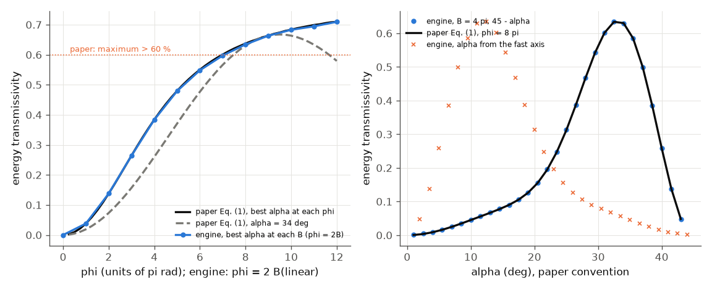
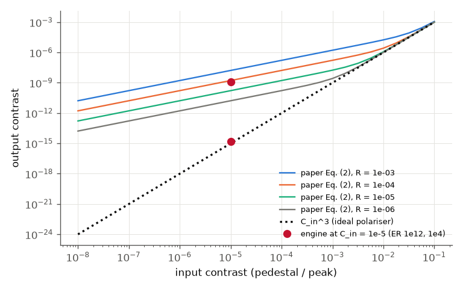
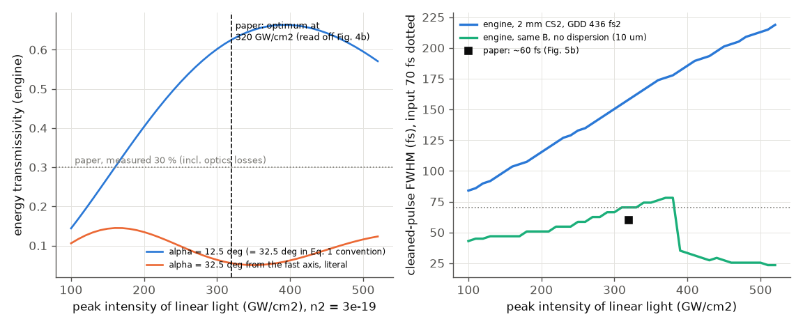
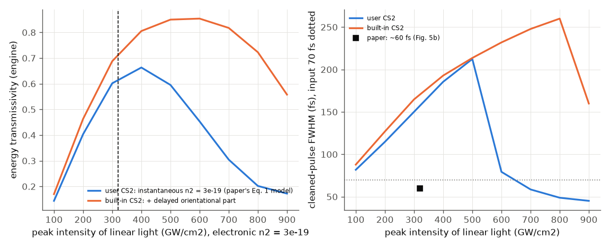

# Liu 2013 -- pulse cleaner by nonlinear ellipse rotation in liquid CS2

**PDF readable?** Yes (3 pages). Read through the text layer (PyMuPDF; the Read tool's PDF mode needs `pdftoppm`, which is not
installed) and rendered images; Eq. (1) and "n2 = (3 +- 0.6)e-19 m2/W" were confirmed on rendered crops. Figure values are read off
plots. Nothing is copied from the paper.

## What the paper does
Linear light -> quarter-wave plate (QWP1, angle alpha) -> CS2 cell -> QWP2 (axis perpendicular) -> crossed polarizer. Intense light
rotates its polarisation ellipse and passes; weak prepulses and ASE do not. Theory (Eq. 1, Gaussian 100 fs, 800 nm): transmissivity
above 60 % at alpha about 34 deg; contrast improved by four orders for polariser extinction ratio 1e4 (Eq. 2). Experiment (808 nm,
70 fs, 2 mm CS2, ~320 GW/cm2): 30 % transmission, three orders of contrast, 60 fs cleaned pulse, optimum alpha 32.5 deg.

## Engine set-up (`run.py`, `paper.json`)
Engine elements `waveplate` - `bulk` - `waveplate` - `polarizer`. Paper-model runs: a user material with the
Kedenburg 2012 index formula (external; not from the paper) and the paper's n2 = 3e-19 m2/W as an instantaneous Kerr effect, no
delayed response, which is what Eq. (1) assumes. **New (2026-11): the built-in material `CS2`** has the same index, the electronic
n2 = 3e-19 m2/W and a delayed `orientational` part (total n2 3e-18, 90 % delayed, 0.2 / 1.6 ps, `anisotropicFraction` 1.5; all UNVERIFIED typical values).
Section 4 of `run.py` repeats the 70 fs experiment with it as a sensitivity study (40 ps window, 32768 points, no grid warning up to 900 GW/cm2). 1-D plane wave. B is the B-integral of linear light at the same peak intensity; the engine's reported B follows the
pulse inside the cell, so it is calibrated on a 10 um cell and scaled (checked against a numpy split-step to 1e-3).

## The angle and phase convention of Eq. (1)
Jones calculus for this chain gives T = cos^2(2a) sin^2(theta), theta = (B/3) sin(2a) (the engine's NER law), a measured from the fast
axis; the engine matches it to 0.005. The paper's Eq. (1) is `sin^2(2a) sin^2(phi cos(2a)/6)`. The two coincide with
**a_paper = 45 deg - a** and **phi = 2B** (derived, not fitted; engine vs Eq. (1) then agrees to 0.002 everywhere on the (alpha, B)
map). With the paper's literal definitions (a from the fast axis, phi = B) they differ by up to 0.68. The paper does not define phi_SPM
for elliptical light, so this is a convention issue of the paper, not an engine disagreement.

## Results

Left: transmissivity against phase (engine with phi = 2B vs Eq. 1). Right: against alpha at phi = 8 pi.

Contrast (pedestal / peak; smaller is better): the paper's Eq. (2) curves and the engine at C_in = 1e-5.

Experiment-like case (808 nm, 70 fs, 2 mm CS2): transmissivity against intensity, and cleaned-pulse width.

| quantity | paper | ours |
|---|---|---|
| Eq. (1) max transmissivity, alpha = 34 deg (Gaussian) | > 60 %, Fig. 2a ~0.66 at ~9.5 pi | 0.667 at 9.5 pi (evaluated) |
| engine max transmissivity (all alpha, B <= 6 pi) | -- | 0.709, same as Eq. (1) over its range |
| contrast, ideal polariser | ~1e15 from 1e5 (Fig. 3a) | 10 orders gained (1.6e-15 from 1e-5) |
| contrast gain, ER 1e4 | about 4 orders (Fig. 3b) | engine 3.9; Eq. (2) 3.7 |
| optimum alpha, experiment case (paper convention) | 32.5 deg (Fig. 4a); 34 deg theory | 32.5 deg (full tier, 1.5 deg grid); 31 deg (fast tier) |
| optimum intensity | ~320 GW/cm2 (Fig. 4b) | 393 (327-491 for n2 3.6-2.4e-19); literal angle: 164 |
| transmissivity at optimum | 30 % measured (optics losses) | 0.66 (not comparable) |
| cleaned width, no dispersion | ~60 fs from 70 | 0.89 x input at the transmission optimum |
| cleaned width, with the cell's GDD (436 fs2) | ~60 fs | **158 fs at 320 GW/cm2** |
| spectrum broadened, spatial profile preserved (Fig. 6) | qualitative | not compared |
| 3 orders contrast in the experiment | Fig. 5a | not comparable (scatter, ER, plate accuracy) |
| **built-in CS2** (electronic + delayed orientational), alpha = 12.5 deg: optimum intensity, max T | -- | 560 GW/cm2, 0.85 (user material, same grid: 397, 0.66) |
| built-in CS2: T and width at 320 GW/cm2 | 30 % measured, ~60 fs | 0.72 and 171 fs (user material: 0.63 and 157 fs) |

The same experiment with the built-in CS2 (orange) and with the instantaneous user material on the same fine grid (blue). The intensity axis is the paper's
(electronic n2 = 3e-19). With the delayed part the transmissivity is higher at every intensity (0.32 against 0.27 at 150 GW/cm2, 0.72 against 0.63 at 320), the
maximum 0.85 exceeds the 0.71 limit of Eq. (1) (likely because the delayed index flattens the rotation across the pulse; not separated), and the optimum moves up to about 560 GW/cm2. This is a
sensitivity result with unverified response values, not a statement about the paper's cell; the width problem below is not cured (171 fs).

All numbers above the built-in rows are unchanged from the previous engine (Jones check 0.005, Eq. (1) mapping 0.002, literal 0.68, contrast gains, optimum alpha 31 deg
in the fast tier, 393 GW/cm2, 0.66, widths 158 / 70 fs, split-step 1e-3): the carrier and grid changes did not move this paper.

## What does not reproduce
* **Cleaned pulse width.** With CS2's own dispersion the engine's cleaned pulse is 158 fs (input 70 fs), not ~60 fs. Debugging: the
  engine agrees with an independent numpy split-step to 1e-3 (peak) and exactly (width); with the cell shortened to 10 um at the same
  B the width is 70 fs and the narrowing 0.89 matches the paper's trend. So it is the 1-D physics with 436 fs2 of GDD (from the
  Kedenburg formula, not cross-checked) and B = 15 rad, which Eq. (1) neglects. Open: the real focused beam, the quartz cell, and the
  paper's pulse chirp are not modelled. Not an engine bug.
* **Intensity optimum** is 23 % above 320 GW/cm2, inside the paper's n2 uncertainty (+-20 %), and depends on the unstated beam
  definition. The 30 % measured transmission includes optics losses and is not compared.
* **Delayed response of CS2: fixed.** Old `repro_1.py` (deleted): `anisotropicFraction` on `expression` delayed responses was silently ignored and values above 1 were
  rejected. Now `T` of the chain changes with it (b = 0 / 1 / 1.5: 0.073 / 0.416 / 0.543, hard check) and 1.5 is accepted, so the built-in CS2 exists. Its response values are unverified.
* The experiment has P/Pcr ~ 4e5 (6 mJ, 70 fs); self-focusing is outside a 1-D model. The implied beam area at 320 GW/cm2 is 0.25 cm2.

## Run
`python run.py --tier fast` (~3.5 min, was 12 s: the built-in CS2 sweep uses a 32768-point grid) or `--tier full --figures`; `python3 build/paper_check.py liu-2013-ner-cs2-pulse-cleaner`: 14 checks, 13 pass, 1 soft-fail (the cleaned width).

## How well the science matched
| quantity | paper | ours | verdict | most likely reason |
|---|---|---|---|---|
| Eq. (1) maximum transmissivity at alpha = 34 deg | > 60 %, Fig. 2a about 0.66 at 9.5 pi | 0.667 at 9.5 pi; engine = Eq. (1) to 0.002 | agrees | engine reproduces the formula (with the derived mapping) |
| angle and phase convention of Eq. (1) | alpha from the fast axis, phi_SPM | literal reading differs by up to 0.68; alpha_paper = 45 deg - alpha, phi = 2B fits | partly | paper does not define phi_SPM for elliptical light and the angle origin (paper ambiguity); mapping derived by Jones calculus, not fitted |
| contrast gain, ideal polariser | about 1e15 from 1e5 (Fig. 3a) | 10 orders gained | agrees | |
| contrast gain, ER 1e4 | about 4 orders (Fig. 3b) | 3.9 (Eq. 2: 3.7) | agrees | |
| optimum alpha, experiment case | 32.5 deg (34 theory) | 31 (fast), 32.5 (full) deg | agrees | |
| optimum intensity | about 320 GW/cm2 (Fig. 4b) | 393 (327-491 for n2 +-20 %) | partly | paper does not say which plane/definition of intensity (assumption); n2 uncertainty; instantaneous Kerr only |
| transmissivity at optimum | 30 % measured | 0.66 | not comparable | optics losses, polariser, beam profile not given (assumption) |
| cleaned pulse width | about 60 fs from 70 | 62 fs without dispersion (0.89 x); 158 fs with CS2's GDD (171 fs with built-in CS2) | does not | paper does not state chirp, cell material/length details or beam; 1-D engine (engine limitation: focused beam, B = 15 rad with 436 fs2 of GDD not modelled spatially); Kedenburg GDD UNVERIFIED |
| contrast 3 orders, 60 fs, spectrum and beam profile (Fig. 5-6) | measured | not comparable / not compared | UNVERIFIED reading | needs scatter, ER and plate data; the spatial part needs the radial model with the unknown beam |
| delayed orientational response of CS2 | not treated | built-in CS2 moves the optimum 397 -> 560 GW/cm2 and raises max T 0.66 -> 0.85 | sensitivity only | response values UNVERIFIED |

Overall: the paper's theory (Eq. 1, Eq. 2, the angle and phase optimum, the contrast gain) is reproduced quantitatively once the convention is derived, and the optimum angle
and order of the optimum intensity of the experiment follow. The experimental pulse width (60 fs) and the 30 % transmission do not, and the data to test them (chirp,
beam profile, optics losses, which intensity) are not in the paper; the single hard mismatch is the width, where the 1-D plane-wave model with CS2 dispersion
gives 158 fs. Closing it needs the real focused-beam geometry (radial model with the measured beam), verified CS2 GDD and response, and the input chirp.
