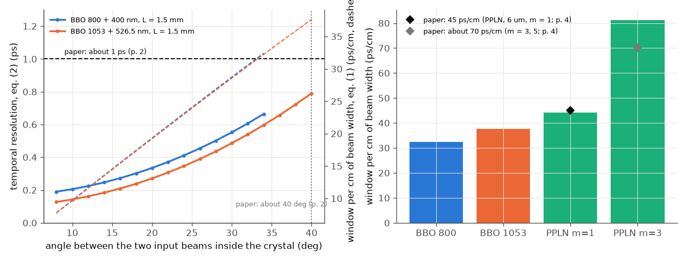
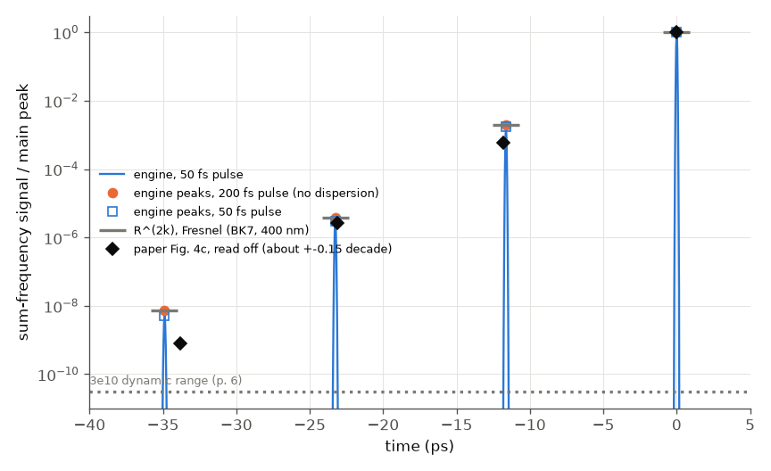
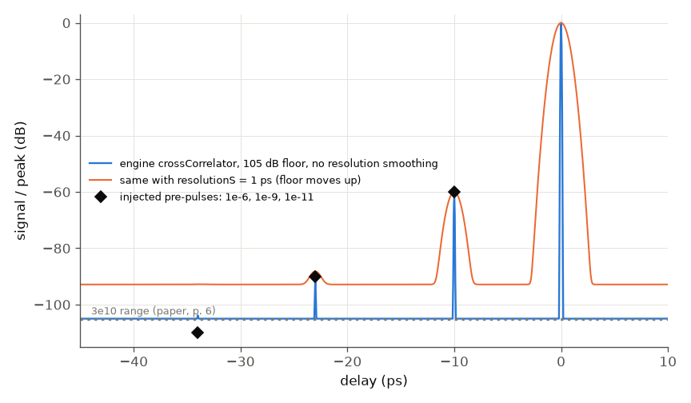

# Ma et al. (2018): a single-shot cross-correlator for pulse contrast

**Reading status.** Open access (CC BY 4.0). The Read tool's PDF mode failed (poppler missing); the 11-page text was read through the
macOS PDFKit text layer, which is clean. Equations (1) and (2) and Fig. 4c were checked on page images (Fig. 4c at 7x). The PDF and
its figures are not in the repository. Anything not in the text is marked UNVERIFIED.

## What the paper is

A review of one instrument. Petawatt lasers need a pulse contrast near 1e10, and the standard tool (a delay-scanning third-order
cross-correlator) needs thousands of shots. The single-shot version crosses the pulse under test (PT) and a clean sampling pulse
(usually its second harmonic) at a large angle in a nonlinear crystal. Where the beams meet at different times across the
crystal, the sum-frequency signal at position x measures the PT at delay tau(x): time is encoded in space. The paper's key points:

* **Window and resolution from geometry** (eqs. 1, 2): T = W/c (n_T sin a + n_S sin b) and dtau = L/c (n_T cos a - n_S cos b),
  with W the width of the beam overlap, L the crystal length, a and b the angles of the two inputs to the signal beam. A larger angle
  gives a larger window and a worse resolution. Quasi-phase matching in PPLN allows larger angles (45 ps/cm; about 70 ps/cm for m = 3, 5).
* **Dynamic range** from reading the 100 spatial channels through delay-staggered fibres into one PMT: 1e10, up to 3e10 (a detector
  specification; a CCD reaches only about 1e6).
* **Artefacts of time-to-space encoding**: air scattering of the bright signal peak (1e-8 to 1e-6) and spikes from reflections
  between crystal faces at +-2 n L/c. Demonstration of the range: a 1.1 mm BK7 plate in the sampling arm makes three replicas (Fig. 4c).

## What the engine can and cannot do here

| paper element | engine |
|---|---|
| noncollinear SFG, phase matching, internal angles, indices (BBO, PPLN) | yes: `crystal.phase_match` (used for eqs. 1, 2) |
| delay-scanning cross-correlation of a pulse with replicas | yes: Branched system (splitter, SHG, plate with `ghosts`, SFG) with `study` over the PT delay |
| third-order `crossCorrelator` instrument, dynamic-range floor | yes (used with a pedestal) |
| single-shot time-to-space readout (crossing beams on a Cartesian grid + camera, position to delay) | **not simulated**: example 40 shows crossing beams on a grid, but at 3 degrees and 0.2 mm; a 40 degree, centimetre-wide, 50 ps geometry was not attempted (grid size). No instrument converts position to delay |
| fibre array + PMT readout, attenuators | missing |
| air scattering of the correlation signal; stripe filter (a spatial mask of 1e-4 on the peak) | missing as an instrument-side effect; no scattering model of the signal |
| crystal-face artefact spikes of the *crossing* geometry | not simulated (only the plate replicas are) |

This is stated as a missing capability: the paper's central object, the single-shot mapping, is evaluated only through its
analytic formulas (eqs. 1, 2) with the engine's refractive indices.

## Setup (`run.py`)

1. **Geometry.** `phase_match("BBO", "sfg", "I", a=lambda, b=lambda/2, noncollinear=...)` for 800 + 400 nm and 1053 + 526.5 nm, L = 1.5 mm;
   alpha, beta, n_T, n_S from its output, then eqs. (1) and (2). PPLN (LiNbO3, first-order QPM, 6 um, 800 nm + 3.3 um; the PT wavelength is UNVERIFIED:
   it is in the paper's ref. [26]): the angle where the engine's phase mismatch changes sign is found by bisection. m = 3 is a first-order grating of 2 um.
2. **Fig. 4c.** Beam splitter, PT arm (delay), sampling arm (SHG in 100 um BBO, 1.1 mm N-BK7 plate with three ghost orders, overlap 1), SFG in
   100 um BBO (collinear, 1-D). The PT delay is scanned; the peak of the sum-frequency energy near each replica is read. The plate acts on the
   sampling pulse (the paper says the replicas are on the sampling pulse). 200 fs (quantitative check, dispersion negligible) and 50 fs (assumed, as Fig. 3).
   `grid.satelliteLevel` is lowered to 1e-11 (default 1e-8 would not make room for the third ghost, about 7e-9).
3. **Instrument.** `crossCorrelator` on a 50 fs pulse with pre-pulses 1e-6, 1e-9, 1e-11 at -10, -23, -34 ps and a 105 dB floor (the
   3e10 range).

## Results

Left: eq. (2) resolution (solid) and eq. (1) window per cm (dashed) against the crossing angle inside BBO. Right: window per cm
for the four cases against the paper's numbers.

Replica levels against the main peak, time axis as in the paper (replicas on the sampling pulse appear before the PT's main peak).
Grey bars: R^(2k) from Fresnel. Black diamonds: the paper's Fig. 4c read off.

## Comparison table

| quantity | paper (location) | ours | verdict |
|---|---|---|---|
| resolution, about 40 deg, 1-2 mm BBO | about 1 ps (p. 2) | 0.53 / 0.79 / 1.05 ps at L = 1 / 1.5 / 2 mm (1053 nm, 40 deg) | agrees (brackets 1 ps) |
| largest crossing angle in BBO | about 40 deg (p. 2) | 34 deg (800 nm), 40 deg (1053 nm) inside the crystal | agrees for 1053 nm |
| window per cm, BBO | not given; windows 50 / 70 ps (p. 9) | 32.4 (800) / 37.6 (1053) ps/cm, implying W = 1.5 / 1.9 cm (W not given) | consistent, W UNVERIFIED |
| PPLN 6 um, m = 1, window | about 45 ps/cm (p. 4) | 44.2 ps/cm at 37.4 deg (alpha 6.8, beta 30.5 deg) | agrees (PT wavelength assumed 800 nm, UNVERIFIED) |
| PPLN m = 3 (5) | about 70 ps/cm (p. 4) | 81 ps/cm (period of that case not given) | larger as stated; value differs 16 % |
| crystal-face spike at 15 ps | 2 n_S L / c (p. 7, Fig. 6a) | implies L = 1.33 mm in BBO (within the 1-2 mm of p. 2) | consistent; L of that figure UNVERIFIED |
| BK7 1.1 mm replica spacing | equal, about 11.3-11.8 ps read off Fig. 4c | 11.628 ps = 2 n_g d / c | agrees |
| replica I | about 6e-4 (read off) | 1.94e-3 (R^2 = 1.94e-3 exactly, 200 fs); 1.8e-3 at 50 fs | **0.5 decade above the paper** |
| replica II | about 2.7e-6 | 3.74e-6 (R^4 = 3.77e-6); 3.1e-6 at 50 fs | agrees (0.14 decade) |
| replica III | about 8e-10 read off; "about 1e-9" (p. 6) | 7.2e-9 (R^6 = 7.3e-9); 5.1e-9 at 50 fs | **about 0.9 decade above the paper** |
| dynamic range | 1e10, 3e10 (pp. 1, 6) | detector specification; engine floor set to 105 dB and read back (-60.0, -89.9, -103.8 dB for 1e-6, 1e-9, 1e-11: the last is floor plus 1e-11, not resolved) | not a test of the paper (circular) |
| channels, fibre delay 1-1.5 m, 1 ns PMT | p. 5 | not modelled; dt = dl n / c is 4.8-7.3 ns for n = 1.45 (UNVERIFIED core index) | arithmetic only |

## What agrees

The engine reproduces its own Fresnel ladder to 1 % (200 fs; the ratios are 0.997, 0.994, 0.990), the spacing exactly, and the
geometric resolution and PPLN window within the paper's rounding. With a 50 fs pulse the replicas that went through the plate three,
five and seven times are lower (0.92, 0.81, 0.70 of R^(2k)) because the plate stretches them (the BK7 group-delay dispersion
at 400 nm is 122 fs^2/mm): a real effect of a plate in the sampling arm, not an engine error.

## What does not reproduce

* **Replicas I and III are 0.5 and 0.9 decade above Fig. 4c.** The paper gives no plate angle, polarisation, coating, wavelength or
  attenuator calibration; an uncoated plate at normal incidence has R^2 = 1.9e-3 per order by Fresnel, which the engine reproduces to 1 %, so
  this is a setup difference (a tilted or coated plate, a sampling wavelength of 800 nm, a calibration of the fibre attenuators), not
  evidence against the engine. Not tuned. Replica III in the paper also sits among background fluctuations of 1e-9, so the read-off is uncertain.
* **Finding, engine: `crossCorrelator` with `resolutionS` (minimal case `repro_1.py`).** A 50 fs pulse, one pre-pulse of 1e-6, floor 105 dB.
  With `resolutionS = 1 ps` (the SSCC's resolution) the trace shows the pre-pulse at -60.0 dB but the floor at -92.9 dB, and
  `contrastAt_m10ps_db` reports -72.1 dB. The smoothing lowers both the peak (by 12.1 dB) and the narrow pre-pulse; the trace is normalised
  to the smoothed peak, the floor and the report to the unsmoothed one. Without `resolutionS` all three are right. A device with 1 ps
  resolution reads -60 dB for a pre-pulse of the same duration as the main pulse; the report does not. Likely a normalisation inconsistency;
  triage with `/bug-report`. The dynamic-range figure above shows the trace with and without it.

## What is left

* A single-shot simulation of the time-to-space mapping (crossing beams at 20-40 degrees on a wide Cartesian grid, camera readout, position
  to delay) and of the resolution trade-off of eq. (2) beyond the formula. Needs a large 2-D grid and a position-to-delay instrument.
* Air scattering of the correlation signal and the stripe filter; reflections of the correlation signal between crystal faces; the fibre array and PMT.
* The PT wavelength of the PPLN case, the beam width W, the crystal length of Fig. 6a and the plate geometry of Fig. 4c (UNVERIFIED / not stated).
* Fig. 6b angle pairs (20, 44) and (4, 78) deg: wavelengths not stated, so not evaluated.

Run: `python3 build/paper_check.py ma-2018` (fast, about 2 minutes); `python3 run.py --tier full --figures` for the dense plate profiles.
