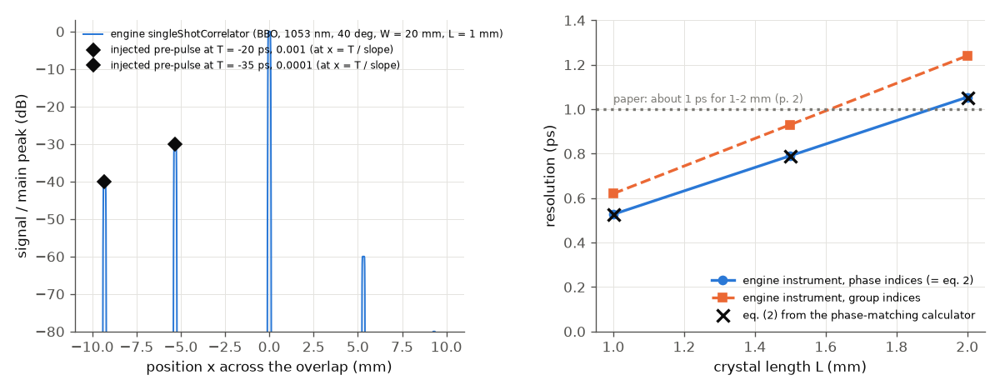

# Ma et al. (2018): a single-shot cross-correlator for pulse contrast

**Reading status.** Open access (CC BY 4.0). The Read tool's PDF mode failed (poppler missing); the 11-page text was read through the
macOS PDFKit text layer, which is clean. Equations (1) and (2) and Fig. 4c were checked on page images (Fig. 4c at 7x). The PDF and
its figures are not in the repository. Anything not in the text is marked UNVERIFIED.

## What the paper is

A review of one instrument. Petawatt lasers need a pulse contrast near 1e10, and the standard tool (a delay-scanning third-order
cross-correlator) needs thousands of shots. The single-shot version crosses the pulse under test (PT) and a clean sampling pulse
(usually its second harmonic) at a large angle in a nonlinear crystal. Where the beams meet at different times across the
crystal, the sum-frequency signal at position x measures the PT at delay tau(x): time is encoded in space. The paper's key points:

* **Window and resolution from geometry** (eqs. 1, 2): T = W/c (n_T sin a + n_S sin b) and dtau = L/c (n_T cos a - n_S cos b),
  with W the width of the beam overlap, L the crystal length, a and b the angles of the two inputs to the signal beam. A larger angle
  gives a larger window and a worse resolution. Quasi-phase matching in PPLN allows larger angles (45 ps/cm; about 70 ps/cm for m = 3, 5).
* **Dynamic range** from reading the 100 spatial channels through delay-staggered fibres into one PMT: 1e10, up to 3e10 (a detector
  specification; a CCD reaches only about 1e6).
* **Artefacts of time-to-space encoding**: air scattering of the bright signal peak (1e-8 to 1e-6) and spikes from reflections
  between crystal faces at +-2 n L/c. Demonstration of the range: a 1.1 mm BK7 plate in the sampling arm makes three replicas (Fig. 4c).

## What the engine can and cannot do here

| paper element | engine |
|---|---|
| noncollinear SFG, phase matching, internal angles, indices (BBO, PPLN) | yes: `crystal.phase_match` |
| window and resolution from the crossing geometry, eqs. (1)-(2); position-to-delay mapping on a camera | yes: `singleShotCorrelator` instrument (BBO, any library crystal or given indices); area conserved |
| plate replicas in the sampling arm (Fig. 4c) | yes: `crossCorrelator` with `gateArm` (plate with `ghosts`, compiled at the second-harmonic wavelength) |
| dynamic-range floor, `resolutionS` | yes: `crossCorrelator` (`dynamicRangeDb`, `resolutionS`) |
| PPLN windows (QPM, 800 nm + 3.3 um assumed) | only through eq. (1) with the phase-matching calculator: the instrument's sampling pulse is the second harmonic or the pulse itself, so a 3.3 um sampling pulse cannot be set |
| **not simulated by `singleShotCorrelator`** | beam propagation in the crystal (conversion efficiency, depletion, the envelope of the signal across the overlap, walk-off); air scattering of the bright signal (1e-8 to 1e-6, paper p. 6); the stripe filter; reflections between the crystal faces (spikes at +-2 n L / c); the fibre array, delay-staggered fibres and the PMT. The engine's spatial `sfg` crystal on a Cartesian grid does reproduce the mapping at 20 degrees (slow test `SpatialSfgOfTwoCrossedBeams_PutsAReplicaAtTheInstrumentsPosition`), but a 40 degree, centimetre-wide, 50 ps case was not attempted |

Eqs. (1) and (2) are therefore tested with the instrument, not only analytically; the physics of the instrument's artefacts (the paper's second
half) is not.

## Setup (`run.py`)

1. **Geometry, analytic.** `phase_match("BBO", "sfg", "I", a=lambda, b=lambda/2, noncollinear=...)` for 800 + 400 nm and 1053 + 526.5 nm, L = 1.5 mm;
   alpha, beta, n_T, n_S from its output, then eqs. (1) and (2). PPLN (LiNbO3, first-order QPM, 6 um, 800 nm + 3.3 um; the PT wavelength is UNVERIFIED:
   it is in the paper's ref. [26]): the angle where the engine's phase mismatch changes sign is found by bisection. m = 3 is a first-order grating of 2 um.
2. **Fig. 4c.** One `crossCorrelator` on a probe system (800 nm, 1 uJ) with `gateArm`: a 1.1 mm N-BK7 plate with three ghost orders acts on the
   second-harmonic gate only. 200 fs (quantitative check, dispersion negligible) and 50 fs (assumed, as Fig. 3); 200 dB range so nothing is
   hidden. This replaces the earlier Branched system (beam splitter, SHG, plate, SFG, delay `study`), which took two minutes; now 0.5 s.
3. **Instrument dynamic range.** `crossCorrelator` on a 50 fs pulse with pre-pulses 1e-6, 1e-9, 1e-11 at -10, -23, -34 ps and a 105 dB floor (the
   3e10 range), without and with `resolutionS = 1 ps`.
4. **`singleShotCorrelator`.** BBO, `delayIndex: "phase"` (that choice makes the resolution exactly eq. (2)). (a) window and resolution at the largest
   angle of 800 nm (34 deg) and 1053 nm (40 deg) against section 1; resolution against L = 1, 1.5, 2 mm with phase and group indices.
   (b) 1053 nm, 40 deg, W = 20 mm, L = 1 mm, 50 fs pulse with pre-pulses 1e-3 at -20 ps and 1e-4 at -35 ps: where they land and how high.

## Results

Left: eq. (2) resolution (solid) and eq. (1) window per cm (dashed) against the crossing angle inside BBO. Right: window per cm
for the four cases against the paper's numbers.

Third-order signal of the `crossCorrelator` with the plate in the gate arm (blue line, 50 fs pulse), the replica peaks for 200 fs (orange) and 50 fs
(open squares). Grey bars: R^(2k) from Fresnel. Black diamonds: the paper's Fig. 4c read off. Time axis as in the paper.

The `crossCorrelator` at 105 dB with three injected pre-pulses, without (blue) and with (orange) `resolutionS = 1 ps`. Both read -60 dB for 1e-6
and about -90 dB for 1e-9; the 1e-11 pre-pulse is below the floor. The 1 ps smoothing no longer moves the floor or the reported contrast.

Left: the `singleShotCorrelator` trace against position across the overlap for a 50 fs pulse with two pre-pulses; the black diamonds are the
injected levels at x = T / slope (the time-to-space mapping of the paper). The peak at +5.3 mm (-60 dB) is the pre-pulse seen by the other beam:
the second-harmonic gate carries the pre-pulse at e^2 = 1e-6 and the main pulse samples it at +20 ps (our reading of the engine's output, not a
statement of the paper). Right: resolution against crystal length: eq. (2) (phase indices, crosses, matching the instrument to 1e-6) and the
instrument with group indices (orange), which is 18 % larger.

## Comparison table

| quantity | paper (location) | ours | verdict |
|---|---|---|---|
| resolution, about 40 deg, 1-2 mm BBO | about 1 ps (p. 2) | instrument: 0.53 / 0.79 / 1.05 ps at L = 1 / 1.5 / 2 mm (1053 nm, 40 deg, phase indices = eq. 2; equal to the analytic value to 1e-6); with group indices 0.62 / 0.93 / 1.24 ps | agrees (brackets 1 ps) |
| largest crossing angle in BBO | about 40 deg (p. 2) | 34 deg (800 nm), 40 deg (1053 nm) inside the crystal | agrees for 1053 nm |
| window per cm, BBO | not given; windows 50 / 70 ps (p. 9) | instrument = eq. (1): 32.4 (800) / 37.6 (1053) ps/cm (ratio 1.00000), implying W = 1.5 / 1.9 cm (W not given) | consistent, W UNVERIFIED |
| PPLN 6 um, m = 1, window | about 45 ps/cm (p. 4) | 44.2 ps/cm at 37.4 deg (alpha 6.8, beta 30.5 deg) | agrees (PT wavelength assumed 800 nm, UNVERIFIED) |
| PPLN m = 3 (5) | about 70 ps/cm (p. 4) | 81 ps/cm (period of that case not given) | larger as stated; value differs 16 % |
| crystal-face spike at 15 ps | 2 n_S L / c (p. 7, Fig. 6a) | implies L = 1.33 mm in BBO (within the 1-2 mm of p. 2) | consistent; L of that figure UNVERIFIED |
| BK7 1.1 mm replica spacing | equal, about 11.3-11.8 ps read off Fig. 4c | 11.628 ps = 2 n_g d / c | agrees |
| replica I | about 6e-4 (read off) | 1.93e-3 (R^2 = 1.94e-3; `gateArm`, 200 fs); 1.74e-3 at 50 fs | **0.5 decade above the paper** |
| replica II | about 2.7e-6 | 3.73e-6 (R^4 = 3.77e-6); 2.9e-6 at 50 fs | agrees (0.14 decade) |
| replica III | about 8e-10 read off; "about 1e-9" (p. 6) | 7.2e-9 (R^6 = 7.3e-9); 4.7e-9 at 50 fs | **about 0.9 decade above the paper** |
| pre-pulse at -20 ps (1e-3), -35 ps (1e-4) | time-to-space mapping, x = T / slope (Fig. 1) | instrument: position error 3e-5 pixel, level / injected 1.0000 | engine self-consistency (analytic by construction) |
| dynamic range | 1e10, 3e10 (pp. 1, 6) | detector specification; engine floor set to 105 dB and read back (-60.0, -89.9, -103.8 dB for 1e-6, 1e-9, 1e-11: the last is floor plus 1e-11, not resolved) | not a test of the paper (circular) |
| channels, fibre delay 1-1.5 m, 1 ns PMT | p. 5 | not modelled; dt = dl n / c is 4.8-7.3 ns for n = 1.45 (UNVERIFIED core index) | arithmetic only |

## What agrees

The engine reproduces its own Fresnel ladder to 1.3 % (200 fs; the ratios are 0.993, 0.991, 0.987), the spacing exactly, and the
geometric resolution and PPLN window within the paper's rounding. With a 50 fs pulse the replicas that went through the plate three,
five and seven times are lower because the plate stretches them (the BK7 group-delay dispersion
at 400 nm is 122 fs^2/mm): a real effect of a plate in the sampling arm, not an engine error (0.90, 0.76, 0.64 of R^(2k) with the `gateArm` version).

## What does not reproduce

* **Replicas I and III are 0.5 and 0.9 decade above Fig. 4c.** The paper gives no plate angle, polarisation, coating, wavelength or
  attenuator calibration; an uncoated plate at normal incidence has R^2 = 1.9e-3 per order by Fresnel, which the engine reproduces to 1 %, so
  this is a setup difference (a tilted or coated plate, a sampling wavelength of 800 nm, a calibration of the fibre attenuators), not
  evidence against the engine. Not tuned. Replica III in the paper also sits among background fluctuations of 1e-9, so the read-off is uncertain.
* **Resolved engine finding: `crossCorrelator` with `resolutionS`.** An earlier version of this folder reported (minimal case `repro_1.py`,
  now deleted) that with `resolutionS = 1 ps` the floor rose to -92.9 dB and `contrastAt_m10ps_db` read -72.1 dB while the trace read -60 dB. The
  engine now normalises all three to the resolution-limited peak: trace -60.0 dB, floor -105.0 dB, report -60.0 dB. The two checks are hard.
* **The dynamic range itself is a detector specification** (fibre array and PMT), not simulated: the 105 dB floor is an input, so reading it back is circular.

## What is left

* Not simulated by `singleShotCorrelator`: beam propagation in the crystal (efficiency, depletion, the envelope across the overlap, walk-off), air scatter
  of the signal, the stripe filter, crystal-face reflections of the signal (the 15 ps spikes), the fibre array and PMT. These are the paper's artefact
  discussion (Sec. 5) and its dynamic-range claims; none is compared here.
* The PT wavelength of the PPLN case, the beam width W, the crystal length of Fig. 6a and the plate geometry of Fig. 4c (UNVERIFIED / not stated).
* Fig. 6b angle pairs (20, 44) and (4, 78) deg: wavelengths not stated, so not evaluated.
* A sampling pulse of a different wavelength than the second harmonic (the PPLN case) in `singleShotCorrelator`.

Run: `python3 build/paper_check.py ma-2018` (fast, about 7 s now); `python3 run.py --tier full --figures` for the committed figures.

## How well the science matched

Reasons: A = the paper does not specify inputs (assumption); E = erratum or internal inconsistency; L = engine limitation (named); B = engine bug
(named); U = UNVERIFIED reading.

| quantity | paper | ours | verdict | most likely reason |
|---|---|---|---|---|
| window T = W (n_T sin a + n_S sin b) / c, eq. (1) | formula | instrument = analytic to 1e-7 (BBO 800 / 1053 nm) | agrees | none (formula check; W not given: A) |
| resolution dtau, eq. (2) | about 1 ps for 1-2 mm at about 40 deg | 0.53-1.05 ps (phase indices); 0.62-1.24 ps (group indices) | agrees | eq. (2) uses phase indices; the group-index version is larger by 18 % (our reading of the physics, not in the paper) |
| PPLN window, 6 um, m = 1 | about 45 ps/cm | 44.2 ps/cm | agrees | A: PT wavelength assumed 800 nm (U); analytic only (L: instrument has no free sampling wavelength) |
| PPLN window, m = 3 (5) | about 70 ps/cm | 81 ps/cm | partly | A: the grating period of that case is not given |
| BK7 replica spacing | equal, about 11.5 ps | 11.63 ps = 2 n_g d / c | agrees | none |
| replica I (1.1 mm BK7 plate in the sampling arm) | about 6e-4 | 1.9e-3 (R^2) | does not (0.5 decade) | A: plate angle, coating, polarisation, attenuator calibration not given |
| replica II | about 2.7e-6 | 3.7e-6 | agrees (0.14 decade) | none |
| replica III | about 8e-10 / "about 1e-9" | 7.2e-9 | does not (0.9 decade) | A as for I, and U: the read-off sits among 1e-9 background fluctuations |
| pre-pulse position and height (time to space) | Fig. 1 principle | exact to 1e-5 pixel / 1e-9 | agrees | engine self-consistency (analytic by construction), not a test of the paper |
| dynamic range 1e10 / 3e10 | detector specification | input of the model | not tested | L: fibre array, PMT, air scatter, stripe filter not simulated |
| air scatter 1e-8 to 1e-6; crystal-face spikes at 15 ps | measured / Fig. 6a | spike delay implies L = 1.33 mm only | not tested | L: no beam propagation in the crystal, no scatter, no face reflections in `singleShotCorrelator` |

**Overall.** The geometry of the instrument (eqs. 1 and 2, the position-to-delay mapping, the area law) and the replica ladder of a plate in the
gate arm are now reproduced with engine instruments, the former to 1e-6 against the analytic formulas. The two replica levels that disagree with the
paper come from a plate whose angle and coating the paper does not state; Fresnel for bare BK7 is what the engine gives. The paper's second
half (dynamic range, scatter, reflections, the fibre-array read-out) is about the instrument's artefacts and electronics and is not simulated. To
close the gap one would need a spatial model of the crossing beams in the crystal (efficiency, depletion, walk-off, face reflections) and the plate
and attenuator data of the experiment.
