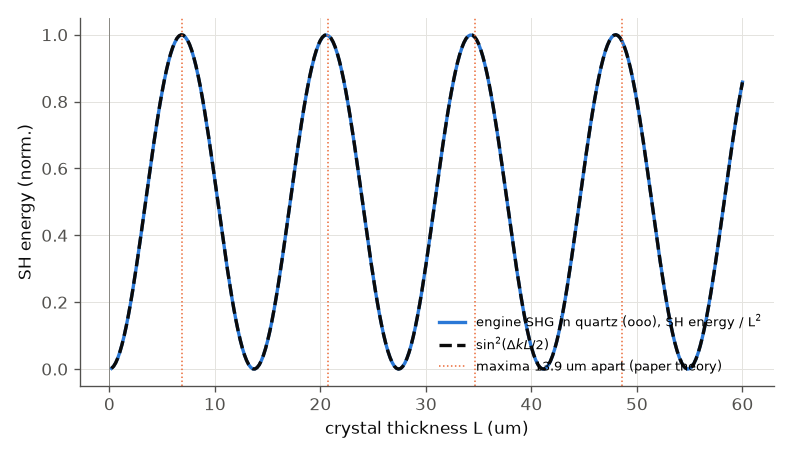
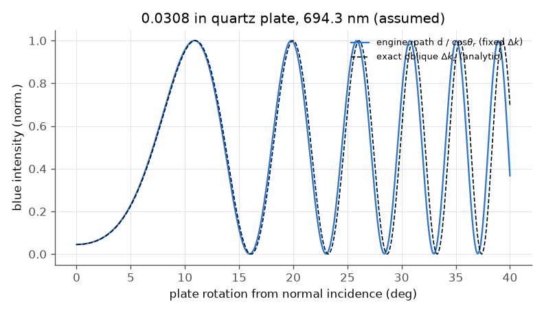
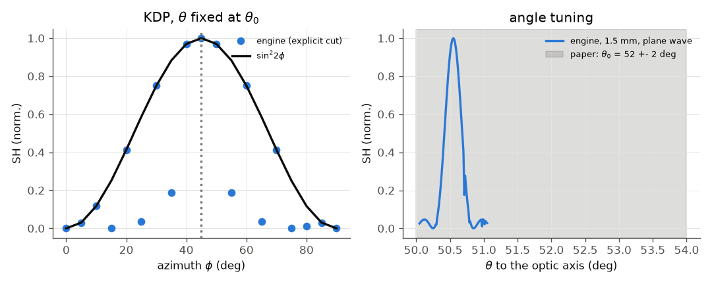
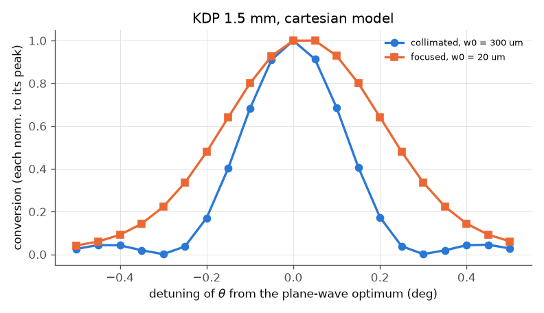

# Maker, Terhune, Nisenoff, Savage (1962): dispersion and focusing in optical harmonic generation

**Which paper this is.** The request named a "Bjorkholm-type" paper. The PDF in `docs/papers/` with this title is the two-page Physical Review
Letters of Maker et al. (Phys. Rev. Lett. 8, 21 (1962)), the paper that first showed the "Maker fringes". That is what is replicated.

**Reading status.** Read in full (the third page of the PDF is blank). The text layer was read through macOS PDFKit; equations and figure
labels were checked on page images at 1.8x. The PDF and its figures are not in the repository. The paper is qualitative: it has one
equation, three figures and a handful of numbers.

## What the paper did

* **Quartz (Fig. 1).** A ruby-laser beam passes through a 0.0308 in (0.782 mm) quartz plate that is tilted; the blue (second-harmonic) light
  oscillates with the tilt because the plate's optical thickness changes and the harmonic and its source polarisation drift out of
  phase. Spacing of the maxima expressed as a thickness change: 13.9 um calculated, 14 um measured.
* **KDP (Fig. 2).** An ordinary red ray can phase-match an extraordinary blue ray in KDP; the blue is 300 times stronger at theta_0 = 52 +- 2 degrees,
  phi_0 = 45 degrees (beam collimated within 1/4 degree).
* **Focusing (p. 22, Fig. 3).** A focused beam gives more blue; in KDP "a gain of 3000" which the authors split by rough calculation into 100 (smaller beam)
  times 30 (mixing of divergent rays), and the blue only appears for rays at theta >= theta_0 (a crescent in the far field).
  Photon ratios (red photons per blue photon): quartz 5e12 collimated, 6e10 focused; KDP 3e9 and 1e6. The authors say these depend on the laser's coherence.

## What was run (`run.py`, fast tier about 4 min, full tier about 8 min)

1. **Quartz.** A user crystal with Ghosh (1999) quartz indices (the same as the engine's `Quartz` material), SHG o o -> o at 694.3 nm (ruby wavelength assumed),
   thickness scanned from 0 to 60 um; then the 0.782 mm plate at rotations 0-40 degrees, modelled as the path d / cos(theta_r).
   The stepper tolerance is 1e-11 (see finding 2).
2. **KDP.** Phase-matching calculator and `crystal` element at the matched angle: theta_0, phi_0, the phi dependence, the angular width of 1.5 mm.
3. **Focusing.** 1.5 mm KDP in the cartesian transverse model (walk-off included), collimated (w0 300 um) and focused (w0 20 um), angle scan.
   The beam sizes are assumptions. The paper gives none.

Engine SHG against plate thickness divided by L^2 (blue) lies on sin^2(dk L / 2) (dashed). The dotted lines are 13.9 um apart, the paper's spacing.

Blue light against tilt for the 0.782 mm plate. Blue: engine with path d / cos(theta_r) and the normal-incidence mismatch. Dashed: the exact oblique formula
dk_z = (4 pi / lambda)(sqrt(n_2w^2 - sin^2 theta) - sqrt(n_w^2 - sin^2 theta)). The paper's curve (Fig. 1) is not redrawn. It shows about the same
pattern of fringes getting closer together, but its envelope also has Fresnel and geometry factors that the engine does not have.

Left: d_eff against azimuth at the matched theta. The dots are the engine, the line is sin^2(2 phi). Seven of nineteen points are wrong (finding 1). Right: the angle tuning of
a 1.5 mm plate (plane wave, 0.25 degree wide); the band is the paper's theta_0 = 52 +- 2 degrees.

Conversion against detuning of theta, each curve normalised to its peak.

### Paper against ours

| quantity | paper (location) | ours | verdict |
|---|---|---|---|
| quartz fringe spacing, o o -> o | 13.9 um calc., 14 um measured (p. 21, Fig. 1) | 13.71 um (scan and 2 pi / dk agree) | agrees to 1.4 % (1961 index data differ from Ghosh 1999) |
| same for the e e combination | | 13.25 um | 4.7 % low: the ordinary-wave case is the one that fits |
| SH energy vs thickness | sin^2(dk L) law (p. 21 equation) | within 0.06 % of sin^2 after dividing by L^2 | agrees |
| tilted plate, fringes between 0 and 40 degrees | not counted (read off Fig. 1: UNVERIFIED) | 6 maxima, path model and exact oblique formula agree on the count; total phase differs 2 % | consistent |
| KDP theta_0 | 52 +- 2 degrees (Fig. 2) | 50.55 degrees | agrees (1.5 degrees below, inside the quoted band) |
| KDP phi_0 | 45 degrees (Fig. 2) | 45 degrees | agrees |
| d_eff against phi | sin(2 phi) (p. 21, symmetry) | follows it at 12 of 19 azimuths, erratic at the other 7 | **finding 1** |
| angular width, 1.5 mm KDP | about 1 degree on the figure's 5 degree scale bar (read off Fig. 2, UNVERIFIED; includes +-1/4 degree beam divergence) | 0.25 degree internal, plane wave | not comparable (external angle, divergence, thickness of that run not given) |
| 300-fold enhancement at the matched orientation | p. 21 | not computed: no baseline orientation or thickness is given | not reproduced |
| focusing: conversion ratio, focused / collimated | factor 100 from the smaller beam, plus 30 from mixing of divergent rays (p. 22) | 123 for an area ratio of 225: 0.54 of the 1/area law | opposite sign to the "30"; assumed beam sizes |
| focused curve is broader and, near theta_0, one-sided | blue only for theta >= theta_0 (p. 22, Fig. 3) | FWHM 0.35 against 0.20 degrees; skew at +-0.2 degrees: 0.15 (focused), 0.01 (collimated) | qualitative agreement; far-field crescent not extracted |

## Commentary

**Dispersion.** The paper's equation S = 2 pi c P^2 (k_b / dk)^2 sin^2(dk x) is the plane-wave result. The engine reproduces it with a
period of 2 pi / dk = lambda / (2 (n_2w - n_w)); the printed 13.9 um is that spacing, not the coherence length (half of it, 6.9 um).
The fringes in thickness are what rotating the plate scans.

**Quartz geometry.** The text says the red is polarised parallel to z while the plate turns about z. For a crystal of class 32 an electric field along its optic axis alone does not
drive any second-order polarisation (d33 = 0), so "z" here probably is not the optic axis of today's convention. The ordinary-wave interaction
(d11, o o -> o) is the one whose spacing matches 13.9 um. I did not investigate this further.

**Focusing.** The engine's cartesian model carries each wave's walk-off, which is the first-order angular dependence of the extraordinary index. With it the focused curve is broader
(0.35 against 0.20 degrees) and has a small skew, which is the beginning of the effect behind Fig. 3. The conversion is 123 times higher for a beam
15 times narrower (225 times smaller in area): the 1/area law holds to a factor 0.54, the rest being lost to the beam's angular spread (0.64 degrees for a 20 um waist, more than the 0.27 degree
acceptance). The paper's extra factor 30 from "mixing of divergent rays" does not appear; this is not a contradiction, because
the 1962 beams were multimode, uncollimated ruby-laser beams. The engine has no model of the second-order index surface curvature, only the walk-off term, and the
far-field crescent (Fig. 3) is not extracted.

## What does not reproduce, and why (findings)

1. **Erratic d_eff in the KDP crystal element** (`repro_1.py`). With the cut given explicitly (`cut: {thetaDeg, phiDeg}`), the reported `deffPmPerV`, and the conversion with it,
   is not a smooth function of phi at fixed theta: for example at theta = 50.5478 degrees, phi = 45.0 gives 0.224 pm/V while 44.75 and 45.25 give 0.308 pm/V; 46.0 gives -0.142 pm/V. About 18 % of the azimuths
   in a 0.25 degree scan are off by more than 1 %. It does not depend on `polarizationAxisDeg`. `cut: "auto"` (phi = 45) and the phase-matching calculator give 0.308 pm/V. Not yet debugged to the cause.
   The azimuth is therefore the one thing in this paper that can not be trusted from the element with an explicit cut.
2. **The adaptive stepper does not resolve a strongly phase-mismatched thick crystal** (`repro_2.py`). In the default solver (tolerance 1e-6) a 0.8 mm quartz plate (dk L = 370 rad) takes 20 steps of 18 rad
   each and gives an SH energy 150-960 times above the plane-wave law, with no warning. Tolerance 1e-9 is still off by up to 5 times, 1e-11 gives the law to 2 %. This is why the rotation curve is computed
   with 1e-11. The step error is judged relative to the fundamental, which hides a SH amplitude 1e-5 times smaller.

## What is missing

* Fresnel factors and refraction at a tilted face (engine has normal incidence), so the envelope of Fig. 1 is not reproduced, only the fringe positions.
* The far-field blue pattern of Fig. 3 (the crescent bounded at theta_0), and the paper's photon-ratio table.
* The `externalAngleDeg` key is declared in the schema but gave "unknown parameter" in the library used here (seen in the Dubietis run).
