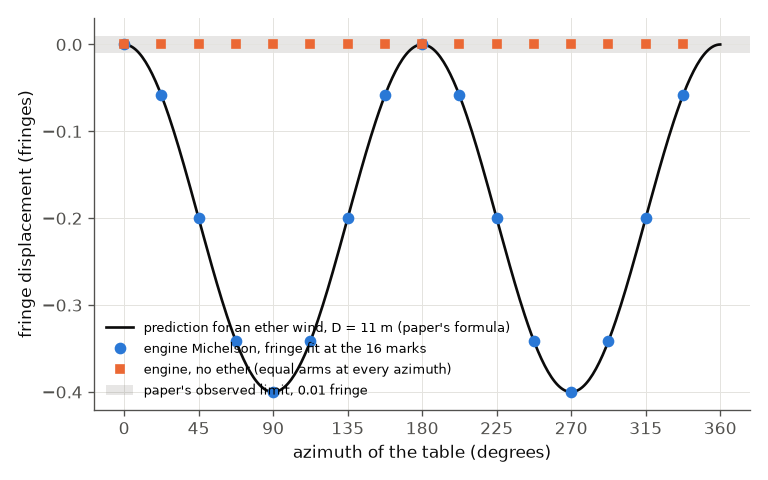
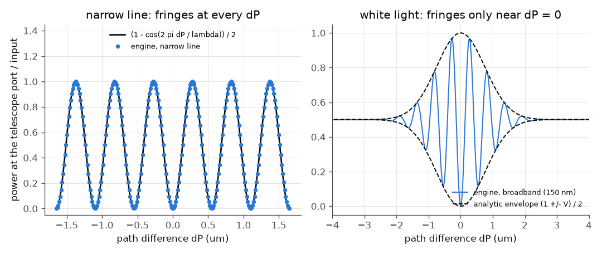

# Michelson and Morley (1887): the null result of the ether-wind interferometer

**Reading status.** The Read tool's PDF mode failed (poppler is missing), so the scan was read through macOS PDFKit: an OCR text
layer plus page images viewed directly. The prose and formulas were read in full (13 pages, journal pp. 333-345). The two data
tables on p. 340 are garbled by the OCR and are **not used** (UNVERIFIED). Page numbers are the journal's.

## What the paper does

A beam splitter divides light into two perpendicular arms; mirrors return it and the two beams interfere in a telescope.
If light moved at c relative to a stationary ether and the Earth moved through it at v, the round trip along the wind should take
slightly longer than across it. The path difference is D v^2/V^2, and turning the apparatus by 90 degrees reverses it, so
the fringes should move by **2 D v^2 / V^2** of a wavelength (p. 336). The first experiment had D = 2e6 waves (0.04 fringe,
masked by errors); the 1887 one folded the path with mirrors to **D = 11 m = 2e7 waves of yellow light, giving 0.4 fringe**
(p. 341). The apparatus floated on mercury and turned once in six minutes past 16 marks (p. 339), and the observed displacement was
**less than about 0.01 fringe** (p. 340), which makes the relative velocity "probably less than one sixth, certainly less than
one fourth" of the orbital velocity (p. 341).

## What the engine can and cannot do

The engine propagates light that travels at c in every direction. It has no ether and no moving frame, so:

* **Not simulable: the physics of the experiment.** The null result is built into the engine: equal arms give the same fringe at
  every azimuth. Passing it is not evidence for anything. Aberration, strain from turning, temperature drift, vibration and the
  statistics of the readings are also outside the engine.
* **Simulable: the instrument.** The paper's first-order prediction for the ether wind (an input from the paper's theory) is entered as
  the arm lengths 2D(1 + b^2 (1 - sin^2 theta / 2)), and the engine's Michelson (`beamSplitter`, two `delay` arms, the plate met
  again with `sameAs` and `side: 2`; [branches](../../reference/branches.md)) reads the fringe position at the 16 marks.
  This shows the readout has the right fringe period (one wavelength of path difference), full visibility, the resolution to see
  0.01 fringe, and that the shift scales as v^2. It is a check of the interferometer model, not a discovery.
* The white-light part (p. 339: the central fringe was found in white light, then sodium light was used) is simulable:
  a broadband pulse gives fringes only within a coherence length of zero path difference.

Run: `python run.py --tier fast` (seconds); `--tier full --figures` writes the figures here.
Setup: beamSplitter (50:50) -> two delays of 2D (22 m) -> the same splitter, `side: 2`; source cw at 550 nm (a 150 nm
Gaussian pulse for the white-light case). At each azimuth the readout scans arm B over one wavelength and fits
`P = a + c cos(ks) + e sin(ks)`, whose phase is the fringe position.

## Comparison

| quantity | paper | ours |
|---|---|---|
| D in waves of yellow light | 2e7 (p. 341) | 2.0e7 (11 m at 550 nm) |
| predicted shift, 90 degree turn, D = 11 m | 0.4 fringe (p. 341) | 0.4000 fringe (engine readout) |
| predicted shift, first experiment D = 2e6 waves | 0.04 fringe (p. 336) | 0.0400 fringe |
| shift at v/4 relative to full | (1/4)^2 = 1/16 (p. 341) | 0.0625 |
| shift at v/6 | 0.4/36 = 0.0111 (derived) | 0.0111 fringe, read by the engine (above the paper's own 0.01 limit) |
| observed limit | about 0.01 fringe (p. 340); < 1/20 certainly, < 1/40 probably of 0.4 (p. 341) | engine readout resolves it (not a result about the ether) |
| velocity bound from 0.02 / 0.01 fringe | < 1/4, < 1/6 of v_orbit (p. 341) | 0.224, 0.158 (from the engine's 0.4-fringe scale) |
| no ether, table turns | no displacement | 0 (built in) |
| narrow-line fringes | (1 - cos)/2 with period lambda | error 1.4e-9 |
| white-light fringes | only near zero path (p. 339) | follow the Gaussian visibility envelope to 2.3e-5 (the reference phase uses the carrier the pulse is built at, `outputGrid.reportOmega0`, since the 2026-11 grid fix; with the old lattice carrier it would read 3.6e-4); coherence length (V = 1/e) about 1.07 um for 150 nm |

Most rows are **circular by construction**: the engine is given the paper's path difference and returns it as a fringe shift.
What they test is the engine's interferometer: fringe period, fringe phase against delay at a 22 m arm length (phase of
2.5e8 rad kept to about 1e-9 fringe), full visibility and signs.

## Plots

Fringe displacement (fringes, relative to azimuth 0) as the table turns through the 16 marks. The black line is the paper's formula
for an ether wind, the blue points the engine's readout. Orange: equal arms (no ether), flat. The grey band is the paper's observed
limit of 0.01 fringe: an ether wind at the orbital velocity would have swung the fringe through the whole 0.4 fringe, forty times the band.

Left: output power against path difference for a narrow line; fringes repeat every wavelength at any path difference.
Right: a 150 nm wide source; the fringes exist only within about two micrometres of zero path difference, as the paper
uses to find the central fringe. Dashed: the analytic envelope.

## What does not reproduce / what is left

* Nothing disagrees. Nothing can: the experiment's physics (the null) is not in the engine.
* Not done: the p. 340 tables and Fig. 6 (data and the one-eighth-theory curves), UNVERIFIED because the OCR is unusable; the
  paper's supplementary proposals (reflection from moving mirrors, p. 342) are not simulated.

## How well the science matched

Re-run after the 2026-11 engine fixes: all ten checks pass; the one number that moved is the white-light envelope error (3.6e-4 if the old lattice carrier is
used for the reference phase, 2.3e-5 now), because pulses are built at the requested carrier and `run.py` now reads `reportOmega0`. This is a
change in how the test reads the carrier, not a physics change.

| quantity | paper | ours | verdict | most likely reason |
|---|---|---|---|---|
| expected shift 2 D v^2/V^2, D = 11 m | 0.4 fringe (p. 341) | 0.4000 | agrees (circular) | the paper's own first-order formula is the input; the engine only reads it out |
| first experiment, D = 2e6 waves | 0.04 fringe (p. 336) | 0.0400 | agrees (circular) | same |
| shift at v/4, v/6 | 1/16; 0.0111 | 0.0625; 0.0111 | agrees (arithmetic) | same |
| observed displacement | less than about 0.01 fringe (p. 340) | no ether: 0 | agrees trivially | engine limitation: no ether, no moving frame, so the null is built in and cannot be tested |
| velocity bounds | < 1/6 probable, < 1/4 certain (p. 341) | 0.158, 0.224 | agrees (arithmetic) | |
| the 16 readings and the p. 340 tables, Fig. 6 | data and curves | not compared | not tested | UNVERIFIED reading: the OCR of the tables was unusable (digits garbled) and no numbers were taken |
| white-light central fringe (p. 339) | fringes only near zero path | Gaussian envelope, coherence length 1.07 um for 150 nm | agrees | the paper gives no bandwidth: the 150 nm is our assumption |

**Overall judgement.** The engine reproduces the instrument (fringe period, visibility, sensitivity to 0.01 fringe, phase stability at a 22 m arm length)
but none of the science: the experiment tests whether light speed depends on the Earth's motion, and the engine propagates light at c in every
direction, so a null is the only possible outcome and a match carries no information. A meaningful test would need a model with a preferred frame
(arms whose round-trip times depend on a velocity relative to a medium, with an ether-drag or Lorentz-contraction option) and then a prediction that
differs between the hypotheses, together with the real error sources (thermal drift, strain from rotation, vibration, reading noise) and the digitised
p. 340 data to compare against. The first two do not exist in the engine.
