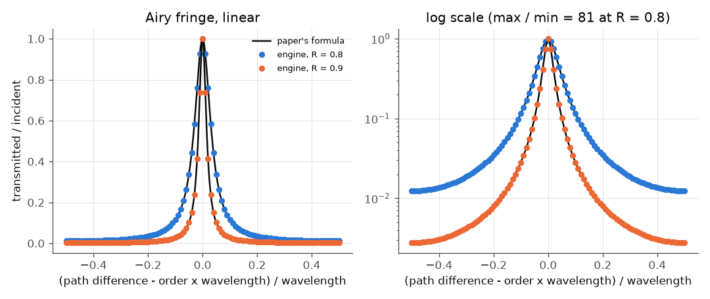
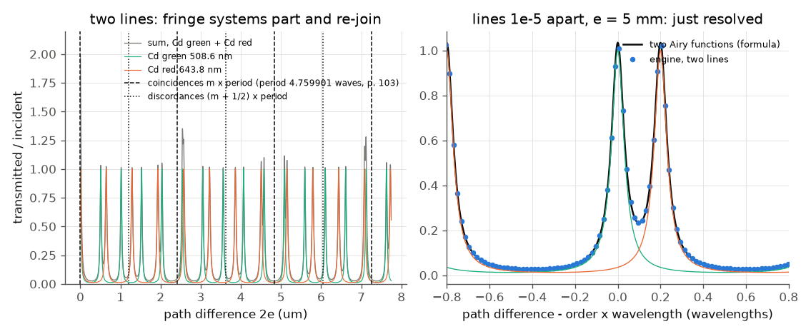

# Perot and Fabry (1899): multiple-beam fringes, coincidences of two lines, resolving power

**This is not the paper that was asked for.** The file supplied as "Michelson 1892, *On the application of interference phenomena
to the solution of various problems of spectroscopy and metrology*" has that title, but its author line reads **A. Perot and Charles
Fabry**, *Astrophysical Journal* 9, 87 (1899) (translated from *Bulletin Astronomique*). It describes what is now called the
Fabry-Perot interferometer. Michelson's 1892 work on fringe visibility versus path difference and line widths was **not available to
read**, so any number attributed to it is UNVERIFIED and no check depends on it. (This paper cites Michelson's visibility curves and
says its own two-line results reproduce them, p. 100; no numbers are given there.)

**Reading status.** The Read tool's PDF mode failed (poppler is missing). The scan was read through macOS PDFKit: an OCR text layer
for the prose, page images for formulas and numbers (pp. 91, 92, 99 were checked on the images). The prose was read in full to
p. 112; pp. 112-115 (long lengths, standard films) were only skimmed and are not used. Page numbers are the journal's.

## What the paper does

Two silvered, parallel, plane plates send light back and forth many times. The transmitted waves have path differences
Delta, 2 Delta, 3 Delta, ... (Delta = 2 e cos i for plate spacing e), with amplitudes falling geometrically, so the fringe is a narrow
bright line instead of a cosine (p. 91): **I = I0 / (1 + (4f/(1-f)^2) sin^2(pi Delta/lambda))**, f the reflecting power of each
plate; for f = 0.8 the coefficient is **80**. Two near lines give two fringe systems that coincide and separate periodically; the
period in path difference is Omega = lambda lambda'/(lambda - lambda') (pp. 96-98). The paper uses coincidences to find the order of
a fringe and to compare wavelengths (Hg against Cd lines), and reads the resolving power from the order: two lines are clearly
separate when their rings are 1/5 of a ring spacing apart (p. 99).

## What the engine can and cannot do

* **Simulable:** the etalon as a branched system (two `beamSplitter` mirrors, two `gap`s, a `ringDown` loop; the engine's own
  `FabryPerot_LoopGivesTheAiryFunction` test and [example 32](../../examples/32-interferometers/README.md) use the same graph), driven by a single-frequency
  source. Lines are mutually incoherent, so each is run separately and the transmitted intensities add.
* **Not simulable here (and not attempted):** rings in convergent light (Delta = 2 e cos i; this needs a spatial model),
  the silver's absorption (the mirrors here are lossless, so I0 = 1), the white-light superposition fringes of two plates, the standard
  films and the long-length measurements, the plate-parallelism adjustment and every instrument detail.
* Note: the engine moves a cw source's wavelength to a sample of its frequency grid. With the default window that is up to 3e-7
  relative, which is not negligible for lines 1e-6 apart. `run.py` sets a 1 microsecond window (shift below 1e-9).

Run: `python run.py --tier fast` (about one minute, a few thousand cw runs); mirrors R = 0.8 (and 0.9 for the bright-part remark).
The fringe spacing of each line is measured from the positions of two peaks 2 mm and 4 mm of path difference apart (about 4000
orders), refined by a parabola; the period of coincidence follows from the two measured spacings.

## Comparison

| quantity | paper | ours |
|---|---|---|
| coefficient 4f/(1-f)^2, f = 0.8 | 80 (p. 91) | 80 (formula); engine curve matches the Airy function to 3e-7 |
| I_max (no absorption) | I0 (p. 91) | 0.9999997 of the incident |
| I_max / I_min | 1 + 80 = 81 (from the formula) | 81.0 |
| FWHM of a fringe / spacing, R = 0.8 | not given | 0.07133 (formula 0.07133) |
| bright part of a fringe | "not more than 1/20 of the interval" (p. 92, no f given) | FWHM 1/14 at R = 0.8 and 1/30 at R = 0.9; 1/20 needs R >= 0.855 (read as FWHM; soft) |
| period, Hg yellow doublet | 311.9 Cd-green waves (p. 102) | 311.914 |
| period, Cd green / Hg green | 14.56515 (p. 102) | 14.56515 |
| period, Cd green / Cd red | 4.759901 (p. 103) | 4.759902 |
| period, Na D lines | "about 1000" (p. 98) | 987 (from tabulated D wavelengths; soft) |
| ring offset when lines are 1e-5 apart, e = 5 mm | 1/5 of the spacing at p = 20,000 (p. 99) | 0.2000 of the spacing at p = 19,999 |
| the same at e = 5 cm (eps/lambda = 1e-6) | 1/5 at p = 200,000 (p. 99) | 0.2000 at p = 199,861 (the engine's eps/lambda is 1.0007e-6) |
| two lines at that separation | "clearly visible" (p. 99) | two distinct peaks; valley at 22 % of the peak of the sum |

The coincidence periods reproduce to the paper's printed digits: they are fixed by the wavelengths, and the engine's etalon peaks
sit exactly lambda apart (to 1e-9). The agreement of the two-line comparison therefore tests that the etalon's fringe lattice is
exact over thousands of orders and that two incoherent systems add correctly. The Airy rows test the engine's loop against the
paper's formula. No disagreement was found.

One reading check: the coincidences seen directly in the engine's two scans (figure, left) are found from the product of the two
patterns at multiples of the period to within 0.13 of a period (a soft check: the fringe spacing is 0.21 of the Cd-green/Cd-red
period, so the position of a coincidence is only defined to about that).

## Plots

The fringe of one order for R = 0.8 and 0.9 (linear and log scales). Black: the paper's formula; points: the engine's etalon.

Left: transmission of the two Cd lines (green, orange) and their sum (grey) against path difference. Dashed lines: coincidences at
multiples of the period 4.759901 Cd-green waves; dotted: discordances at half-integer multiples. The systems separate, then re-join.
Right: two lines 1e-5 apart, at the order p = lambda/(5 eps) (e = 5 mm): their fringes are 1/5 of a spacing apart and the sum
shows two peaks, the paper's criterion for "just resolved". Black: the sum of two Airy functions.

## What does not reproduce / what is left

* Nothing disagrees. The silver absorption, rings in convergent light, white-light superposition fringes and the length
  measurements (pp. 108-115) are not simulated.
* Michelson's 1892 paper: not available, not replicated. Fringe visibility versus path difference for a source with structure
  (the Michelson interferometer) is exercised in the sibling folder `michelson-1887-ether-null` (white-light visibility
  envelope against the analytic Gaussian result), but that is not a check of any value from the 1892 paper.
