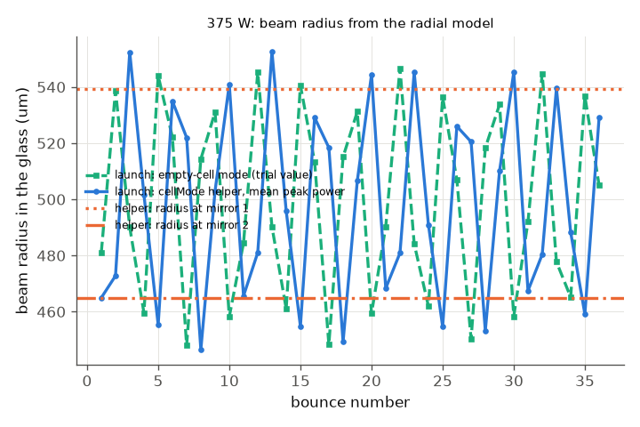

# Schulte et al. 2016: nonlinear pulse compression in a fused-silica multi-pass cell

J. Schulte, T. Sartorius, J. Weitenberg, A. Vernaleken, P. Russbueldt, Opt. Lett. 41, 4511 (2016), DOI 10.1364/OL.41.004511.
(The PDF in `docs/papers/` is this paper; it is not a 2017 Weitenberg paper, although Weitenberg is a co-author.)

**Readability.** All 4 pages were read as extracted text (the page-image reader needs `pdftoppm`, which is not installed).
No figure was seen. Every reference value below comes from the running text; three glyphs are garbled in the text layer
(the mirror curvature, the "+-" of the mirror GDD and the compressor GDD digits). They are marked UNVERIFIED or reconstructed
with a stated cross-check (`paper.json`).

## What the paper does

A 10 MHz, 850 fs Yb:YAG pulse (1.6 nm bandwidth) goes through a Herriott cell of two concave-convex mirrors, 540 mm apart,
with 36 bounces in total. The mirror substrates (13 mm fused silica, entered through the AR concave face, reflected at the HR
convex face) are the Kerr medium: about 1 m of glass in a 20 m path. Each bounce has a B-integral far below pi, but the peak power
is above the critical power for self-focusing, which a single piece of glass could not stand. The mirror coatings have -400 fs2
GDD per bounce. With 354 W out the bandwidth grows from 1.6 nm to 13.4 nm, with 446 W out to 16.1 nm; a three-bounce chirped-mirror
compressor gives a pulse shorter than 170 fs (autocorrelation 200 fs) at 375 W, with 91 % transmission of the cell.

## What we model

`run.py` builds 36 bounces of `[0.54 m air] -> [26 mm fused silica] -> [curved mirror R = 350 mm, GDD -400 fs2, reflectance 0.91^(1/36)]`.
The field is resolved on a radial (Hankel) grid, so diffraction, the Kerr lens and the beam-integrated spectrum (what the paper's
spectrometer saw) come from the engine. Input energy is set from the output power: E = P_out / 0.91 / 10 MHz (38.9, 41.2, 49.0 uJ for 354, 375, 446 W).
The 91 % transmission is an input, not a result. Assumptions: `paper.json`.

**Launch beam (changed): the Kerr-matched cell mode.** The first gap now starts with the beam from `ultrafast.cells.cell_mode` (the `cellMode` command),
not with a trial value. Mapping of our bounce on the helper's cell: the 26 mm plate against mirror 2 (1 um gap, so the mirror stays in air as in the radial model), mirror separation
540 mm + 26 mm, launch plane = start of the first air gap, 36 traversals, peak power = the mean over the 36 bounces of the peak power the engine reports for the
pulse entering each gap (rule fixed in advance; first bounce 42.7 MW, mean 36.9 MW at 375 W, because loss and the mirror GDD lower the peak). The earlier trial value
was the empty-cell mode of the air-only cell (waist 220 um, 459 um on the mirrors).

* The effective mirror curvature 350 mm is inferred: a symmetric two-mirror cell with 540 mm distance and R = 350 mm has a
  459 um mode on the mirrors, the 460 um of the paper (with the 26 mm of glass in the empty cell the helper gives 477 um).
* The bandwidth uses the paper's definition (half maximum on the outer slopes of the outer peaks), not the FWHM.
* Compression is a pure GDD (the paper's dispersive mirrors); the optimum is searched, not set.
* The carrier is the requested 1030 nm (`grid.snapCarrier: false`); the engine default snaps it onto the frequency lattice (see "Changed numbers").


*Left: spectrum per wavelength at 375 W and 354 W out (blue, green) and the on-axis 1-D comparator (orange); the grey band is only
the width the paper quotes at 354 W. Right: the pulse compressed with the best GDD; the grey band is the paper's "< 170 fs".*


*Outer-peak bandwidth and FWHM against the cell's output power; diamonds are the two bandwidths the paper quotes.*



*Beam radius in the glass at each bounce (radial model, 375 W): launched with the earlier empty-cell mode (squares) and with the Kerr-matched mode of the helper (circles);
horizontal lines are the helper's radii on mirror 1 (540 um) and mirror 2 (465 um).*

## Comparison

| quantity | paper (location) | ours (helper launch, requested carrier) |
|---|---|---|
| bandwidth, 354 W out | 13.4 nm (p. 3 text, "350 W") | 13.6 nm |
| bandwidth, 375 W out | 13.5 nm (p. 4) | 14.1 nm |
| bandwidth, 446 W out | 16.1 nm (p. 3) | 17.2 nm |
| increase vs 1.6 nm, 354 / 446 W | 8.4 / 10 (p. 3) | 8.5 / 10.7 (against the paper's 1.6 nm; our sech2 input has about 1.1-1.3 nm) |
| transform-limited duration, 354 / 446 W | 160 / 140 fs (p. 3) | 153 / 126 fs |
| optimum compressor GDD at 375 W | within 3 x (-18000 ... -7000) fs2 (p. 3, UNVERIFIED digits) | -27700 fs2 (inside) |
| compressed duration, 375 W | < 170 fs (inferred, p. 4) | 154 fs (5.5-fold shorter than 850 fs; paper "factor five") |
| autocorrelation FWHM | 200 fs (p. 4) | 207 fs |
| energy in the main peak | ~75 % (p. 4, estimated) | 79 % (within +-1.5 FWHM) |
| B-integral at maximum power | ~5 pi (p. 2, from measured radii) | 6.7 pi at 446 W (5.3 pi at 354 W) |
| peak power / critical power | above 1 (p. 1) | 10 at the first glass |
| transmission 91 % | input | input (reproduced to 0.9102) |
| Kerr-matched beam (new) | 460 um on the mirrors without Kerr lensing (p. 2) | helper at 375 W: waist 198 um; 539 / 465 um on mirror 1 / 2; overlap 0.985 with the empty-cell mode; B = 17.0 rad per 36 traversals against the radial model's 17.4 rad |

All hard checks pass (`checks.json`).

## Changed numbers: what moved against the earlier README, and why

| quantity | earlier README | now | cause |
|---|---|---|---|
| bandwidth 354 / 375 / 446 W (nm) | 13.5 / 14.2 / 17.0 | 13.6 / 14.1 / 17.2 | helper launch: differences of 0.1 nm, within the half-maximum point steps of the spectral grid (128 vs 48 samples changes 0.2 nm) |
| TL 354 / 446 W (fs) | 153 / 126 | 153 / 126 | none |
| optimum GDD (fs2) | -26900 | -27700 | search step 100 fs2 over a flat maximum; follows the launch beam |
| compressed / AC / main peak | 154 fs / 207 fs / 79 % | 154 fs / 207 fs / 79 % | none |
| B at 446 W | 6.6 pi | 6.7 pi | launch beam |

The default engine run (`snapCarrier` true, which snaps the carrier to the frequency lattice) gives different numbers from the earlier README on the **same** trial launch:
354 W: 13.27 nm (README 13.5), TL 154.7 fs (153), 375 W: AC 204.9 fs (207), GDD -26700 fs2 (-26900), compressed 152.6 fs (154), B 17.48 rad (17.41). With
`snapCarrier: false` the earlier README numbers are reproduced (13.46 nm, 152.6 fs, 207.1 fs, -26900 fs2, 153.7 fs, 17.41 rad). So the only change visible
on this cell is the carrier snapping (up to half a lattice step in the carrier frequency: 1.4 % in the bandwidth, 0.4 % in B). The stream-1 note says the input pulse is built at the
requested carrier; here the lattice carrier of the default grid still matters at the percent level. We therefore set `snapCarrier: false` in `run.py` and report both.
The round-aperture and stepper fixes do not change this cell (no aperture; the adaptive stepper at 1e-6).

## Kerr-matched mode against what the radial model needed

* **Mapping check (linear).** Launching the radial model with the helper's empty-cell mode at 1 nJ keeps the glass radius at 476.8 um on every bounce (spread 0.13 um): waist, waist
  distance and plane are mapped correctly (check `helperLinearSpreadUm`).
* **The earlier trial value was already close to the matched mode.** The empty-cell mode of the air-only cell has 459 um on the mirrors; the helper's mode at 375 W has 539 / 465 um; the radial model
  with either launch stays between 446 and 553 um in the glass. The bandwidth, B and TL differ by less than the numerical noise of the half-maximum points (table above):
  at this power the cell is insensitive to a +-15 % mismatch of the launch radius, so the helper confirms the geometry, it does not move the answer.
* **The helper's cell is not the radial model's cell.** The helper (one plate, at mirror 2) is not periodic per bounce: its radii on the two mirrors differ (539 / 465 um). The radial model repeats the same
  bounce, so it has one radius per bounce, with a 446-553 um ripple. A diagnostic with 13 mm of glass against each mirror (periodic helper cell, 496 um on both mirrors; `symPlates_*`) gives a radial
  ripple of 475-515 um and the same bandwidth (14.05 nm): so the ripple is partly a launch-mapping artefact and the bandwidth is not affected. Total B from the helper (17.0 rad) matches the radial 17.4 rad to 2 %.
* **The 514 mm reading, again.** With the glass inside the 540 mm (air gap 514 mm) the helper finds a matched mode (mirror 528 um, waist 201 um at 375 W). The radial model launched with it still
  grows to 1.12 mm with B = 135 rad and a 50 nm bandwidth (and with the empty-cell mode launch: 1.05 mm, 130 rad). Starting at a symmetric-plate helper mode the radius follows the helper for
  about 7 bounces, then grows (12-bounce run: 455 -> 715 um, for the helper mode at P = 0, 0.5 and 1 times the mean peak power alike). So the divergence is not a launch mismatch: the cell is near
  the edge of its stability range, and a fixed point of the thin-lens map is no guarantee of a stable run (the helper does not analyse the stability of the nonlinear map; its model is the pulse peak only).
  It stays a statement about our simplified geometry and not about the paper's cell.

## Caveats and sensitivities (full tier)

* **The agreement depends on geometry the paper does not give.** With the glass in addition to the 540 mm air gap the beam in the
  glass stays between 446 and 553 um over 36 bounces. When the 26 mm of glass sit inside the 540 mm (air gap 514 mm) the cell is unstable in the radial
  model (see above). The 540 mm reading was tried first and the 514 mm reading second; neither was adjusted. The real cell has a meniscus
  substrate lens and was mode-matched at 375 W; we do not model that, so the stable window is a property of our simplified geometry, not a check of the paper's.
* **1-D on-axis model**: 29 nm at 375 W against 14 nm in the beam-integrated radial model. The spectrometer saw the whole beam;
  an on-axis plane-wave model is not a valid comparison for these bandwidths.
* **Mirror GDD +-100 fs2** (the paper's stated spread): -300 fs2 gives 13.6 nm, -500 fs2 gives 15.1 nm at 375 W.
* **Air**: linear instead of Kerr air changes the bandwidth from 14.1 to 13.9 nm. Air carries 0.11 rad of the 17.4 rad B-integral;
  the rest is the glass.
* **Numerics**: 128 radial points on 2 mm (instead of 96 on 1.5 mm) and 128 stored spectral samples (instead of 48) change the
  bandwidth by less than 0.2 nm (the half-maximum points move in steps of the spectral grid).
* **Input shape**: 850 fs and 1.6 nm cannot both hold for a transform-limited pulse of a standard shape (product 0.38). We took a
  sech2 of 850 fs (1.1-1.3 nm). The ratio to the paper's 1.6 nm is quoted above.
* **A touching plate immerses the mirror (helper behaviour).** If a `cellMode` plate touches the mirror, the mirror is treated as immersed in the glass (power 2n/R): the empty-cell radius on
  the mirror jumps from 477 to 761 um. Physically defensible (curved glass-air interface) but not what our radial model does (mirror in air); we leave a 1 um gap. A first attempt without the gap
  launched a mode with a 134 um waist and 846 um on mirror 1 that the radial model could not hold (36 nm bandwidth, B = 42 pi); this was our mapping error, found before the numbers above.

## What does not reproduce / what is left

Nothing in the table disagrees beyond its tolerance. Not modelled, and not checked: M2 and mode overlap versus power, thermal lensing
(20 K in the substrates), the coupling prisms, the measured spectral shapes (figures not read), a re-optimised mode match at
each power, and the AR/HR split of the 9 % loss (taken as even per bounce).

## How well the science matched

| quantity | paper | ours | verdict | most likely reason |
|---|---|---|---|---|
| bandwidth at 354 / 446 W | 13.4 / 16.1 nm | 13.6 / 17.2 nm | agrees | (within 1 nm; 7 % high at 446 W) the 446 W beam and mirror GDD are not given exactly: assumption (GDD +-100 fs2 moves the bandwidth by 0.8 nm) |
| bandwidth at 375 W (compressed) | 13.5 nm | 14.1 nm | agrees | 0.6 nm = 4 %; same assumption |
| bandwidth ratio | 8.4 / 10 | 8.5 / 10.7 | agrees | the paper's 1.6 nm input bandwidth is incompatible with 850 fs (product 0.38 < Gaussian): paper internal inconsistency; our sech2 input has 1.1-1.3 nm |
| transform-limited duration | 160 / 140 fs | 153 / 126 fs | agrees (354 W), partly (446 W: 10 % low) | assumption: the measured spectrum shape (figures not read) |
| compressed duration, AC | < 170 fs, 200 fs | 154 fs, 207 fs | agrees | ideal GDD compressor instead of 3 chirped-mirror bounces: assumption |
| compressor GDD | 3 x (-18000 ... -7000) fs2 | -27700 fs2 | agrees (UNVERIFIED digits) | garbled glyphs in the text layer: UNVERIFIED reading |
| main-peak energy | ~75 % | 79 % | agrees | the paper's value is read from an AC estimate; window definition differs |
| B-integral at 446 W | ~5 pi | 6.7 pi | partly | the paper estimates B from measured beam radii (no Kerr-lens or M2 model, no spectrum-integrated number): assumption; ours is the sum of the on-axis peak B in the radial model |
| peak power over critical | > 1 | 10 | agrees | -- |
| Kerr-matched mode | 460 um without Kerr (p. 2) | 459 um (air-only) / 477 um (with 26 mm of glass) empty; 539 / 465 um matched | agrees | the mapping of the real meniscus substrate to R = 350 mm is an assumption (the paper's curvature glyph is garbled: UNVERIFIED reading) |
| stability window of the cell | works (experiment) | 540 mm air gap stable; 514 mm air gap unstable | not comparable | engine limitation (our substrate lens is lumped into a thin mirror; no meniscus lens, no M2); the paper does not give the glass position |

**Overall judgement.** The engine reproduces the headline numbers of this paper (bandwidth at three powers within 1 nm, compression to ~150 fs, B and peak power) with a cell
geometry that is inferred, not given. The result is robust to the launch beam: the Kerr-matched mode and the trial value give the same spectra to 0.1 nm, so the model's weak points are the geometry
(radius of curvature, where the glass sits, no meniscus lens) and the measured spectral shape, not the solver. To close the remaining gap one needs the actual substrate/mirror prescription,
the measured input spectrum and the compressor's GDD curve, and a stability analysis of the Kerr-matched mode for the 514 mm reading.

## Run

```bash
python3 build/paper_check.py schulte        # fast tier, 3 powers, ~75 s
cd docs/papers/schulte-2016-mpc-fused-silica && python run.py --tier full --figures   # sweep, sensitivities, figures (~5 min)
```
