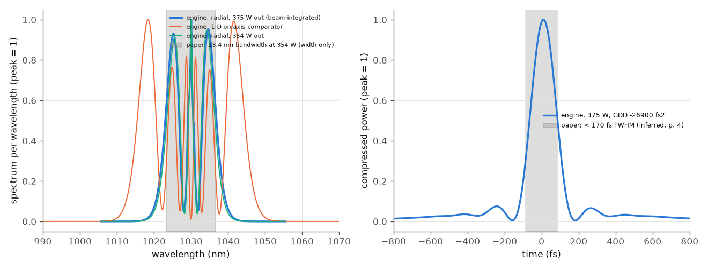
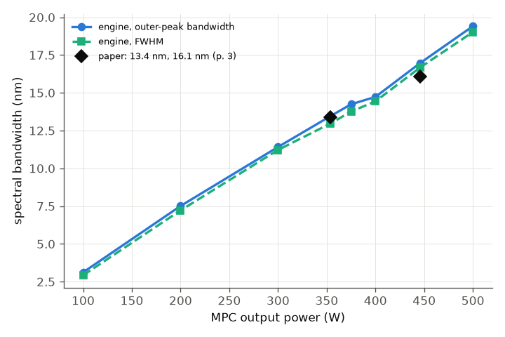

# Schulte et al. 2016: nonlinear pulse compression in a fused-silica multi-pass cell

J. Schulte, T. Sartorius, J. Weitenberg, A. Vernaleken, P. Russbueldt, Opt. Lett. 41, 4511 (2016), DOI 10.1364/OL.41.004511.
(The PDF in `docs/papers/` is this paper; it is not a 2017 Weitenberg paper, although Weitenberg is a co-author.)

**Readability.** All 4 pages were read as extracted text (the page-image reader needs `pdftoppm`, which is not installed).
No figure was seen. Every reference value below comes from the running text; three glyphs are garbled in the text layer
(the mirror curvature, the "+-" of the mirror GDD and the compressor GDD digits). They are marked UNVERIFIED or reconstructed
with a stated cross-check (`paper.json`).

## What the paper does

A 10 MHz, 850 fs Yb:YAG pulse (1.6 nm bandwidth) goes through a Herriott cell of two concave-convex mirrors, 540 mm apart,
with 36 bounces in total. The mirror substrates (13 mm fused silica, entered through the AR concave face, reflected at the HR
convex face) are the Kerr medium: about 1 m of glass in a 20 m path. Each bounce has a B-integral far below pi, but the peak power
is above the critical power for self-focusing, which a single piece of glass could not stand. The mirror coatings have -400 fs2
GDD per bounce. With 354 W out the bandwidth grows from 1.6 nm to 13.4 nm, with 446 W out to 16.1 nm; a three-bounce chirped-mirror
compressor gives a pulse shorter than 170 fs (autocorrelation 200 fs) at 375 W, with 91 % transmission of the cell.

## What we model

`run.py` builds 36 bounces of `[0.54 m air] -> [26 mm fused silica] -> [curved mirror R = 350 mm, GDD -400 fs2, reflectance 0.91^(1/36)]`.
The field is resolved on a radial (Hankel) grid, so diffraction, the Kerr lens and the beam-integrated spectrum (what the paper's
spectrometer saw) come from the engine. The first gap starts with the Gaussian mode of the empty cell (waist 220 um, 459 um on
the mirrors). Input energy is set from the output power: E = P_out / 0.91 / 10 MHz (38.9, 41.2, 49.0 uJ for 354, 375, 446 W).
The 91 % transmission is an input, not a result. Assumptions: `paper.json`.

* The effective mirror curvature 350 mm is inferred: a symmetric two-mirror cell with 540 mm distance and R = 350 mm has a
  459 um mode on the mirrors, the 460 um of the paper.
* The bandwidth uses the paper's definition (half maximum on the outer slopes of the outer peaks), not the FWHM.
* Compression is a pure GDD (the paper's dispersive mirrors); the optimum is searched, not set.



*Left: spectrum per wavelength at 375 W and 354 W out (blue, green) and the on-axis 1-D comparator (orange); the grey band is only
the width the paper quotes at 354 W. Right: the pulse compressed with the best GDD; the grey band is the paper's "< 170 fs".*



*Outer-peak bandwidth and FWHM against the cell's output power; diamonds are the two bandwidths the paper quotes.*

## Comparison

| quantity | paper (location) | ours |
|---|---|---|
| bandwidth, 354 W out | 13.4 nm (p. 3 text, "350 W") | 13.5 nm |
| bandwidth, 375 W out | 13.5 nm (p. 4) | 14.2 nm |
| bandwidth, 446 W out | 16.1 nm (p. 3) | 17.0 nm |
| increase vs 1.6 nm, 354 / 446 W | 8.4 / 10 (p. 3) | 8.4 / 10.6 (against the paper's 1.6 nm; our sech2 input has about 1.1-1.3 nm) |
| transform-limited duration, 354 / 446 W | 160 / 140 fs (p. 3) | 153 / 126 fs |
| optimum compressor GDD at 375 W | within 3 x (-18000 ... -7000) fs2 (p. 3, UNVERIFIED digits) | -26900 fs2 (inside) |
| compressed duration, 375 W | < 170 fs (inferred, p. 4) | 154 fs (5.5-fold shorter than 850 fs; paper "factor five") |
| autocorrelation FWHM | 200 fs (p. 4) | 207 fs |
| energy in the main peak | ~75 % (p. 4, estimated) | 79 % (within +-1.5 FWHM) |
| B-integral at maximum power | ~5 pi (p. 2, from measured radii) | 6.6 pi at 446 W (5.2 pi at 354 W) |
| peak power / critical power | above 1 (p. 1) | 10 at the first glass |
| transmission 91 % | input | input (reproduced to 0.9102) |

All hard checks pass (`checks.json`). The agreement is better than the inputs justify, so the caveats matter.

## Caveats and sensitivities (full tier)

* **The agreement depends on geometry the paper does not give.** With the empty-cell mode and a 540 mm air gap the beam in the
  glass stays between 448 and 547 um over 36 bounces. When we instead put the 26 mm of glass inside the 540 mm (air gap 514 mm), the
  Kerr lens makes the beam grow to about 1 mm and the bandwidth becomes 49 nm with B = 130 rad: the cell, as we built it, is no
  longer stable. We tried the 540 mm reading first and the 514 mm reading second; neither was adjusted. The real cell has a
  meniscus substrate lens and was mode-matched at 375 W; we do not model that, so the stable window is a property of our simplified
  geometry, not a check of the paper's.
* **1-D on-axis model**: 29 nm at 375 W against 14 nm in the beam-integrated radial model. The spectrometer saw the whole beam;
  an on-axis plane-wave model is not a valid comparison for these bandwidths.
* **Mirror GDD +-100 fs2** (the paper's stated spread): -300 fs2 gives 13.6 nm, -500 fs2 gives 15.0 nm at 375 W.
* **Air**: linear instead of Kerr air changes the bandwidth from 14.2 to 13.9 nm. Air carries 0.11 rad of the 17.4 rad B-integral;
  the rest is the glass.
* **Numerics**: 128 radial points on 2 mm (instead of 96 on 1.5 mm) and 128 stored spectral samples (instead of 48) change the
  bandwidth by less than 0.2 nm (the half-maximum points move in steps of the spectral grid).
* **Input shape**: 850 fs and 1.6 nm cannot both hold for a transform-limited pulse of a standard shape (product 0.38). We took a
  sech2 of 850 fs (1.1-1.3 nm). The ratio to the paper's 1.6 nm is quoted above.

## What does not reproduce / what is left

Nothing in the table disagrees beyond its tolerance. Not modelled, and not checked: M2 and mode overlap versus power, thermal lensing
(20 K in the substrates), the coupling prisms, the measured spectral shapes (figures not read), a re-optimised mode match at
each power, and the AR/HR split of the 9 % loss (taken as even per bounce).

## Run

```bash
python3 build/paper_check.py schulte        # fast tier, 3 powers, ~20 s
cd docs/papers/schulte-2016-mpc-fused-silica && python run.py --tier full --figures   # sweep, sensitivities, figures (~3 min)
```
