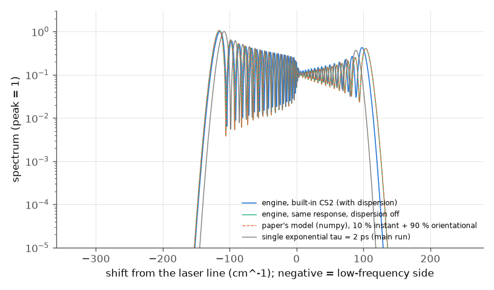

# Shimizu 1967 -- frequency broadening in CS2 by a short pulse with a relaxing index

**PDF readable?** Yes. The 5-page PDF has an OCR text layer, garbled in places; it was read through that layer and every number was
confirmed on rendered page images (the Read tool's PDF mode needs `pdftoppm`, which is not installed). Pages 1 and 4-5 belong to other
papers of the issue. Fig. 1 is a photograph: only its 100 cm^-1 scale bar is used. Nothing is copied from the paper.

## What the paper does
A Q-switched ruby laser (694.3 nm) makes filaments in a 7.5 cm CS2 cell. Their spectra show broadening mostly on the low-frequency
side, with a regular periodic structure. The paper explains it by phase modulation with a relaxing index
`dn(t) = (n2/tau) * integral of <E^2>(t') exp(-(t-t')/tau) dt'` (lowest order, envelope not distorted): for tau = 0 the broadening is
two-sided, for large tau only red; the fringes are the interference of two times with the same instantaneous frequency shift.
It gives no n2, intensity, tau or pulse shape.

## Engine set-up (`run.py`, `paper.json`)
* **Main run: a user material**, because the paper's model is a single exponential with the whole nonlinearity delayed: Kedenburg et al. 2012 index
  formula (via refractiveindex.info, not from the paper), n2 = 3e-19 m2/W (sets only the intensity scale), response `h(t) = exp(-t/tau)/tau`, fR = 1.
* **Second run: the built-in material `CS2`** (since 2026-11: Kedenburg index, total n2 3e-18 m2/W of which 90 % is a delayed `orientational` response,
  `h = (exp(-t/1.6 ps) - exp(-t/0.2 ps))/1.4 ps`; the total, the split and both times are UNVERIFIED typical values). It is compared with the same
  material written out as a user material (identical to 1e-45) and, with dispersion off, with the paper's model in numpy using that response (3.6e-5).
* Assumed (not from the paper): Gaussian, 6 ps FWHM (the paper's own inferred duration); tau = 2 ps for the main run (literature value,
  UNVERIFIED) with a scan 0..18 ps; B = 120 rad (stationary peak phase), giving ~100-150 cm^-1 of broadening, the scale of Fig. 1. 1-D.
* Reference: the paper's own model evaluated in numpy on the engine's input pulse, **including the sub-bin offset of the requested carrier from the
  frequency lattice** (see "Regression" below).

## Results

Left: engine spectrum (tau = 2 ps) and the paper's model; negative shifts are the low-frequency side. Right: spacing of adjacent
minima against the paper's stationary-phase formula 1/(c(t2-t1)); the grey band is the paper's 10 +- 3 cm^-1.

Spectra for several tau, and the energy fraction on the low-frequency side against tau/T.

| quantity | paper | ours |
|---|---|---|
| engine vs the paper's model (dispersion off), total variation, all tau | -- | <= 6e-4 (5e-5 at tau = 0) |
| tau = 0: energy on the low side | symmetric (p. 1099) | 0.4998 |
| low-side fraction grows with tau | p. 1099 | 0.50 (0), 0.72 (2 ps), 0.86 (6 ps), 0.95 (18 ps) |
| energy on the low-frequency side | about 90 % (p. 1098) | 0.86 at tau/T = 1; 0.72 at the assumed 2 ps |
| intensity maximum at the low extremity | p. 1098 | 8 cm^-1 inside the extremal shift (-117 cm^-1) |
| peak at the laser frequency | p. 1098 | yes |
| fringe spacing grows towards the extremity | p. 1098 | 4.4 -> 10.0 cm^-1 |
| spacing vs the paper's formula | p. 1099 | median ratio 1.02 |
| period linear in distance from centre | p. 1098 | R^2 = 0.94 |
| max/min ratio of the structure | at least 10 | median 26 |
| average period | 10 +- 3 cm^-1 | 6.8 cm^-1 (depends on B and T, neither given) |
| structure on the high side with larger spacing | p. 1098 | present, spacing 5.9 vs 6.8 cm^-1: **not larger** (tau = 2 ps) |
| duration from the period | 6e-12 s | see below |
| built-in CS2 (1.6 / 0.2 ps orientational, 90 %), same B: low-side energy | about 90 % (p. 1098) | 0.69; wings -129 / +108 cm^-1 (0.5 % points) |
| built-in CS2 = same material as a user material; = paper's model (dispersion off) | -- | 1e-45; 3.6e-5 (total variation) |
| auto grid with tau = 18 ps | -- | window 690 ps planned, matches the model to 2.3e-4; a fixed 120 ps window now warns |

The built-in CS2 (blue) against the same response without dispersion (cyan) and the paper's model (dashed, hidden behind cyan), and the single-exponential
main run (grey). The built-in response is a bi-exponential (1.6 ps decay, 0.2 ps rise) with a 10 % instantaneous part; its low-side fraction is 0.69, a little
below the 2 ps single exponential (0.72). I did not separate how much comes from the instantaneous part and how much from the rise. With CS2's own dispersion the spectrum
differs by 0.28 (total variation) from the dispersion-free one.

## Regression found and explained (2026-11-08)
After the engine change "input pulse built at the requested carrier, not the lattice-snapped carrier", the hard check "engine (CS2 dispersion off) = the
paper's lowest-order model" went from 6e-4 to 5.8e-3 (tolerance 5e-3). **Cause: the numpy reference, not the engine.** The reference
multiplied sqrt(P) exp(i phi) on the engine's frequency lattice, i.e. it assumed the carrier sits on a lattice point. The engine now centres the pulse at
the requested 694.3 nm, which is 0.0238 cm^-1 (0.086 of the 0.278 cm^-1 lattice step; `grid.reportOmega0 - grid.omega0`) off the nearest lattice
frequency, so the whole fringe pattern (periods of 4-10 cm^-1, ~15 fringes) is shifted by that amount against the reference: total variation 3.7e-3 (tau = 0) to
5.8e-3 (tau = 18 ps). Multiplying the reference field by exp(-i delta t) with delta = reportOmega0 - omega0 brings it back to 5e-5 (tau = 0) and <= 6.2e-4 (all tau), the old
value. The window was not involved (fixed 120 / 480 ps here). The engine is right; the run now records both numbers
(`modelVsEngineTVMax`, `modelVsEngineTVMaxLatticeCarrierRef`) and the check tolerance is tightened to 2e-3.

## What does not reproduce / caveats
* **Average period and blue-side spacing** differ from the paper, but both depend on quantities the paper does not give (B, T, tau);
  they were not tuned. The period scales as 1/T.
* **Internal inconsistency of the paper**: "duration ~ inverse of the average period" with 10 cm^-1 gives 3.3 ps, not the stated 6 ps.
  The engine's mean period times T is 1.22 (in units of 1/c), the paper's numbers give 1.80; the stationary-phase formula (checked) is
  not a simple inverse because the period varies along the spectrum.
* **CS2 dispersion** (GDD 2e-26 s2 over 7.5 cm) changes the spectra by 0.2 % (tau = 18 ps) to 38 % (tau <= 1 ps) (total variation) at B = 120 rad,
  because the SPM chirp is large; the paper's model neglects it. With a constant index the engine matches the model to 6e-4.
* **Grid finding, fixed** (old `repro_1.py`, deleted): a delayed response is a circular convolution; with tau = 18 ps in a 120 ps window the spectrum
  was wrong (total variation 0.48) with no warning. Now the planner adds the response memory (690 ps window, 2.3e-4 from the model) and a too-short fixed window warns;
  both are hard checks in `run.py`.
* Not modelled: the filament (1-D only; P/Pcr = 56 here), the ruby laser's mode structure, Raman scattering.

## How well the science matched
| quantity | paper | ours | verdict | most likely reason |
|---|---|---|---|---|
| spectral model: phase modulation by a relaxing index (Debye integral) | p. 1098-1099 | engine = paper's model to 6e-4 (total variation, all tau) | agrees | engine reproduces the paper's own model |
| tau = 0: two-sided, symmetric | p. 1099 | 0.4998 | agrees | |
| red side grows with tau, one-sided for large tau | p. 1099 | 0.50 / 0.72 / 0.86 / 0.95 for tau = 0 / 2 / 6 / 18 ps | agrees | |
| about 90 % of the energy on the low side | p. 1098 | 0.86 (tau = T); 0.72 (2 ps); 0.69 (built-in CS2) | partly | paper does not specify tau, T, B (assumption); built-in response values UNVERIFIED |
| maximum at the low extremity; peak at the laser line | p. 1098 | 8 cm^-1 from the extremum; present | agrees | |
| period grows linearly with distance, follows 1/(c (t2-t1)) | p. 1098-99 | R^2 0.94; ratio 1.02 | agrees | |
| max/min of the structure at least 10 | p. 1098 | median 26 | agrees | smooth Gaussian assumed |
| average period 10 +- 3 cm^-1 | p. 1098 | 6.8 cm^-1 | does not | paper does not give B or T (assumption; period scales as 1/T, grows with smaller B) |
| high-side structure with larger spacing | p. 1098 | 5.9 vs 6.8 cm^-1 | does not | paper does not give tau/T and B (assumption); real pulse is multimode, not Gaussian |
| duration = 1/(average period) = 6 ps | p. 1099 | 3.3 ps from 10 cm^-1 | does not | paper internal inconsistency (the formula is not a simple inverse) |
| broadening up to 5 % of the carrier | p. 1098 | 0.85 % at B = 120 rad | partly | B is free (assumption) |
| dispersion negligible | implicit | 0.2-38 % change of the spectrum | does not (for ps pulses at B = 120) | paper's approximation; engine includes dispersion |
| filament (self-focused) propagation | p. 1098 | not modelled (1-D; P/Pcr = 56) | engine limitation | 1-D run; a radial model exists but pulse and beam sizes are unknown |

Overall: the physics the paper actually proves (the lowest-order relaxing-index phase modulation, its limits for tau = 0 and large tau, the red
asymmetry and the stationary-phase fringe formula) is reproduced, and the engine equals the paper's model to 6e-4. The paper's experimental numbers
(period, 90 %, blue side) are not reproduced because the paper gives no intensity, duration, tau or pulse shape; they were never tuned. To close the gap one needs the
measured pulse (mode structure, duration) and intensity, a filament model, and verified CS2 response times and n2.

## Run
`python run.py --tier fast` (~1 min) or `--tier full --figures`; `python3 build/paper_check.py shimizu-1967-cs2-broadening`: 19 checks, 16 hard pass, 3 soft-fail
(blue spacing, average period, built-in CS2 low-side fraction).
