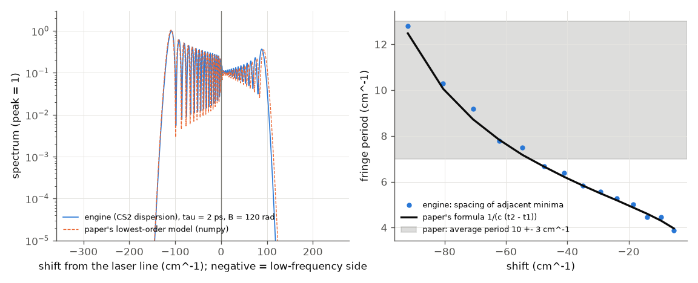
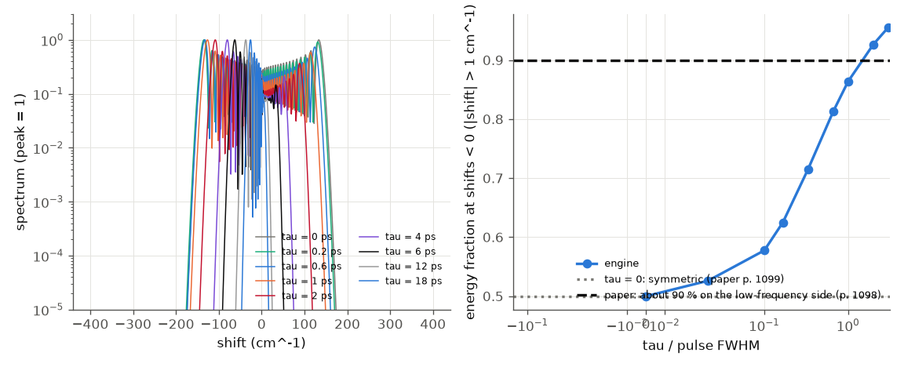

# Shimizu 1967 -- frequency broadening in CS2 by a short pulse with a relaxing index

**PDF readable?** Yes. The 5-page PDF has an OCR text layer, garbled in places; it was read through that layer and every number was
confirmed on rendered page images (the Read tool's PDF mode needs `pdftoppm`, which is not installed). Pages 1 and 4-5 belong to other
papers of the issue. Fig. 1 is a photograph: only its 100 cm^-1 scale bar is used. Nothing is copied from the paper.

## What the paper does
A Q-switched ruby laser (694.3 nm) makes filaments in a 7.5 cm CS2 cell. Their spectra show broadening mostly on the low-frequency
side, with a regular periodic structure. The paper explains it by phase modulation with a relaxing index
`dn(t) = (n2/tau) * integral of <E^2>(t') exp(-(t-t')/tau) dt'` (lowest order, envelope not distorted): for tau = 0 the broadening is
two-sided, for large tau only red; the fringes are the interference of two times with the same instantaneous frequency shift.
It gives no n2, intensity, tau or pulse shape.

## Engine set-up (`run.py`, `paper.json`)
* CS2 is **not a built-in material** (finding). Supplied as a user material: index formula of Kedenburg et al. 2012 (via
  refractiveindex.info, not from the paper), n2 = 3e-19 m2/W (sets only the intensity scale), response as a user delayed response
  `h(t) = exp(-t/tau)/tau`, fR = 1.
* Assumed (not from the paper): Gaussian, 6 ps FWHM (the paper's own inferred duration); tau = 2 ps for the main run (literature value,
  UNVERIFIED) with a scan 0..18 ps; B = 120 rad (stationary peak phase), giving ~100-150 cm^-1 of broadening, the scale of Fig. 1. 1-D.
* Reference: the paper's own model evaluated in numpy on the engine's input pulse.

## Results

Left: engine spectrum (tau = 2 ps) and the paper's model; negative shifts are the low-frequency side. Right: spacing of adjacent
minima against the paper's stationary-phase formula 1/(c(t2-t1)); the grey band is the paper's 10 +- 3 cm^-1.

Spectra for several tau, and the energy fraction on the low-frequency side against tau/T.

| quantity | paper | ours |
|---|---|---|
| engine vs the paper's model (dispersion off), total variation, all tau | -- | <= 6e-4 |
| tau = 0: energy on the low side | symmetric (p. 1099) | 0.4998 |
| low-side fraction grows with tau | p. 1099 | 0.50 (0), 0.72 (2 ps), 0.86 (6 ps), 0.95 (18 ps) |
| energy on the low-frequency side | about 90 % (p. 1098) | 0.86 at tau/T = 1; 0.72 at the assumed 2 ps |
| intensity maximum at the low extremity | p. 1098 | 8 cm^-1 inside the extremal shift (-117 cm^-1) |
| peak at the laser frequency | p. 1098 | yes |
| fringe spacing grows towards the extremity | p. 1098 | 4.4 -> 10.0 cm^-1 |
| spacing vs the paper's formula | p. 1099 | median ratio 1.02 |
| period linear in distance from centre | p. 1098 | R^2 = 0.94 |
| max/min ratio of the structure | at least 10 | median 26 |
| average period | 10 +- 3 cm^-1 | 6.8 cm^-1 (depends on B and T, neither given) |
| structure on the high side with larger spacing | p. 1098 | present, spacing 5.9 vs 6.8 cm^-1: **not larger** (tau = 2 ps) |
| duration from the period | 6e-12 s | see below |

## What does not reproduce / caveats
* **Average period and blue-side spacing** differ from the paper, but both depend on quantities the paper does not give (B, T, tau);
  they were not tuned. The period scales as 1/T.
* **Internal inconsistency of the paper**: "duration ~ inverse of the average period" with 10 cm^-1 gives 3.3 ps, not the stated 6 ps.
  The engine's mean period times T is 1.22 (in units of 1/c), the paper's numbers give 1.80; the stationary-phase formula (checked) is
  not a simple inverse because the period varies along the spectrum.
* **CS2 dispersion** (GDD 2e-26 s2 over 7.5 cm) changes the spectra by 3-38 % (total variation) at B = 120 rad even for ps pulses,
  because the SPM chirp is large; the paper's model neglects it. With a constant index the engine matches the model to 6e-4.
* **Grid finding** (`repro_1.py`): a delayed response is a circular convolution; with tau = 18 ps in a 120 ps window the spectrum is
  wrong (total variation 0.48 vs a 480 ps window) and the run reports "Configured grid is adequate" with no warning. The planner does
  not add the response memory. The 480 ps result matches numpy to 3e-4.
* Not modelled: the filament (1-D only; P/Pcr = 56 here), the ruby laser's mode structure, Raman scattering.

## Run
`python run.py --tier fast` (~40 s) or `--tier full --figures`; `python3 build/paper_check.py shimizu`: 14 checks, 12 pass, 2 soft-fail.
