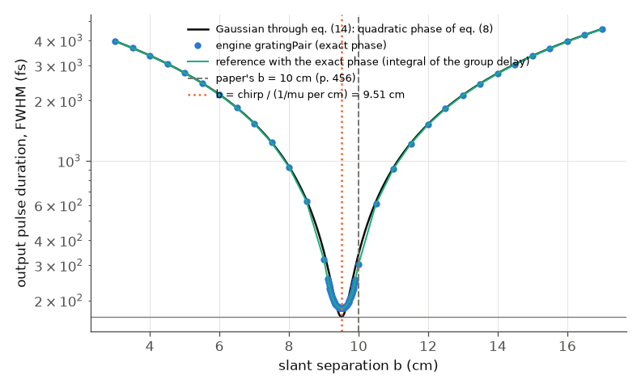
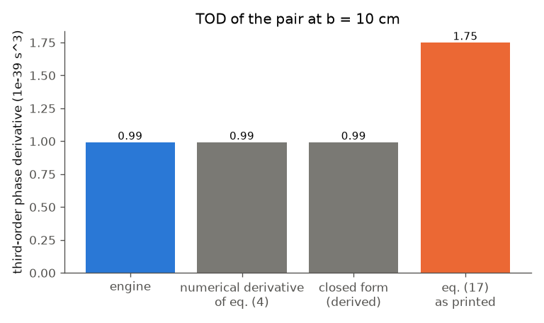

# Treacy (1969): optical pulse compression with a grating pair

**Reading status.** The Read tool's PDF mode failed (poppler is missing). The licensed IEEE PDF (5 pages) was read through macOS PDFKit;
its text layer garbles the equations, so every formula and number was read from page images (eq. (17) at four times magnification).
The PDF and its figures are not in the repository.

## What the paper does

Two parallel gratings, light passing the pair once, delay longer wavelengths more, so the phase shift through the pair has a quadratic
term in frequency: a chirped pulse of the right sign is compressed. The paper derives the group delay
tau_0 = b (1 + cos theta)/c (eq. 7) from the geometry (slant separation b, angle theta between the incident and diffracted rays,
sin(gamma - theta) = lambda/d - sin gamma, eq. 3), and the chirp rate

    1/mu = 4 pi^2 c b / (omega^3 d^2 [1 - (lambda/d - sin gamma)^2])        (eq. 8, phi'' = -1/mu)

The output of the pair for an input envelope A exp(i psi) is a Fresnel transform (eq. 14), the same integral as Fresnel diffraction,
with the grating separation b playing the part of the propagation distance (Table I). The worked example (p. 456): 1200 lines/mm,
1.06 um, 60 degrees; two wavelengths 100 A apart are delayed by **0.58 ps per cm of slant separation**; a pulse with a linear
sweep over a 100 A band and 5.8 ps duration is compressed to its minimum at **b = 10 cm**. The last section (eq. 17) adds the cubic
term sigma (omega - omega_0)^3, "of order twice the fractional bandwidth" relative to the quadratic one.

## Setup in the engine

`gratingPair` with `linesPerMm: 1200`, `aoiDeg: 60`, `order: -1`, **`passes: 1`** (the engine's default is 2, a double-passed
compressor, which would double the dispersion), and `separationM` = G, the **perpendicular** distance; Treacy's b is the slant
separation, so G = b cos(theta_d) with theta_d = 23.95 degrees the diffraction angle (equal to gamma - theta of eq. 3).
The input is a Gaussian at 1.06 um with 10 nm FWHM of its intensity spectrum (an assumption for the "100 A band"), 165 fs
transform limit, and a group-delay dispersion of +3.46e5 fs^2 that makes it 5.8 ps long. Positive GDD means longer wavelengths
first; the pair delays them more, so it compresses this pulse and lengthens one with the opposite chirp (11.9 ps in the run), which
confirms the sign convention end to end. Grid: 16384 points, 60 ps window (3.7 fs step). Run `python run.py --tier fast` (about
20 s) or `--tier full --figures`.

## Comparison

| quantity | paper | ours |
|---|---|---|
| group delay at b = 10 cm, eq. (7) | tau_0 = b (1 + cos theta)/c | engine 603.271 ps; eq. (7) 603.264 ps (1e-5) |
| GDD at b = 10 cm, eq. (8) | -1/mu | engine -3.6364e5 fs^2; eq. (8) -3.6367e5 fs^2 (8e-5) |
| TOD at b = 10 cm, exact phase | not given | engine 9.935e-40 s^3; numerical derivative of eq. (4)/(7) 9.936e-40 (1.3e-4) |
| TOD, **eq. (17) as printed** | sigma = (2 omega_0 mu)^-1 (1 + (lambda/d) sin gamma + sin^2 gamma) | **1.751e-39 s^3, 1.76 times the exact value** (see below) |
| delay per cm for 100 A, eq. (5a) | 0.58 ps/cm (p. 456) | **0.610 ps/cm** from the engine and from eq. (5a) itself (+5 %) |
| compression optimum | b = 10 cm (p. 456) | **9.51 cm** (engine scan; the chirp divided by eq. (8)'s rate: 9.51 cm) |
| minimum duration | "compressed to its minimum length" | 182.5 fs (165.4 fs transform limit; 1.10 times, from the cubic phase) |
| pulse before, after | 5.8 ps, minimum | 5.80 ps, 182.5 fs: factor 32 |
| angular dispersion per 100 A (p. 457) | about 2e-2 rad | 1.31e-2 rad (1/(d cos theta_d) x 100 A) |

## Disagreements, and where they come from (none is in the engine)

1. **Printed example, 0.58 ps/cm.** Equation (5a), evaluated with the paper's own numbers, gives 0.610 ps/cm, and the engine agrees with the
   equation to 1e-4. The printed value is 5 % lower, and the 10 cm for a 5.8 ps pulse follows from 0.58 (5.8 ps / 0.58 ps/cm), whereas the
   formula gives 9.5 cm. A rounding or a different wavelength spacing in the paper's arithmetic; the engine follows the equation. No tuning was done.
2. **Equation (17).** The coefficient of the cubic phase, as printed, is 1.76 times the exact derivative of the paper's own group delay (eq. 4/7, at
   fixed perpendicular separation G, so b varies with wavelength). The engine (9.935e-40 s^3) agrees with the numerical derivative to 1.3e-4.
   Differentiating eq. (5b) once more by hand gives, with the dependence of b on wavelength kept,

       phi''' = 3 |phi''| / omega_0 x (1 + (lambda/d) sin gamma - sin^2 gamma) / cos^2 theta_d

   (checked against the numerical derivative to 7e-8). The printed form has "+ sin^2 gamma" and no 1/cos^2 theta_d. This is a statement about the
   printed equation in this copy, not about the engine; a later erratum or correction may exist, which was not looked for. The size of the cubic
   effect decides how far a real pulse compresses: with the exact phase, at the optimum b the minimum duration is 182.5 fs, 10 % above the
   165 fs transform limit; the quadratic-only closed form would say 165 fs.
3. **Angular dispersion "about 2e-2 rad per 100 A"** (p. 457): the grating equation gives 1.31e-2. Soft: the digit was read from a scan and
   the paper calls it approximate.

## Plots

Output duration (FWHM, fs) against slant separation. Black: the closed-form Gaussian through the paper's quadratic phase (eq. 8, eq. 14); green: a
reference computed in `run.py` with the exact phase (the integral of the exact group delay over frequency); blue points: the engine. Vertical
lines: the paper's 10 cm (grey) and the separation at which the pair's chirp cancels the pulse's (orange, 9.51 cm). The engine follows the exact-phase
reference to 0.2 % everywhere; both sit above the horizontal transform limit at the minimum because of the cubic phase.

Third-order phase derivative at b = 10 cm: the engine, the numerical derivative of the paper's eq. (4), the closed form derived above, and eq. (17)
as printed.

## What does not reproduce / what is left

* The two printed numbers (0.58 ps/cm, 10 cm) and the eq. (17) coefficient differ from the paper's own formulas, as above; the engine follows the formulas.
* Not simulated: finite resolving power and grating size (p. 457), efficiency, beam walk-off between the gratings (spatial chirp; the engine's
  `gratingPair` with `passes: 1` leaves it, see `docs/reference/components.md`), and the paper's Table I Fresnel analogy beyond the Gaussian case.
* The sign of Treacy's convention (exp(-i omega t)) was not compared symbol by symbol; the physical statement (positive chirp is compressed, negative
  lengthened) was tested instead.
