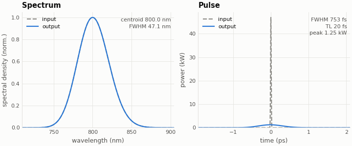
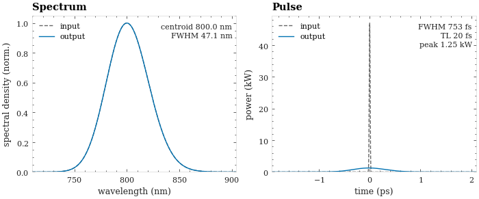
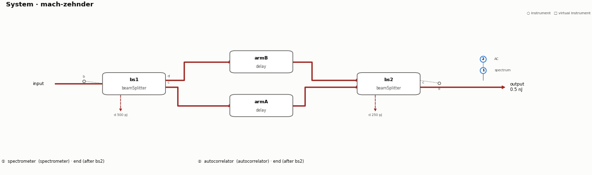
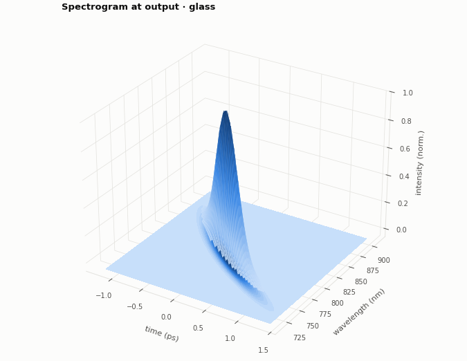
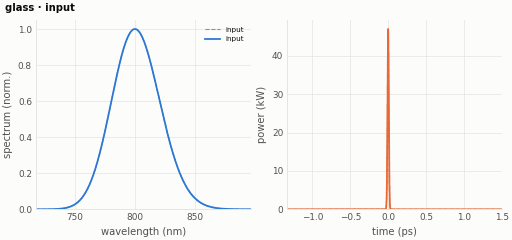

# Plotting: styles, schematics, 3-D spectrogram, evolution animation

`ultrafast-plot` and `ultrafast.plotting` draw results ([Python](python.md#plotting-results) lists the figures). This page covers the
plot styles for screen and for papers, the schematics of branched systems, the 3-D spectrogram and the evolution animation. The
plotting code needs NumPy and matplotlib, not the engine. The default `pip install ultrafast-engine` brings both; the GIF writer needs
Pillow (`pip install "ultrafast-engine[animate]"`, or `[all]`), the `science` style needs SciencePlots (`[paper]`).

## Keys

```python
from ultrafast import plotting as up
up.use_style("paper")                      # from now on
with up.use_style("ultrafast-dark"):       # only inside the block
    fig = up.overview(result)
```

```bash
ultrafast-plot results/ --style paper                 # --column single | double for the paper styles
ULTRAFAST_PLOT_STYLE=ultrafast-dark ultrafast-plot results/
```

`ULTRAFAST_PLOT_STYLE` sets the style at import and is what `use_style()` without a name uses. `--dark` is the same as
`--style ultrafast-dark`.

| style | what |
|---|---|
| `ultrafast` | default: the logo's blue and orange first, light surface, soft grid, no top / right frame |
| `ultrafast-dark` | the same on the logo's dark surface; the boxes of the schematic have their own dark fill |
| `paper` | publication: serif text with Computer Modern maths (`mathtext.fontset = cm`, no LaTeX needed), inward ticks on all four sides, minor ticks, no grid, black ink, thin lines with a line style per series (reads in grey), figures set to the journal column width (3.4 in single, 7.0 in double, the default; `use_style("paper", column="single")`), saved at 600 dpi |
| `science` | the look of [SciencePlots](https://github.com/garrettj403/SciencePlots) when it is installed; otherwise a warning and `paper`. No code or asset of SciencePlots is copied into this project: only its installed style sheets are applied |

A dashboard wider than 9 in (the `overview`, `probes`, `system` figures) keeps its size in the paper styles and is saved at the highest
resolution that stays under 4800 pixels across (`up.save_dpi(fig)`); a figure of one panel row is set to the column width and saved at 600 dpi.

 
 

Schematics, spectrogram and animation:

| call | what |
|---|---|
| `up.system(result, params=False)` | schematic of the system; `params=True` adds the key numbers of each element under its box, for a Branched system |
| `up.spectrogram_3d(result, at="output", n_time=90, n_wavelength=90, floor=True, elev=28, azim=-58)` | surface over time and wavelength; `at` is `"input"`, `"output"` or a probe id |
| `up.spectrogram(result, at="output", n_time=120, n_wavelength=120, level=1e-3)` | `{"time_s", "wavelength_m", "intensity", "window_sigma_s"}` for your own plot; `intensity` has shape (n_wavelength, n_time), peak 1, cropped to where the pulse and spectrum exceed `level` of their peaks |
| `up.animate_evolution(result, path="evolution.gif", probes="all", db=False, fps=3, dpi=80, mp4=False, floor_db=-40)` | GIF (and MP4 with `mp4=True` when `ffmpeg` is installed) of the spectrum and the pulse through the system; returns the writer's dict plus `locations` |

## Model

**Palette.** The series colours were checked with the dataviz palette validator (lightness band, chroma floor, colour-vision-deficiency
separation of adjacent colours, normal-vision separation, contrast with the surface), six series at a time:

| style | result |
|---|---|
| `ultrafast` | passes; the yellow, green and pink are below 3:1 against the light surface (2.1 to 2.7), so label lines directly or in a legend, never by colour alone |
| `ultrafast-dark` | passes, including 3:1 contrast on the dark surface |
| `paper` | Okabe and Ito (2008) colours in an order that passes (worst adjacent pair ΔE 9.6 in colour-blind vision); the line-style cycle is the secondary encoding |

Each theme holds eight series colours. The check covers six; a ninth series reuses the first colour (the matplotlib cycle wraps), so
fold the extra series into one or split the figure.

**Branched-system schematic.** `up.system(result)` draws a Branched system as a graph and a Sequential one as the beam line with
glyphs. The layout is computed from `summary["graph"]` by `ultrafast.plotting.graph_layout.layout_graph`, so the same system always
gives the same picture (decision V2).

 

* **Loops** are a dashed arc below the row, from the element that closes the loop back to the one it feeds, inside a shaded region
  labelled with the loop kind (`ringDown`, `steadyState`).
* **Orthogonal routing.** A link leaves its box horizontally, turns in a channel next to the source layer, travels along a free track
  between the rows of boxes when it skips layers, turns again before the target layer and enters horizontally. It never crosses a box
  (`graph_layout.segments_cross_boxes` is empty). Several links through one channel are offset; the ports of one box are spread over its side and labelled (`c`, `d`, `1`, `2`).
* **Runs of identical elements**: a run of at least 3 identical elements (the 46 passes of a `sameAs` multipass cell) is one box
  `pass1 … pass46`, `× 46`.
* **Instrument tags** (numbered circles, the numbers used in every instrument title) stand above the box they follow; aux beams come
  in from above with their wavelength, by-products leave below with their energy; virtual ports are open circles on dotted links.
* `params=True` has an effect only for a Branched system drawn as a graph; a Sequential system ignores it.
* The theme's `panel` colour fills the boxes, so the dark theme is readable.


The same graph as text: `ultrafast validate system.ufs --graph --mermaid` prints a Mermaid flowchart. Elements are boxes `id / type`, virtual
input and output ports are open circles on dotted links, each loop is a `subgraph` naming its kind and entry, and a Sequential system is its chain.

**3-D spectrogram.** A Gaussian-window short-time transform of the pulse envelope, drawn as a surface over time and wavelength with its
square root as a heat map on the floor (so the faint tails show). The window is matched to the pulse (`σ_w = √(σ_t / (2π σ_ν))`). The
marginal over time is the spectrum and the marginal over wavelength is the pulse. The ridge of a pulse with positive GDD runs from
long to short wavelength (red leads), the engine's `exp(−iωt)` convention. For a probe the envelope is rebuilt from the stored
spectrum and spectral phase on 4096 points; its time axis is `(i − n/2) Δt`, centred on t = 0, and the group delay of the pulse
appears as an offset of the pulse inside it.



**Evolution animation.** One frame per location (input, every probe in element order, output) with the spectrum and the pulse power, the input
dashed for reference and the axes fixed over all frames. Each frame also notes the pulse width: the main-lobe FWHM (`mainLobeFwhmS`),
and the outer FWHM `fwhmS` "(with satellites)" when a satellite crosses half maximum. It needs probes (`run_spec(probes="all")`, the
default). It uses [`plotting.animate`](python.md#plotting-results): defaults `fps=3`, `dpi=80`, the last frame held for
`pause_last_s=1.5` s. The 2.5 MB size budget is not enforced: the result dict has `overBudget`, which is `True` above 2.5 MB.



The images on this page come from `python python/tools/make_plotting_docs.py`.

## Validation

All in `python/tests`:

| what | test |
|---|---|
| `use_style` as a call and a context manager, errors, environment variable | `test_use_style_is_a_call_and_a_context_manager`, `test_unknown_style_and_column_are_value_errors`, `test_environment_variable_sets_the_default_style` |
| paper recipe: 3.4 / 7.0 in, inward ticks, no grid, 600 dpi | `test_paper_style_follows_the_publication_recipe`, `test_a_paper_figure_has_inward_ticks_on_all_sides_and_no_grid`, `test_save_dpi_never_makes_a_dashboard_enormous` |
| `science` falls back to `paper` | `test_science_style_uses_scienceplots_when_installed_else_paper` |
| palettes distinct, light enough, ordered from the logo hues; dark box fill | `test_palettes_are_distinct_light_enough_and_ordered_from_the_logo_hues`, `test_dark_theme_has_its_own_box_fill` |
| graph layout: lanes, orthogonal routes that end on boxes, loop arc, 46 passes as one box, no crossing of boxes, deterministic | `test_graph_layout.py` |
| schematics show loops, instruments, parameters | `test_branched_figures_show_loops_instruments_parameters_and_the_dark_panel`, `test_46_pass_same_as_cell_draws_one_box_times_46_in_both_topologies` |
| spectrogram marginals reproduce the spectrum and the pulse; ridge of positive GDD runs red to blue | `test_spectrogram_marginals_reproduce_the_spectrum_and_the_pulse`, `test_spectrogram_ridge_of_a_positive_gdd_pulse_runs_from_red_to_blue` |
| animation: one frame per location; main-lobe and outer FWHM | `test_animate_evolution_writes_a_gif_with_one_frame_per_location`, `test_evolution_plots_the_main_lobe_fwhm_and_the_outer_fwhm_dashed` |

## Limits

* No more than eight series colours; a ninth series repeats a colour.
* The GIF size budget is reported (`overBudget`), not enforced: reduce `dpi`, the figure size or the number of probes.
* The 3-D spectrogram of a probe is rebuilt from the stored spectrum and phase; it shows what the probe stored, not the full time-domain field.
* The `science` style needs SciencePlots; without it the figure is drawn in `paper`.
