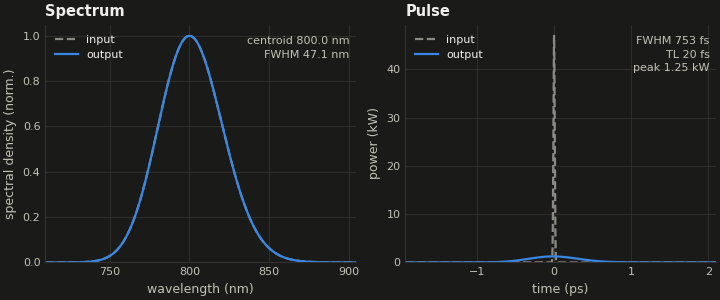
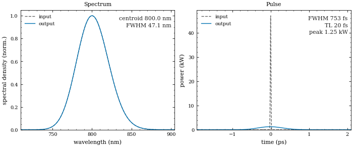
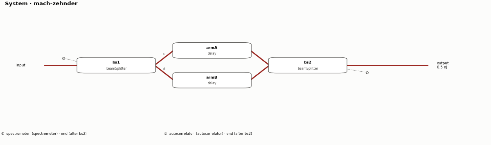
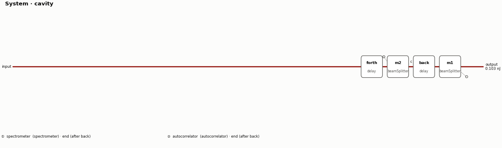
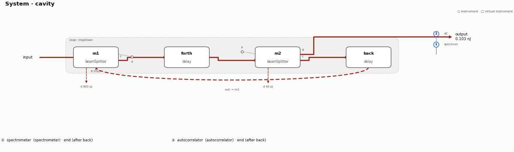
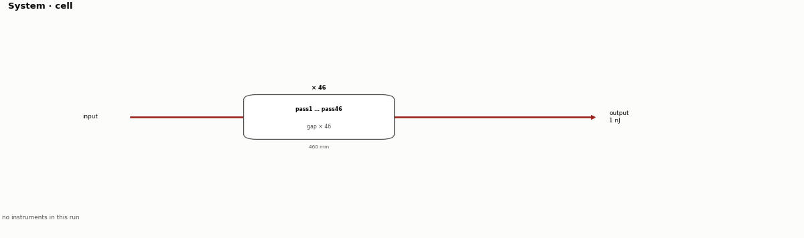

# Plotting: styles, schematics, 3-D spectrogram, evolution animation

`ultrafast-plot` and `ultrafast.plotting` draw results ([Python](python.md#plotting-results) lists the figures). This page covers
what WP-2 added: plot **styles** for screen and for papers, **schematics** of branched systems, the **3-D spectrogram** and the
**evolution animation**. Everything needs only NumPy and matplotlib (Pillow for the GIF), not the engine.

## Styles

```python
from ultrafast import plotting as up
up.use_style("paper")                      # from now on
with up.use_style("ultrafast-dark"):       # only inside the block
    fig = up.overview(result)
```

```bash
ultrafast-plot results/ --style paper                 # --column single | double for the paper styles
ULTRAFAST_PLOT_STYLE=ultrafast-dark ultrafast-plot results/
```

| style | what |
|---|---|
| `ultrafast` | default: the logo's blue and orange first, light surface, soft grid, no top / right frame |
| `ultrafast-dark` | the same on the logo's dark surface; boxes of the schematic have their own dark fill (they were white before) |
| `paper` | publication: serif text with Computer Modern maths (`mathtext.fontset = cm`, no LaTeX needed), inward ticks on all four sides, minor ticks, no grid, black ink, thin lines with a **line style** per series (reads in grey), figures set to the journal column width (**3.4 in** single, **7.0 in** double, the default; `use_style("paper", column="single")`), saved at **600 dpi** |
| `science` | the look of [SciencePlots](https://github.com/garrettj403/SciencePlots) when it is installed (optional extra `paper`: `pip install ultrafast-engine[paper]`); otherwise a warning and `paper`. No code or asset of SciencePlots is copied into this project: only its installed style sheets are applied |

`ULTRAFAST_PLOT_STYLE` sets the style at import and is what `use_style()` without a name uses. `--dark` is the same as `--style ultrafast-dark`.
A dashboard wider than 9 in (the `overview`, `probes`, `system` figures) keeps its size in the paper styles and is saved at the highest
resolution that stays under 4800 pixels across (`up.save_dpi(fig)`); a figure of one panel row is set to the column width and saved at 600 dpi.

 
 

**Palette checks.** The series colours were checked with the dataviz palette validator (lightness band, chroma floor, colour-vision-deficiency
separation of adjacent colours, normal-vision separation, contrast with the surface), six series at a time:

| style | result |
|---|---|
| `ultrafast` | passes; the yellow, green and pink are below 3:1 against the light surface (2.1 to 2.7), so lines are labelled directly or in a legend, never by colour alone |
| `ultrafast-dark` | passes, including 3:1 contrast on the dark surface |
| `paper` | Okabe and Ito (2008) colours in an order that passes (worst adjacent pair ΔE 9.6 in colour-blind vision); the line-style cycle is the secondary encoding |

The ninth series and beyond are never generated hues: fold them into "other" or facet.

## Schematics of branched systems

`up.system(result)` draws a Branched system as a graph (a Sequential one keeps the beam line with glyphs). The layout is computed by code from
`summary["graph"]`, so the same system always gives the same picture (decision V2): `ultrafast.plotting.graph_layout.layout_graph`.

 

 

What it does, with the images above (before: the plotting module of the commit before WP-2):

* **Loops** are drawn as a dashed arc below the row, from the element that closes the loop back to the one it feeds, inside a shaded region
  labelled with the loop kind (`ringDown`, `steadyState`). Before, loops were not drawn at all and the cavity was a sequence of boxes on one line.
* **Orthogonal routing.** A link leaves its box horizontally, turns in a channel next to the source layer, travels along a free track
  between the rows of boxes when it skips layers, turns again before the target layer and enters horizontally. It never crosses a box
  (`graph_layout.segments_cross_boxes` is empty; a test checks it). Several links through one channel are offset, ports of one box are
  spread over its side and labelled (`c`, `d`, `1`, `2`).
* **Runs of identical elements** (the 46 passes of a `sameAs` multipass cell) are one box `pass1 … pass46`, `× 46`.
* **Instrument tags** (numbered circles, the numbers used in every instrument title) stand above the box they follow; **aux beams** come in from above with their wavelength,
  **by-products** leave below with their energy; **virtual ports** are open circles on dotted links.
* `up.system(result, params=True)` adds the key numbers of each element under its box (length, reflectivity, delay, round trips, as far as the run summary carries them).
* The theme's `panel` colour fills the boxes: the dark theme is readable (it was white boxes with light text).



The same graph as text: `ultrafast validate system.ufs --graph --mermaid` prints a Mermaid flowchart. Elements are boxes `id / type`, virtual
input and output ports are open circles on dotted links, each loop is a `subgraph` naming its kind and entry, and a Sequential system is its chain.

## 3-D spectrogram

```python
fig = up.spectrogram_3d(result, at="output")     # at: "input", "output" or a probe id
data = up.spectrogram(result, "output")          # {"time_s", "wavelength_m", "intensity"} for your own plot
```

A Gaussian-window short-time transform of the pulse envelope, drawn as a surface over time and wavelength with its square root as a heat map on the
floor (so the faint tails show). The window is matched to the pulse (`σ_w = √(σ_t / (2π σ_ν))`). The marginal over time is the spectrum and the
marginal over wavelength is the pulse (a test compares both). The ridge of a pulse with positive GDD runs from long to short wavelength
(red leads), the engine's `exp(−iωt)` convention. For a probe the envelope is rebuilt from the stored spectrum and spectral phase; its time axis
is centred on the pulse's group delay.


## Evolution animation

```python
up.animate_evolution(result, "evolution.gif")                       # input, every probe in element order, output
up.animate_evolution(result, "evo.gif", probes=["plate2"], db=True, mp4=True)
```

One frame per location with the spectrum and the pulse power, the input dashed for reference and the axes fixed over all frames. Needs probes
(`run_spec(probes="all")`, the default). It uses [`plotting.animate`](python.md#plotting-results) (Pillow GIF; MP4 when `ffmpeg` is installed) and stays under
its 2.5 MB budget at the default 80 dpi. Returns the writer's dict plus `locations`.


The images on this page come from `python python/tools/make_plotting_docs.py`.
