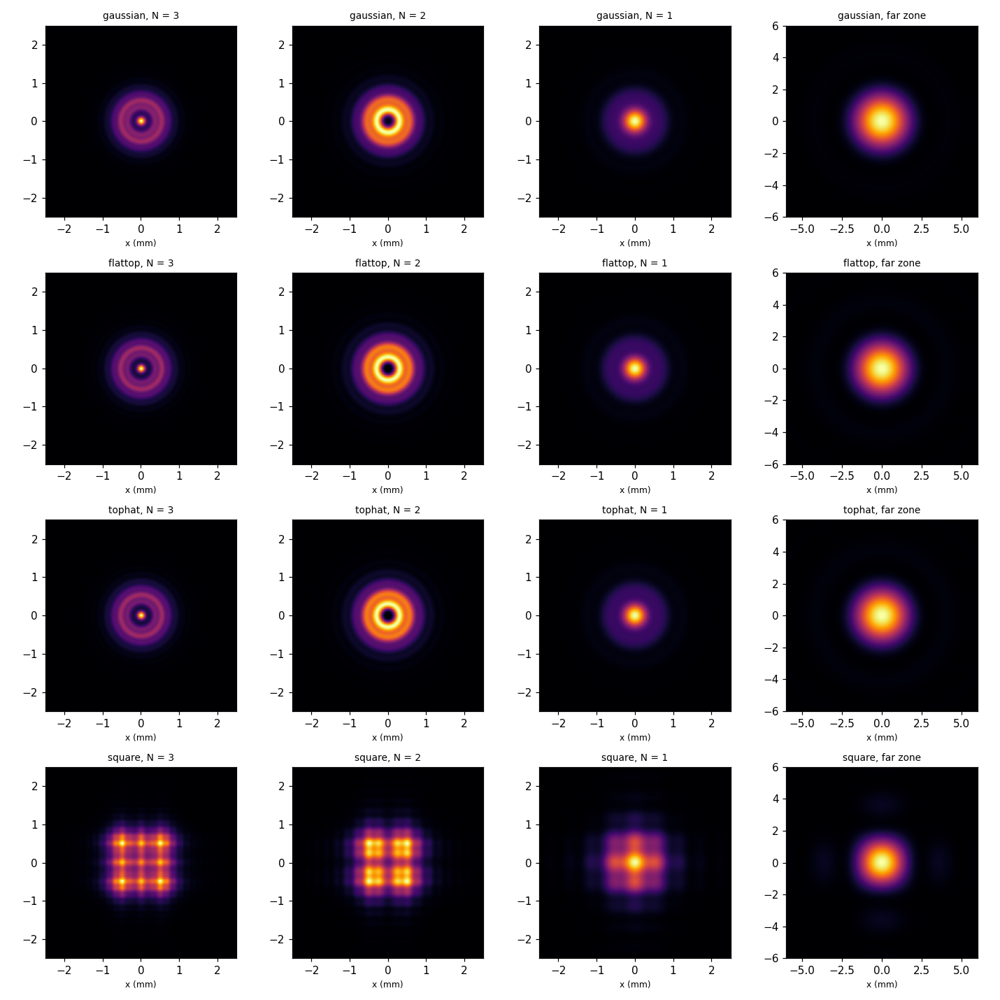
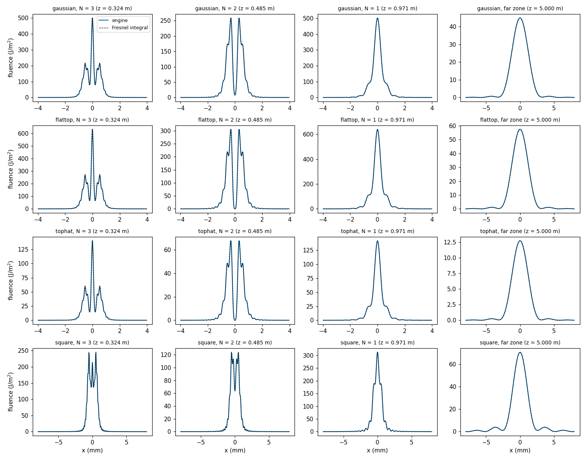

# Tutorial 6 -- Diffraction by an iris

**Goal:** send beams of different shapes through an iris, image the diffraction pattern at several distances, and check
the result against the Fresnel diffraction integral. Along the way: how to choose a transverse grid for a hard aperture,
and how to tell a physical pattern from a numerical one.

Files: `docs/examples/30-iris-diffraction/` (`gaussian.ufs`, `flattop.ufs`, `tophat.ufs`, `square.ufs`, `run.json`,
`compare.py`, `iris.py`). Run the commands from that folder.

## 1. What to expect

A field cut by an opening of radius (or half-width) a spreads as it travels. How it looks at a distance z depends on one
number, the **Fresnel number** of the opening seen from z:

N = a² / (λ z)

* **N ≫ 1, near field:** the beam keeps the shape of the opening, with fine ripples at its edge.
* **N ~ 1, Fresnel zone:** the opening holds N Fresnel zones -- rings whose waves arrive at the axis with phases
  0, π, 2π... For a uniform (plane-wave) beam through a round iris the fluence on the axis is
  F(0, z) = 4 F_in sin²(π N / 2) (Born & Wolf, *Principles of Optics*, 8.8): 4 x the incident fluence at N = 1 and 3, zero at
  N = 2.
* **N ≪ 1, far zone (Fraunhofer):** the pattern stops changing shape and grows linearly with z: the Airy disc of a round iris
  (first dark ring at 0.61 λz/a) or the sinc² of a square one (first zero at λz/2a along x).

With a = 1 mm and λ = 1030 nm, N = 3, 2, 1 at z = 0.32, 0.49, 0.97 m; at 5 m, N = 0.19.

## 2. The system: a source, an iris, free space

```jsonc
"elements": [
  { "id": "source", "type": "gap", "lengthM": 0, "material": "Vacuum",
    "transverse": { "model": "radial", "points": 1024, "radiusM": 12e-3, "absorbingBoundary": true,
                    "initialProfile": { "kind": "gaussian", "radiusM": 2e-3 } } },
  { "id": "iris", "type": "aperture", "radiusM": 1e-3 },
  { "id": "n3",  "type": "gap", "lengthM": 0.323625, "material": "Vacuum", "transverse": { ...same grid... } },
  { "id": "n2",  "type": "gap", "lengthM": 0.161812, ... },
  { "id": "n1",  "type": "gap", "lengthM": 0.485437, ... },
  { "id": "far", "type": "gap", "lengthM": 4.02913,  ... } ]
```

* The **zero-length `gap`** with a transverse model makes the beam: `initialProfile` sets its shape and size, so no `beam` is needed.
  The 1-D pulse (`run.json`: 1 ps, 1 mJ at 1030 nm) gives the spectrum and the energy.
* The **`aperture`** masks the carried profile at every stored frequency and books the clipped energy as `clip`
  ([Transverse: diffraction and apertures](../reference/transverse.md#diffraction-and-apertures)).
* The **gaps** propagate the field. Each gap ends at one of the four planes, and the instruments in `run.json` sit there:
  a `beamProfile` (radial fluence, or x/y cuts on a cartesian grid) and a `camera` image.

```bash
ultrafast run gaussian.ufs run.json -o results-gaussian
```

`summary.json -> elements` reports what happened: the iris's `transmission` (0.3926; 1 − exp(−2a²/w²) = 0.3935) and
`apertureSamples` (85: grid samples across the iris radius), and for each gap `onAxisFluenceOutJPerM2`, `peakFluenceOutJPerM2` and
`absorbedAtBoundaryFraction`. The `representation` of gap `n3` says
`radial (Hankel), 1024 points to r = 12 mm x 48 frequency samples (linear: the profile is propagated in 8 steps)`: a linear gap
propagates only the beam's transverse profile at its stored frequencies, not the whole field, so the run takes a few seconds.

## 3. Choosing the grid

A hard edge has detail at every scale, so the grid decides what you see. Three rules:

1. **Resolve the opening.** At least 10-20 samples across its radius or half-width -- the engine warns below 10
   ("the aperture spans only ... grid samples"). Edge samples transmit the fraction of their cell inside the opening, which
   puts the edge in the right place between samples. Light diffracted to angles beyond the grid's largest angle is not
   represented, so the transmission converges from below, by about dx / 3a times the edge fluence.
2. **Resolve the pattern.** Its finest feature near the edge is the outermost Fresnel zone, λz / 2a wide (26 µm at z = 5 cm,
   167 µm at N = 3 here).
3. **Hold the pattern, and absorb what leaves.** The grid must be several times wider than the pattern (the Airy disc is
   1.2 λz/a across). Light diffracted to larger angles reaches the edge of the grid: a radial grid reflects it back (it
   focuses onto the axis and shows up as a spike), a cartesian grid wraps it around to the other side. `"absorbingBoundary":
   true` removes it in the outer 15 % of the grid. Linear gaps are then split into steps so that the steepest wave crosses
   the absorber within one step. The absorbed energy is booked as `grid boundary` -- in the far zone here 3-4 % of the energy, the
   outer Airy rings beyond the 12 mm window.

The radial grid used here (1024 points over 12 mm, 11.7 µm steps) satisfies all three for N ≤ 3. Try `"points": 64`: the
iris spans 5 samples, the warning appears, and the patterns drift from the reference. Try `"absorbingBoundary": false` on the square beam: the far-zone pattern
picks up the wrapped light (about 19 % error on the axis).

## 4. Four beam shapes

```jsonc
"initialProfile": { "kind": "gaussian", "radiusM": 2e-3 }                          // gaussian.ufs
"initialProfile": { "kind": "flatTop",  "radiusM": 1.5e-3 }                        // flattop.ufs: super-Gaussian of order 10
"initialProfile": { "kind": "tophat",   "radiusM": 3e-3 }                          // tophat.ufs: hard edge -- a plane wave for the 1 mm iris
"initialProfile": { "kind": "flatTop",  "geometry": "square", "radiusM": 1.5e-3 }  // square.ufs, cartesian grid
```

`"geometry": "square"` makes the shape separable in x and y, which needs a cartesian grid: `square.ufs` uses 512 x 512 over
24 mm and a square aperture (`"halfWidthXM": 1e-3, "halfWidthYM": 1e-3`). It also sets `"spectralSamples": 4`: a 1 ps pulse has a
narrow spectrum, and the profile's memory scales with the number of stored frequencies (48 by default).

```bash
for b in gaussian flattop tophat square; do ultrafast run $b.ufs run.json -o results-$b; done
```



The uniform and flat-top beams show the textbook behaviour: a bright centre at N = 3 and N = 1, a dark one at N = 2. The
Gaussian's edge field is e^−0.25 of its centre, so its edge wave is weaker and the centre at N = 2 is dim rather than black.
The square beam makes a grid of bright spots in the near field and a sinc² cross in the far zone.

## 5. Check against the Fresnel integral

`compare.py` computes the Fresnel diffraction integral of the field just after the aperture, independently of the engine (NumPy
quadrature), and compares every cut:

```bash
python compare.py
```

```
beam      at      z (m)      N  T iris    F(0) engine   F(0) Fresnel    max err
gaussian  n2     0.4854      2  0.3926          7.976          7.949      0.03%
tophat    n3     0.3236      3  0.1108          140.4          140.5      0.05%
tophat    n2     0.4854      2  0.1108        0.00105      0.0003552      0.05%
tophat    n1     0.9709      1  0.1108          142.2          141.4      0.57%
square    far    5.0000   0.19  0.4945          70.57          70.94      0.51%
...
largest difference over all patterns: 1.29 % of the peak
```



The uniform beam's centre reaches 4 x 35.4 = 141.5 J/m² at N = 1 and 3 and vanishes at N = 2, as 4 sin²(πN/2) says. The
largest difference over all 16 patterns is 1.3 % of the peak (square beam, near field, 21 samples across the aperture); for the
round beams on the 1024-point radial grid it is below 0.6 %. The same checks run as C# tests (`DiffractionTests`): the Fresnel
zones on the axis, the Fresnel integral over the whole profile, the Airy and sinc zeros in the far zone, the transmission of a hard
edge on coarse and fine grids, the absorbing boundary, and the profile-only propagation against the full-field one.

## 6. From Python: scan the iris

`iris.py` builds the Gaussian system with the builders of `ultrafast.build` and scans the iris radius:

```python
from ultrafast import build as b
source = b.transverse("radial", points=1024, radius_m=12e-3, absorbing_boundary=True,
                      initial_profile=b.initial_profile("gaussian", radius_m=2e-3))
grid = b.transverse("radial", points=1024, radius_m=12e-3, absorbing_boundary=True)
system = b.system("iris", [b.gap("source", 0.0, medium="Vacuum", transverse=source),
                           b.aperture("iris", radius_m=a),
                           b.gap("screen", a * a / 1030e-9, medium="Vacuum", transverse=grid)])   # N = 1
```

```
 a (mm)   z (m)   T engine   T analytic   F(0) engine   F(0) Fresnel
  0.50    0.243     0.1162       0.1175         595.5          598.4
  1.00    0.971     0.3926       0.3935         502.3          500.4
  1.50    2.184     0.6746       0.6753         379.9            380
  2.00    3.883     0.8639       0.8647         270.3          270.4
  3.00    8.738     0.9889       0.9889         128.5          128.5
```

For a Gaussian beam cut at r = a the integral on the axis has a closed form, F(0, z) = F0 |(k/2z) / p|² |1 − exp(−a²p)|² with
p = 1/w² − ik/2z. The engine follows it to 0.5 % as the iris opens from a quarter to one and a half times the beam radius.

## Where next

* A lens before the iris and the iris in its focal plane make a spatial filter; a soft aperture (`"softRadiusM"`, `"order"`)
  suppresses the rings. [Transverse](../reference/transverse.md) lists the elements that act on the carried profile.
* With a short pulse every colour diffracts with its own Fresnel number; keep the default 48 `spectralSamples`.
* Gratings and prisms spread colours across the beam instead: [spatio-temporal couplings](../reference/components.md#spatio-temporal-couplings).
