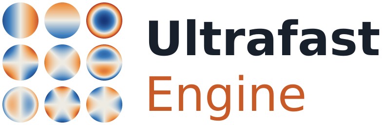
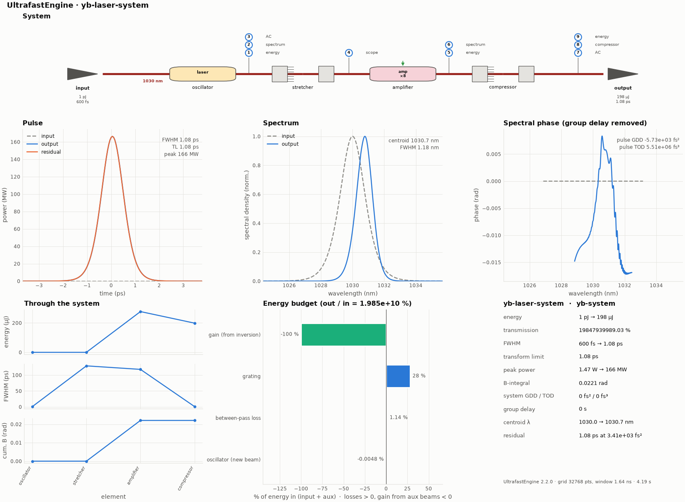
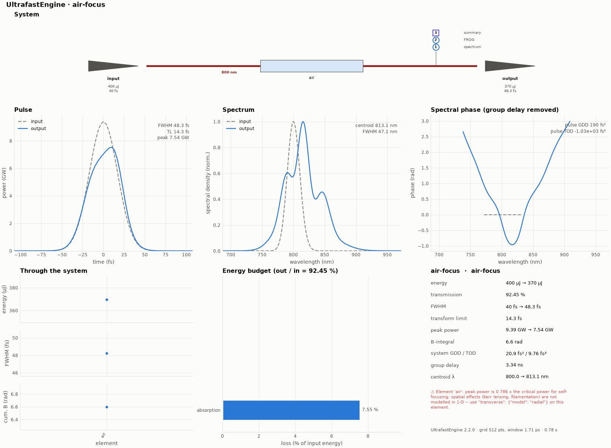
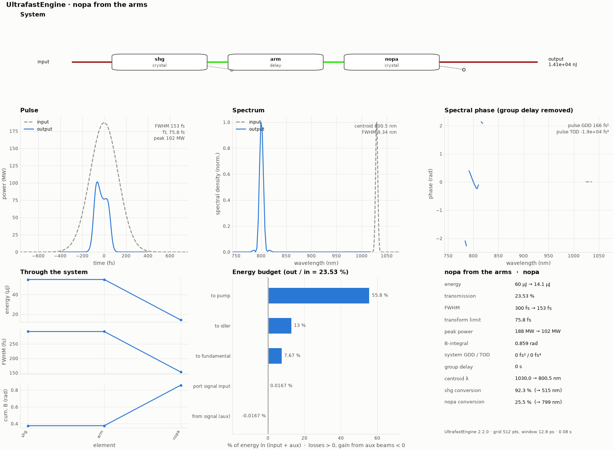
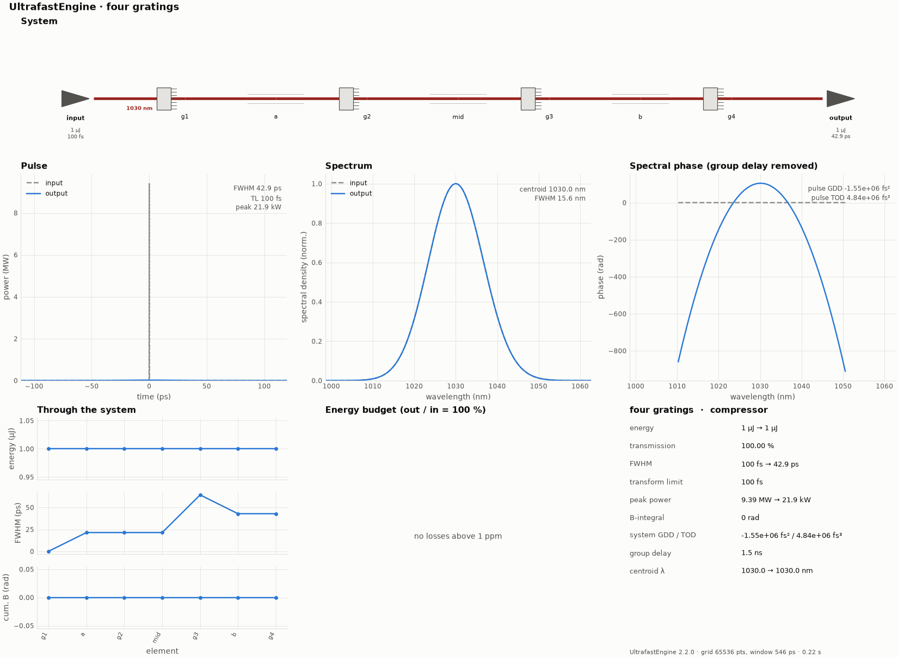
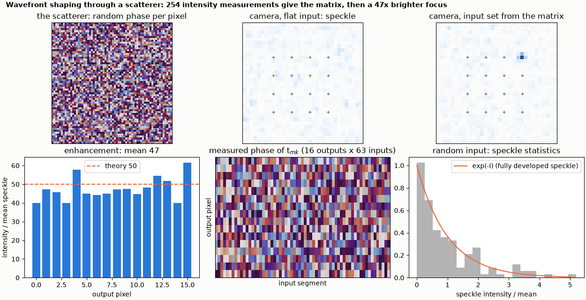
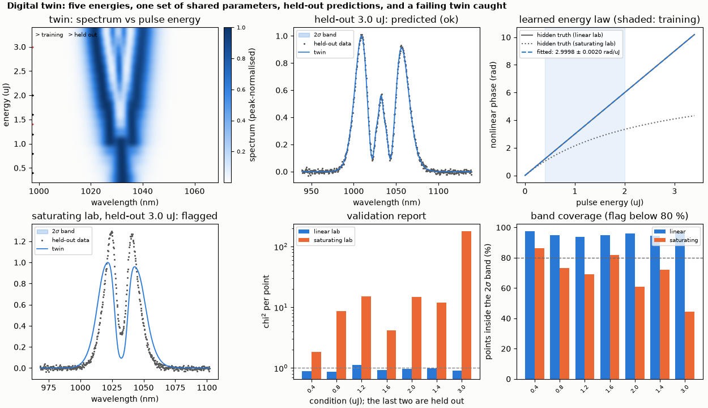
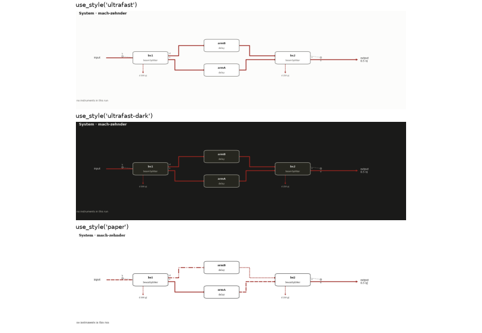
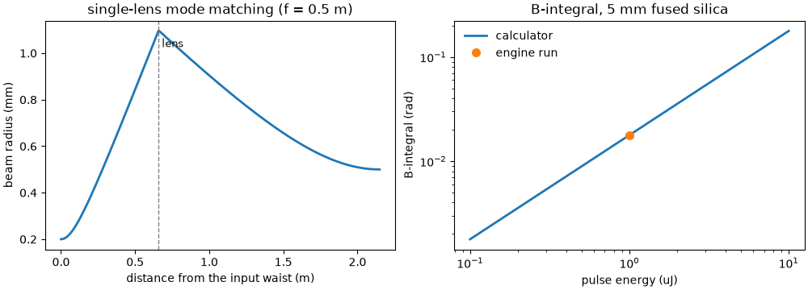
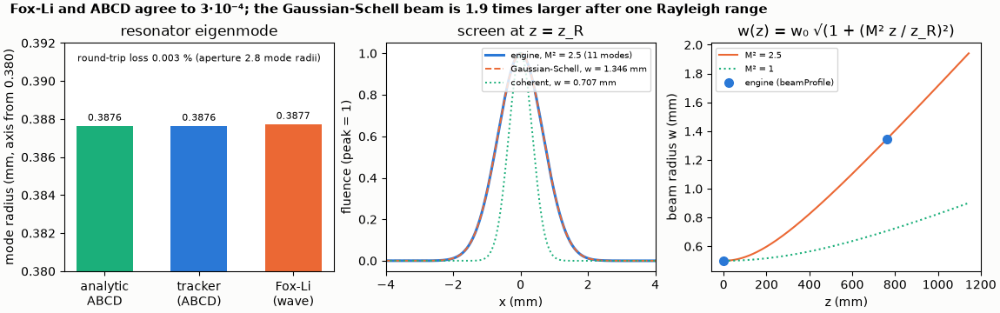

<p align="center">
  <a href="https://github.com/JosephCodemard/UltrafastEngine"></a>
</p>

<h3 align="center">Simulate an ultrafast laser system end to end: from the oscillator to the measurement your lab instruments would report.</h3>

<p align="center">
  <a href="https://pypi.org/project/ultrafast-engine/"></a>
  
  
  <a href="https://github.com/JosephCodemard/UltrafastEngine/blob/main/LICENSE"></a>
</p>

<p align="center">
  <a href="https://josephcodemard.github.io/UltrafastEngine/"><b>Documentation</b></a> ·
  <a href="https://josephcodemard.github.io/UltrafastEngine/tutorials/01-first-run/">Tutorial</a> ·
  <a href="https://josephcodemard.github.io/UltrafastEngine/gallery/">Gallery</a> ·
  <a href="https://github.com/JosephCodemard/UltrafastEngine"><b>Repository</b></a> ·
  <a href="https://github.com/JosephCodemard/UltrafastEngine/issues">Issues</a>
</p>

> **Alpha release.** UltrafastEngine 1.0 is complete and tested, and this alpha is its first public release, so that use in real labs can show what still needs fixing before 1.0.
> Install it with `pip install --pre ultrafast-engine` (`--pre` is how pip is told that an alpha is wanted).

**UltrafastEngine** propagates an ultrashort pulse through a **complete optical system**: stretchers and compressors, amplifiers, multipass cells, fibres, crystals, plates, gas cells,
mirrors and coatings. It models the pulse as a field with a spectrum, in real media, with dispersion to all orders, Kerr, Raman and plasma nonlinearities, χ(2) mixing, gain and diffraction.
It then reads the result out with **virtual instruments** (spectrometer, autocorrelator, FROG, d-scan, cameras) that include the resolution and detector of the real device, so you can compare a simulation
with what your lab measured. This package is the Python interface to the engine.

## Get started in two minutes

**1. Install** (Python 3.10 or newer):

```bash
python -m venv .venv && source .venv/bin/activate      # Windows: .venv\Scripts\activate
pip install --pre ultrafast-engine
```

**2. Check that it works.**

```bash
python -c "import ultrafast as uf; print(uf.version()); print(uf.devices()['devices'])"
```

> **The .NET 10 runtime.** On Linux, macOS and Windows on ARM the engine runs on the free [.NET 10 runtime](https://dotnet.microsoft.com/download/dotnet/10.0): install it once.
> On **Windows (x64) pip picks a wheel that already contains the engine and needs no .NET.** (That wheel cannot load plugin folders; the GPU, HITRAN and adaptive-optics plugins are built into it.)

**3. Run a first simulation**: two glass plates and a chirped mirror, a pulse in, the compressed pulse out.

```python
import ultrafast as uf
from ultrafast import build as b

system = b.system("two-plates", [
    b.bulk("plate1", "FusedSilica", 3e-3, beam=b.gaussian_beam(w0_m=150e-6, z_waist_m=1.5e-3)),
    b.gap("air", 0.10),
    b.chirped_mirror("cm", gdd_s2=-150e-30, bounces=2),
    b.bulk("plate2", "FusedSilica", 3e-3, beam=b.gaussian_beam(w0_m=150e-6, z_waist_m=1.5e-3)),
])
spec = b.run_spec(b.pulse(1.03e-6, 180e-15, energy=8e-6), instruments=[b.instrument("compressor")])

res = uf.run(system, spec)                       # propagate
out = res.summary["output"]
print(f"output {out['fwhmS'] * 1e15:.0f} fs, B-integral {res.summary['totals']['bIntegralRad']:.2f} rad, "
      f"compressible to {res.instrument('compressor')['compressedFwhmS'] * 1e15:.0f} fs")
uf.plot(res).savefig("overview.png", dpi=120)    # spectrum, pulse, instruments, per-element table
```

```text
output 176 fs, B-integral 1.14 rad, compressible to 114 fs
```

**4. Where to go next.** The [tutorial](https://josephcodemard.github.io/UltrafastEngine/tutorials/01-first-run/) takes you from here to your own system in ten minutes. More than sixty
[worked examples](https://github.com/JosephCodemard/UltrafastEngine/tree/main/docs/examples), each with code, a figure and the numbers to expect, show what the engine can do. Describe your own setup in a
`.ufs` system file and a `run.json` spec, or build it in Python as above.

## What to install: the extras

`pip install --pre ultrafast-engine` is enough to **simulate and plot**: it installs the engine's Python interface, NumPy, `clr_loader` (which starts the engine on .NET) and Matplotlib.
Extras add optional features. Combine them with commas: `pip install --pre "ultrafast-engine[paper,animate]"`.

| you want to ... | install | adds |
|---|---|---|
| simulate, plot, use the calculators, command line, MCP server (**most people**) | `pip install --pre ultrafast-engine` | NumPy, `clr_loader`, Matplotlib |
| figures in the style of a journal (serif fonts, single and double column widths, the `science` style) | `pip install --pre "ultrafast-engine[paper]"` | [SciencePlots](https://github.com/garrettj403/SciencePlots) |
| animated GIFs of a pulse travelling through a system | `pip install --pre "ultrafast-engine[animate]"` | Pillow |
| everything above | `pip install --pre "ultrafast-engine[all]"` | SciencePlots, Pillow |
| run the test suite of the package | `pip install --pre "ultrafast-engine[test]"` | pytest |

`[hosted]` and `[plot]` still work (older instructions use them); they are part of the default install now.
GPU back-ends (CUDA, OpenCL) use the drivers on your computer and need nothing extra from pip. Building from source and the other plugins (fitting, digital twin, Zemax export) are described in the
[install guide](https://josephcodemard.github.io/UltrafastEngine/install/).

## What you can do

<table align="center">
<tr>
<td align="center"><a href="https://github.com/JosephCodemard/UltrafastEngine/tree/main/docs/examples/LaserSystems/yb-laser-system"></a><br><sub>A complete Yb laser system</sub></td>
<td align="center"><a href="https://github.com/JosephCodemard/UltrafastEngine/tree/main/docs/examples/Nonlinear/filament"></a><br><sub>Filament in air</sub></td>
<td align="center"><a href="https://github.com/JosephCodemard/UltrafastEngine/tree/main/docs/examples/LaserSystems/noncollinear-opa"></a><br><sub>Non-collinear OPA</sub></td>
</tr>
<tr>
<td align="center"><a href="https://github.com/JosephCodemard/UltrafastEngine/tree/main/docs/examples/LaserSystems/four-grating-compressor"></a><br><sub>Four-grating compressor</sub></td>
<td align="center"><a href="https://github.com/JosephCodemard/UltrafastEngine/tree/main/docs/examples/AdaptiveOptics/scatterer-focusing"></a><br><sub>Focusing through a scatterer</sub></td>
<td align="center"><a href="https://github.com/JosephCodemard/UltrafastEngine/tree/main/docs/examples/DigitalTwin/build-the-twin"></a><br><sub>A digital twin of a lab</sub></td>
</tr>
<tr>
<td align="center"><a href="https://github.com/JosephCodemard/UltrafastEngine/tree/main/docs/examples/Branched/system-schematics"></a><br><sub>System schematics in four plot styles</sub></td>
<td align="center"><a href="https://github.com/JosephCodemard/UltrafastEngine/tree/main/docs/examples/GettingStarted/calculators"></a><br><sub>Calculators: one call per design question</sub></td>
<td align="center"><a href="https://github.com/JosephCodemard/UltrafastEngine/tree/main/docs/examples/Branched/cavity-and-coherence"></a><br><sub>Resonator eigenmode and coherence</sub></td>
</tr>
</table>

Also in the package:

* **Plotting** (`ultrafast.plotting`, command `ultrafast-plot`): publication figures and system schematics in four styles.
* **Calculators** (`ultrafast.calc`): pulse limits, beam and cavity matching, B-integral and critical power, phase matching.
* **Compare with your lab**: attach recordings to an instrument and the engine returns χ² per instrument; fit parameters to the data ([measured data](https://josephcodemard.github.io/UltrafastEngine/reference/measured-data/)).
* **For AI agents**: `ultrafast-mcp` is a local [MCP](https://modelcontextprotocol.io) server with 13 tools, and `ultrafast-agent install --target claude` adds skills for Claude Code, Codex or Cursor
  ([guide](https://josephcodemard.github.io/UltrafastEngine/reference/mcp/)).

## Help, source and citation

* **Documentation:** <https://josephcodemard.github.io/UltrafastEngine/>: install, tutorials, every option, every example and the paper replications.
* **Source, issues and discussions:** <https://github.com/JosephCodemard/UltrafastEngine>. This is an alpha: please report what does not work, with the system file if you can.
* **Citation and licence:** Apache-2.0. Cite with the [CITATION.cff](https://github.com/JosephCodemard/UltrafastEngine/blob/main/CITATION.cff) file of the repository.

<p align="center">
  <a href="https://github.com/JosephCodemard/UltrafastEngine"></a>
</p>
